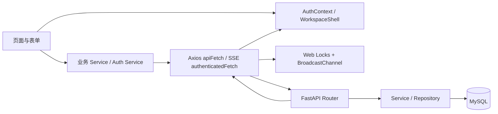
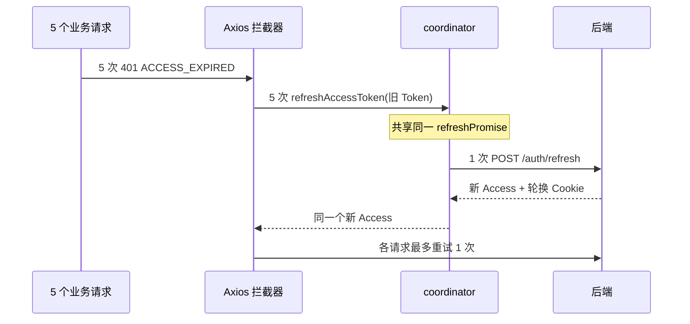
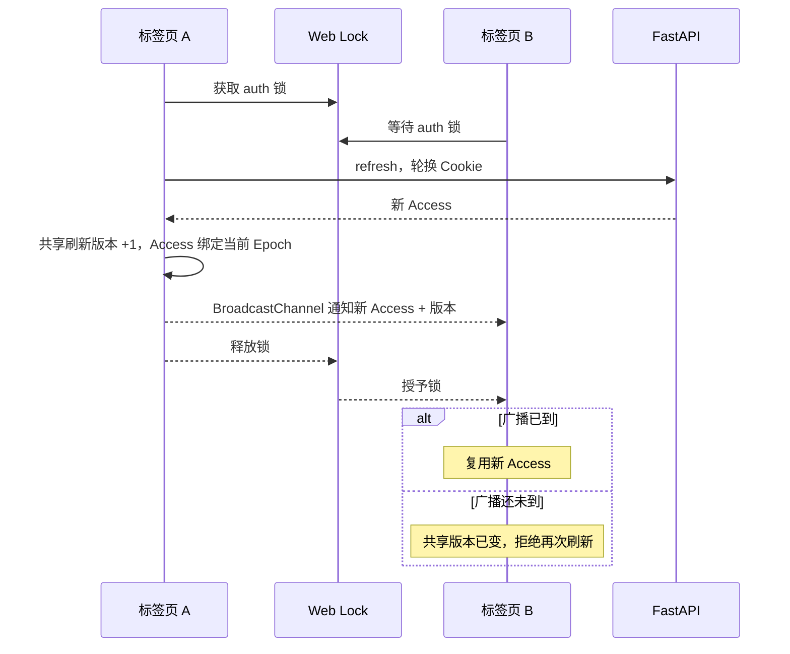
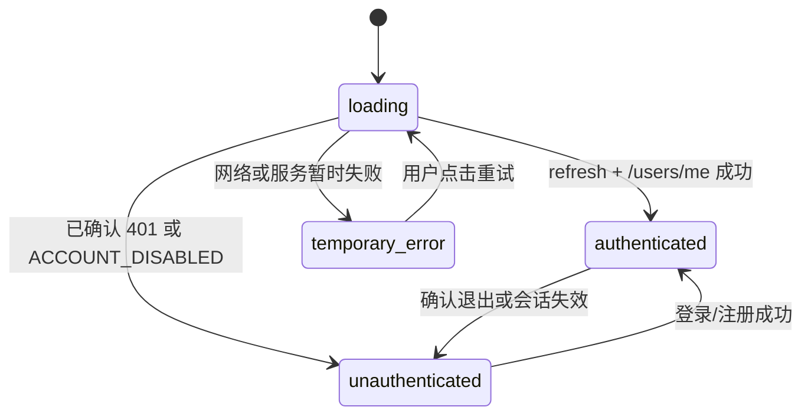

# Auth V2.0 前端核心源码学习说明书

> 源码基准：`D:\project` 当前工作区，2026-11-27，含未提交改动。下面的函数名以本次交付版本为准；后续改代码时应重新核对。示例中的邮箱、密码和 Token 均为占位符。

## 第 0 章：先建立全局地图

旧版把 Access/Refresh Token 都交给前端持久化，并由各个页面自行判断登录状态。新版让 Access Token 只在当前标签页内存里，Refresh Token 由后端设置 HttpOnly Cookie。页面刷新时内存归零，需要先调 `/auth/refresh`，再调 `/users/me`。



阅读顺序：`next-fro/types/auth.ts` → `lib/auth/token.ts` → `lib/auth/coordinator.ts` → `lib/api/client.ts` → `contexts/AuthContext.tsx` → `components/layout/WorkspaceShell.tsx` → `services/auth.service.ts` → 表单组件。先会读 `async/await`、Promise、React `useEffect` 和 HTTP 状态码即可。`lib/api/client.ts` 是普通 JSON 与 SSE 的共同入口，业务 Service 不负责 Token 刷新。

| 文件 | 主要职责 |
| --- | --- |
| `next-fro/lib/auth/token.ts` | 当前标签页内存 Token、代际与旧存储清理 |
| `next-fro/lib/auth/coordinator.ts` | 标签页内单飞、跨标签页锁与通知 |
| `next-fro/lib/api/client.ts` | Axios 请求、错误解析、刷新后重试和 SSE 预读重试 |
| `next-fro/contexts/AuthContext.tsx` | 当前用户、认证状态、刷新页面后恢复 |
| `next-fro/components/layout/WorkspaceShell.tsx` | 工作区路由守卫与公共布局 |
| `next-fro/services/auth.service.ts` | 后端认证与账号 API 的业务名字 |
| `next-fro/components/auth/LoginForm.tsx`、`next-fro/components/RegisterForm.tsx` | 输入和用户反馈 |
| `next-fro/components/auth/UsersProfile.tsx` | 资料、安全设置、设备会话 |

## 第 1 章：Axios、请求与响应拦截器

**是什么、为什么用：** Axios 是 Promise 风格 HTTP 客户端。`axios.create` 生成独立实例，统一设置 `baseURL`、`timeout`、`withCredentials`；相比裸 `fetch`，拦截器可在所有 JSON 请求前注入认证头，在返回后统一解析错误。SSE 仍用 `fetch` 的 `ReadableStream`，不走 Axios。若每个页面自行写刷新逻辑，很容易重复刷新或遗漏 CSRF 头。

源码：`next-fro/lib/api/client.ts` 的 `apiError()`、`requestRefresh()`、`apiFetch()` 和两个拦截器。关键过程：

```ts
const refreshClient = axios.create({ baseURL: API_BASE_URL, timeout: 15000, withCredentials: true });
export const httpClient = axios.create({ baseURL: API_BASE_URL, timeout: 20000, withCredentials: true });

httpClient.interceptors.request.use((config) => {
  const auth = config as AuthConfig;
  const currentEpoch = authEpoch();
  if (auth.epoch !== undefined && auth.epoch !== currentEpoch) throw sessionMismatch();
  auth.epoch = currentEpoch;
  auth.tokenUsed = getAccessToken(); // Token 自己也核对绑定的 Epoch
  config.headers = AxiosHeaders.from(config.headers);
  if (auth.tokenUsed) config.headers.set("Authorization", `Bearer ${auth.tokenUsed}`);
  if (config.method && !["get", "head", "options"].includes(config.method.toLowerCase()))
    config.headers.set("X-CSRF-Protection", "1");
  if (auth.userActivity) config.headers.set("X-User-Activity", "1");
  return config;
});
```

`withCredentials: true` 让浏览器按 Cookie 规则附带 Refresh Cookie；JS 仍读不到 HttpOnly Cookie。普通请求用 20 秒超时，刷新用独立的 15 秒客户端，防止刷新请求又进普通响应拦截器。请求拦截器在发出网络请求前执行；响应拦截器在收到响应或错误后执行。`AuthConfig.tokenUsed` 记下这个请求实际携带的 Token，`epoch` 记下账号代际。`apiFetch<T>` 最终返回后端统一响应体的 `T`，例如 `ApiResponse<Plan[]>`。

响应错误先经 `apiError()` 提取 `detail` 字符串、`detail.message` 或 FastAPI 422 的字段错误数组。只有 `401 + ACCESS_EXPIRED` 才调用 `refreshAccessToken()`；成功后仅重发一次原请求，`retried` 防止死循环。`INVALID_CREDENTIALS` 等认证表单错误不会触发刷新。网络错误 `status=0` 不清除登录。`ApiError` 保留 HTTP 状态、后端错误码和 422 issues。`apiFetch()` 在请求进入拦截器前保存 Epoch；拦截器在**发送前**核对，不能把账号 1 的旧请求改用账号 2 的 Token 发出。没有当前 Token 时清除残留的 `Authorization` 头。响应阶段再次核对，旧请求错误也只有在 Epoch 和所用 Token 都仍匹配时才能清除当前认证。

**例子：** 点击“我的计划”调用 `listPlans()` → `apiFetch<ApiResponse<Plan[]>>("/plans")`；若 401 `ACCESS_EXPIRED`，先刷新并用新 Access Token 只重试一次。调试时在浏览器 Network 看 `/plans`、`/auth/refresh`、重试的 `/plans` 顺序，不能把 Token 复制进日志。优点是业务代码短；代价是拦截器的时序需要测试。理解题：为什么刷新专用客户端不能复用 `httpClient`？答：刷新自身 401 若再次进入同一拦截器，可能递归请求或无限重试。

## 第 2 章：内存 Token、Cookie 与浏览器边界

`next-fro/lib/auth/token.ts` 的关键代码；完整源码见附录：

```ts
// Access Token 只存在当前标签页的运行内存中；服务端渲染不读写此变量。
let accessToken: string | null = null;
let tokenEpoch: string | null = null;
let generation = 0;

export function getAccessToken(): string | null {
  if (typeof window === "undefined") return null;
  return tokenEpoch === readAuthEpoch() ? accessToken : null;
}

export function setAccessToken(token: string, epoch = readAuthEpoch()): void {
  if (typeof window === "undefined") return;
  if (epoch !== readAuthEpoch()) throw new Error("登录状态已变化，请重试");
  accessToken = token;
  tokenEpoch = epoch;
  // 通知订阅者；实现还会清除旧的退出标记。
}
```

模块变量在当前 JS 运行环境里共享；两个标签页各有自己的模块实例。`localStorage` 和 `sessionStorage` 可被页面 JS 读取，旧的敏感键因此要清掉。HttpOnly Cookie 由浏览器自动管理，不能被 JS 读出；它能缓解 Refresh Token 被脚本直接读取，但请求仍可能受 CSRF 影响，所以后端还校验 Origin 与 `X-CSRF-Protection`。XSS 是恶意脚本在同源页面运行，CSRF 是利用已登录浏览器发起非预期请求，两者防护重点不同。Access 短期且存在内存；Refresh 可跨页面刷新继续使用，但受后端 Session 与轮换控制。

`generation` 在清除时递增，让尚未返回的刷新结果知道自己已经过时。`tokenEpoch` 解决另一个问题：共享 Epoch 已更新而当前标签页尚未收到广播时，旧内存 Token 立即变为不可用。页面刷新时 `accessToken=null` 是正常现象，`AuthContext.restoreUser()` 会恢复。`typeof window` 防止 Next.js 服务端请求之间共享模块级用户状态。调试时可验证旧键消失、刷新后仍能登录；不要把 Token 写入控制台。理解题：内存 Token 消失是否等于退出？答：否，只要合法 Refresh Cookie 还在，就可恢复。

## 第 3 章：Promise 单飞与 Refresh 轮换

源码：`next-fro/lib/auth/coordinator.ts` 的 `refreshAccessToken()`、`lib/api/client.ts` 的 `requestRefresh()`。`async` 函数返回 Promise；多个请求可以共享同一 Promise。`refreshPromise` 就是单标签页的“正在刷新”任务，不是 Token 本身。关键实现：

```ts
// 结构摘要，完整实现见附录。
const seenVersion = refreshVersion(epoch); // 请求刷新前记住共享版本
const pending = withAuthLock(async () => {
  if (!sameAuthEpoch(epoch) || getAuthGeneration() !== generation)
    throw new Error("登录状态已变化，请重试");
  const newer = getAccessToken();
  if (newer && newer !== usedToken) return newer;
  if (refreshVersion(epoch) !== seenVersion)
    throw new Error("登录状态已变化，请重试");
  if (localStorage.getItem(uncertainRefreshKey) === JSON.stringify(epoch))
    throw new Error("刷新结果不确定，请重新登录");
  // requestRefresh() 的结果未知时标记当前 Epoch，不自动再轮换 Cookie。
  const token = await requestRefresh();
  const version = advanceRefreshVersion(epoch);
  setAccessToken(token, epoch);
  getChannel()?.postMessage({ type: "token", token, epoch, version });
  return token;
});
```

**五个请求示例：** A-E 都拿旧 Access 请求 `/plans` 等接口并得到 `ACCESS_EXPIRED`。A 先创建 `refreshPromise`；B-E 在同一 epoch/generation 下直接得到同一个 Promise。A 获得 Web Lock，检查代际，调用一次 `/auth/refresh`。后端把旧 Refresh Cookie 轮换成新值；A 保存新 Access。A-E 等待同一结果，各自只重试一次业务请求。`finally` 仅清掉仍属自己的 Promise；账号已切换时，新账号会创建新 Promise 等待锁，不会沿用旧刷新结果。



后端严格轮换和重放检测意味着两个无协调刷新可能把同一个旧 Refresh Cookie 提交两次。`usedToken` 使后来拿锁的请求发现已有更新的 Access 后直接复用。广播若晚于 Web Lock 授予，后一个标签页会发现共享刷新版本已改变，拒绝第二次刷新。刷新请求若超时或服务器返回 5xx，Cookie 是否轮换不确定；同一 Epoch 会阻止再自动刷新，提示重新登录。刷新失败若后端明确返回 `REFRESH_INVALID`、`SESSION_REVOKED` 等则只清除仍属于原请求的 Access；网络故障不能据此断言会话失效。`finally` 仅清除仍属于自己的 Promise。理解题：为何只对 `ACCESS_EXPIRED` 自动重试？答：这是后端明确表示原业务没有因有效 Access 完成；其他 401 或网络中断并无相同保证。

## 第 4 章：多标签页、锁与认证代际

`next-fro/lib/auth/coordinator.ts` 中 `withAuthLock()` 用 Web Locks 的同名独占锁，把登录、注册、刷新、重置密码、退出等会改 Cookie 的操作排队。锁释放发生在 `work()` 的 Promise 结束后。锁**不能重入**：`logoutAllSessions()` 等当前账号退出操作先在锁外通过 `/users/me` 完成可能需要的 Access 刷新，随后取锁、重新核对发起操作时的 Epoch 与内存代际；锁内请求设置 `skipAuthRefresh`。如果等待期间换了账号，旧操作直接停止，不会使用新账号的 Cookie。`BroadcastChannel` 把登录/退出消息和临时新 Access 发给同源其他标签页；不传 Refresh Token。`ssp-auth-epoch` 只保存随机版本标记，不保存凭据。接收所有消息先核对 Epoch；Token 消息还核对共享刷新版本，已清除的本地会话不会被迟到 Token 恢复。



跨标签退出：A 持锁请求 `/auth/logout`；服务器确认撤销后 A 清 Token、更新 epoch、广播 logout；B 清 Token 并切换为未登录。账号切换：登录操作也持同一把锁；先更新共享 Epoch，再绑定新 Access。旧 Token 在尚未收到广播时就不可用了。若退出期间已有刷新，旧 Promise 还会经过 epoch/generation 复核。不支持 Web Locks 时认证 Cookie 写操作明确报错；BroadcastChannel 不可用时由 `storage` 事件同步登录/退出 Epoch，但不传 Access；`localStorage` 不可访问则在改 Cookie 前失败。多页行为仍需真实浏览器检验。理解题：为何单页 `refreshPromise` 不足够？答：两个标签页的 JS 堆互不共享，Promise 也不共享。

## 第 5 章：AuthContext 的状态机

`next-fro/contexts/AuthContext.tsx:64` 创建 Context，`AuthProvider` 放在 `app/layout.tsx`，`useAuth()` 供任意子组件读取。`useState` 保存 `status`、`user`、重试次数；`useEffect` 在挂载和重试时执行恢复；卸载时 `live=false` 防止旧结果写入。`restorePromise` 让 React Strict Mode 重复执行 Effect 时共用一次恢复请求；epoch/generation 改变后创建新任务，避免复用旧账号结果。代码没有使用 `useCallback`/`useMemo`，无需额外理解它们才能读本实现。



核心顺序是 `restoreAccessToken()` → `getCurrentUser()`，不能只凭内存 Token 暂空就跳登录。`completeLogin()` 在登录响应后写用户，`updateUser()` 在资料保存后替换用户；`clear()` 清状态。广播 login 会清旧用户并重新恢复，广播 logout 会使所有已打开标签页清用户。调试时区分 `temporary-error` 和 `unauthenticated`：断网时页面要能重试，而非假装已退出。优点是状态统一；限制是目前恢复与真实 Cookie 策略仍需浏览器联调。理解题：为什么所有页面不各调一次 `/users/me`？答：会制造重复请求与互相冲突的状态转换。

## 第 6 章：工作区守卫

Next.js App Router 的根 `app/layout.tsx` 包裹 Provider；工作区 `components/layout/WorkspaceShell.tsx:81-110` 在 Client Component 中调用 `useAuth()`。`loading` 时只显示检查中，`temporary-error` 时显示重试，`unauthenticated` 时用 `router.replace('/login')`，只有 `authenticated` 才渲染原工作区与用户数据。这样硬刷新不会先短暂露出数据或跳登录再返回。`replace` 不把受保护页面追加到浏览器历史。前端守卫只是显示控制；后端 `get_current_user` 和业务所有权校验才是数据安全边界。常见错误是把 `getAccessToken() === null` 当作未登录，导致刷新页面闪烁或循环跳转。理解题：为何守卫不直接查询数据库？答：浏览器只通过 API 与后端通信，数据库和授权在后端。

## 第 7 章：Auth Service 与 TypeScript 契约

`next-fro/types/auth.ts` 以 `interface` 表示对象结构，以联合类型限制验证码 `purpose`；`ApiResponse<T>` 的 `T` 是接口 `data` 的真实类型。例如 `ApiResponse<LoginResponse>` 的 `data.access_token` 是字符串、`data.user` 是 `User`。`import type` 表示运行时不需要该类型。前端类型只在编译期生效，运行时合法性由后端 Pydantic 和前端表单校验共同负责。

`next-fro/services/auth.service.ts` 的 `loginUser()` 将 `{username,password}` 转为 `application/x-www-form-urlencoded`，调用 `/auth/login`；`loginWithEmail()` JSON 调 `/auth/login/email`；`registerUser()` JSON 调 `/users` 并直接消费返回的 LoginResponse；`getCurrentUser()` 调 `/users/me`。这些函数不解析 Cookie，也不自己实现刷新。密码登录示例：请求 `username=demo&password=<PASSWORD>`；响应 `{"code":200,"message":"...","data":{"access_token":"<ACCESS_TOKEN>","token_type":"bearer","expires_in":900,"user":{"id":1,"username":"demo",...}}}`。字段以实际后端 Schema 为准，示例中的时长是占位，不能当成当前配置值。

登录组件负责输入、提交、错误展示；Service 负责选择接口和整理请求；Axios 负责协议通用部分。`rememberLogin()` 将新 Epoch 附在返回结果上，登录和注册页面在调用 `AuthContext.completeLogin()` 前再次核对；迟到的旧登录结果不能显示为当前用户。修改密码错误只显示后端业务提示，不会误清当前会话。常见调试点：检查 Content-Type、实际后端字段名、422 detail。优点是页面不接触底层认证协议；限制是 TypeScript 无法代替真实 API 集成测试。理解题：`Promise<ApiResponse<User>>` 中两层含义是什么？答：Promise 表示将来完成；ApiResponse 的 data 字段是 User。

## 第 8 章：普通业务接口迁移，以 GET /plans 为例

实际链路：计划页面或工作台 Hook → `next-fro/services/plans.service.ts:23` 的 `listPlans()` → `apiFetch<ApiResponse<Plan[]>>("/plans")` → 请求拦截器注入 Bearer → `back/app/api/routes/plans.py:38` → 后端用户依赖、Service/Repository → MySQL → Axios 响应拦截器 → Hook `setPlans()` → React 重新渲染。迁移前业务 Service 也调用 `apiFetch`，但内部是手写 `fetch` 并依赖持久化 Token；迁移后同一业务调用签名保持，内部换成 Axios。因此各页面不需要知道 Refresh Cookie 在哪里。

正常请求：直接返回 `data`。Access 过期：拦截器刷新，再重试一次 GET。会话撤销：收到明确 `SESSION_REVOKED` 等码，且错误仍属于当前代际时清本地 Access。若只是业务请求网络超时，显示错误并允许用户判断是否重试，不能假定后端未执行某个 POST；刷新请求超时则需重新登录，不能自动重试 Cookie 轮换。SSE 仍经 `authenticatedFetch()`，只允许在响应流开始前根据明确 `ACCESS_EXPIRED` 刷新，已开始读流就不能重放；解析错误响应后、刷新前，以及流读取和事件交给组件前都复核代际。调试先看 Network 中请求是否带 Authorization、响应 `detail.code`，再看 Context 状态。旧页面按任意 401 跳登录的分支已删除，业务错误继续显示在原页面；已确认会话失效交给公共认证状态处理。理解题：为何业务 Service 不处理 Refresh？答：它对计划、任务、知识等接口都一样，放在公共客户端可保持一致。

## 第 9 章：十二条业务流程速查

| 流程 | 实际入口 → 关键函数 → 状态变化 |
| --- | --- |
| 首次注册 | `RegisterForm` → `sendEmailCode(REGISTER)` → `registerUser()` → `rememberLogin()` → `completeLogin()` |
| 密码登录 | `LoginForm` → `loginUser()` → `/auth/login` → 内存 Access + AuthContext 用户 |
| 邮箱验证码登录 | `LoginForm` → `sendEmailCode(LOGIN)` → `loginWithEmail()` → 同上 |
| 页面刷新恢复 | `AuthProvider` → `restoreAccessToken()` → `/auth/refresh` → `/users/me` |
| 普通业务请求 | `plans.service.listPlans()` → `apiFetch()` → Bearer → React state |
| 并发刷新 | 多个 `ACCESS_EXPIRED` → 同一 `refreshPromise` → 一次轮换 |
| 多标签协调 | `withAuthLock()` 排队 Cookie 写；BroadcastChannel 通知登录、退出、临时 Access |
| 修改密码 | `UsersProfile` → `changePassword()` → `/auth/password/change`；错误保留会话 |
| 邮箱换绑 | `UsersProfile` → 旧、新邮箱各一次验证码 → `changeEmail()` → 刷新用户资料 |
| 远程撤销设备 | `UsersProfile` → `listSessions()` → `revokeSession()` → 重新查询列表 |
| 当前会话退出 | `logoutUser()` → 后端确认 `session_revoked` → 清 Token 与 Context → 登录页 |
| 全部会话退出 | `logoutAllSessions()` → 后端确认 → 清 Token、广播 → 登录页 |

## 第 10 章：知识复盘、练习与答辩

核心知识是 Promise 的共享和 `finally`、TypeScript 泛型、React Context/Effect、Next.js Layout、HTTP 401/422、Axios 拦截器、Cookie/JWT/Session、CSRF、SSE 与分层。学习顺序建议先复述第 0 章链路，再用第 3 章五请求案例画时序，最后拿 Network 验证。

| 练习/答辩问题 | 参考答案或检查方法 |
| --- | --- |
| 五个请求同时过期为何只刷新一次？ | 同页共享 `refreshPromise`；跨页还需 Web Lock，拿锁后复核新 Token。 |
| 为什么 401 密码错误不退出？ | `INVALID_CREDENTIALS` 不是 `ACCESS_EXPIRED`，也不属于已确认会话撤销码。 |
| 页面刷新后为什么还可登录？ | 浏览器带 HttpOnly Refresh Cookie，Context 恢复 Access，再查 `/users/me`。 |
| `withCredentials` 是否让 JS 读到 Cookie？ | 否，只让浏览器在符合 Cookie 策略的请求中携带它。 |
| 为什么 SSE 不统一用 Axios？ | 现有 SSE 解析依赖 `ReadableStream`；只在流开始前重试。 |
| 前端守卫能阻止伪造请求吗？ | 不能，后端用户认证和对象归属校验负责真正授权。 |
| 修改练习：新增一个只读个人资料字段 | 先核对 Pydantic Schema，再更新 `types/auth.ts`，由 `/users/me` 填入，最后补测试。 |
| 调试练习：刷新后偶发退出 | 在两个标签页重现，观察 Web Lock、`authEpoch`、`detail.code` 与 Cookie 策略；勿打印 Token。 |

**当前验证边界：** 自动化单元测试可验证单飞与模拟双标签页；真实浏览器、邮件验证码、真实 MySQL/后端 Cookie 轮换需要按测试报告进一步联调。本文解释已实现的前端代码，不把模拟测试写成真实浏览器结果。

## 附录：最终核心源码（阅读时对照前述章节）

以下源码摘录自本次最终工作区；文件改动后应重新核对。

### `next-fro/lib/auth/token.ts`

```ts
// Access Token 只存在当前标签页的运行内存中；服务端渲染不读写此变量。
let accessToken: string | null = null;
let tokenEpoch: string | null = null;
let clearedEpoch: string | null | undefined;
let generation = 0;
const listeners = new Set<() => void>();
export const AUTH_EPOCH_KEY = "ssp-auth-epoch";

export function readAuthEpoch(): string | null {
  return typeof window === "undefined" ? null : localStorage.getItem(AUTH_EPOCH_KEY);
}

export function getAccessToken(): string | null {
  if (typeof window === "undefined") return null;
  return tokenEpoch === readAuthEpoch() ? accessToken : null;
}

export function getAuthGeneration(): number {
  return generation;
}

export function setAccessToken(token: string, epoch = readAuthEpoch()): void {
  if (typeof window === "undefined") return;
  if (epoch !== readAuthEpoch()) throw new Error("登录状态已变化，请重试");
  accessToken = token;
  tokenEpoch = epoch;
  clearedEpoch = undefined;
  listeners.forEach((listener) => listener());
}

export function clearAccessToken(): void {
  accessToken = null;
  tokenEpoch = null;
  try { clearedEpoch = readAuthEpoch(); }
  catch { clearedEpoch = undefined; }
  generation += 1;
  listeners.forEach((listener) => listener());
}

export function acceptBroadcastToken(token: string, epoch: string | null): void {
  // 只更新已经属于同一代际的本地会话；退出后的迟到消息不能复活它。
  if (accessToken && tokenEpoch === epoch && clearedEpoch !== epoch && readAuthEpoch() === epoch)
    setAccessToken(token, epoch);
}

export function subscribeAuth(listener: () => void): () => void {
  listeners.add(listener);
  return () => listeners.delete(listener);
}

export function clearLegacyTokens(): void {
  if (typeof window === "undefined") return;
  localStorage.removeItem("access_token");
  localStorage.removeItem("refresh_token");
}
```

### `next-fro/lib/auth/coordinator.ts`

```ts
import { AUTH_EPOCH_KEY, acceptBroadcastToken, getAccessToken, getAuthGeneration, readAuthEpoch, setAccessToken } from "./token";

const channelName = "ssp-auth-v2";
const refreshVersionKey = "ssp-auth-refresh-version";
const uncertainRefreshKey = "ssp-auth-uncertain-refresh";
let refreshPromise: Promise<string> | null = null;
let refreshEpoch: string | null = null;
let refreshGeneration = 0;
let channel: BroadcastChannel | null = null;

function refreshVersion(epoch: string | null): number {
  const stored = localStorage.getItem(refreshVersionKey);
  if (!stored) return 0;
  try {
    const value = JSON.parse(stored) as { epoch?: string | null; version?: number };
    return value.epoch === epoch && Number.isInteger(value.version) ? value.version! : 0;
  } catch { return 0; }
}

function advanceRefreshVersion(epoch: string | null): number {
  // Web Lock 内递增；迟到的旧广播不能覆盖后一次刷新的 Token。
  const version = refreshVersion(epoch) + 1;
  localStorage.setItem(refreshVersionKey, JSON.stringify({ epoch, version }));
  return version;
}

function getChannel(): BroadcastChannel | null {
  if (
    typeof window === "undefined" ||
    typeof window.BroadcastChannel !== "function"
  )
    return null;
  if (!channel) channel = new BroadcastChannel(channelName);
  return channel;
}

export function authEpoch(): string | null {
  return readAuthEpoch();
}

export function sameAuthEpoch(epoch: string | null): boolean {
  return authEpoch() === epoch;
}

export function announceAuthChange(type: "login" | "logout"): string {
  const epoch = `${type}:${crypto.randomUUID()}`;
  localStorage.setItem(AUTH_EPOCH_KEY, epoch);
  getChannel()?.postMessage({ type, epoch });
  return epoch;
}

export function onAuthMessage(
  listener: (type: "login" | "logout") => void,
): () => void {
  const bus = getChannel();
  let notifiedEpoch: string | null = null;
  const notify = (type: "login" | "logout", epoch: string) => {
    if (epoch !== authEpoch() || notifiedEpoch === epoch) return;
    notifiedEpoch = epoch;
    listener(type);
  };
  const receive = (event: MessageEvent) => {
    const message = event.data;
    try {
      if (message?.epoch !== authEpoch()) return;
      if (message.type === "token" && typeof message.token === "string" &&
          message.version === refreshVersion(message.epoch))
        acceptBroadcastToken(message.token, message.epoch);
      if (message.type === "login" || message.type === "logout")
        notify(message.type, message.epoch);
    } catch { /* 存储不可用时不接受无法核对代际的消息。 */ }
  };
  const storage = (event: StorageEvent) => {
    if (event.key !== AUTH_EPOCH_KEY || !event.newValue) return;
    try { notify(event.newValue.startsWith("logout:") ? "logout" : "login", event.newValue); }
    catch { /* 同上：无法核对共享代际时忽略消息。 */ }
  };
  bus?.addEventListener("message", receive);
  if (typeof window !== "undefined" && typeof window.addEventListener === "function")
    window.addEventListener("storage", storage);
  return () => {
    bus?.removeEventListener("message", receive);
    if (typeof window !== "undefined" && typeof window.removeEventListener === "function")
      window.removeEventListener("storage", storage);
  };
}

export async function withAuthLock<T>(work: () => Promise<T>): Promise<T> {
  authEpoch(); // 共享存储不可用时，在修改 Cookie 前失败。
  if (typeof navigator === "undefined" || !navigator.locks?.request) {
    throw new Error(
      "当前浏览器无法安全协调多标签页认证，请使用支持 Web Locks 的浏览器",
    );
  }
  return navigator.locks.request(channelName, { mode: "exclusive" }, work);
}

export function refreshAccessToken(
  usedToken: string | null,
  requestRefresh: () => Promise<string>,
): Promise<string> {
  const epoch = authEpoch();
  const generation = getAuthGeneration();
  const seenVersion = refreshVersion(epoch);
  if (
    refreshPromise &&
    refreshEpoch === epoch &&
    refreshGeneration === generation
  )
    return refreshPromise;
  const pending = withAuthLock(async () => {
    if (!sameAuthEpoch(epoch) || getAuthGeneration() !== generation)
      throw new Error("登录状态已变化，请重试");
    const newer = getAccessToken();
    if (newer && newer !== usedToken) return newer;
    // 广播可能晚于获锁；已有别的标签页刷新成功时，等待其消息而非再次轮换 Cookie。
    if (refreshVersion(epoch) !== seenVersion)
      throw new Error("登录状态已变化，请重试");
    // 超时后 Cookie 可能已经轮换，不能再次发送 Refresh Token。
    if (localStorage.getItem(uncertainRefreshKey) === JSON.stringify(epoch))
      throw new Error("刷新结果不确定，请重新登录");
    let token: string;
    try {
      token = await requestRefresh();
    } catch (error) {
      const status = error && typeof error === "object" && "status" in error
        ? (error as { status: unknown }).status : undefined;
      if (typeof status !== "number" || status === 0 || status >= 500)
        localStorage.setItem(uncertainRefreshKey, JSON.stringify(epoch));
      throw error;
    }
    if (!sameAuthEpoch(epoch) || getAuthGeneration() !== generation)
      throw new Error("登录状态已变化，请重试");
    const version = advanceRefreshVersion(epoch);
    setAccessToken(token, epoch);
    getChannel()?.postMessage({ type: "token", token, epoch, version });
    return token;
  });
  const tracked = pending.finally(() => {
    if (refreshPromise === tracked) refreshPromise = null;
  });
  refreshPromise = tracked;
  refreshEpoch = epoch;
  refreshGeneration = generation;
  return tracked;
}
```

### `next-fro/lib/api/client.ts`

```ts
import axios, { AxiosHeaders, type AxiosRequestConfig } from "axios";
import { messages } from "@/messages";
import {
  authEpoch,
  refreshAccessToken,
  sameAuthEpoch,
} from "@/lib/auth/coordinator";
import { clearAccessToken, getAccessToken, getAuthGeneration } from "@/lib/auth/token";
import type { ValidationIssue } from "@/types/api";

export const API_BASE_URL =
  process.env.NEXT_PUBLIC_API_BASE_URL ?? "http://localhost:8000";

type BackendError = {
  detail?: string | { code?: string; message?: string } | ValidationIssue[];
  message?: string;
  data?: unknown;
};
type AuthConfig = AxiosRequestConfig & {
  skipAuthRefresh?: boolean;
  retried?: boolean;
  tokenUsed?: string | null;
  epoch?: string | null;
  userActivity?: boolean;
};

function sessionMismatch(): ApiError {
  return new ApiError("登录状态已变化，请重试", 409, [], "SESSION_MISMATCH");
}

function clearIfCurrent(epoch: string | null, usedToken: string | null): void {
  // 旧请求的错误不能清掉切换账号或同代际刷新后取得的新 Token。
  if (sameAuthEpoch(epoch) && getAccessToken() === usedToken) clearAccessToken();
}

export class ApiError extends Error {
  constructor(
    message: string,
    public status: number,
    public validationIssues: ValidationIssue[] = [],
    public code?: string,
  ) {
    super(message);
    this.name = "ApiError";
  }
}

function apiError(status: number, body: BackendError | undefined): ApiError {
  const detail = body?.detail;
  const issues = Array.isArray(detail)
    ? detail
    : Array.isArray(body?.data) && status === 422
      ? (body.data as ValidationIssue[])
      : [];
  const message =
    typeof detail === "string"
      ? detail
      : !Array.isArray(detail) && detail?.message
        ? detail.message
        : issues.length
          ? issues.map((issue) => issue.msg).join("；")
          : (body?.message ?? messages.common.httpRequestFailed(status));
  return new ApiError(
    message,
    status,
    issues,
    !Array.isArray(detail) && typeof detail === "object"
      ? detail?.code
      : undefined,
  );
}

const refreshClient = axios.create({
  baseURL: API_BASE_URL,
  timeout: 15000,
  withCredentials: true,
});
export const httpClient = axios.create({
  baseURL: API_BASE_URL,
  timeout: 20000,
  withCredentials: true,
});

async function requestRefresh(): Promise<string> {
  try {
    const response = await refreshClient.post("/auth/refresh", null, {
      headers: { "X-CSRF-Protection": "1" },
    });
    const token = response.data?.data?.access_token;
    if (typeof token !== "string" || !token)
      throw new ApiError(
        messages.auth.sessionExpired,
        401,
        [],
        "REFRESH_INVALID",
      );
    return token;
  } catch (error) {
    if (axios.isAxiosError(error))
      throw apiError(error.response?.status ?? 0, error.response?.data);
    throw error;
  }
}

export async function restoreAccessToken(): Promise<string> {
  return refreshAccessToken(getAccessToken(), requestRefresh);
}

httpClient.interceptors.request.use((config) => {
  const auth = config as AuthConfig;
  const currentEpoch = authEpoch();
  if (auth.epoch !== undefined && auth.epoch !== currentEpoch) throw sessionMismatch();
  auth.epoch = currentEpoch;
  auth.tokenUsed = getAccessToken();
  config.headers = AxiosHeaders.from(config.headers);
  if (auth.tokenUsed)
    config.headers.set("Authorization", `Bearer ${auth.tokenUsed}`);
  else config.headers.delete("Authorization");
  if (
    config.method &&
    !["get", "head", "options"].includes(config.method.toLowerCase())
  )
    config.headers.set("X-CSRF-Protection", "1");
  if (auth.userActivity) config.headers.set("X-User-Activity", "1");
  return config;
});

httpClient.interceptors.response.use(
  (response) => {
    const config = response.config as AuthConfig;
    if (!sameAuthEpoch(config.epoch ?? null)) throw sessionMismatch();
    return response;
  },
  async (error: unknown) => {
    if (!axios.isAxiosError(error)) throw error;
    const config = error.config as AuthConfig | undefined;
    const status = error.response?.status ?? 0;
    const parsed = apiError(status, error.response?.data);
    if (config && !sameAuthEpoch(config.epoch ?? null)) throw sessionMismatch();
    if (
      status === 401 &&
      parsed.code === "ACCESS_EXPIRED" &&
      config &&
      !config.retried &&
      !config.skipAuthRefresh
    ) {
      config.retried = true;
      try {
        const token = await refreshAccessToken(
          config.tokenUsed ?? null,
          requestRefresh,
        );
        if (!sameAuthEpoch(config.epoch ?? null)) throw sessionMismatch();
        config.headers = AxiosHeaders.from(
          config.headers as Record<string, string>,
        );
        config.headers.set("Authorization", `Bearer ${token}`);
        return await httpClient.request(config);
      } catch (refreshError) {
        if (
          refreshError instanceof ApiError &&
          [
            "REFRESH_INVALID",
            "SESSION_REVOKED",
            "SESSION_EXPIRED",
            "ACCOUNT_DISABLED",
          ].includes(refreshError.code ?? "")
        )
          clearIfCurrent(config.epoch ?? null, config.tokenUsed ?? null);
        throw refreshError;
      }
    }
    if (
      [401, 403].includes(status) &&
      !config?.skipAuthRefresh &&
      [
        "SESSION_REVOKED",
        "SESSION_EXPIRED",
        "ACCOUNT_DISABLED",
        "INVALID_TOKEN",
      ].includes(parsed.code ?? "")
    )
      clearIfCurrent(config?.epoch ?? null, config?.tokenUsed ?? null);
    throw parsed;
  },
);

export interface ApiFetchOptions extends RequestInit {
  skipAuthRefresh?: boolean;
  userActivity?: boolean;
}

export async function apiFetch<T>(
  path: string,
  options: ApiFetchOptions = {},
): Promise<T> {
  const { skipAuthRefresh, userActivity, ...request } = options;
  const headers = AxiosHeaders.from(
    request.headers as Record<string, string> | undefined,
  );
  if (typeof request.body === "string" && !headers.has("Content-Type"))
    headers.set("Content-Type", "application/json");
  const method = request.method ?? "GET";
  const activeRequest =
    userActivity ??
    (method !== "GET" &&
      ["/plans", "/tasks", "/notes", "/focus", "/ai/practices"].some(
        (prefix) => path === prefix || path.startsWith(`${prefix}/`),
      ) &&
      path !== "/focus/sync");
  const response = await httpClient.request<T>({
    url: path,
    method,
    headers,
    data: request.body,
    signal: request.signal ?? undefined,
    skipAuthRefresh,
    userActivity: activeRequest,
    epoch: authEpoch(),
  } as AuthConfig);
  return response.data;
}

function guardSseResponse(response: Response, epoch: string | null, generation: number): Response {
  if (!response.body || !response.headers.get("Content-Type")?.startsWith("text/event-stream"))
    return response;
  const reader = response.body.getReader();
  const current = () => sameAuthEpoch(epoch) && getAuthGeneration() === generation;
  const body = new ReadableStream<Uint8Array>({
    async pull(controller) {
      try {
        if (!current()) throw sessionMismatch();
        const chunk = await reader.read();
        if (!current()) throw sessionMismatch();
        if (chunk.done) controller.close();
        else controller.enqueue(chunk.value);
      } catch (error) {
        void reader.cancel().catch(() => {});
        controller.error(error);
      }
    },
    cancel(reason) { return reader.cancel(reason); },
  }, { highWaterMark: 0 });
  const guarded = new Response(body, {
    status: response.status,
    statusText: response.statusText,
    headers: response.headers,
  });
  sseSessionChecks.set(guarded, current);
  return guarded;
}

const sseSessionChecks = new WeakMap<Response, () => boolean>();

export function assertSseSession(response: Response): void {
  // 解码后、交给组件前再检查一次，防止已缓冲的旧事件写入新账号界面。
  if (sseSessionChecks.get(response)?.() === false) throw sessionMismatch();
}

// 流式响应仍交给 ReadableStream；只在收到 HTTP 401 且尚未开始读流时重试。
export async function authenticatedFetch(
  path: string,
  options: ApiFetchOptions = {},
): Promise<Response> {
  const { skipAuthRefresh = false, userActivity = false, ...request } = options;
  const epoch = authEpoch();
  const generation = getAuthGeneration();
  const original = getAccessToken();
  async function send(token: string | null) {
    if (!sameAuthEpoch(epoch) || getAuthGeneration() !== generation)
      throw sessionMismatch();
    const headers = new Headers(request.headers);
    if (token) headers.set("Authorization", `Bearer ${token}`);
    else headers.delete("Authorization");
    if (
      request.method &&
      !["GET", "HEAD", "OPTIONS"].includes(request.method.toUpperCase())
    )
      headers.set("X-CSRF-Protection", "1");
    if (userActivity) headers.set("X-User-Activity", "1");
    if (
      request.body &&
      !(request.body instanceof FormData) &&
      !headers.has("Content-Type")
    )
      headers.set("Content-Type", "application/json");
    return fetch(`${API_BASE_URL}${path}`, {
      ...request,
      headers,
      credentials: "include",
    });
  }
  let response = await send(original);
  if (!sameAuthEpoch(epoch) || getAuthGeneration() !== generation) throw sessionMismatch();
  if (skipAuthRefresh || ![401, 403].includes(response.status))
    return guardSseResponse(response, epoch, generation);
  const body = await response
    .clone()
    .json()
    .catch(() => null);
  if (!sameAuthEpoch(epoch) || getAuthGeneration() !== generation) throw sessionMismatch();
  if (
    [401, 403].includes(response.status) &&
    [
      "SESSION_REVOKED",
      "SESSION_EXPIRED",
      "ACCOUNT_DISABLED",
      "INVALID_TOKEN",
    ].includes(body?.detail?.code)
  )
    clearIfCurrent(epoch, original);
  if (response.status !== 401 || body?.detail?.code !== "ACCESS_EXPIRED")
    return guardSseResponse(response, epoch, generation);
  let token: string;
  try {
    token = await refreshAccessToken(original, requestRefresh);
  } catch (error) {
    if (
      error instanceof ApiError &&
      [
        "REFRESH_INVALID",
        "SESSION_REVOKED",
        "SESSION_EXPIRED",
        "ACCOUNT_DISABLED",
      ].includes(error.code ?? "")
    )
      clearIfCurrent(epoch, original);
    throw error;
  }
  if (!sameAuthEpoch(epoch) || getAuthGeneration() !== generation) throw sessionMismatch();
  response = await send(token);
  if (!sameAuthEpoch(epoch) || getAuthGeneration() !== generation) throw sessionMismatch();
  return guardSseResponse(response, epoch, generation);
}
```

### `next-fro/contexts/AuthContext.tsx`

```tsx
"use client";

import {
  createContext,
  useContext,
  useEffect,
  useState,
  type ReactNode,
} from "react";
import { ApiError, restoreAccessToken } from "@/lib/api/client";
import {
  authEpoch,
  onAuthMessage,
  sameAuthEpoch,
} from "@/lib/auth/coordinator";
import {
  clearAccessToken,
  clearLegacyTokens,
  getAccessToken,
  getAuthGeneration,
  subscribeAuth,
} from "@/lib/auth/token";
import { getCurrentUser } from "@/services/auth.service";
import type { User } from "@/types/auth";

type AuthState =
  | "loading"
  | "authenticated"
  | "unauthenticated"
  | "temporary-error";
type AuthValue = {
  status: AuthState;
  user: User | null;
  completeLogin: (user: User) => void;
  updateUser: (user: User) => void;
  clear: () => void;
  retry: () => void;
};
const AuthContext = createContext<AuthValue | null>(null);
let restorePromise: Promise<User> | null = null;
let restoreEpoch: string | null = null;
let restoreGeneration = 0;

function restoreUser(epoch: string | null, generation: number): Promise<User> {
  if (
    !restorePromise ||
    restoreEpoch !== epoch ||
    restoreGeneration !== generation
  ) {
    const pending = (async () => {
      await restoreAccessToken();
      return (await getCurrentUser()).data;
    })();
    const tracked = pending.finally(() => {
      if (restorePromise === tracked) restorePromise = null;
    });
    restorePromise = tracked;
    restoreEpoch = epoch;
    restoreGeneration = generation;
  }
  return restorePromise;
}

export function AuthProvider({ children }: { children: ReactNode }) {
  const [status, setStatus] = useState<AuthState>("loading");
  const [user, setUser] = useState<User | null>(null);
  const [revision, setRevision] = useState(0);

  useEffect(() => {
    let live = true;
    let epoch: string | null;
    try {
      clearLegacyTokens();
      epoch = authEpoch();
    } catch {
      queueMicrotask(() => {
        setUser(null);
        setStatus("temporary-error");
      });
      return;
    }
    const generation = getAuthGeneration();
    const stillCurrent = () => {
      if (!live) return false;
      try { return sameAuthEpoch(epoch) && getAuthGeneration() === generation; }
      catch {
        setUser(null);
        setStatus("temporary-error");
        return false;
      }
    };
    void restoreUser(epoch, generation)
      .then((restored) => {
        if (stillCurrent()) {
          setUser(restored);
          setStatus("authenticated");
        }
      })
      .catch((error: unknown) => {
        if (!stillCurrent()) return;
        setUser(null);
        const confirmed = error instanceof ApiError && (
          error.status === 401 || error.code === "ACCOUNT_DISABLED"
        );
        setStatus(confirmed ? "unauthenticated" : "temporary-error");
      });
    return () => {
      live = false;
    };
  }, [revision]);

  useEffect(
    () =>
      onAuthMessage((type) => {
        clearAccessToken();
        setUser(null);
        if (type === "logout") setStatus("unauthenticated");
        else {
          setStatus("loading");
          setRevision((value) => value + 1);
        }
      }),
    [],
  );

  useEffect(
    () =>
      subscribeAuth(() => {
        try {
          if (getAccessToken()) return;
          setUser(null);
          setStatus("unauthenticated");
        } catch {
          setUser(null);
          setStatus("temporary-error");
        }
      }),
    [],
  );

  return (
    <AuthContext.Provider
      value={{
        status,
        user,
        completeLogin: (next) => {
          setUser(next);
          setStatus("authenticated");
        },
        updateUser: (next) => setUser(next),
        clear: () => {
          clearAccessToken();
          setUser(null);
          setStatus("unauthenticated");
        },
        retry: () => {
          setStatus("loading");
          setRevision((value) => value + 1);
        },
      }}
    >
      {children}
    </AuthContext.Provider>
  );
}

export function useAuth(): AuthValue {
  const context = useContext(AuthContext);
  if (!context) throw new Error("AuthProvider is missing");
  return context;
}
```

### `next-fro/services/auth.service.ts`

```ts
import { apiFetch } from "@/lib/api/client";
import { announceAuthChange, authEpoch, sameAuthEpoch, withAuthLock } from "@/lib/auth/coordinator";
import { clearAccessToken, getAuthGeneration, setAccessToken } from "@/lib/auth/token";
import type {
  ApiResponse,
  EmailChangeRequest,
  EmailCodePurpose,
  EmailLoginRequest,
  LoginRequest,
  LoginResponse,
  LoginSession,
  PasswordChangeRequest,
  PasswordResetRequest,
  RegisterRequest,
  SessionListResponse,
  User,
} from "@/types/auth";

function rememberLogin(
  result: ApiResponse<LoginResponse>,
): ApiResponse<LoginResponse> & { authEpoch: string } {
  const epoch = announceAuthChange("login");
  setAccessToken(result.data.access_token, epoch);
  return { ...result, authEpoch: epoch };
}

export function sendEmailCode(email: string, purpose: EmailCodePurpose) {
  return apiFetch<ApiResponse<null>>("/auth/email-code", {
    method: "POST",
    body: JSON.stringify({ email, purpose }),
    skipAuthRefresh:
      purpose !== "CHANGE_EMAIL_OLD" && purpose !== "CHANGE_EMAIL_NEW",
  });
}

export function registerUser(payload: RegisterRequest) {
  return withAuthLock(async () =>
    rememberLogin(
      await apiFetch<ApiResponse<LoginResponse>>("/users", {
        method: "POST",
        body: JSON.stringify(payload),
        skipAuthRefresh: true,
      }),
    ),
  );
}

export function loginUser(data: LoginRequest) {
  return withAuthLock(async () => {
    const form = new URLSearchParams({
      username: data.username,
      password: data.password,
    });
    return rememberLogin(
      await apiFetch<ApiResponse<LoginResponse>>("/auth/login", {
        method: "POST",
        headers: { "Content-Type": "application/x-www-form-urlencoded" },
        body: form,
        skipAuthRefresh: true,
      }),
    );
  });
}

export function loginWithEmail(data: EmailLoginRequest) {
  return withAuthLock(async () =>
    rememberLogin(
      await apiFetch<ApiResponse<LoginResponse>>("/auth/login/email", {
        method: "POST",
        body: JSON.stringify(data),
        skipAuthRefresh: true,
      }),
    ),
  );
}

export function getCurrentUser() {
  return apiFetch<ApiResponse<User>>("/users/me");
}

export function resetPassword(data: PasswordResetRequest) {
  return withAuthLock(() =>
    apiFetch<ApiResponse<null>>("/auth/password/reset", {
      method: "POST",
      body: JSON.stringify(data),
      skipAuthRefresh: true,
    }),
  );
}

export function changePassword(data: PasswordChangeRequest) {
  return apiFetch<ApiResponse<null>>("/auth/password/change", {
    method: "POST",
    body: JSON.stringify(data),
    userActivity: true,
  });
}

export function changeEmail(data: EmailChangeRequest) {
  return apiFetch<ApiResponse<User>>("/auth/email/change", {
    method: "POST",
    body: JSON.stringify(data),
    userActivity: true,
  });
}

export function updateNickname(id: number, nickname: string) {
  return apiFetch<ApiResponse<null>>(`/users/${id}`, {
    method: "PUT",
    body: JSON.stringify({ nickname }),
    userActivity: true,
  });
}

export function uploadAvatar(file: File) {
  const form = new FormData();
  form.set("file", file);
  return apiFetch<ApiResponse<{ avatar_url: string }>>("/users/me/avatar", {
    method: "POST",
    body: form,
    userActivity: true,
  });
}

export function deleteAvatar() {
  return apiFetch<ApiResponse<{ avatar_url: null }>>("/users/me/avatar", {
    method: "DELETE",
    userActivity: true,
  });
}

export function listSessions(page = 1, pageSize = 20) {
  return apiFetch<ApiResponse<SessionListResponse>>(
    `/auth/sessions?page=${page}&page_size=${pageSize}`,
  );
}

export function currentSession() {
  return apiFetch<ApiResponse<LoginSession>>("/auth/sessions/current");
}

export function revokeSession(familyId: string, password: string) {
  return apiFetch<ApiResponse<null>>(`/auth/sessions/${familyId}/revoke`, {
    method: "POST",
    body: JSON.stringify({ password }),
    userActivity: true,
  });
}

export function revokeOtherSessions(password: string) {
  return apiFetch<ApiResponse<{ revoked_count: number }>>(
    "/auth/sessions/revoke-others",
    {
      method: "POST",
      body: JSON.stringify({ password }),
      userActivity: true,
    },
  );
}

export function logoutUser() {
  return withCurrentSessionLock(async () => {
    const result = await apiFetch<ApiResponse<{ session_revoked: boolean }>>(
      "/auth/logout",
      { method: "POST", skipAuthRefresh: true },
    );
    if (result.data.session_revoked) {
      clearAccessToken();
      announceAuthChange("logout");
    }
    return result;
  });
}

export function logoutAllSessions(password: string) {
  return withCurrentSessionLock(async () => {
    const result = await apiFetch<ApiResponse<{ revoked_count: number }>>(
      "/auth/logout-all",
      {
        method: "POST",
        body: JSON.stringify({ password }),
        userActivity: true,
        skipAuthRefresh: true,
      },
    );
    clearAccessToken();
    announceAuthChange("logout");
    return result;
  });
}

async function withCurrentSessionLock<T>(work: () => Promise<T>): Promise<T> {
  const epoch = authEpoch();
  const generation = getAuthGeneration();
  // 可能需要的 Access 刷新先在锁外完成；锁内请求禁止隐式刷新。
  await getCurrentUser();
  if (!sameAuthEpoch(epoch) || getAuthGeneration() !== generation)
    throw new Error("登录状态已变化，请重试");
  return withAuthLock(async () => {
    if (!sameAuthEpoch(epoch) || getAuthGeneration() !== generation)
      throw new Error("登录状态已变化，请重试");
    return work();
  });
}
```

### `next-fro/services/knowledge-ai.service.ts`

```ts
import { ApiError, assertSseSession, authenticatedFetch } from "@/lib/api/client";
import { readSseEvents } from "@/lib/api/sse";
import type { KnowledgeAiDone, KnowledgeAiEvent, KnowledgeAiRequest } from "@/types/knowledge-ai";

type ErrorBody = {
  message?: unknown;
  detail?: unknown;
};

export function aiResponseErrorMessage(body: unknown, status: number): string {
  if (!body || typeof body !== "object") return `AI 请求失败（${status}）`;
  const { detail, message } = body as ErrorBody;
  if (typeof detail === "string" && detail.trim()) return detail;
  if (Array.isArray(detail)) {
    const messages = detail
      .map((issue) => issue && typeof issue === "object" ? (issue as { msg?: unknown }).msg : null)
      .filter((value): value is string => typeof value === "string" && Boolean(value.trim()));
    if (messages.length) return messages.join("；");
  }
  if (detail && typeof detail === "object") {
    const detailMessage = (detail as { message?: unknown }).message;
    if (typeof detailMessage === "string" && detailMessage.trim()) return detailMessage;
  }
  if (typeof message === "string" && message.trim()) return message;
  return `AI 请求失败（${status}）`;
}

async function responseError(response: Response): Promise<ApiError> {
  let body: unknown = null;
  try { body = await response.json(); } catch { /* 非 JSON 错误使用状态文案。 */ }
  return new ApiError(aiResponseErrorMessage(body, response.status), response.status);
}

export async function streamKnowledgeAi(
  request: KnowledgeAiRequest,
  onEvent: (event: KnowledgeAiEvent) => void,
  signal: AbortSignal,
): Promise<KnowledgeAiEvent> {
  const path = request.operation === "generate"
    ? "/notes/ai/generate"
    : `/notes/${request.noteId}/ai/${request.operation}`;
  const response = await authenticatedFetch(path, {
    method: "POST",
    body: request.operation === "generate"
      ? JSON.stringify({ topic: request.topic, instructions: request.instructions || null })
      : request.operation === "ask"
        ? JSON.stringify({ question: request.question, history: request.history })
        : undefined,
    signal,
  });

  if (!response.ok) throw await responseError(response);
  if (!response.body) throw new Error("浏览器未提供流式响应内容");

  for await (const event of readSseEvents(response.body)) {
    assertSseSession(response);
    onEvent(event);
    if (["done", "blocked", "error"].includes(event.event)) return event;
  }
  throw new Error("AI 响应提前结束，请重试");
}

export function asKnowledgeAiDone(event: KnowledgeAiEvent): KnowledgeAiDone {
  return event.data as KnowledgeAiDone;
}
```

### `next-fro/services/ai-practice.service.ts`

```ts
import { ApiError, apiFetch, assertSseSession, authenticatedFetch } from "@/lib/api/client";
import { readSseEvents } from "@/lib/api/sse";
import { aiResponseErrorMessage } from "@/services/knowledge-ai.service";
import type { KnowledgeAiEvent } from "@/types/knowledge-ai";
import type { PracticeAnswer, PracticeList, PracticeRecord } from "@/types/ai-practice";
import type { ApiResponse } from "@/types/api";

async function streamPractice(
  path: string,
  body: object,
  signal: AbortSignal,
  onEvent: (event: KnowledgeAiEvent) => void,
): Promise<KnowledgeAiEvent> {
  const response = await authenticatedFetch(path, { method: "POST", body: JSON.stringify(body), signal });
  if (!response.ok) {
    let error: unknown = null;
    try { error = await response.json(); } catch { /* 状态码仍可提示。 */ }
    throw new ApiError(aiResponseErrorMessage(error, response.status), response.status);
  }
  if (!response.body) throw new Error("浏览器未提供流式响应内容");
  for await (const event of readSseEvents(response.body)) {
    assertSseSession(response);
    onEvent(event);
    if (["done", "blocked", "error"].includes(event.event)) return event;
  }
  throw new Error("AI 响应提前结束，请重试");
}

export const generatePractice = (noteId: number, count: 5 | 10 | 15, signal: AbortSignal, onEvent: (event: KnowledgeAiEvent) => void) =>
  streamPractice("/ai/practices/generate", { note_id: noteId, question_count: count }, signal, onEvent);

export const submitPractice = (body: { practice_ticket: string; answers: PracticeAnswer[] } | { submission_ticket: string }, signal: AbortSignal, onEvent: (event: KnowledgeAiEvent) => void) =>
  streamPractice("/ai/practices/submit", body, signal, onEvent);

export async function listPractices(page = 1, noteId?: number): Promise<PracticeList> {
  const query = new URLSearchParams({ page: String(page), page_size: "10" });
  if (noteId) query.set("note_id", String(noteId));
  return (await apiFetch<ApiResponse<PracticeList>>(`/ai/practices?${query}`)).data;
}

export async function getPractice(id: number): Promise<PracticeRecord> {
  return (await apiFetch<ApiResponse<PracticeRecord>>(`/ai/practices/${id}`)).data;
}

export async function deletePractice(id: number): Promise<void> {
  await apiFetch(`/ai/practices/${id}`, { method: "DELETE" });
}
```

