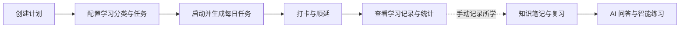

# Smart Study Planner｜8 分钟答辩演示操作手册

> 用途：现场按顺序操作、讲解和应对提问。不是功能开发清单。
> 编写依据：2026-11-28 当前本地前后端源码，以及《全项目答辩学习总报告》。
> 时间基准：演示当天的北京时间。本文的“今天、明天、后天”每次彩排都重新选择。
> 核验范围：本次核对了源码和页面文案，没有代你执行浏览器彩排、访问真实 AI 或创建演示数据。文中的预期结果必须在答辩前亲自确认。

## 1. 先记住这条主线

**我把一个长期目标拆成每日任务，记录实际完成量，把未完成部分合理顺延，再利用笔记、复习和 AI 检验理解。管理员可以管理用户和 AI 资源。**



虚线表示用户主动整理知识。系统没有因为打卡自动生成笔记，也没有自动根据 AI 成绩修改计划。

## 2. 8 分钟时间表

| 时间 | 展示内容 | 现场必须完成的动作 |
|---|---|---|
| 00:00–00:30 | 项目定位 | 用一句话说明解决的问题 |
| 00:30–01:00 | 登录与工作台 | 进入演示账号，说明首页能做什么 |
| 01:00–02:40 | 计划、步骤、任务生成 | 创建 3 天计划，配置两个任务，启动 |
| 02:40–04:10 | 打卡与顺延 | 数量累计 20 → 60，剩余 40 顺延；完成型打卡 |
| 04:10–05:00 | 笔记与复习 | 打开准备好的笔记，记录一次复习 |
| 05:00–06:00 | AI | 一次实时问答，展示提前保存的练习结果 |
| 06:00–06:40 | 学习记录与统计 | 区分记录次数、打卡天数和计划进度 |
| 06:40–07:30 | 管理后台 | 展示用户筛选、AI 治理、已有审计详情 |
| 07:30–08:00 | 技术说明与结束 | 解释分层、事务、权限及 AI 接入 |

**超时优先压缩顺序：管理后台 → AI 历史结果细节 → 登录讲解。保留打卡与顺延，因为这最能体现你自己的业务设计。**

## 3. 答辩前准备：这一部分提前完成

### 3.1 账号、环境与页面

- [ ] 使用独立的演示账号，不使用保存私人资料的主账号。
- [ ] 准备普通学习账号；若要展示后台，再准备有真实 ADMIN 权限的演示账号。
- [ ] 前端、FastAPI、MySQL 和 Redis 服务可用，当前网页没有错误遮罩。
- [ ] 核对演示地址：本地通常是前端 `http://localhost:3000`、后端 `http://localhost:8000`；现场以实际运行配置为准。
- [ ] 如果展示 AI，提前确认功能开关、模型调用、日额度和网络可用。
- [ ] 提前成功做一次完整彩排；临近正式展示时不要再批量生成 AI 请求，以免触发频率限制。
- [ ] 关闭无关窗口、通知和开发者工具，浏览器缩放到自己能看清文字的比例。
- [ ] 管理员使用另一个浏览器或独立浏览器配置登录，避免普通账号与管理员在同一浏览器的标签页中相互切换。

普通标签页共享 Cookie。仅开两个普通标签页并不能稳定地分别保存两个账号。

### 3.2 准备三份演示材料

| 材料 | 具体内容 | 用途 |
|---|---|---|
| 现场新建计划 | `答辩演示｜三天英语学习` | 现场建立真实业务闭环 |
| 已保存笔记 | `一般现在时复习卡`，正文见下方 | 复习、AI 问答的稳定输入 |
| 已完成练习 | 根据上述笔记真实生成并提交过的练习 | 模型响应慢时展示已持久化结果 |

另外准备一份已经启动、日期仍有效的备用计划，例如 `备用｜三天英语学习`。备用计划至少有今天目标为 100 的未开始数量任务，以及明天目标为 100 且没有打卡历史的同一学习任务。

**备用计划只用于切换演示；每次彩排后重新准备。已经顺延过的来源任务不能拿来重复演示顺延。**

### 3.3 笔记正文：答辩前复制保存

````markdown
# 一般现在时

## 用途
一般现在时常用于习惯、经常发生的动作和客观事实。

## 肯定句
- I / You / We / They + 动词原形。
- He / She / It + 动词第三人称单数形式。
- 例如：I read every day. / She reads every day.

## 否定句
- I / You / We / They + do not + 动词原形。
- He / She / It + does not + 动词原形。
- 例如：She does not read every day.

## 一般疑问句
- Do + I / you / we / they + 动词原形？
- Does + he / she / it + 动词原形？
- 例如：Does she read every day?

## 易错点
出现 does 或 does not 时，后面的实义动词使用原形。
错误：Does she reads every day?
正确：Does she read every day?
````

提前打开该笔记，确认 Markdown 能显示，复习按钮可用；再生成最少的 **5 道题**，作答、批改并保留结果。当前界面支持 5 / 10 / 15 题，不要现场寻找不存在的“1 题”选项。

### 3.4 准备页面入口

不必一次打开所有页面。把以下地址加入书签，遇到导航耗时就使用书签。

| 页面 | 前端路径 |
|---|---|
| 工作台 | `/` |
| 我的计划 | `/plans` |
| 创建计划 | `/plans/new` |
| 今日任务 | `/task/today` |
| 知识中心 | `/knowledge` |
| 指定笔记预览 | `/knowledge/实际笔记ID` |
| AI 练习历史 | `/ai/practice/history` |
| 学习记录 | `/history` |
| 学习统计 | `/statistics` |
| 管理概览 / 用户 / AI / 审计 | `/admin`、`/admin/users`、`/admin/ai`、`/admin/audit` |

上面的“实际笔记ID”是占位说明，需要换成准备好的笔记编号。

## 4. 现场照着走

### 第 1 步｜开场，30 秒

**画面停在：工作台，或登录页。**

你说：

> “我的项目叫 Smart Study Planner，是一个智能学习计划管理系统。它围绕目标拆解、每日执行、学习记录和复习反馈建立完整流程。我接下来用一个三天英语计划演示这条主线。”

不要在这里开始背技术栈清单。先让老师知道这个系统能帮用户完成什么。

### 第 2 步｜登录与工作台，30 秒

**你操作：**

1. 使用准备好的普通演示账号登录；如果现场已经登录，就直接展示工作台。
2. 指一下今日任务、计划入口和侧边导航。

**预期：** 登录后进入工作台，能看到该账号自己的学习数据。

你说：

> “用户进入首页就能看到今天要做的事，也能直接打卡。账号认证使用短期 Access Token 和服务端会话配合刷新 Cookie；Access Token 放在标签页内存中，后端还会检查会话是否有效。”

**不要现场展开：** 注册收邮件、找回密码、等待 Token 自然过期。认证原理留给问答，避免等待和敏感信息暴露。

### 第 3 步｜创建计划并拆分步骤，1 分 40 秒

**你操作：**

1. 点击「我的计划」→「创建计划」。
2. 输入以下内容：

| 字段 | 填写值 |
|---|---|
| 计划名称 | `答辩演示｜三天英语学习` |
| 计划描述 | `三天背 300 个单词，并每天阅读一篇英语短文` |
| 开始日期 | 演示当天 |
| 结束日期 | 演示当天 + 2 天 |

3. 点击「保存并配置步骤」。计划此时是草稿。
4. 点击「新增学习步骤」，选择「学习分类」。
5. 分类名称填写 `英语基础`；分类中的第一个学习任务填写 `背单词`。
6. 执行方式选择「数量型 · 自动分配」，总目标填写 `300`。
7. 点击「创建分类和首个任务」，关闭成功提示。
8. 在分类「英语基础」的更多操作中选择「添加子步骤」，选择「学习任务」。
9. 名称填写 `英语阅读`，执行方式选择「完成型 · 每天重复」，重复内容填写 `阅读一篇英语短文`。
10. 点击「添加学习任务」，关闭成功提示。
11. 点击「完成步骤配置」，回到计划详情的「确认启动」阶段，点击「开始执行计划」并确认。

**预期结构：**

```text
答辩演示｜三天英语学习
└─ 英语基础（分类，不直接打卡）
   ├─ 背单词（数量型，总目标 300）
   └─ 英语阅读（完成型，每天 1 条）
```

**预期结果：** 3 天 × 2 个学习任务，共生成 **6 条每日任务**。其中单词每天 100，阅读每天 1 条。开始日和结束日都计入周期。

你边操作边说：

> “分类负责组织结构，真正生成任务的是分类下面的学习项目。创建时先保存草稿，启动时后端再校验整棵步骤树和规则，把整个周期的每日任务一次性生成。”

> “这里 300 分到三天，每天是 100。任务生成与计划启动在同一个事务内完成，发生错误就回滚，避免计划显示已启动但任务没生成。”

**确认点：** 启动成功提示出现、状态进入进行中，再进入今日任务。不要重复点击启动。

### 第 4 步｜累计打卡与顺延，1 分 30 秒

**你操作：**

1. 进入「今日任务」，找到刚创建计划下的「背单词」。
2. 在「累计完成」输入框手动输入 `20`，点击「打卡」。
3. 等成功响应后，再输入 `60`，点击「打卡」。
4. 展开该任务「详情」，指一下实际累计和尚需完成。
5. 点击「顺延到未来日期」，选择**明天**，点击「确认顺延」并确认。
6. 回到该计划的任务列表，查看明天的「背单词」，确认目标变成 `140`。
7. 回「今日任务」，为「阅读一篇英语短文」点击一次「打卡」。

**重要：** 输入的是“截至现在累计完成”，不是“本次新增”。不要在第 2 步直接点击默认的「全部完成」，否则今天的数量任务会完成，无法继续演示剩余量顺延。

你说：

> “数量型任务支持多次记录，但提交的是累计值。刚才先填 20，再填 60，实际完成是 60，不是 80。完成型任务则只需要一次确认。”

> “今天目标 100，完成 60，剩下 40 转到明天，明天原本 100 就变成 140。今天的来源任务会结算并锁定，但实际学习量仍是 60。系统保留顺延关系，不能靠重复顺延或重新打卡虚增完成量。”

**你要心里有数的数据：**

| 字段 | 顺延前 | 顺延后 |
|---|---:|---:|
| 今天原始目标 `target_quantity` | 100 | 100 |
| 今天实际累计 `actual_quantity` | 60 | 60 |
| 今天转出数量 `rollover_out_quantity` | 0 | 40 |
| 今天有效目标 | 100 | 60 |
| 今天剩余 | 40 | 0 |
| 明天目标 | 100 | 140 |

来源数据库状态会变成 `COMPLETED`；前端可以显示为已顺延结算。它表示任务责任已结算，不能解释成用户实际背完了 100 个单词。

**三个观察点：** 来源操作锁定；明天目标增加；来源打卡历史中依旧只有累计 20、累计 60，没有系统伪造的一条“完成 100”。

目标日必须晚于今天且不超过计划结束日。目标任务必须可合并且没有打卡历史，所以要使用刚生成的明天任务。明天的任务此时只能查看，不能提前打卡。

### 第 5 步｜笔记预览与复习，50 秒

**你操作：**

1. 点击「知识中心」，搜索准备好的 `一般现在时复习卡`。
2. 点击笔记卡片，进入只读预览。
3. 指一下 Markdown 正文、编辑入口和复习区域。
4. 点击一次「完成一次复习」，看到复习次数或记录更新。

你说：

> “学习过程中形成的知识可以保存为 Markdown 笔记，并关联到学习计划或具体学习项目。卡片默认进入阅读模式，编辑要单独进入。复习也保存独立记录，所以我可以回顾自己什么时候复习过。”

**注意：** 这份预先准备的笔记不会自动关联到现场刚创建的计划。如果没有现场关联，就如实说它是一份演示笔记；不要声称系统已经自动建立关联。

### 第 6 步｜AI 问答与练习结果，1 分钟

**你操作：**

1. 在笔记预览中点击「打开 AI 问答」。
2. 输入：`为什么 Does she read every day 里的 read 不加 s？请用两句话解释。`
3. 点击「发送」，展示回答逐步出现。
4. 回答展示后，切到「AI 学习助手」→「练习历史」，打开提前保存的真实练习结果。
5. 指一下总成绩、自己的答案、参考答案或解析。

你说：

> “AI 问答基于当前已保存的笔记，回答通过 SSE 流式传给前端。前端会显示生成和检查状态。它也支持根据笔记生成练习，提交后返回成绩和反馈。”

> “这里是我事先完成并保存的一次练习。单选题由后端按答案判断，简答题通过模型给出评分，再由后端校验和汇总成绩。”

**等待上限：** 现场建议最多等约 15 秒。如果仍未完成，点击「停止生成」并切到已有结果，说：“实时生成依赖外部模型响应，我先展示之前实际保存的练习结果。”不要连续点击发送。

如果现场 AI 不可用，直接展示历史结果，并明确说明本次没有完成实时调用。

### 第 7 步｜学习记录与学习统计，40 秒

**你操作：**

1. 点击「学习记录」→「任务打卡」，筛选刚创建的计划。
2. 指出今天的数量提交和完成型打卡；若完全按本手册操作，应有两条数量记录加一条完成型记录。
3. 指一下「笔记复习」「专注自习」「智能练习」的分类入口，不逐一停留。
4. 点击「学习统计」，展示日历，再切「计划坚持」查看当前计划的累计天数、连续天数和 7 天圆点。

你说：

> “学习记录回答的是做过什么，学习统计回答的是坚持了多久。今天虽然保存了多次打卡，但同一个计划的累计打卡天数只增加一天。笔记复习、专注和智能练习分别记录，不混作任务打卡。”

> “计划进度使用实际任务数据计算；数量型任务扣除已转出的目标，避免顺延前后重复计算。”

**不要承诺全站统计恰好是 3 次：** 普通演示账号可能有旧数据。三条是本次新计划的记录，整体统计包含账号其他有效计划。

### 第 8 步｜管理后台，50 秒

**你操作：** 切换到已经用管理员账号登录的独立浏览器。

1. 打开「管理概览」，指一下用户、计划、打卡和 AI 请求统计。
2. 打开「用户管理」，搜索演示用户，查看详情。
3. 打开「AI 治理中心」，展示 AI 开关、日额度和请求情况。
4. 打开「操作审计」，展开一条提前准备的真实操作记录，展示操作人、时间、原因及变更前后。

你说：

> “后台由管理员权限保护，后端每次请求都会检查权限。管理员可以管理账号和会话，并调整 AI 功能开关及额度。涉及配置和用户状态的操作会留下审计记录，便于追溯。”

八分钟主流程以查看为主。若老师要求现场修改，使用专门的测试用户或测试配置，操作前说明影响，完成后恢复；不要封禁正在用于学习演示的账号，也不要误关全站 AI。

**没有可展示的审计记录时：** 如实展示空状态，不把空列表说成已经验证了变更追溯。

### 第 9 步｜结束，30 秒

你说：

> “前端使用 Next.js、React 和 TypeScript，后端使用 FastAPI。核心业务按 Router、Service 和 Repository 分层，使用 SQLAlchemy Session 和原生 SQL 访问 MySQL。复杂操作通过事务、锁和条件更新保持一致性，Redis 用来处理 AI 短时间请求频率，DeepSeek 提供生成能力。”

> “这个项目中我重点处理了三件事：计划如何变成每日任务，实际打卡和顺延怎样保持数据一致，以及认证和 AI 调用如何应对失败与并发。”

说完停下，进入提问。不要在结束时突然增加一个新功能演示。

## 5. 老师追问时，按这些操作展开

### 5.1 “你的业务复杂在哪里？”

打开今天刚才顺延的来源任务。

> “一个顺延请求要同时改变目标任务、结算来源任务、保存来源关系。任何一步失败都应回滚。来源还必须锁定，否则用户可能一边继续打卡一边把剩余量转走，造成重复计算。”

可补充：目标即使累计变回 0，只要已有打卡历史，也不能当成全新任务合并。

### 5.2 “进度怎么算？为什么不能直接统计 COMPLETED？”

指向数量型任务的实际量和转出量。

```text
有效目标 = 原始目标 - 已转出数量
剩余数量 = max(0, 有效目标 - 实际累计)
数量型叶子进度 = min(实际累计总和 / 有效目标总和, 1)
计划进度 = 各个可计算叶子进度的算术平均
```

> “顺延来源可能处于 COMPLETED，但实际只完成了 60，所以不能把状态当作真实数量。系统还会显式处理零目标和不可计算的叶子。”

当前源码中，完成型叶子会排除已经作为顺延来源的任务，再计算已完成条数占比；已结束计划当前不返回可计算进度。不要把旧报告中的待确认口径直接当成当前实现。

### 5.3 “为什么选择原生 SQL？”

> “SQLAlchemy 仍然管理 Session、连接和事务。我使用参数绑定的原生 SQL，便于清楚地表达关联查询、聚合、行锁和条件更新。Router 负责请求，Service 负责业务与事务，Repository 执行 SQL。”

### 5.4 “用户改 ID 能看别人数据吗？”

> “后端从认证信息取得用户 ID，查询计划和任务时校验归属，不信任前端自己传的用户身份。普通用户与管理员接口还分别做权限判断。”

如需现场证明，提前准备两个测试账号及一个明确属于另一账号的对象。只在测试账号范围内用 API 文档操作，并展示后端实际响应；不要现场猜测真实用户的对象 ID。

### 5.5 “AI 是你训练的吗？答案会不会直接改笔记？”

> “我接入的是 DeepSeek，项目负责上下文组织、结构校验、安全检查、流式传输、额度控制和结果保存。生成或整理的候选内容需要用户确认，笔记不会因为模型生成就自动覆盖。”

当前项目不是跨笔记向量检索 RAG，也没有训练自己的模型。流式出现文字不代表最终业务成功，仍要处理最终检查和结束事件。

### 5.6 “练习答案是不是已经暴露给浏览器？”

> “题目预览不返回明文标准答案，后端把必要的私有试卷信息放进加密且有有效期的票据。提交后，单选题在后端判分，简答题经模型辅助评分并校验，最终由后端计算总成绩。”

加密票据不是让前端自行解密，也不是让前端提交一个可信的最终分数。

### 5.7 “为什么需要 Redis？”

> “多个进程需要共享短时间请求频率。Redis 用有序集合记录窗口内的请求，Lua 把清理过期项、判断数量和登记请求放在一个原子操作里，降低并发穿透风险。日额度、请求记录及其他协调仍有 MySQL 参与，不能说所有治理状态都放在 Redis。”

### 5.8 “怎么证明测试过？”

> “我会区分自动化测试、浏览器操作、真实数据库验证和真实模型联调。测试数量以最终提交版本的实际运行报告为准。”

现场只展示提前保存且对应最终版本的测试结果，不为了凑数字引用旧阶段成绩。八分钟演示没有覆盖到的并发边界，也不要宣称已现场验证。

## 6. 出问题时怎么继续

| 现场情况 | 你做什么 | 你怎么说 |
|---|---|---|
| 登录失败、收不到邮件 | 使用已登录的独立演示会话；若没有可用会话，切本地录屏 | “当前认证依赖暂不可用，接下来展示提前录制的真实流程。” |
| 创建步骤超过时间 | 切到备用计划 | “为控制演示时间，我用结构相同的备用计划继续。” |
| 启动提示已成功，但页面刷新失败 | 刷新查询状态和任务数量，不重复启动 | “先确认服务端已经保存的状态，避免把显示刷新失败误当成业务失败。” |
| 顺延失败 | 核对今天、目标日期、计划状态和目标任务打卡历史 | “顺延有日期和历史限制，这个提示是在阻止不合法合并。” |
| 顺延来源已被彩排用过 | 切换全新备用任务，不尝试解锁 | “来源结算后不能重复操作，我换一条未使用的演示任务。” |
| AI 响应慢、额度或限流提示 | 停止等待，展示真实练习历史 | “这里依赖外部模型，本次实时结果尚未完成；我先展示已保存的结果。” |
| 统计暂时没更新 | 点一次刷新，区分当前筛选与全账号统计 | “我先核对时间范围和账号数据范围。” |
| 数据库或后端不可用 | 展示事先录制的真实流程和源码链路 | “本次现场环境未完成请求，录屏展示的是此前实际运行结果。” |

**先读提示，再决定下一步。不要连续点击提交，不要刷新正在作答但尚未提交的练习，不要为了继续演示修改数据库。**

## 7. 可选加演：老师感兴趣再做

| 内容 | 操作 | 需要提前知道的边界 |
|---|---|---|
| 专注自习 | 自由计时开始、暂停、恢复，展示环境声与沉浸模式 | 不要把短时间演示说成已完成一个番茄钟；最终状态以接口结果为准 |
| 数量自动分配余数 | 换一个不能整除天数的总目标，启动并查看每天数量 | 先按当前算法彩排；保证分配之和等于总目标 |
| 完整 AI 练习闭环 | 选择笔记 → 5 题 → 生成 → 预览 → 开始 → 作答 → 提交 → 结果 | 给模型等待留足时间；不要把预览当作已提交记录 |
| AI 候选稿 | 新建笔记或进入编辑 → 生成/整理 → 用户确认 → 保存 | 已保存笔记的整理/总结需要先保存最新编辑 |
| 账号安全 | 查看设备列表，打开“退出其他设备”确认弹窗后取消 | 当前设备退出不要求密码；其他或全部设备操作需要确认密码，最后再演示退出 |
| 笔记回收站 | 仅对专用测试笔记删除并恢复 | 不删除用于 AI 练习的主笔记 |

## 8. 被要求看源码时的定位表

不需要把所有文件背下来。先说清一次操作怎样经过各层，再打开对应文件。

| 展示点 | 主要源码及入口 |
|---|---|
| 计划启动、任务生成 | [plan_activation_service.py](/D:/project/back/app/services/plans/plan_activation_service.py)：`start_plan`、`_build_leaf_tasks`、`_validate_tree` |
| 计划归属与草稿 CRUD | [plan_service.py](/D:/project/back/app/services/plans/plan_service.py)：`get_owned_plan`、`create_plan`、`update_plan` |
| 打卡校验、数量累计、历史保存 | [task_service.py](/D:/project/back/app/services/tasks/task_service.py)：`update_numeric_task`，以及 BOOLEAN 打卡事务 |
| 顺延业务与事务 | [rollover_service.py](/D:/project/back/app/services/rollovers/rollover_service.py)：`rollover_task`、`_validate_rollover`、`_rollover_numeric` |
| 来源原子结算、目标合并 SQL | [rollover_repository.py](/D:/project/back/app/repositories/rollovers/rollover_repository.py)：`add_source_rollover_quantity`、`add_quantity_to_target` |
| 叶子与计划进度 | [progress_service.py](/D:/project/back/app/services/progress/progress_service.py)：`_numeric_leaf`、`_boolean_leaf`、`get_plan_progress` |
| 学习记录与逐计划打卡日期 | [history_repository.py](/D:/project/back/app/repositories/history_repository.py)：`get_checkin_summary`、`list_checkins` |
| 计划坚持天数 | [plan-consistency.ts](/D:/project/next-fro/lib/statistics/plan-consistency.ts)：`buildPlanConsistency` |
| 登录代际与内存 Token | [token.ts](/D:/project/next-fro/lib/auth/token.ts)、[coordinator.ts](/D:/project/next-fro/lib/auth/coordinator.ts) |
| AI 问答请求链 | [knowledge_ai.py](/D:/project/back/app/api/routes/knowledge_ai.py)：`ask_note` → 快照、准入、公共 Guard、SSE |
| AI 练习与评分 | [ai_practice_service.py](/D:/project/back/app/services/knowledge/ai_practice_service.py)、[ai_practice_grading_service.py](/D:/project/back/app/services/knowledge/ai_practice_grading_service.py)：`calculate_result` |
| Redis 限流 | [ai_rate_limit_service.py](/D:/project/back/app/services/knowledge/ai_rate_limit_service.py)：Lua 脚本与 `check_ai_rate_limit` |
| 管理员接口与权限依赖 | [admin.py](/D:/project/back/app/api/routes/admin.py)：`Depends(require_admin)` |
| 东八区业务日与 UTC 工具 | [clock.py](/D:/project/back/app/core/clock.py)：`business_today`、`utc_db_now`。各业务字段的存储规则需再看写入代码，不要泛称所有表统一存 UTC |

核心接口速查：

```text
POST  /plans                            创建草稿
POST  /plans/{plan_id}/steps            新建草稿步骤
POST  /plans/{plan_id}/start            启动并生成任务
GET   /tasks/today                      查询今日任务
PUT   /tasks/{task_id}/progress         提交数量累计
POST  /tasks/{task_id}/complete         完成型打卡
POST  /tasks/{task_id}/rollover         顺延剩余责任
GET   /tasks/{task_id}/records          任务打卡历史
GET   /plans/{plan_id}/tasks            全周期任务
GET   /plans/{plan_id}/progress         当前计划进度
POST  /notes/{note_id}/reviews          记录复习
POST  /notes/{note_id}/ai/ask           笔记 AI 问答
POST  /ai/practices/generate            生成练习
POST  /ai/practices/submit              提交批改
GET   /history/checkins                 查询打卡记录
GET   /history/checkin-summary          计划、步骤和打卡日期
GET   /statistics/overview              学习统计概览
GET   /admin/dashboard                  管理概览
GET   /admin/ai/config                  AI 动态配置
PATCH /admin/ai/config                  修改配置并审计
```

这些是后端路径；前端的 `/knowledge`、`/ai/practice` 是页面地址，不能与后端 `/notes`、`/ai/practices` 混淆。

## 9. 上台前最后看这一页

- [ ] 我知道今天、明天、后天的日期，计划首尾合计正好 3 天。
- [ ] 我知道分类不打卡，叶子才生成任务。
- [ ] 我能解释累计 20 → 60，实际仍是 60。
- [ ] 我会先手动输入数量，不误按「全部完成」。
- [ ] 我能解释来源 100 / 实际 60 / 转出 40 / 明天 140。
- [ ] 我知道顺延来源 `COMPLETED` 表示结算，不等于实际做完原始目标。
- [ ] 我知道多条打卡记录不等于多个打卡天数。
- [ ] 我有可用的笔记、真实练习历史，以及不会和普通账号抢 Cookie 的管理员窗口。
- [ ] 我能在 AI 等待过长时停止并切到历史结果。
- [ ] 我不展示密钥、Cookie、真实 Token、个人邮箱验证码或数据库密码。
- [ ] 我用最终版本彩排过一遍，实际计时在 8 分钟内。

**最后只背这六个词：目标、拆分、执行、记录、复习、治理。每切一个页面，都用一句话说明它在这条流程中解决了什么问题。**
