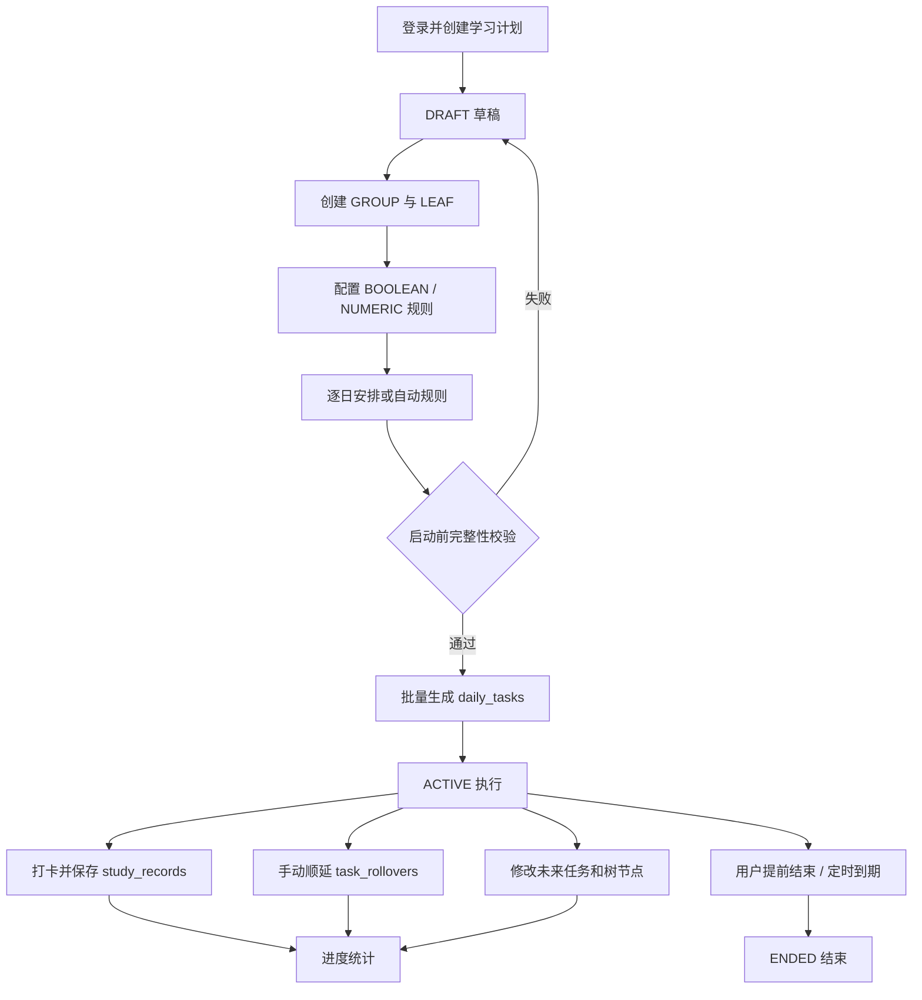
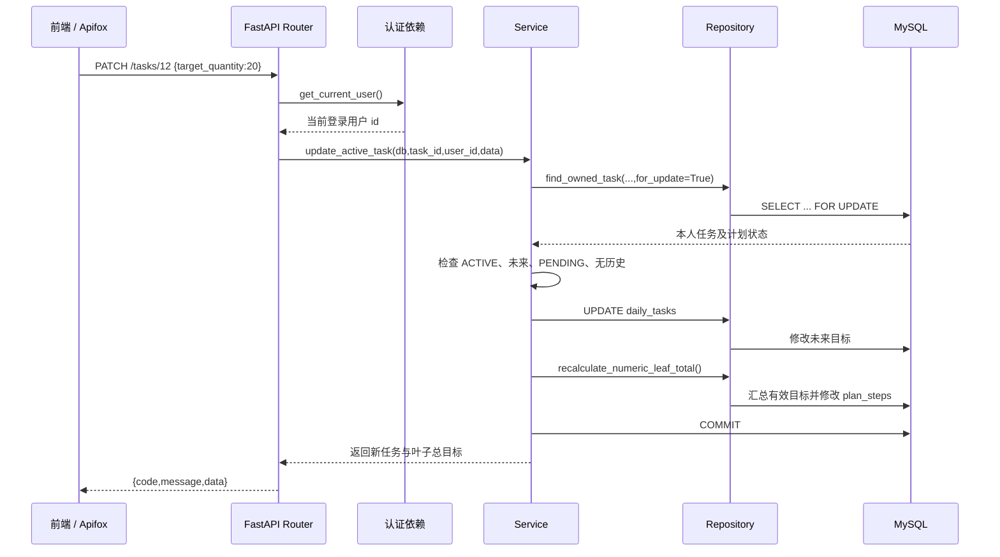
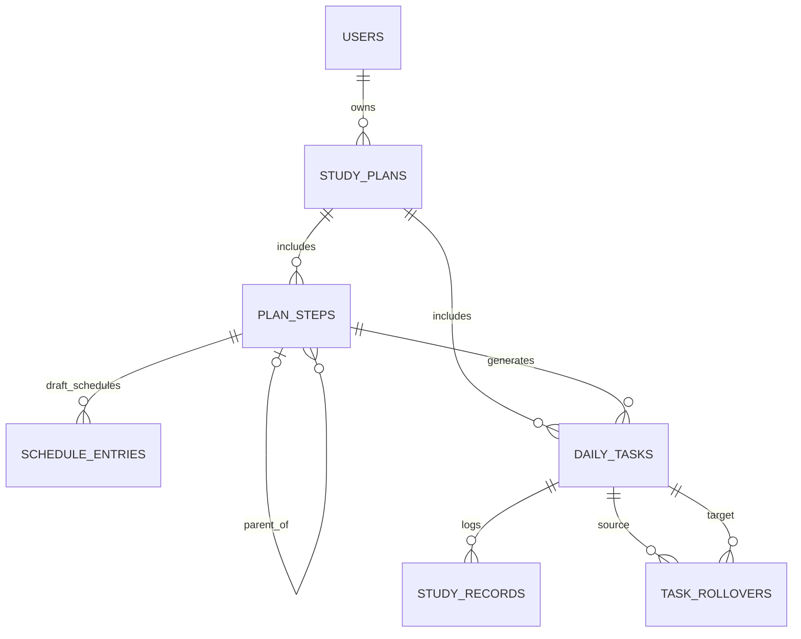

# Smart Study Planner：后端核心业务与答辩指南 V3.0

> **今晚小答辩·深度理解版｜2026-11-15**  
> 目标不是背函数名字，而是做到：**拿出一张表能讲字段；指着一个接口能讲调用链；给出一组数字能说清业务变化；被问“为什么”时能解释设计取舍。**
>
> **依据与版本说明：**本指南以你上传的《后端核心业务与答辩指南.md》为基础，结合后续已经讨论、编写和汇报测试结果的阶段 8 修复、阶段 9A/9B、阶段 10、阶段 11 代码方案更新。原指南是较早的工作区快照，里面“进度统计尚未实现”“BOOLEAN 统计口径待定”等表述现已过时。**本文不是对你电脑上的最新 Git 提交做的逐文件审计**：阶段 9、10 的功能状态来自你反馈的测试结果；阶段 11 的代码已给出，但在本次对话中**尚未收到 Trae 对 L01–L17 的验收结果**。示例代码是与你的项目结构对应的教学节选，不应未经核对就替换本地文件。

---

## 今晚先这样读：15 分钟、35 分钟、60 分钟

| 你有多少时间 | 先读什么 | 读完能做到什么 |
|---|---|---|
| **15 分钟** | 第 1、2、3、8、10、15 节 | 讲清项目是什么、请求怎么流转、顺延和完成率怎么算、如何回答核心追问 |
| **35 分钟** | 再读第 4、5、6、7、9、11、13 节 | 能用表结构和核心函数解释从创建计划到结束计划的全过程 |
| **60 分钟以上** | 全部阅读，最后做第 17 节模拟问答 | 能讲代码设计原因、事务与锁的区别、边界情况和未完成事项 |

**学习方法：**每读完一节，合上文档，用“**业务场景 → 数据怎么变 → 哪段代码负责 → 为什么这样设计**”四句话重新讲一遍。真正能说出来，才算理解。

## 目录

1. [项目介绍：把大目标变成每天能执行的事](#1-项目介绍把大目标变成每天能执行的事)
2. [系统全景图与当前完成度](#2-系统全景图与当前完成度)
3. [后端分层：一次 HTTP 请求的旅行](#3-后端分层一次-http-请求的旅行)
4. [六张核心表：数据库到底保存了什么](#4-六张核心表数据库到底保存了什么)
5. [树形步骤：递归、parent_id 与空 GROUP](#5-树形步骤递归parent_id-与空-group)
6. [执行规则与草稿：为什么开始前要检查](#6-执行规则与草稿为什么开始前要检查)
7. [启动计划：批量生成任务和事务](#7-启动计划批量生成任务和事务)
8. [每日打卡：BOOLEAN、NUMERIC 与历史记录](#8-每日打卡booleannumeric-与历史记录)
9. [任务顺延：全项目最值得讲的业务设计](#9-任务顺延全项目最值得讲的业务设计)
10. [ACTIVE 期间修改：计划运行后怎么改还不乱](#10-active-期间修改计划运行后怎么改还不乱)
11. [完成率统计：叶子节点等权与有效目标](#11-完成率统计叶子节点等权与有效目标)
12. [计划结束与定时任务：COMPLETED 不等于 ENDED](#12-计划结束与定时任务completed-不等于-ended)
13. [事务、行锁、权限、幂等：保护数据的四道门](#13-事务行锁权限幂等保护数据的四道门)
14. [一个完整案例：从创建到统计的每一步](#14-一个完整案例从创建到统计的每一步)
15. [今晚可直接讲的开场、亮点与演示路线](#15-今晚可直接讲的开场亮点与演示路线)
16. [接口与文件定位速查](#16-接口与文件定位速查)
17. [模拟答辩：25 个高频问题与回答思路](#17-模拟答辩25-个高频问题与回答思路)
18. [最后五分钟速记卡](#18-最后五分钟速记卡)

---

## 1. 项目介绍：把大目标变成每天能执行的事

### 1.1 它解决什么问题？

假设一个学生说：“我要在一个月内背完 900 个单词。”这句话很有目标感，但它有三个问题：

- 不知道**今天具体做什么**。
- 今天没做完，不知道**剩下的怎么处理**。
- 学到一半，不知道**总目标完成了多少**。

Smart Study Planner 的核心思路就是把**目标 → 拆解 → 安排 → 执行 → 调整 → 统计**连成一条业务链。

可以把它想成一家餐厅：

- **计划 Plan** 是这周要完成的总订单。
- **GROUP** 是菜单分类，不直接做菜。
- **LEAF** 是具体菜品，能说明做什么、做多少。
- **执行规则** 是排班规则。
- **每日任务** 是当天真正派发到厨房的工单。
- **打卡记录** 是工单执行日志。
- **顺延** 是把没做完的工单合理转到下一天，而不是偷偷改掉昨天的历史。

**答辩的一句话定位：**“我的系统不是简单的待办清单，而是将有时间范围的学习目标拆成树形步骤，按规则生成每日任务，并通过打卡、顺延、进度统计和计划生命周期管理形成完整的后端业务闭环。”

### 1.2 和普通 Todo List 有什么不同？

| 普通待办 | 这个项目 |
|---|---|
| 新建一条“背单词” | 先创建带周期的学习计划，再建立 GROUP/LEAF |
| 今天手工写任务 | 根据 REPEAT、DAILY_CUSTOM、AUTO_DISTRIBUTE、DAILY_MANUAL 生成任务 |
| 点一下完成 | 区分 BOOLEAN 完成和 NUMERIC 累计数量 |
| 没做完只能留着 | 支持有来源记录的手动顺延，NUMERIC 只转移剩余量 |
| 显示做完几项 | 按有效任务计算叶子完成率，再对全局叶子等权平均 |
| 删除就是不见了 | 逻辑删除，历史打卡和顺延关系仍可追溯 |

**答辩不要夸大：**当前优先完成的是**手动计划的核心业务**，不是“AI 自动生成学习计划”。AI 生成是后续扩展。

---

## 2. 系统全景图与当前完成度

### 2.1 从用户操作到业务结果



一句话记忆：**草稿负责“想清楚”，开始负责“生成清楚”，执行负责“记录清楚”，统计负责“算清楚”，结束负责“停清楚”。**

### 2.2 目前能声称完成到哪里？

| 模块 | 本次指南采用的状态 | 答辩时准确说法 |
|---|---|---|
| 双 Token 登录认证 | 之前已开发并通过相关测试 | 基础鉴权已具备，业务接口复用当前用户依赖 |
| 计划 CRUD / 树形步骤 / 规则 / 草稿安排 | 已编写并推进测试 | 基础计划与树形业务已有实现 |
| 启动计划与每日任务生成 | 已编写并推进测试 | 能由规则批量生成实际执行任务 |
| 每日打卡、顺延（阶段 7–8） | Codex 反馈数据库回归通过，仍有并发与 HTTP 待验收 | **主要逻辑通过回归**，不说“高并发全验证” |
| ACTIVE 修改（阶段 9A/9B） | 你反馈“检查正常”“一切正常” | 已完成初步功能检查 |
| 完成率统计（阶段 10） | 你反馈 Trae 测试“通过了” | 已实现并按本轮测试验收 |
| 计划提前结束与独立到期 Worker（阶段 11） | **代码方案已提供；本对话未收到验收反馈** | 已设计/已提供实现，实际运行结果需确认 |
| Next.js 完整业务页面 | 尚未在本对话验收 | 后续集中联调；不要说页面已经完整交付 |

**如果老师问“有没有全部做完？”**可以说：后端核心业务已形成雏形，计划管理、树形步骤、任务执行、顺延与统计是现阶段重点；自动到期、完整前端交互和真实多连接并发属于需要继续验证的部分。这样诚实且专业。

---

## 3. 后端分层：一次 HTTP 请求的旅行

### 3.1 为什么不把所有 SQL 都塞进 `main.py`？

把系统想成医院就容易理解：

- **Router：挂号窗口**，知道你来办什么事、把你分到哪里。
- **Schema：填表检查员**，检查类型是否正确、必填项是否齐全。
- **Service：主治医生**，根据业务规则决定能否执行、执行哪些步骤。
- **Repository：操作人员**，负责具体数据库读写。
- **MySQL：档案室**，保存事实、约束关系。

这是“**职责分离**”：每一层做自己的事。后面修复顺延 Bug 时，只需调整对应 Service 和 Repository，不用把所有接口推倒重写。

### 3.2 从请求进入数据库的完整路径

以修改一个未来 NUMERIC 任务为例：



### 3.3 四句核心语法，答辩一定要懂

**（1）`Depends()` 是依赖注入**

```python
from fastapi import Depends

user: dict = Depends(get_current_user)
db: Session = Depends(get_db)
```

不用你手工调用 `get_current_user()` 和创建 Session；FastAPI 按规则注入。`user` 不是前端随意传进来的，而是从 Access Token 解析身份后查询得到。

**（2）`text()` 是参数化原生 SQL**

```python
sql = text("SELECT id, name FROM study_plans WHERE user_id = :user_id")
result = db.execute(sql, {"user_id": user_id})
```

`:user_id` 是 SQL 命名参数占位符，SQLAlchemy 会把参数安全传入数据库，而不是自己字符串拼接用户输入。**我们使用 SQLAlchemy 的 Session，但数据操作以 `text()` 原生 SQL 为主，不依赖完整 ORM 对象模型。**

**（3）`mappings().first()` 得到可以按列名访问的结果**

```python
row = result.mappings().first()
if row is not None:
    print(row["name"])
```

`first()` 取第一行；`mappings()` 让这一行可以像字典一样通过字段名访问。`mappings().all()` 则取全部映射结果。

**（4）`commit()` / `rollback()` 控制事务**

```python
try:
    # 多个 Repository 操作
    db.commit()
except Exception:
    db.rollback()
    raise
```

提交前可以进行多次 SQL 操作；只要其中一步出错就回滚，防止数据库里只留下“半个业务结果”。

> **答辩提问**：“Repository 为什么不直接 `commit`？”  
> **回答**：“因为一次业务可能涉及多张表。把提交权放在 Service，才能让所有修改作为一个事务整体成功或整体回滚。”

---

## 4. 六张核心表：数据库到底保存了什么

原指南采用的六张核心业务表是 `study_plans`、`plan_steps`、`schedule_entries`、`daily_tasks`、`study_records`、`task_rollovers`。此外还有 `users` 和认证用的 `tb_refresh_token`。

### 4.1 用一张关系图认识它们



| 表名 | 人话解释 | 答辩要记住的关键字段 |
|---|---|---|
| `study_plans` | 一份总计划 | `user_id`、`start_date`、`end_date`、`status`、`deleted_at` |
| `plan_steps` | 可无限分层的学习步骤 | `parent_id`、`node_type`、`task_type`、`schedule_mode`、`total_target` |
| `schedule_entries` | 开始前手工排好的日程草稿 | `step_id`、`task_date`、`content`、`target_quantity` |
| `daily_tasks` | 真正执行的每日工单 | `task_date`、`target_quantity`、`actual_quantity`、`rollover_out_quantity`、`status` |
| `study_records` | 每次真实打卡的历史流水 | `task_id`、`event_type`、`recorded_value`、`recorded_at` |
| `task_rollovers` | 任务顺延的转出转入关系 | `source_task_id`、`target_task_id`、`quantity` |

### 4.2 为什么要同时有 `daily_tasks` 和 `study_records`？

一个 NUMERIC 任务目标 50：第一次提交 20，第二次提交 35。

```text
daily_tasks（当前快照）：actual_quantity = 35

study_records（历史流水）：
    第一次 NUMERIC_PROGRESS = 20
    第二次 NUMERIC_PROGRESS = 35
```

**不能说已完成 20 + 35 = 55！** 因为接口提交的是“**目前累计是多少**”，不是“本次新增多少”。

另外，有人先提交 10、又改回 0：当前任务看起来像 PENDING，但历史表证明它**曾经开始过**。阶段 8 合并目标和阶段 11 提前结束都需要这个信息。

### 4.3 为什么采用逻辑删除？

逻辑删除不是 `DELETE FROM`，而是：

```sql
UPDATE daily_tasks
SET deleted_at = UTC_TIMESTAMP()
WHERE id = :task_id AND deleted_at IS NULL;
```

**比喻：**书从“正在借阅”清单撤下，但档案室还保留借阅记录。正常列表和统计过滤 `deleted_at IS NULL`；历史关系仍在。删除 A→B→C 的 B，只删 B，A 与 C 的关系和记录不被物理毁坏。

### 4.4 数据库约束是最后一道保险

例如同一个 NUMERIC 叶子节点、同一天最多一条**有效** NUMERIC 任务。数据库采用生成列和唯一索引保护这个规则（具体列名以你的当前数据库为准）。BOOLEAN 则允许同一天多条任务。

一句话：**Service 讲“为什么不行”，数据库约束保证“真的不能乱写”。**

---
## 5. 树形步骤：递归、`parent_id` 与空 GROUP

### 5.1 为什么有 GROUP 和 LEAF 两种节点？

```text
英语学习计划
├── 词汇学习（GROUP）
│   ├── 每日背单词（LEAF，NUMERIC）
│   └── 复习生词（LEAF，BOOLEAN）
└── 听力训练（GROUP）
    └── 听一段英文材料（LEAF，BOOLEAN）
```

**GROUP = 文件夹**，只分组，不生成任务。**LEAF = 可执行事项**，有类型和执行规则，才真正生成每日任务。

数据库不为“一级分类、二级分类、三级分类”分别建表，而是通过同一张 `plan_steps` 的 `parent_id` 实现自关联：

| id | name | parent_id | node_type |
|---:|---|---:|---|
| 1 | 词汇学习 | NULL | GROUP |
| 2 | 每日背单词 | 1 | LEAF |
| 3 | 复习生词 | 1 | LEAF |
| 4 | 听力训练 | NULL | GROUP |
| 5 | 听一段英文材料 | 4 | LEAF |

`parent_id=NULL` 代表根节点。要把节点 2 放在节点 1 下，只需要 `parent_id=1`。

### 5.2 `_insert_tree()` 为什么要递归？

用户可能一次提交完整的一棵树：一个 GROUP 带多个 LEAF，还可能带更深的 GROUP。最自然的操作是：

1. 插入自己，取得自己新生成的数据库 `id`。
2. 遍历每个 `child`。
3. 把自己的 `id` 当作孩子的 `parent_id`，调用同一个插入逻辑。

**教学伪代码：**

```python
def insert_tree(node, parent_id):
    current_id = insert_node(node, parent_id)
    for child in node.children:
        insert_tree(child, parent_id=current_id)
    return current_id
```

你可以把“递归”理解为**组长先报名，再帮自己的每个组员重复做同样的报名动作**。

**为什么必须放进一个事务？**因为若第四个节点插入失败，前面 3 个节点不能单独留下一棵不完整的树。

### 5.3 `get_step_tree()` 怎么把表格变成树？

数据库返回的是一排排记录，但前端想看到嵌套的 `children`。高效做法是两遍扫描：

```python
nodes = {row["id"]: {**row, "children": []} for row in rows}
roots = []
for node in nodes.values():
    parent_id = node["parent_id"]
    if parent_id is None:
        roots.append(node)
    else:
        nodes[parent_id]["children"].append(node)
```

- 第一遍准备 `id → 节点对象` 字典。
- 第二遍把每个孩子挂到对应父节点。
- 对 n 条已经读出的记录，组装过程通常是 **O(n)**，不需要每遇到一个孩子就重新遍历整张表。

真实代码还要校验父子归属和异常数据；上面是便于你理解算法的教学简化版。

### 5.4 为什么删除 LEAF 可能顺带删除 GROUP？

假设“听力训练”下面只有“听一段英文材料”这一条 LEAF。删除叶子后，听力 GROUP 就空了。**我们的规则不允许空 GROUP**，因此 Service 必须向上清理空祖先，直到遇到仍然有其他孩子的 GROUP。

数据库中可能用递归 CTE 查询后代：

```sql
WITH RECURSIVE descendants AS (
    SELECT id FROM plan_steps WHERE id = :step_id
    UNION ALL
    SELECT p.id FROM plan_steps p
    JOIN descendants d ON p.parent_id = d.id
)
SELECT id FROM descendants;
```

**注意区别：**创建使用 Python 递归处理输入树；删除时可用 MySQL 递归查询取得后代；查询展示则在 Python 内存中用映射组装树。**“递归”是一种处理层级关系的思想，不限制只能写在哪个地方。**

**本节答辩话术：**“我把树形结构抽象成 GROUP 和 LEAF，通过 `parent_id` 自关联存储。创建时递归插入，查询时用字典映射还原树，删除时级联处理并清理空父节点，保证结构合法。”

---

## 6. 执行规则与草稿：为什么开始前要检查

### 6.1 两种任务，四种模式

| 任务类型 | 执行模式 | 人话 | 示例 |
|---|---|---|---|
| BOOLEAN | `REPEAT` | 每天同一件事 | 每天听 15 分钟英文播客 |
| BOOLEAN | `DAILY_CUSTOM` | 每天内容不同，用户逐日填 | 1 日听新闻、2 日听访谈 |
| NUMERIC | `AUTO_DISTRIBUTE` | 总数量自动按天分配 | 3 天背 100 个单词 |
| NUMERIC | `DAILY_MANUAL` | 每天目标由用户指定 | 第 1 天 20、第 2 天 30、第 3 天 50 |

`StepRule` 的 Pydantic 校验负责禁止不合法组合。例如 BOOLEAN 不能写 NUMERIC 的总数量；NUMERIC 不用 BOOLEAN 的重复文本。Schema **检查输入格式与结构**；Service **核对数据库状态与完整业务规则**。

### 6.2 为什么草稿允许不完整？

假设计划 3 天，用户只来得及安排了 1 日和 2 日。草稿阶段允许保存，明天再继续填写；不应该因为暂时缺 3 日就连草稿也不让存。

但正式开始必须检查完整性：

- BOOLEAN 自定义：周期每一天至少有一条内容，同一天允许多条。
- NUMERIC 手动：每一天**恰好一条**数量安排，且数量合计等于叶子总目标。
- 日期不能越过计划周期。

**这就是“编辑灵活”与“执行严格”的区别。**

### 6.3 `replace_schedule()` 为什么是“整组替换”？

它不是修改某一天的一行，而是对一个草稿叶子的日程做整组更新：

```text
检查 DRAFT、归属、类型和日期
   ↓
软删除该叶子的旧 schedule_entries
   ↓
插入本次提交的完整 entries
   ↓
一个事务提交
```

若新数据插入失败，就回滚之前的软删除，旧草稿不应该被破坏。**修改 LEAF 执行规则时，也需要清理与新规则不兼容的旧草稿。**

---

## 7. 启动计划：批量生成任务和事务

### 7.1 `start_plan()` 是“正式签发工单”

草稿的树和规则只是“计划书”；`POST /plans/{plan_id}/start` 才真正把规则展开为每一天需要执行的 `daily_tasks`。

```text
查询本人 DRAFT 计划并锁定
        ↓
检查是否已经生成过正式任务
        ↓
检查树完整、LEAF 合法、日期合法、草稿安排齐全
        ↓
按规则生成整个周期 daily_tasks
        ↓
插入任务 + 把计划设成 ACTIVE
        ↓
             COMMIT
```

失败时 `rollback()`。重复点击“开始”不能重复生成任务：状态校验、已有任务检查及数据库唯一约束共同保护。

### 7.2 日期为什么必须 `+1`？

12 月 1 日到 12 月 3 日是 **1、2、3 共三天**，不是两天：

```python
number_of_days = (end_date - start_date).days + 1
```

**答辩老师可能专门问边界日期。**“开始日和结束日都包含在计划内，因此需要加 1。”

### 7.3 `distribute_numeric_target()` 如何分 100 个单词？

总目标 100，周期 3 天：

```python
base = 100 // 3  # 33
first_two = [33, 33]
last = 100 - base * 2  # 34
```

结果：`33、33、34`。用整数除法，最后一天承接余数，**一定不会凭空丢掉目标**。

需要诚实说明局限：2 个目标分 5 天会得到 `0、0、0、0、2`，因为项目选择的是“余数集中最后一天”，不是平均撒在各天；这是一条明确、简单、可解释的规则，并不是 AI 算法。

### 7.4 四种规则最终怎样生成？

- BOOLEAN / REPEAT：每一天复制同一项内容。
- BOOLEAN / DAILY_CUSTOM：按输入安排生成，支持同日多条。
- NUMERIC / AUTO_DISTRIBUTE：按 `get_plan_days()` 和 `distribute_numeric_target()` 生成。
- NUMERIC / DAILY_MANUAL：检查每日恰好一条，合计等于总目标。

**一个最容易被追问的问题：**“如果任务生成到一半失败，计划还会开始吗？”  
**答：不会。**生成任务与切换 ACTIVE 必须在同一个事务，失败时全部回滚。

---

## 8. 每日打卡：BOOLEAN、NUMERIC 与历史记录

### 8.1 为什么打卡前先走 `_validate_checkin()`？

前端按钮灰了，不代表用户不能自己构造 HTTP 请求。后端必须逐项检查：

- 当前登录用户是不是任务所有者。
- 计划是否 `ACTIVE`，今天是否位于计划执行周期内。
- 任务是否已 `COMPLETED` 或 `ENDED`。
- 是否企图提前打卡未来任务。
- 是否是已顺延、必须锁定的来源任务。

**允许 ACTIVE 计划中的过去未完成任务补打卡**，但归属日期仍是原 `task_date`，不会改成今天。

### 8.2 BOOLEAN：做了就是完成，不能撤销

例如“听一段英文材料”：

```text
PENDING
   ↓ POST /tasks/{id}/complete
COMPLETED + 写入一条 BOOLEAN_COMPLETE 历史
   ↓ 再次点击
409 拒绝重复打卡
```

核心思想不是“把状态改一下”这么简单，而是：**状态更新和历史记录插入同时成功、同时失败**。

### 8.3 NUMERIC：输入的是累计，不是增量

目标 50：

| 第几次提交 | 本次填入 | 当前 `actual_quantity` | 状态 |
|---|---:|---:|---|
| 1 | 20 | 20 | IN_PROGRESS |
| 2 | 35 | 35 | IN_PROGRESS |
| 3 | 60 | 60 | COMPLETED |

并不是 20 + 35 + 60 = 115。实际最终记录的累计值是 **60**，允许超过目标，但完成率最多展示 100%。

关键状态选择逻辑（教学节选）：

```python
if actual_quantity >= target:
    new_status = "COMPLETED"
elif actual_quantity > 0:
    new_status = "IN_PROGRESS"
else:
    new_status = "PENDING"
```

**修复后的关键约束：**如果 NUMERIC 来源任务已经转出剩余目标，不能再调用这个普通打卡更新，否则会发生来源和目标重复计算。因此 `_validate_checkin()` 与 Repository 的 SQL WHERE 都要拦截 `rollover_out_quantity > 0`。

### 8.4 一个极容易错的问题：现在是 0 ≠ 从未开始

假设用户先填 10，后来改回 0：

```text
current actual_quantity = 0
current status = PENDING
study_records = [10, 0]  ← 证明它曾经操作过
```

后面 NUMERIC 顺延目标合并、ACTIVE 修改、提前结束时，必须结合 `study_records` 判断“有没有开始”。不能只凭当前状态和当前数量。

### 8.5 `OVERDUE` 有两种视角

`task_service._format_task()` 会根据日期给前端返回 `is_overdue`、`display_status`；这不一定等于数据库持久化的 `status` 已经改成 `OVERDUE`。

一句话：**数据库状态是保存的事实，展示状态可以结合“今天是哪一天”临时计算。** 业务日期由 `business_today()` 统一使用 UTC+8；一些时间戳用 `UTC_TIMESTAMP()` 记录，需要区分日期口径与真实时间点。

---

## 9. 任务顺延：全项目最值得讲的业务设计

### 9.1 为什么“顺延”不等于“修改日期”？

星期一背 100 个单词，完成 60，剩 40。若直接把星期一的任务日期改成星期二，就像把昨天的成绩单改成今天的：**丢失了昨天完成 60 的事实**，而星期二可能本来还有自己的 50 个目标。

所以我们采用三个动作：**保留来源 → 转移剩余 → 建立历史关系**。

### 9.2 NUMERIC 例子：100 → 实际 60 → 顺延 40

```text
                     星期一：来源 A
    target_quantity=100, actual_quantity=60
                     │
                转出剩余 40
                     ▼
                     星期二：目标 B
        原目标 50 + 转入 40 = 90
```

| 字段 | 来源 A 顺延前 | 来源 A 顺延后 | 目标 B 顺延后 |
|---|---:|---:|---:|
| `target_quantity` | 100 | 100 | 90（原 50） |
| `actual_quantity` | 60 | 60 | 0 |
| `rollover_out_quantity` | 0 | 40 | 0 |
| `status` | IN_PROGRESS | **COMPLETED** | PENDING |

**注意新的 COMPLETED 语义：**这里 A 的 COMPLETED 表示**来源任务已结算**，不代表实际完成了 100。真实完成仍是 60；转移的 40 不应该被伪造成打卡记录。

**算剩余量：**

```python
original_target = source["target_quantity"]
actual = source["actual_quantity"]
already_out = source["rollover_out_quantity"]
remaining = original_target - actual - already_out
if remaining <= 0:
    _reject("没有可顺延的剩余数量")
```

这个减法有三项，不能忘记 `already_out`。目标为 0 时也会触发禁止顺延，属于有效的边界保护。

### 9.3 为什么 NUMERIC 要有 `rollover_out_quantity`？

如果简单算 `SUM(target_quantity)`：来源 100、目标 90，会得到 190，其中顺延的 40 被重复算了一次。正确做法是：

```text
A 有效目标 = 100 - 40 = 60
B 有效目标 = 90 - 0 = 90

两天有效目标合计 = 60 + 90 = 150
原本两天总目标   = 100 + 50 = 150
```

顺延改变的是**学习目标的分布日期**，不是凭空给用户增加 40 个目标。只有用户后续主动修改目标、删除任务等操作，才可能真正改变有效总目标。

### 9.4 目标日期如果已有 NUMERIC 任务怎么办？

同一 LEAF 同一天只能有一个有效 NUMERIC 任务，所以优先**合并**而不是插第二条。

合并的条件：

- 目标任务仍是 `PENDING`。
- 当前实际数量为 0，未转出数量。
- **没有任何历史打卡记录**。
- 合并后数量不能超过 MySQL 无符号整数范围。

**SQL 的关键写法：**

```sql
UPDATE daily_tasks
SET target_quantity = target_quantity + :quantity
WHERE id = :target_id
  AND task_type = 'NUMERIC'
  AND status = 'PENDING'
  AND actual_quantity = 0
  AND rollover_out_quantity = 0
  AND NOT EXISTS (
      SELECT 1 FROM study_records
      WHERE task_id = :target_id
  )
  AND deleted_at IS NULL;
```

这样就不会把“提交过 10 后改回 0”的任务当成从未开始。

### 9.5 来源任务为什么要原子化结算？

这是阶段 8 实际修复过的 Bug。过去只增加 `rollover_out_quantity`，如果打卡接口没有同步限制，来源可能继续提交累计 100；目标又已经接收 40，造成重复。

现在更新来源时，要在**同一条 SQL**中：

```sql
UPDATE daily_tasks
SET rollover_out_quantity = rollover_out_quantity + :quantity,
    status = 'COMPLETED',
    completed_at = UTC_TIMESTAMP()
WHERE id = :source_id
  AND task_type = 'NUMERIC'
  AND status IN ('PENDING','IN_PROGRESS','OVERDUE')
  AND actual_quantity = :expected_actual
  AND target_quantity = :expected_target
  AND rollover_out_quantity = :expected_out
  AND actual_quantity + rollover_out_quantity + :quantity = target_quantity
  AND deleted_at IS NULL;
```

**拆开解释关键 WHERE：**

- `status IN (...)`：只能结算未完成任务。
- `actual_quantity = :expected_actual`：用户的累计数不能在读取后偷偷变化。
- `target_quantity = :expected_target`：原目标不能在读取后偷偷变化。
- `rollover_out_quantity = :expected_out`：已经转移过的数量不能被忽略。
- `actual + out + quantity = target`：**把来源原目标恰好结清**；60 + 0 + 40 = 100。

如果 SQL 影响行数不是 1，Service 要拒绝并回滚；来源状态和数量不能只改成功一半。

### 9.6 BOOLEAN 顺延为什么用“历史关系”判断？

BOOLEAN 没有数量，今天没听英语，用户决定明天听：

```text
A：星期一听英语，PENDING
       │
       └── task_rollovers：A → B，quantity=NULL
                            ▼
B：星期二听英语，PENDING
```

A **不是真的完成**，所以不应强行变成 COMPLETED，但它已经顺延了，必须不能再打卡、也不能再重复顺延。

因此关键判断不是 `rollover_out_quantity`，而是：

```sql
SELECT id
FROM task_rollovers
WHERE source_task_id = :source_id
LIMIT 1;
```

特别注意：**不能只检查“是否顺延过同一天”，而是检查“这个来源是否曾经顺延过任何日期”。** 不因为目标被逻辑删除而抹掉历史。

### 9.7 A → B → C 链式顺延

```text
A：100，实际 60，转出 40 → 状态 COMPLETED
          │ 40
          ▼
B：40，实际 15，转出 25 → 状态 COMPLETED
          │ 25
          ▼
C：25，实际 0，待执行
```

每次只能顺延**当前来源**的剩余数量：A 不能再顺延一次，但 B 可以成为新的来源。这就是“同一来源只结算一次”和“整个链可以继续流转”不矛盾的原因。

有效目标：A 为 60，B 为 15，C 为 25，总计 100；实际完成 60+15+0=75，当前进度 75%。

**如果删除中间 B：**只给 B 设置 `deleted_at`，A 不恢复 40，C 仍存在，历史关系保留。现有统计只算 A、C：有效目标 60+25=85、实际 60，进度约 70.59%。这**不再是“全链目标守恒”**，因为用户主动删除了一个有效任务；需要区分“顺延本身不增减目标”和“删除会改变有效统计范围”。

### 9.8 为什么整个顺延放在一个事务里？

```text
锁定来源 → 校验规则 → 锁定目标/新建目标
        → 合并目标数量 → 结算来源 → 写 task_rollovers
        → commit
          └── 任何一步失败 → rollback
```

可用“银行转账”比喻：**不能只给收款方加钱，没从付款方扣款；也不能转账成功却丢了转账流水。**

`FOR UPDATE` 保护行锁范围内的并发读写；事务保证跨表操作要么全成功要么全失败。实际多连接并发压测仍须在隔离数据库验证，不能声称“完全没有并发风险”。

**这一节最有分量的答辩回答：**“我发现顺延不是移动日期这么简单，它会影响打卡、任务状态、目标数量和统计。我通过转出量字段、顺延关系表、来源原子结算、行锁与事务，让同一份剩余目标不会被反复转移。”

---
## 10. ACTIVE 期间修改：计划运行后怎么改还不乱

### 10.1 为什么“开始前修改”和“开始后修改”不一样？

DRAFT 就像还没印刷的课程表，改起来很自由。ACTIVE 则像学生已经拿到课程表并上过课：**不能为了改明天的安排，把昨天真实上过的课改掉。**

阶段 9 把 ACTIVE 修改分成两组：

| 阶段 | 功能 | 核心限制 |
|---|---|---|
| **9A** | 修改未来每日任务 | 必须未来日期、PENDING、无历史打卡、未顺延结算 |
| **9B** | 新增或删除树形节点 | 新叶只生成剩余周期任务；GROUP 不得为空；删除级联且不破坏历史 |

### 10.2 9A：修改未来 NUMERIC 目标的例子

某个 NUMERIC 叶子原来安排：

| 日期 | 数量 | 是否能修改 |
|---|---:|---|
| 今天 | 50（已经打卡） | 不可以 |
| 明天 | 30（未开始） | 可以 |
| 后天 | 40（未开始） | 可以 |

用户把明天 30 改为 20。当前有效总目标由 **120 → 110**。

为什么不能只修改 `daily_tasks` 的一行？因为 `plan_steps.total_target` 也需要同步变成新总目标；否则数据库会出现两套互相矛盾的数量。

**核心流程：**

```python
# 教学节选：active_task_service.update_active_task()
task = find_owned_task(..., for_update=True)
assert task["plan_status"] == "ACTIVE"
assert task["task_date"] > business_today()
assert task["status"] == "PENDING"
assert not has_study_history(db, task_id)

update_future_numeric(db, task_id, new_target)
new_total = recalculate_numeric_leaf_total(db, plan_id, step_id)
db.commit()
```

注意这段是教学流程示意；真实项目用 `HTTPException` 返回业务错误，不直接用 `assert` 代替业务校验。

### 10.3 为什么新目标不能小于“已经接收的顺延量”？

假设明天的任务原目标 20，今天顺延过来 40，明天当前目标是 60。

- 修改到 50：允许，仍有空间承担转来的 40。
- 修改到 30：拒绝，因为已经有 40 是真实存在的顺延承接历史，不能随便把它抹掉。

Repository 会查询 `task_rollovers` 中以当前任务为**目标**的数量合计：

```sql
SELECT COALESCE(SUM(quantity), 0)
FROM task_rollovers
WHERE target_task_id = :task_id;
```

再用条件更新防止绕过 Service。这里的 `COALESCE(..., 0)` 是：如果查询结果是 NULL，就用 0 代替。

### 10.4 删除 NUMERIC 任务，为什么总目标也要重算？

假设有效任务目标是 `50 + 20 + 40 = 110`，用户删除目标 20 的那一天。它的 `deleted_at` 不再为 NULL，统计时必须排除它，叶子有效总目标变成 **90**。

**正确事务顺序：**

```text
锁定本人任务
    ↓
逻辑删除 daily_tasks
    ↓
重算该 LEAF 的有效总目标
    ↓
commit
```

如果“删除成功、重算失败”却单独提交，会产生数据不一致。若删除的是顺延链中间任务，仍只删除所选任务，保留上下游与关联历史。

### 10.5 9B：ACTIVE 中途新增一个 LEAF

假设计划从 11 月 10 日到 11 月 20 日，用户 11 月 15 日新增“每日阅读”叶子节点。

- 11 月 10–14 日：**不生成**，过去的学习不能伪造。
- 11 月 15–20 日：生成 6 天任务。
- 如果 NUMERIC 新目标为 100：前五天 `16`，最后一天 `20`。

```python
# active_step_service.create_active_tree() 中的核心思想
first_day = max(business_today(), plan["start_date"])
days = get_plan_days(first_day, plan["end_date"])
```

这意味着新增 LEAF 的 `total_target` 是**新增日到原计划结束日这段剩余周期的总目标**，而不是原计划一开始到结束的总目标。

### 10.6 新增 GROUP 为什么必须带孩子？

不允许先放入空分类，再指望用户以后补上。`ActiveStepNode` 的 Pydantic 校验要求：

- GROUP 必须包含至少一个 `children`。
- GROUP 不能直接配置 LEAF 执行规则。
- LEAF 必须有规则，不能继续包含子节点。

然后 Service 的递归插入在同一个事务中创建整棵子树，并给所有新增 LEAF 生成剩余周期每日任务。**一个孩子的规则出错，整棵新增子树都回滚。**

### 10.7 删除树节点：为什么要“向下删后代，向上清空祖先”？

```text
英语
└── 阅读训练（GROUP）
    └── 新闻阅读（LEAF） ← 用户删除
```

删除新闻阅读后，阅读训练变空，也必须清理。若再往上的英语 GROUP 也只剩这一个分类，就继续清理，直到遇到仍有有效孩子的祖先。

ACTIVE 计划还有一条额外保护：**不能把最后一个有效 LEAF 删掉**。如果用户想完全放弃计划，应使用结束计划功能。

### 10.8 `parent_id <=> :parent_id` 是什么？

MySQL 的 `<=>` 是**空值安全等于运算符**。排序时既要找普通父节点的孩子，又要找 `parent_id=NULL` 的根节点。`=` 遇到 NULL 无法正常表示相等关系，但 `<=>` 可以。

**本节答辩话术：**“ACTIVE 阶段允许合理调整，但不能覆盖已经开始的历史。我的实现把修改范围限定在未来未开始的数据，并通过事务同步维护每日目标、叶子总目标和树结构合法性。”

---

## 11. 完成率统计：叶子节点等权与有效目标

> **状态更新：**原指南中的“进度统计尚未实现”已经过时。我们在阶段 10 提供了 `progress_repository.py`、`progress_service.py`、`progress.py`，你已反馈测试通过。这里讲的是这套新算法。

### 11.1 先记住三个原则

1. **只看有效数据：**已逻辑删除的节点和任务不参与当前统计。
2. **不同任务类型算法不同：**BOOLEAN 看完成次数；NUMERIC 看累计真实完成量与有效目标。
3. **全局 LEAF 等权：**不根据树深度、GROUP 数量或节点位置改变权重。

### 11.2 BOOLEAN 叶子：先排除顺延来源

假设“英语阅读”叶子有下面的任务：

| 任务 | 状态 | 是否为顺延来源 | 是否参与统计 |
|---|---|---|---|
| A | PENDING | 是，A→B | **不参与** |
| B | COMPLETED | 否 | 参与：完成 |
| C | PENDING | 否 | 参与：未完成 |

BOOLEAN 完成率 = **1 / 2 = 50%**，不是 1/3。A 已经顺延，不能把同一件事重复放进分母。

关键代码：

```python
effective_tasks = [
    task for task in tasks
    if not task["has_rollover"]
]
total_count = len(effective_tasks)
completed_count = sum(
    1 for task in effective_tasks
    if task["status"] == "COMPLETED"
)
```

`has_rollover` 是 Repository 通过 `EXISTS (SELECT ... FROM task_rollovers WHERE source_task_id=t.id)` 算出的标记。即使 B 后来被删除，A 的历史顺延仍然存在，A 仍不进入当前分母。

**如果剩下没有一条可统计任务：返回 `null`，不伪造 100%。**

### 11.3 NUMERIC 叶子：别被 `COMPLETED` 骗了

| 任务 | `target_quantity` | `actual_quantity` | `rollover_out_quantity` | 有效目标 |
|---|---:|---:|---:|---:|
| A（已结算） | 100 | 60 | 40 | 60 |
| B（承接任务） | 40 | 20 | 0 | 40 |
| **合计** | 140（原始字段直接相加） | **80** | 40 | **100** |

正确进度：

\[
P_{NUMERIC}=\min\left(\frac{\sum actual\_quantity}{\sum(target\_quantity-rollover\_out\_quantity)},1\right)\times100\%
\]

= 80 / 100 = **80%**。

**为什么不能只数状态 COMPLETED？**因为 A 虽然结算为 COMPLETED，但它实际只做了 60；要把数量转移和真实学习量分开。

核心代码（对应 `progress_service._calculate_numeric()` 的思想）：

```python
effective_target = 0
total_actual = 0
for task in tasks:
    effective_target += (
        task["target_quantity"]
        - task["rollover_out_quantity"]
    )
    total_actual += task["actual_quantity"]

if effective_target > 0:
    progress = min(
        Decimal(total_actual) * 100 / Decimal(effective_target),
        Decimal(100),
    )
else:
    progress = None
```

实际实现还会校验数量是否为空、是否为负数、转出量是否大于目标；非法数据要返回明确错误，不能默默算出一个假百分比。

### 11.4 为什么 `Decimal` 而不是浮点数？

百分比往往出现无限小数，例如 `1 / 3`。用 `Decimal` 运算，再通过 `ROUND_HALF_UP` 保留两位百分数，结果更可控。

**关键细节：**先用未四舍五入的原始进度求总体平均，最后再四舍五入，避免中间四舍五入积累误差。

### 11.5 总计划：所有“可统计的有效 LEAF”算术平均

假设计划下面的 LEAF 进度：

| LEAF | 进度 | 当前统计权重 |
|---|---:|---:|
| 背单词 | 80% | 1/3 |
| 听力训练 | 50% | 1/3 |
| 阅读训练 | 100% | 1/3 |

\[
P_{plan}=\frac{80+50+100}{3}=76.67\%
\]

不是先平均“单词 GROUP”、再平均“英语 GROUP”。**只要它是同一个计划下的有效且可计算 LEAF，不论嵌在第几层，权重相同。**

```
英语计划
├── 单词（GROUP）
│   ├── 基础单词（LEAF：80%）
│   └── 高频单词（LEAF：50%）
└── 听力（GROUP）
    └── 新闻听力（LEAF：100%）

计划 = (80% + 50% + 100%) / 3
```

### 11.6 为什么“不额外保存叶子权重”？

因为用户随时可能新增或删除叶子节点。如果把每个权重固定存成 33.33%，新增第四个节点就得更新所有旧节点。

实时计算更简单：**当前有效且可统计的 LEAF 数量是 n，每个权重就是 1/n。**

注意展示层保留两位小数时，三个 `33.33%` 加起来是 99.99%，这是显示精度，不代表数学逻辑错误。

### 11.7 `null`、0%、100% 三者怎么区分？

- **0%：**有可统计的任务，实际什么都没完成。
- **100%：**有可统计的任务，达到了封顶进度。
- **`null`：**没有足够的有效数据计算百分比。例如 BOOLEAN 全是已顺延来源，或 NUMERIC 的有效目标总和为 0。

当前阶段 10 的具体实现是：**在可计算进度的有效 LEAF 之间等权平均；进度为 `null` 的叶子仍返回在列表中，但不参与分母。** 当全部不可计算时，总体返回 `null` 和 `NO_STATISTICAL_DATA`。

这是一条需要准确讲述的**当前技术统计口径**。原始需求强调所有有效叶子等权，空数据边界由实现阶段统一处理；不要将“所有叶子”与“所有可计算叶子”混为一谈。

### 11.8 删除链条中间任务会怎样影响统计？

沿用 A→B→C：

```text
A：目标 100，实际 60，转出 40  → 有效目标 60
B：目标 40，实际 15，转出 25   → 有效目标 15
C：目标 25，实际 0            → 有效目标 25
```

未删除时：75 / 100 = **75%**。

删除 B 后：B 不参与；A、C 仍计入，实际 60、有效目标 60+25=85，进度：

\[
\frac{60}{85}\times100\%\approx70.59\%
\]

这里并没有给 A 恢复 40，也没有删除 C。**有效统计范围改变，因此统计结果改变；历史仍可追溯。**

### 11.9 哪些计划返回进度？

当前阶段 10 设计针对 **ACTIVE 执行期进度**。对于 DRAFT 和 ENDED，当前接口返回 `progress_percent=null`，并给出如 `PLAN_NOT_ACTIVE` 的原因字段。

答辩要如实解释：**“当前实现的是执行期统计；结束计划后的历史进度看板尚未作为独立功能完成。”** 不要暗示已经有“任何状态下都能查询完整历史成绩”的接口。

**本节答辩话术：**“我把统计分成两级：先计算每个叶子的有效完成率，再对全局可统计叶子等权平均。BOOLEAN 排除已顺延来源，NUMERIC 用实际数量除以扣除已转出数量的有效目标。所有统计都过滤逻辑删除数据，并处理分母为 0 的边界。”

---
## 12. 计划结束与定时任务：COMPLETED 不等于 ENDED

> **核实提示：**阶段 11 的 Repository / Service / Router / Worker 实现方案已提供，但本次对话还没有收到 Trae 的 L01–L17 验收报告。下面讲解的是当前设计与代码方案，不擅自宣称 Worker 已经在你电脑上持续运行并验证过跨日。

### 12.1 先分清“计划状态”和“任务状态”

**计划状态：**

```text
DRAFT ──用户点击开始──> ACTIVE ──提前结束/正常到期──> ENDED
```

**每日任务状态：**

```text
PENDING（待执行）
   ├── 开始数量打卡 → IN_PROGRESS（部分完成）
   ├── 达标/BOOLEAN确认完成 → COMPLETED
   └── 计划提前结束且未开始 → 逻辑删除

IN_PROGRESS（部分完成）
   ├── 达标或剩余全部顺延结算 → COMPLETED
   └── 计划提前结束 → ENDED
```

要记住：**计划 ENDED 并不意味着所有任务都必须变成任务 ENDED**。

### 12.2 `COMPLETED` 和 `ENDED` 的本质区别

| 状态 | 意思 | 典型原因 |
|---|---|---|
| `COMPLETED` | 当前任务已经达标，或 NUMERIC 来源已按顺延规则结算 | BOOLEAN 完成打卡、NUMERIC 达标、NUMERIC 剩余全转出 |
| `ENDED` | 未完成且不再允许继续执行 | 计划提前结束时，已开始但未完成的任务被终止 |

例如：三个任务分别为“完成 30 / 完成 10 / 从未做过”。用户提前结束：

- 已经 COMPLETED 的任务：**保留 COMPLETED**。
- 做了 10 还没达标的任务：**改成 ENDED，保留实际 10 和历史**。
- 从未开始的任务：**设置 `deleted_at` 进行逻辑删除**。

### 12.3 为什么“提前结束”和“正常到期”不能写成一套动作？

| 业务 | 提前结束 | 正常到期 |
|---|---|---|
| 触发 | 用户调用 `POST /plans/{plan_id}/end` | 独立 Worker 定期检查 |
| 计划最终状态 | ENDED | ENDED |
| COMPLETED 任务 | 保留 | 保留 |
| 已开始、未完成 | 标为任务 ENDED | 保留原状态作为历史 |
| 从未开始 | 逻辑删除 | 保留，不自动删除 |
| 后续打卡、补打卡、顺延 | 全部拒绝 | 全部拒绝 |

**这也是设计状态机的价值：**同一个“结束”目标，因为触发原因不同，处理方式也不同。

### 12.4 如何判断任务“开始过”？

不能只看状态，因为 NUMERIC 从 10 改回 0 后可能仍是 PENDING。Repository 需要组合判断：

```sql
-- 示意条件：有任何一种证据表示已经开始
status = 'IN_PROGRESS'
OR COALESCE(actual_quantity, 0) > 0
OR EXISTS (
    SELECT 1 FROM study_records r
    WHERE r.task_id = t.id
)
```

**答辩话术：**“我判断任务是否开始时不仅看当前累计数量，还看真实历史记录，避免把曾经执行过、但后来改回 0 的任务误删。”

### 12.5 为什么结束日期要用 `< today` 而不是 `<= today`？

例如计划结束日期是 11 月 20 日：

- 11 月 20 日当天仍属于计划周期，允许打卡。
- 11 月 21 日才算正式过期。

所以定时查询条件：

```sql
WHERE status = 'ACTIVE'
  AND end_date < :today
```

如果写 `<=`，就会把结束日期当天的任务提前停止，这违反“首尾均包含”的规则。

### 12.6 为什么定时器不直接放进 FastAPI `main.py`？

项目采用的方案是一个独立的**计划到期 Worker**：

```text
进程 1：FastAPI
   └── 负责用户 API

进程 2：APScheduler Worker
   └── 每隔约 5 分钟查一次到期计划
       └── 通过 Service 结束符合条件的计划
```

这样避免在 Uvicorn 热重载或多进程启动时，无意中启动多个调度器。

阶段 11 提供的运行命令：

```powershell
cd D:\project\back
.\.venv\Scripts\python.exe -m app.jobs.plan_expiration_worker --once
```

`--once` 只检查一次；不带参数可让 Worker 持续调度。**代码中写了定时任务，不代表 Worker 已经自动常驻运行**：必须启动它或在部署时配置独立服务。

### 12.7 Worker 为什么按计划分别开启事务？

假设 100 个计划到期，其中第 37 个恰好遇到数据库锁冲突。如果把 100 个计划捆在一个事务，一个失败可能拖累整个批次。每个计划独立 Session、独立提交：

```text
计划 1：成功提交
计划 2：成功提交
计划 3：失败回滚，下次重试
计划 4：继续执行
```

还要防止重复执行：`FOR UPDATE` 锁定计划，状态更新必须满足 `ACTIVE → ENDED`，已经结束的计划不会被再次破坏。

### 12.8 有一个容易被老师问到的限制

**阶段 10 当前统计接口只面向 ACTIVE。**计划进入 ENDED 后，该接口设计为返回 `null`，不是已经具有完整历史完成率展示。若将来需要结束后查看最终成绩，需要设计历史进度展示或固定结算快照；目前不要把它说成已完成。

**本节答辩话术：**“我将计划生命周期与单个任务状态分开。提前结束和正常到期都使计划 ENDED，但历史处理不同。自动到期使用独立调度进程，按统一业务时区判断 `end_date < today`，并结合锁、状态条件和事务保护重复运行。”

---

## 13. 事务、行锁、权限、幂等：保护数据的四道门

这是老师最常问的工程化问题。不要混为一谈。

### 第一扇门：归属校验——“是不是你的数据？”

用户从 Token 中解析到自己的 `user_id`，Repository 查询时同时带 `task_id` 与所属用户：

```sql
SELECT t.id, t.status
FROM daily_tasks t
JOIN study_plans p ON t.plan_id = p.id
WHERE t.id = :task_id
  AND p.user_id = :user_id
  AND t.deleted_at IS NULL;
```

如果查不到本人有效任务，通常返回 404。不能只靠前端隐藏“删除别人任务”的按钮。

### 第二扇门：业务校验——“现在能不能做？”

同样是任务 ID 正确，不代表任何时刻都能操作。例如：

- 已完成任务不能再次打卡。
- 未到日期的任务不能提前顺延。
- ENDED 计划不能继续操作。
- ACTIVE 中修改任务仅允许未来、未开始、无历史的任务。
- 顺延来源必须防止二次结算。

这属于 Service 的核心职责，也可能有必要的 Repository WHERE 二次防护。

### 第三扇门：事务——“多步操作是否一起成功？”

```python
try:
    update_target()
    settle_source()
    insert_rollover_relation()
    db.commit()
except Exception:
    db.rollback()
    raise
```

事务解决的是**一致性和原子性**：不能“目标多了 40、来源却没少 40”。

### 第四扇门：锁与约束——“两个人同时操作怎么办？”

```sql
SELECT ... FROM daily_tasks
WHERE id = :task_id
FOR UPDATE;
```

`FOR UPDATE` 在事务内请求行锁；第二个修改同一来源的请求通常需要等待。获得锁后还要重新检查状态、数量和历史，不能假设之前读过的数据永远不变。

**锁 ≠ 事务。**锁协调并发访问，事务保证成组提交/回滚。还需要唯一索引、条件更新与失败处理一起保护。

### 13.1 幂等到底是什么意思？

**同样的请求重复发送，不应该产生重复的实质业务效果。**

例如用户对同一个 DRAFT 计划连续点击两次“开始”：不应该生成两套每日任务。顺延 A 第一次成功后，再次请求 A，应该拒绝，而不是又转出去 40。

**注意术语的准确性：**接口重复调用可能返回 409，而不是每次都返回同样的 200。这说明系统通过拒绝重复请求避免重复效果；答辩时可以称为“重复请求保护”，不必夸大为所有接口都具有完全相同响应的严格幂等语义。

### 13.2 MySQL 死锁怎么办？

当两个事务互相等待对方持有的锁，可能产生死锁；锁等待超时也可能失败。阶段 8 修复报告提到对 MySQL 1205（锁等待超时）和 1213（死锁）进行回滚与可重试业务错误处理。

但 **“写了处理”不等于“真实并发压力场景已验证”**：之前 R20 跨连接并发测试是 BLOCKED。今晚答辩如实说“已有行锁、条件更新、事务和错误处理，隔离库并发压测是后续验证项”。

### 13.3 如果老师问 SQL 注入呢？

项目使用参数化的 `text()`：

```python
sql = text("SELECT * FROM users WHERE username=:username")
db.execute(sql, {"username": username})
```

这不同于直接把用户输入拼进 SQL 文本。**但不能就此说“系统绝对不存在所有 SQL 注入风险”**，仍要避免动态拼接不可信的表名、字段名或整段 SQL。

---

## 14. 一个完整案例：从创建到统计的每一步

这一节建议今晚自己拿纸画一遍，答辩时最有说服力。

### 场景：12 月 1–3 日，三天英语学习计划

计划结构：

```text
英语计划（DRAFT）
├── 单词学习 GROUP
│   └── 背单词 LEAF（NUMERIC + AUTO_DISTRIBUTE，总目标100）
└── 听力训练 GROUP
    └── 每日听力 LEAF（BOOLEAN + REPEAT）
```

#### 第 1 步：创建计划

`POST /plans` → `study_plans` 新增记录，状态 `DRAFT`。

#### 第 2 步：创建树和规则

`plan_steps` 保存 2 个 GROUP 和 2 个 LEAF。LEAF 配置各自规则；GROUP 不直接产生每日任务。

#### 第 3 步：正式开始

`POST /plans/{id}/start` 检查完整性，批量生成：

| 日期 | NUMERIC 单词 | BOOLEAN 听力 |
|---|---:|---|
| 12/1 | 33 | 听一段材料 |
| 12/2 | 33 | 听一段材料 |
| 12/3 | 34 | 听一段材料 |

总共 **6 条每日任务**，计划变成 ACTIVE。

#### 第 4 步：第一天打卡

12/1 背了 20 个：

```text
12/1 NUMERIC：target=33, actual=20, IN_PROGRESS
study_records：新增 NUMERIC_PROGRESS=20
```

#### 第 5 步：把剩下 13 顺延到 12/2

前提：12/2 同一 LEAF 的任务尚未开始，没有历史打卡。

```text
12/1 来源：target=33, actual=20, rollover_out=13
            status=COMPLETED（结算完成）
12/2 目标：原本33，接收13，变成46
            status=PENDING
关系表：12/1 → 12/2，quantity=13
```

**为什么总目标没变？**

```text
来源有效目标 = 33 - 13 = 20
目标有效目标 = 46
第三天目标   = 34
总有效目标   = 20 + 46 + 34 = 100
```

#### 第 6 步：第二天完成 46

12/2 输入累计 46，目标 46 → COMPLETED。第三天尚未执行，NUMERIC 当前累计为 20+46+0=66。

**NUMERIC 叶子完成率：**66 / 100 = **66%**。

#### 第 7 步：BOOLEAN 听力执行情况

假设三天的听力分别是：第 1 天完成、第 2 天未完成、第 3 天完成。没有顺延：

**BOOLEAN 叶子完成率：**2 / 3 ≈ **66.67%**。

#### 第 8 步：看整个计划进度

两个 LEAF 等权：

\[
P=\frac{66\%+66.666\ldots\%}{2}\approx66.33\%
\]

这里用的是**未提前四舍五入的 BOOLEAN 精确比例**参与平均，因此最后约 **66.33%**，不是把展示后的数字随意叠加。

#### 第 9 步：如果第三天还未开始时，修改 NUMERIC 目标？

假设在 12/2，用户把未来 12/3 的目标由 34 改成 24：

- 新有效总目标 = 20 + 46 + 24 = **90**。
- NUMERIC 实际完成仍是 **66**。
- NUMERIC 进度 ≈ **73.33%**。
- BOOLEAN 仍 ≈ **66.67%**。
- 总体 ≈ **70%**。

**区别：**这次总目标改变不是“顺延”造成，而是用户明确修改了未来安排；所以需要同步重算 `plan_steps.total_target`。

#### 第 10 步：如果用户提前结束？

- 已完成任务保留。
- 有学习历史但未完成任务改为 ENDED。
- 从未开始的任务按规则逻辑删除。
- 计划切换为 ENDED，后续打卡、顺延被拒绝。

**重要限定：**这个步骤描述的是阶段 11 的预定/已给出实现逻辑；当前未收到其最终验收报告。且阶段 10 现有执行期进度 API 对 ENDED 返回 `null`，不能直接用它当“最终成绩单”。

### 这个案例你必须能脱口而出的四组数字

| 问题 | 答案 |
|---|---|
| 100 个单词分 3 天？ | **33、33、34** |
| 第一天完成 20，顺延多少？ | **13**；第二天从 33 变 **46** |
| 第二天完成 46、第三天未做，总数量进度？ | **66/100=66%** |
| BOOLEAN 三天完成两次，计划整体进度？ | **(66% + 66.67%)/2≈66.33%** |

---
## 15. 今晚可直接讲的开场、亮点与演示路线

### 15.1 约 90 秒开场讲解稿

> 老师好，我开发的是智能学习计划管理系统的后端核心业务。它要解决的问题是：很多同学有“一个月背完多少单词”这样的大目标，但不知道每天具体执行什么，也不知道没完成的部分应该怎么办。  
>  
> 我的系统先让用户创建有起止日期的学习计划，再把它拆成树形步骤。GROUP 用于分类，LEAF 是真正执行的内容。叶子节点支持 BOOLEAN 和 NUMERIC 两类任务，并根据固定重复、每日自定义、自动平均分配、每日手动安排这四种规则生成每日任务。  
>  
> 计划有 DRAFT、ACTIVE、ENDED 三种状态。正式开始前，后端会检查步骤树和每日安排是否完整，再用一个事务批量生成任务并切换计划状态。执行过程中，用户可以打卡，NUMERIC 使用累计完成数量；没完成的任务可以手动顺延到未来，并保留来源记录。  
>  
> 在实现顺延时，我重点解决了“数量重复计算”的问题：比如目标 100、实际完成 60，就只转移剩余的 40，并在来源记录已转出数量，而不是假装用户完成了 100。完成率按照有效任务统计，NUMERIC 扣除已转出数量，整个计划对有效且可统计的叶子节点等权平均。  
>  
> 在代码结构上，我主要采用 FastAPI 的 Router、Pydantic Schema、Service 和 Repository 分层，通过 SQLAlchemy Session 执行参数化 SQL。涉及跨表修改时使用事务，关键并发操作配合行锁、状态条件和数据库约束。当前后端核心业务已经形成雏形，后续还需要完善完整前端联调及部分并发、定时调度验收。

**练习技巧：**慢速说清楚“树形步骤、规则生成、顺延、不重复计算、事务”五个关键词，比背很多技术名词更重要。

### 15.2 约 3 分钟：推荐的演示讲解顺序

**第 1 幕：展示计划与树（约 40 秒）。**  
“这是一个三天英语计划，上层 GROUP 只是分类，叶子 LEAF 才决定每天生成什么任务。比如单词 LEAF 是 NUMERIC，总目标 100。”

**第 2 幕：展示开始计划（约 35 秒）。**  
“点击开始时，后端先检查树完整性和规则，再生成 33、33、34 三天的任务。任务生成和计划状态更新在一个事务里。”

**第 3 幕：展示打卡与顺延（约 55 秒）。**  
“第一天目标 33，实际只完成 20，剩下 13。顺延到第二天后，第二天目标从 33 变成 46，来源保留实际 20，并记录转出 13。历史不会被改写。”

**第 4 幕：展示统计（约 30 秒）。**  
“NUMERIC 计算时分母用有效目标，不重复算转出的 13；BOOLEAN 统计时排除已顺延来源。最后对叶子进度算术平均。”

**第 5 幕：讲代码保护（约 20 秒）。**  
“这些操作背后有权限校验、事务、`FOR UPDATE` 和数据库约束。重复点击顺延也不能重复转移同一份数量。”

**结尾（约 10 秒）。**  
“系统当前完成了后端的主要业务链条，接下来会集中完善 Next.js 前端交互和整体回归测试。”

### 15.3 六个值得讲的技术亮点

| 亮点 | 不要只说功能；要讲设计原因 |
|---|---|
| **树形步骤** | 自关联 `parent_id` 可表达任意层级，避免每层建表；创建、查询、删除分别选择合适算法 |
| **规则驱动生成** | 用户只填规则，后端生成整个周期的每日任务；启动前完整性校验保护正式数据 |
| **当前值与历史分离** | `daily_tasks` 是快照，`study_records` 是操作流水，能追查累计数变化 |
| **NUMERIC 顺延结算** | `rollover_out_quantity` 与 `task_rollovers` 分别处理有效目标和来源追溯，防重复计算 |
| **实时统计** | 不缓存固定权重；任务和节点修改、删除后按当前有效集合重算 |
| **事务、权限与锁** | 防止跨表半成功、越权操作及同来源重复转移 |

### 15.4 老师要求“展示源代码”，建议打开这些函数

| 展示顺序 | 函数 | 你应该指出的代码行 |
|---|---|---|
| 1 | `plan_activation_service.start_plan()` | 校验 DRAFT、生成任务、`db.commit()` |
| 2 | `plan_rules.distribute_numeric_target()` | `//` 整数除法、最后一天承接余数 |
| 3 | `task_service.update_numeric_task()` | 累计数量、新状态、打卡记录 |
| 4 | `rollover_service.rollover_task()` | 来源加锁、类型分支、事务 |
| 5 | `rollover_repository.add_source_rollover_quantity()` | 同一 UPDATE 中修改转出量与 COMPLETED，以及数量等式约束 |
| 6 | `progress_service.get_plan_progress()` | 按 `step_id` 分组、每个 LEAF 单独统计、平均 |
| 7 | `active_step_service.create_active_tree()` | 递归创建子树、只生成剩余周期任务 |
| 8 | `plan_lifecycle_service.end_plan_early()` | 若阶段 11 已验收，可展示提前结束时两种任务处理 |

**不建议从几百行代码第一行开始念。**答辩的重点是“指出关键条件 → 说出业务后果”。

---

## 16. 接口与文件定位速查

### 16.1 主要 API（以你当前 FastAPI 路由注册结果为准）

| 功能 | 方法与路径 | 主要 Service |
|---|---|---|
| 创建/查询计划 | `POST/GET /plans` | `plan_service` |
| 计划详情、修改、删除 | `GET/PATCH/DELETE /plans/{plan_id}` | `plan_service` |
| DRAFT 树的创建与查询 | `POST/GET /plans/{plan_id}/steps` | `step_service` |
| 修改 DRAFT 节点/规则 | `PATCH/PUT /plans/{plan_id}/steps/{step_id}` 相关接口 | `step_service` |
| 草稿日程 | `GET/PUT /plans/{plan_id}/steps/{step_id}/schedule` | `schedule_service` |
| 启动计划 | `POST /plans/{plan_id}/start` | `plan_activation_service` |
| 计划任务列表 | `GET /plans/{plan_id}/tasks` | `daily_task_service` |
| 今日任务 | `GET /tasks/today` | `task_service` |
| 单任务详情/记录 | `GET /tasks/{task_id}`、`GET /tasks/{task_id}/records` | `task_service` |
| BOOLEAN 完成 | `POST /tasks/{task_id}/complete` | `task_service` |
| NUMERIC 累计更新 | `PUT /tasks/{task_id}/progress` | `task_service` |
| 任务顺延 | `POST /tasks/{task_id}/rollover` | `rollover_service` |
| 删除任务 | `DELETE /tasks/{task_id}` | `task_service` |
| ACTIVE 未来任务修改 | `PATCH /tasks/{task_id}` | `active_task_service` |
| ACTIVE 新增整棵子树 | `POST /plans/{plan_id}/active-steps` | `active_step_service` |
| ACTIVE 删除子树 | `DELETE /plans/{plan_id}/active-steps/{step_id}` | `active_step_service` |
| 查询计划进度 | `GET /plans/{plan_id}/progress` | `progress_service` |
| 用户提前结束计划 | `POST /plans/{plan_id}/end` | `plan_lifecycle_service`（阶段 11 待验收） |

**路由提醒：**`/tasks/today` 这样的固定路径应在 `/tasks/{task_id}` 之前注册，以免被错误当成整数任务 ID。

### 16.2 关键文件地图

项目当前使用 `D:\project\back\app`（以本机实际仓库为准）。你只需记住核心文件“在哪里、管什么”。

```text
back/app/
├── main.py                          FastAPI 入口、全局异常、CORS
├── database.py                      Engine / SessionLocal / get_db
├── core/
│   ├── deps.py                      Access Token → 当前用户
│   └── clock.py                     业务日期（UTC+8）
├── api/
│   ├── router.py                    汇总注册所有业务路由
│   └── routes/
│       ├── plans.py                 计划 CRUD / 启动等入口
│       ├── steps.py                 DRAFT 树管理
│       ├── schedules.py             草稿安排
│       ├── tasks.py                 查询、打卡、删除
│       ├── rollovers.py             顺延
│       ├── active_tasks.py          ACTIVE 任务修改
│       ├── active_steps.py          ACTIVE 树修改
│       ├── progress.py              计划进度
│       └── plan_lifecycle.py        提前结束（阶段11）
├── schemas/
│   ├── plan.py / step.py            计划和树输入规则
│   ├── schedule.py                  每日草稿安排输入
│   ├── task.py / rollover.py        打卡和顺延请求
│   ├── active_task.py               ACTIVE 修改请求
│   └── active_step.py               ACTIVE 新增子树请求
├── services/
│   ├── plan_service.py              计划 CRUD 规则
│   ├── plan_rules.py                纯日期/数量分配计算
│   ├── step_service.py              DRAFT 树逻辑
│   ├── schedule_service.py          草稿安排规则
│   ├── plan_activation_service.py   计划启动、全周期任务生成
│   ├── task_service.py              打卡/查询/删除
│   ├── rollover_service.py          顺延规则与事务
│   ├── active_task_service.py       ACTIVE 未来任务修改
│   ├── active_step_service.py       ACTIVE 节点增删
│   ├── progress_service.py          全局叶子进度
│   └── plan_lifecycle_service.py    结束业务（阶段11）
├── repositories/
│   ├── plan_repository.py / step_repository.py
│   ├── schedule_repository.py / daily_task_repository.py
│   ├── task_repository.py / rollover_repository.py
│   ├── active_task_repository.py / active_step_repository.py
│   ├── progress_repository.py
│   └── plan_lifecycle_repository.py
└── jobs/
    └── plan_expiration_worker.py    独立调度进程（阶段11）
```

目录和文件列表来自我们当前讨论的开发方案，不代表本文件已经对你的整个本地目录做了自动扫描。遇到不一致时，以实际仓库和 `/docs` 路由列表为准。

---

## 17. 模拟答辩：25 个高频问题与回答思路

> 使用方法：先遮住答案自己说。你不需要一字不差背诵，但要能说出**“为什么”**。前 15 题是高优先级。

### Q01. 你的系统到底解决什么问题？

**答：**把长期大目标拆成有时间范围、每天能执行的具体任务，支持打卡、调整、顺延和实时进度统计，让计划从“想法”变成“有记录的执行”。

### Q02. 为什么不直接做普通待办清单？

**答：**待办清单通常只保存单条事项；我的系统存在计划→树形步骤→规则→每日任务→打卡与顺延的多层业务关系，能够按周期批量生成和统计任务。

### Q03. 什么是 GROUP 和 LEAF？

**答：**GROUP 是文件夹，只负责层级组织；LEAF 才有执行规则，能够生成每日任务。这样分类与执行职责分开。

### Q04. 数据库怎样保存树？

**答：**在同一张 `plan_steps` 表使用 `parent_id` 指向父节点，根节点的 `parent_id=NULL`；查询时用字典映射再组装 `children`。

### Q05. 什么是递归？项目哪里用到了？

**答：**函数处理当前节点后继续用相同逻辑处理子节点。树的批量新增会递归插入；删除时可以用数据库递归查询找后代；这适合不确定层级深度的结构。

### Q06. 为什么不允许空 GROUP？

**答：**空 GROUP 没有可执行内容，破坏树结构完整性。所以创建时必须带子节点，删除叶子后若父节点空了，就向上自动清理。

### Q07. DRAFT 和 ACTIVE 的区别？

**答：**DRAFT 是准备阶段，可以保存尚未完整的安排；ACTIVE 是正式执行阶段，已生成的任务会产生真实记录，不能随意改周期或覆盖已开始任务。

### Q08. 两种任务类型与四种模式分别是什么？

**答：**BOOLEAN 表示做或没做，支持 REPEAT、DAILY_CUSTOM；NUMERIC 表示数量，支持 AUTO_DISTRIBUTE、DAILY_MANUAL。类型不同，对输入规则和生成方式的要求不同。

### Q09. 为什么总目标 100 分 3 天是 33、33、34？

**答：**基础数量是整数除法 `100//3=33`，前两天各 33，最后一天用总目标减去前两天已经分配的数量，得到 34，保证总和为 100。

### Q10. 开始计划时为什么一定要用事务？

**答：**生成所有每日任务、更新计划状态必须一起完成；若某个叶子规则异常或插入失败，整体回滚，避免半套任务和错误的 ACTIVE 状态。

### Q11. `Depends(get_current_user)` 做什么？

**答：**FastAPI 依赖注入会取出请求中的访问令牌并验证身份，得到当前用户。业务 SQL 再结合 `user_id` 限制只能操作自己的数据。

### Q12. SQLAlchemy `Session` 和 ORM 是一回事吗？

**答：**不是。Session 是连接和事务管理的基础能力；我的项目主要通过 `Session.execute(text(...))` 执行参数化原生 SQL，不需要每个业务表都通过 ORM 对象完成操作。

### Q13. `mappings().first()` 和 `mappings().all()` 有什么区别？

**答：**`mappings()` 让查询行可以按列名访问；`first()` 取第一条，`all()` 获取全部。

### Q14. 为什么 NUMERIC 第二次提交 35，不是 20+35？

**答：**因为字段代表“当前累计完成”，不是“本次新增”。提交 20 再提交 35，最终实际值是 35，历史表保存两次累计快照。

### Q15. NUMERIC 顺延为什么只移动剩余量？

**答：**来源目标 100、实际 60，只剩 40 没做。若把整条 100 转给明天，就把已经完成的 60 也重复安排了，所以只转移 `target - actual - already_out`。

### Q16. 来源顺延后为什么是 COMPLETED？

**答：**我们明确将 NUMERIC 的 COMPLETED 扩展为“来源任务已经结算”。比如真实完成 60、转出 40，来源不再有待处理数量；但绝不能把它解释成用户实际完成了 100。

### Q17. 为什么 BOOLEAN 顺延不能直接改为 COMPLETED？

**答：**BOOLEAN 只有是否做过，延到明天不代表今天已经做过。保留来源原状态，通过 `task_rollovers` 判断它已经顺延，从而锁定后续打卡。

### Q18. 任务 A 能不能重复顺延到其他日期？

**答：**不行。BOOLEAN 检查该来源是否有过任何历史顺延；NUMERIC 通过结算状态和已转出数量限制。新生成的 B 可以再顺延到 C，但 A 不可反复转移同一份目标。

### Q19. 目标 NUMERIC 任务当前为 0，为什么仍可能不能合并？

**答：**它可能曾填 10、又改回 0，说明已经开始过。要检查 `study_records`，不能仅凭当前 `actual_quantity=0` 和 PENDING。

### Q20. `FOR UPDATE` 能否代替事务？

**答：**不能。行锁用来协调并发读写，事务负责把一组 SQL 一起提交或回滚。两者配合，再加条件更新和唯一约束，才能保护顺延等跨表业务。

### Q21. NUMERIC 顺延后的完成率怎么计算？

**答：**对有效任务汇总真实实际数量，除以所有有效任务的 `target_quantity-rollover_out_quantity` 之和，再封顶 100%。不能只数 COMPLETED 状态。

### Q22. 为什么不按 GROUP 层级平均，而对 LEAF 全局等权？

**答：**如果按父节点递归平均，不同树形分组方式会改变叶子权重。我们明确只统计有效且可计算的 LEAF，每个 LEAF 贡献相同权重，算法简单且结构变化后容易重算。

### Q23. 删除顺延链 A→B→C 的 B 会怎么样？

**答：**只软删除 B，不恢复 A 的已转出数量，也不删除 C；关系历史保留，统计只计算当前有效任务，所以分母和分子可能发生变化。

### Q24. 为什么“正常到期”不能用“提前结束”的 SQL？

**答：**正常到期要保留所有历史未完成任务；提前结束要把已开始未完成任务变为 ENDED，把从未开始任务逻辑删除。虽然计划最终都是 ENDED，但业务原因和历史处理不同。

### Q25. 你的项目现在还有哪些不足？

**答：**后端主要业务已形成雏形，阶段 9/10 有功能检查与测试反馈；阶段 11 定时到期的最终运行验收、完整 Next.js 业务联调以及阶段 8 的真实多连接并发压力测试仍需进一步确认。当前统计侧重 ACTIVE 执行期，完整 ENDED 历史成绩展示尚未独立实现。

### 加分追问：老师直接问“你遇到最大的 Bug 是什么？”

**推荐回答：**

> 我遇到最典型的问题是 NUMERIC 顺延之后，来源任务仍可能继续打卡，导致同一份学习数量在来源和目标中重复计算。根源不是语法错误，而是顺延 Service 和打卡 Service 的规则没有完全衔接。  
>  
> 我们后来把来源任务的转出数量、COMPLETED 结算状态和完成时间放进一条原子 UPDATE；打卡接口同时增加业务校验和 SQL 条件限制。完成率也统一使用“原目标减已顺延数量”的有效目标计算，从而让多个模块遵守同一套规则。  
>  
> 这个 Bug 让我认识到，后端工程化不仅是把代码分层，更重要的是跨模块保持业务约束一致。

---

## 18. 最后五分钟速记卡

**请把下面这页当作进答辩教室前的最后复习。**

### 18.1 六个业务对象

```text
Plan（总目标和日期）
  ↓
GROUP（分类）/ LEAF（执行单位）
  ↓
Rule（任务生成方法）
  ↓
DailyTask（真正执行的任务）
  ↓
StudyRecord（真实打卡历史）
  ↘ Rollover（任务转移历史）
```

### 18.2 四个公式

**计划天数：**

```text
D = (结束日 - 开始日).days + 1
```

**NUMERIC 自动分配：**

```text
前 D-1 天：total // D
最后一天：total - (total // D) * (D-1)
```

**NUMERIC 顺延：**

```text
剩余量 = 原目标 - 实际累计 - 已顺延量
有效目标 = 原目标 - 已顺延量
```

**进度统计：**

```text
BOOLEAN = 已完成的有效、非顺延来源任务 / 有效、非顺延来源任务总数
NUMERIC = min(Σ实际累计 / Σ有效目标, 1)
PLAN = 可计算的有效叶子进度的算术平均
```

### 18.3 五个必须说清的状态

```text
计划：DRAFT → ACTIVE → ENDED
任务：PENDING → IN_PROGRESS → COMPLETED
未完成任务可能因提前结束 → ENDED
```

**最怕被问错的一句：**“NUMERIC 来源状态 COMPLETED，可能只是剩余数量已顺延结算，不代表原始目标全部实际完成。”

### 18.4 四句工程化回答

- **Router / Schema / Service / Repository：**接收请求 / 检查输入 / 决定业务 / 执行 SQL。
- **事务：**多步操作要么全成功，要么全部回滚。
- **`FOR UPDATE`：**锁定相关行，协调并发修改；不代替事务和业务校验。
- **权限：**Token 提供当前身份，数据库查询同时约束所有者 ID。

### 18.5 最后 5 个快速自测题

1. 为什么查询树先建立字典映射？
2. 为什么三天目标 100 要生成 33、33、34？
3. 目标 100、实际 60、顺延 40，来源为什么是 COMPLETED 却不能按真实完成 100 统计？
4. 为什么删除 NUMERIC 任务后要重算叶子总目标？
5. 为什么到期条件是 `end_date < today`，而不是 `<=`？

**这五题能不看答案讲清楚，你就真正抓住这次小答辩最重要的代码和业务逻辑了。**

---

### 附录：本指南与原指南相比更新了什么？

- 原第 12 章“进度统计尚未实现” → 更新为**阶段 10 已编写并收到测试通过反馈**，增加 `progress_repository`、`progress_service`、BOOLEAN 顺延排除、NUMERIC 有效目标、全局叶子等权、`null` 边界。
- 原“BOOLEAN 顺延来源是否计入分母待定” → 更新为**已确认：不参与分母**。
- 增加阶段 9A/9B：ACTIVE 未来任务修改、NUMERIC 总目标重算、递归新增子树、剩余周期生成和空 GROUP 清理。
- 增加阶段 11：提前结束与正常到期差异、`study_records` 开始过的证据、独立 APScheduler Worker、`end_date < today` 边界，**明确尚待最终运行验收**。
- 保留并扩写原指南的树、四种规则、启动事务、打卡累计语义、任务顺延、权限与并发核心解释。
- 新增可直接演讲的 90 秒讲稿、3 分钟演示路线、25 个模拟答辩问题、最后五分钟速记卡。

**适用范围：**课程小答辩、自己复盘代码、给 Agent 理解后端结构。不替代最新源码、数据库 `SHOW CREATE TABLE` 或真实回归测试记录。
