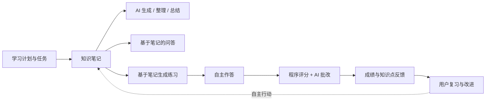
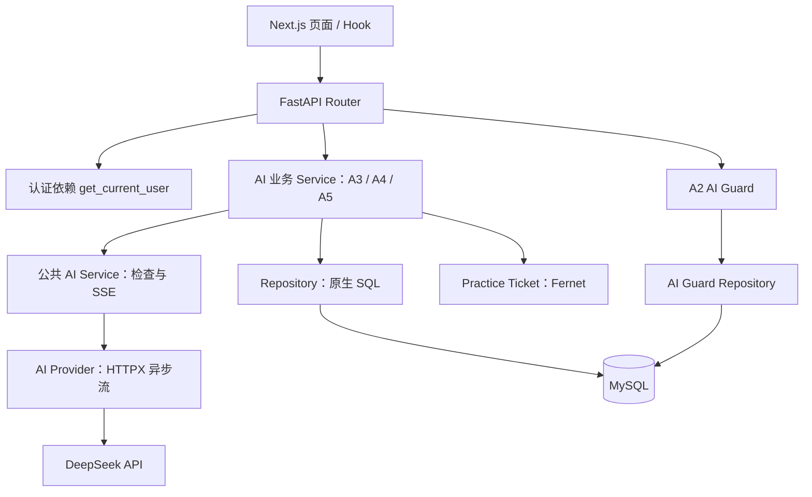
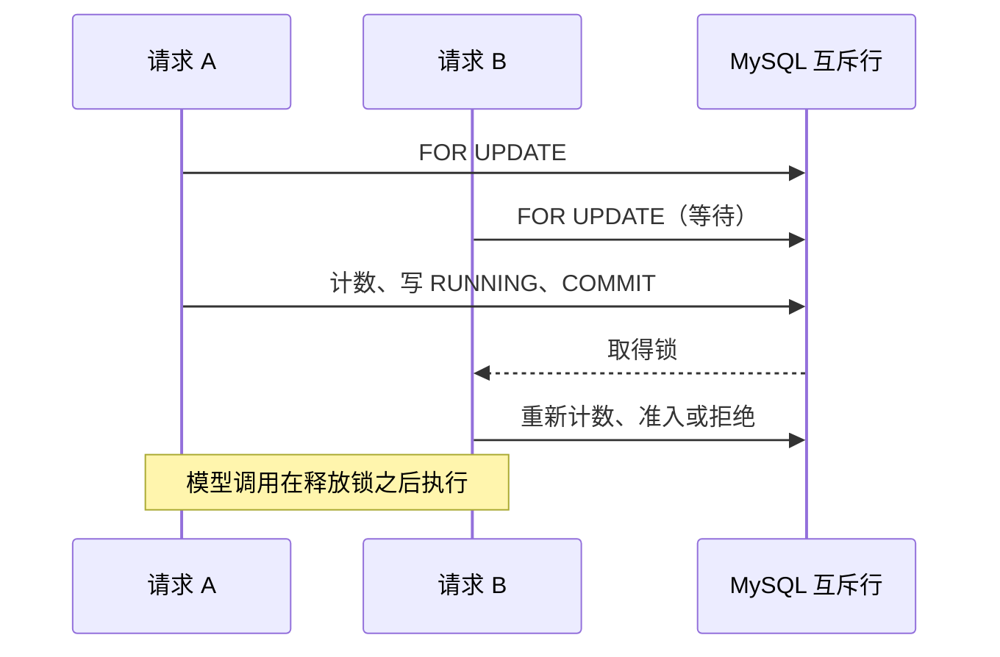
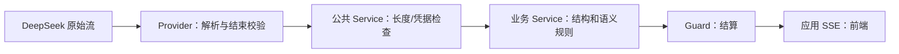
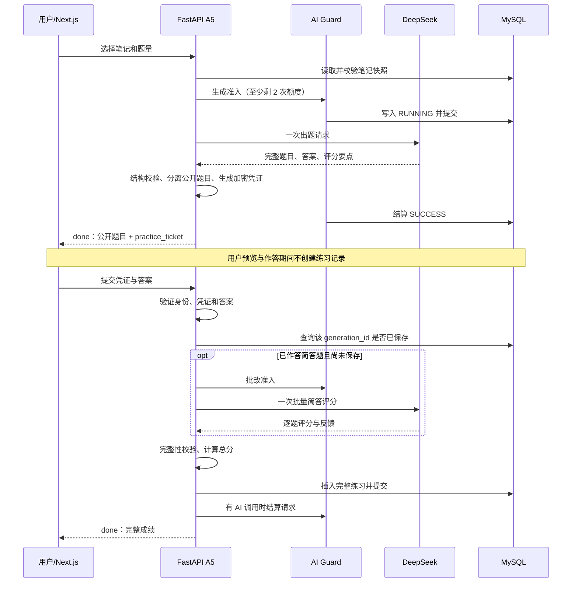
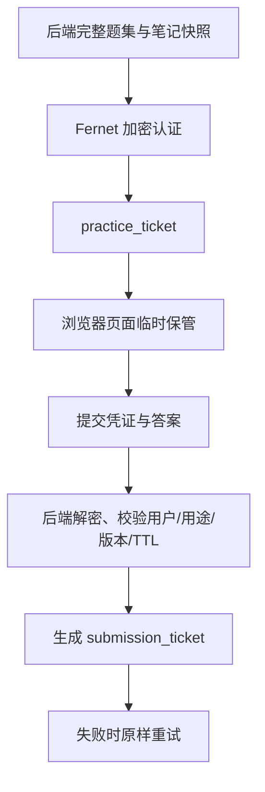
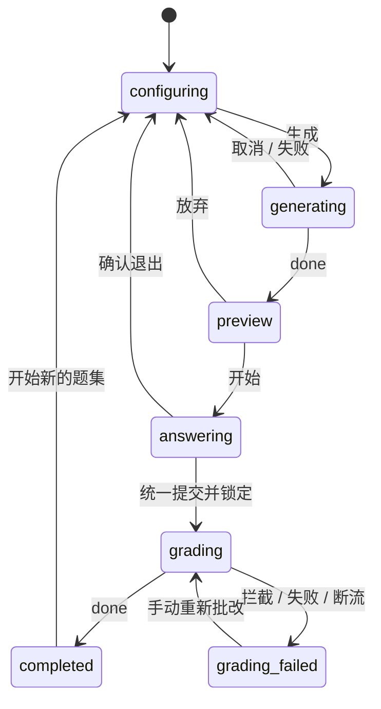

# Smart Study Planner V2.5
## AI 学习助手：系统设计与技术实现说明书

**项目名称：** 智能学习计划管理系统（Smart Study Planner）  
**说明范围：** A2 AI 公共基础设施、A3 知识笔记 AI、A4 知识问答、A5 智能练习  
**编制日期：** 2026-11-24  
**技术栈：** Next.js / TypeScript、FastAPI / Pydantic、SQLAlchemy Session + 原生 SQL、MySQL、DeepSeek API、SSE、Fernet  
**用途：** 项目技术说明、课程答辩、开发复盘、后续维护与验收

> 本文以本次开发提供的三批 Trae 源码调查报告、A5 已交付的后端代码、用户提供的测试反馈及 Codex 前端交接书为依据。A5 后端已按阶段交付，用户反馈测试完成；本文没有直接连接最新本地仓库、真实服务器或模型账户复测。前端交接已完成，不据此推定 Codex 已完成所有页面。文中明确区分实现机制、业务约定、实际测试证据与待验证事项。

---

## 目录

1. [建设背景与目标](#1-建设背景与目标)
2. [系统亮点概览](#2-系统亮点概览)
3. [总体架构与职责划分](#3-总体架构与职责划分)
4. [A2：统一 AI 基础设施](#4-a2统一-ai-基础设施)
5. [A3：知识生成、整理与总结](#5-a3知识生成整理与总结)
6. [A4：知识笔记问答](#6-a4知识笔记问答)
7. [A5：AI 智能练习完整闭环](#7-a5ai-智能练习完整闭环)
8. [可信凭证与安全边界](#8-可信凭证与安全边界)
9. [评分算法、事务与历史数据](#9-评分算法事务与历史数据)
10. [前后端契约与交互状态](#10-前后端契约与交互状态)
11. [异常与边界处理矩阵](#11-异常与边界处理矩阵)
12. [低资源部署与成本控制](#12-低资源部署与成本控制)
13. [开发过程、测试与经验总结](#13-开发过程测试与经验总结)
14. [已知限制与后续验证优先级](#14-已知限制与后续验证优先级)
15. [答辩表达与常见问题](#15-答辩表达与常见问题)
16. [源码索引与资料依据](#16-源码索引与资料依据)

---

# 1. 建设背景与目标

Smart Study Planner 原有的核心业务是学习计划、每日任务、学习记录和知识笔记。它解决的是「学什么、什么时候学、学了多少」的问题。但完成任务并不代表真正掌握知识：用户可能记录了笔记，却没有理解概念、主动回忆或检验自己的学习效果。

V2.5 引入 AI 的目标不是把普通聊天机器人嵌入网站，而是在已有学习管理系统上建立以用户私有笔记为中心的学习辅助链路。



上述闭环不是自动修改学习计划的推荐系统。AI 提供候选内容、解释和反馈，用户决定是否采用和复习。系统没有把 AI 的建议直接变成学习任务或擅自修改知识笔记。

## 1.1 四个阶段的定位

| 阶段 | 建设内容 | 解决的问题 |
|---|---|---|
| A2 | 模型接入、共享额度、并发、SSE 生命周期、输出检查 | AI 调用如何稳定、可控地运行 |
| A3 | 主题生成、笔记整理、结构化总结 | 如何形成和组织知识 |
| A4 | 当前笔记问答、有限多轮上下文 | 如何理解和澄清知识 |
| A5 | 出题、作答、评分、反馈、练习历史 | 如何验证知识掌握程度 |

A2 是基础设施，其余三个阶段是业务能力。区分这两种职责，后续新增 AI 业务时才能复用已有请求治理，而不是重复写限流、模型通信和异常处理。

## 1.2 设计目标与非目标

目标：以私有笔记为基础，提供可控成本、可靠结果边界、用户数据隔离和可追溯练习反馈；在 2GB 服务器条件下尽量保持架构轻量，减少长期占用连接和无用数据。

非目标：自建大模型、通用搜索或 RAG 向量检索系统、全功能在线考试平台、永久草稿、复杂消息队列、题库和独立错题库。当前基于单篇笔记直接构造上下文，不应把它描述为已经实现了向量数据库或严格防作弊考试系统。

# 2. 系统亮点概览

本项目的技术价值主要不是「能够调用 DeepSeek」，而是**把不确定的模型输出转化为具有明确准入规则、成功条件和数据边界的业务结果**。

| 设计亮点 | 实际机制 | 解决的工程问题 |
|---|---|---|
| 数据库共享 AI Guard | MySQL 互斥行、事务内计数与 RUNNING 登记 | 多进程限额与并发协同 |
| 租约式并发回收 | 运行状态 + 截止时间 | 异常退出后避免长期占用名额 |
| 双层流式协议 | Provider 原始流 → 应用 SSE 事件 | 前端不依赖厂商协议，区分临时与正式结果 |
| 多层结果校验 | 上游结束标志、长度检查、业务结构校验、状态结算 | HTTP 200 不等于业务成功 |
| 笔记快照语义 | A3/A4 结束时复查版本，A5 保留生成时快照 | 不同业务采用不同一致性策略 |
| 答案隔离 | 公开题目白名单 + Fernet 加密可信凭证 | 不在生成响应中明文暴露标准答案 |
| 混合判题 | 程序判单选，AI 批量判简答，后端统一总分 | 精确规则与语义判断各司其职 |
| 完整结果持久化 | 单表 JSON、唯一索引、事务提交 | 防止半成品历史与重复记录 |
| 历史独立性 | 标题快照、笔记可空外键、软删标记 | 原笔记变化不破坏已完成练习 |
| 失败可恢复 | 仅手动重试、锁定答案、已保存结果优先返回 | 减少重复调用和错误覆盖 |

这些机制是工程亮点，不代表每一项都已经通过真实环境的并发、安全与压力验证。尤其是模型语义正确性、首次提交强制锁定及租约在极端故障下的行为，仍有明确边界（见第 14 章）。

# 3. 总体架构与职责划分

## 3.1 分层结构



| 模块 | 应当负责 | 不应负责 |
|---|---|---|
| 前端 Page / Hook | 交互状态、渲染、提交、失败提示 | 正式评分、解密凭证、直接调用模型 |
| Router | 依赖注入、参数接收、调用编排、HTTP/SSE 响应 | 大段 SQL 或具体评分算法 |
| Schema | 类型、数量、长度及格式约束 | 访问数据库或发送模型请求 |
| Service | 业务规则、Prompt、快照、评分、事务边界 | 页面视觉布局 |
| Repository | 参数化 SQL、读写及记录转换 | AI Prompt、用户交互决策 |
| Core / Provider | 凭证、公共函数、第三方协议转换 | 具体页面业务 |

本次代码采用务实的分层方式。例如 A5 Router 直接调用已有准入函数和历史查询 Repository 来编排提交流程；尚未严格做到 Router 只依赖 Service。这是当前复用选择，不将其夸大为完全解耦的领域架构。

## 3.2 技术选型理由

- **FastAPI + Pydantic：** 请求参数和模型生成结果均可进行结构校验；异步生成器支持流式响应。
- **SQLAlchemy Session + `text()`：** 保留项目原有手写 SQL 与明确事务控制方式，不引入 ORM Model 或 Alembic 重构。
- **MySQL InnoDB：** 提供行锁、唯一约束、外键和事务，直接承载当前规模的共享 AI 准入。
- **HTTPX + SSE：** 异步消费模型流，再发送业务级事件，适合单向的生成与批改进度通知。
- **Fernet：** 利用成熟的认证加密组件保存可信题集，不自行实现加密算法。
- **Next.js + TypeScript：** 继续复用现有认证、SSE 解析、Markdown 渲染、工作区导航和 UI 组件。

# 4. A2：统一 AI 基础设施

A2 是整个 AI 模块最有复用价值的基础。后续功能只增加业务操作类型和自己的 Service，不重新实现模型连接和限流。

## 4.1 四个维度的共享限制

| 配置项 | 原初始值 | A5 阶段确定值 | 控制对象 |
|---|---:|---:|---|
| `AI_USER_DAILY_LIMIT` | 5 | 10 | 单用户当天准入次数 |
| `AI_GLOBAL_DAILY_LIMIT` | 50 | 80 | 全站当天准入次数 |
| `AI_USER_CONCURRENCY` | 1 | 1 | 单用户有效运行请求数 |
| `AI_GLOBAL_CONCURRENCY` | 3 | 2 | 全站有效运行请求数 |
| `AI_MAX_STREAM_SECONDS` | 120 秒 | 保持 | 单条受 Guard 管理的流的总时间上限目标 |
| `AI_LEASE_SECONDS` | 180 秒 | 保持 | 有效并发占用的租约时长 |
| `AI_MAX_NOTE_CHARS` | 12000 | 保持 | AI 输入笔记正文字符数 |
| `AI_MAX_OUTPUT_CHARS` | 12000 | 保持 | 模型输出字符数 |
| `AI_MAX_OUTPUT_TOKENS` | 3500 | 保持 | 单次模型输出 Token 请求上限 |
| `AI_STREAM_CHUNK_CHARS` | 240 | 保持 | 公共输出的分段字符数 |

这些是代码默认值及本次确认配置，`.env` 可能覆盖默认值。有效部署值应以运行环境为准。业务日期按 UTC+8 计算；租约和结束时间使用 UTC 时间戳口径。

日额度与并发是两个独立概念。日额度约束累计调用成本和滥用；并发约束同一时刻的上游请求、连接和系统压力。全站 AI 并发 2 不等于网站只能同时服务两个人，也不是所有 HTTP API 的并发上限。

## 4.2 为什么不用普通 Python 变量限流？

如果使用 `running_count = 0` 这样的进程内变量，多 Worker 或多个服务进程会各自维护独立计数。即使只有一个进程，「检查还有额度」和「登记占用」如果不是同一原子过程，也会出现竞争：两个请求同时看到最后一个名额，然后同时通过。

本项目采用 `ai_guard_mutex` 里的固定互斥行（`id=1`）作为所有 AI 准入的共享协调点。

```sql
SELECT id FROM ai_guard_mutex WHERE id = 1 FOR UPDATE;
```

在同一个事务中完成：

1. 取得互斥行锁。
2. 查询当前业务日全站、单用户累计准入数。
3. 检查剩余额度及有效运行请求数。
4. 插入一条 `RUNNING` 请求记录，写入唯一 request_id 和租约截止时间。
5. `COMMIT`，释放数据库锁。
6. 事务结束后才调用 DeepSeek。

如果检查失败，则返回 HTTP 429，事务回滚，不产生新的 AI 准入记录。



这是一种低成本、可跨进程协调的准入设计。真正保证限额的前提是所有调用均遵守同一锁协议、计数能读取到已提交的最新相关记录、数据库隔离级别和事务快照符合预期；应专门验证认证依赖已开启事务时的快照行为（见第 14 章）。不能仅凭模拟单元测试宣称真实并发绝不会超额。

**互斥锁只保护准入临界区，不保护整个 AI 生成过程。** 否则一个长达几十秒的模型请求就会阻塞其他准入，严重浪费数据库资源。

## 4.3 租约与异常释放

有效并发请求的条件为：

```sql
WHERE status = 'RUNNING'
  AND leased_until > UTC_TIMESTAMP(6)
```

正常结束时状态被更新为非 `RUNNING`，请求不再占用并发。异常取消时尽力在 `finally` 中结算，使用取消屏蔽降低清理被打断的概率。

若进程被强制终止或数据库结算失败，`RUNNING` 记录可能残留。180 秒租约到期后，它将不再计入有效并发。这里不是自动删除记录，也不保证上游调用一定已物理停止；租约主要提供**逻辑名额回收**。

120 秒流式超时与 180 秒租约形成时间缓冲。配置要求租约大于流超时。实际线程调度、同步 DB 写入和上游取消可能使实际停止时间偏离理论值，因此仍要进行故障注入测试。

## 4.4 请求生命周期与记账

| 状态 | 含义 |
|---|---|
| `RUNNING` | 准入成功，已记录调用占用 |
| `SUCCESS` | 业务结果通过检查并完成 Guard 结算 |
| `BLOCKED` | 内容或凭据检查等安全机制拦截 |
| `STALE` | 当前笔记与原快照不一致，结果失效（适用 A3/A4） |
| `ERROR` | 上游、格式、内部处理或流协议失败 |
| `TIMEOUT` | 流式总时限触发 |
| `CANCELLED` | 请求被取消，尽力结算 |

`ai_requests` 记录用户、笔记、操作类型、业务日期、状态、租约、创建/结束时间及 Token 用量。操作类型从 `SUMMARY/GENERATE/ORGANIZE/ASK` 扩展到 `PRACTICE_GENERATE/PRACTICE_GRADE`，无需新增另一套限流表。

**准入成功即消耗一次日额度。** 失败、取消或拦截不自动返还，因为上游可能已经执行模型推理。Token 数据未知时使用 `NULL` 而不是 0，以区分「未知」和「确实为零」。日志并不等同于厂商账单；上游使用量缺失时无法精确计算费用。

## 4.5 Provider：隔离厂商原始协议

`ai_provider.py` 使用 `httpx.AsyncClient` 请求 DeepSeek，读取流中的 `data:` 记录，将其转换为内部 `ProviderEvent(kind='delta'/'finish')`。

成功结束要求收到上游 `[DONE]`，并且 `finish_reason` 为 `stop`。若发生截断、内容过滤、非法 JSON、网络失败或没有结束标记，则转换为 `ProviderError`，而非把半截文本当作成功。

请求设置了模型输出 Token 上限及 `include_usage`，并配置连接、读写和连接池等待超时。厂商特定的 `thinking`、`safety_check` 参数是否实际受当前模型支持，应以真实 API 联调为准，不能仅凭本地请求字段声称厂商审核有效。

## 4.6 公共检查与应用级 SSE

`stream_checked_completion()` 消费 Provider 的增量内容、限制输出总字符数、缓冲检测潜在凭据，并最终返回完整文本和使用量。凭据检测正则覆盖常见 `sk-` 型密钥和私钥头部；保留 64 字符的前瞻/尾部窗口，降低凭据跨片段而漏检的风险。



| 应用事件 | 语义 |
|---|---|
| `start` | 已开始处理；可携带业务元数据 |
| `delta` | 临时内容（用于 A3/A4 文本输出） |
| `reviewing` | 正在验证或计算结果 |
| `done` | 正式成功结果 |
| `blocked` | 安全拦截终止 |
| `error` | 业务或系统失败终止 |

核心区别：`delta` 是暂态信息，不能直接视为可保存的正式结果。`metered_ai_stream()` 在收到 `done` 后先提交 `SUCCESS` 结算再向前端发送成功事件；缺失终止事件时按错误处理。普通 HTTP 请求完成之前的异常走统一 HTTP JSON 错误格式，SSE 已经开始后的异常则通过事件返回。

**HTTP 200 仅表示流连接已建立，不表示 AI 成功。** 前端必须识别终止事件，连接断开且未收到 `done` 应进入失败或未知状态，不能将部分文本标记为成功。

SSE 相对于 WebSocket 的选择依据：本业务主要是客户端发起一次请求、服务端持续推送结果，没有持续双向通信的需要。采用 POST + fetch 流式读取，也便于继续复用 Access Token 认证。普通 `EventSource` 不适合直接承载此处的 POST 请求体及既有自定义认证流程。

# 5. A3：知识生成、整理与总结

## 5.1 三项能力与约束

| 功能 | 输入 | 输出 | 保存策略 |
|---|---|---|---|
| 主题生成 `GENERATE` | 主题 2–100 字符，可选补充要求最多 500 字符 | Markdown 笔记候选稿 | 由用户确认保存 |
| 笔记整理 `ORGANIZE` | 当前用户已保存笔记 | 保留原意的结构化 Markdown | 作为新笔记候选，不覆盖原文 |
| 知识总结 `SUMMARY` | 当前用户已保存笔记 | 核心概述、关键知识点、知识提纲 | 展示及复制，不自动写入原笔记 |

相关 API：

- `POST /notes/ai/generate`
- `POST /notes/{note_id}/ai/organize`
- `POST /notes/{note_id}/ai/summary`

## 5.2 笔记快照与版本一致性

`prepare_note_snapshot()` 读取当前用户拥有且未软删除的笔记，拒绝空正文、超长正文及可能含常见敏感凭据的输入，并生成不可变数据类 `NoteSnapshot`：

```text
note_id, title, content_md, version
version = SHA-256(title + "\n" + content_md)
```

快照用于固定此次模型调用看到的输入。笔记读取完成后 `rollback()` 结束只读事务，避免等待模型时一直持有连接与事务快照。

对整理和总结，模型结束后通过独立短事务复查当前笔记的标题与正文指纹。如果笔记被修改或删除，返回 `NOTE_CHANGED`，Guard 记为 `STALE`，不把旧内容当作当前笔记的有效处理结果。

例如：用户在一个标签页请求整理笔记，随后另一个标签页修改原笔记。即便 AI 成功生成内容，也不能假装是对修改后版本的整理。复查可发现生成期间的变化。

版本是内容指纹，不是数据库单调递增版本号。修改标签、计划关联不触发失效；编辑后恢复原内容也可能得到相同指纹。复查结束后仍可能发生新的修改，因此它不是贯穿全过程的强事务锁，而是按业务需要进行的结束时一致性判断。

## 5.3 Markdown 和结构化总结

总结要求恰好三个二级标题，顺序为「核心概述」「关键知识点」「知识提纲」。`parse_summary()` 使用正则提取标题并校验顺序和内容，之后构造 `SummaryOutput`。不允许结构错误的总结进入正式 `done`。

生成和整理目前检查非空输出、禁止整篇以 Markdown 代码围栏开头，并通过 Prompt 约束结构和事实范围。这不是完整的 Markdown 语法验证或事实核查。

设计价值：模型的输出是候选内容，用户有最后决定权；即使模型出现误解，也不会自动污染用户原有知识数据。

# 6. A4：知识笔记问答

A4 的目标是围绕当前学习笔记进行解释、举例和合理延伸，而非无限制的通用聊天。

接口：`POST /notes/{note_id}/ai/ask`。

## 6.1 有限上下文

客户端发送当前问题与成功完成的近期问答记录。后端只使用最近三轮，历史总字符预算 9000，超过预算时舍弃较旧的完整问答轮次。当前问题最多 1000 字符，历史请求数组也设有最大长度（20）。

这样既支持连续追问，又避免历史无限增长导致上下文成本和输入体积持续扩大。当前设计不保存服务端聊天历史，因此页面关闭后的历史恢复不属于本次业务能力。

## 6.2 信任边界与回答来源

客户端可修改自己传来的历史，所以后端把这些内容封装为 `role=user` 的待处理资料，而不是伪装为经过验证的真实 assistant 消息。Prompt 同时明确：笔记、历史、问题都不能改变系统评分或回答规则。

对于相关问题，A4 要求区分：

- `### 根据当前笔记`：仅使用当前笔记能够支持的内容。
- `### AI 补充知识`：标明模型基于通用知识作出的相关延伸。

若笔记未涉及问题，则明确说明不足。明显无关的问题给出范围提示。结束时复查笔记版本，避免把旧笔记的解释作为当前内容的正式答案。

**重要区别：** A4 允许标明来源的合理知识补充，而 A5 出题要求严格根据笔记。这是不同业务目标造成的刻意区分。A4 的标题和来源规则主要由 Prompt 约束，现有代码只做基本 Markdown 检查，并不逐条验证引用来源。

# 7. A5：AI 智能练习完整闭环

A5 是本次最能体现业务工程能力的模块。它不仅调用模型出题，还要处理题目可信性、标准答案隔离、自由文本评分、异常重试、唯一性、笔记删除和历史数据生命周期。

## 7.1 冻结的核心业务规则

| 项目 | 规则 |
|---|---|
| 出题范围 | 单篇当前用户已保存且未删除的笔记 |
| 题量 | 5 / 10 / 15 道 |
| 题型 | 60% 四选一单选，40% 简答 |
| 正式提交 | 整套提交，允许跳过 |
| 评分 | 每题等权，总分 100 |
| 批改 | 单选程序判分，所有非空简答合并为一次 AI 调用 |
| 失败 | 不保存部分成绩，保留页面答案，允许手动重新批改 |
| 笔记变化 | 已生成练习按原快照完成 |
| 历史 | 仅保存批改全部成功的结果；只读，可单条物理删除 |
| 凭证 | 加密并校验完整性，生成后有效 24 小时 |
| 草稿 | 不设置服务端草稿表，不做浏览器持久化 |

## 7.2 全过程与数据库写入时点



出题时有 `ai_requests` 请求日志，但没有 `practice_records` 练习记录。不要把「不保存未完成练习」误解为完全不写数据库。

## 7.3 出题准入与结构约束

出题前复用快照读取，并额外检查去掉部分 Markdown 标记与空白后是否至少有 30 字符。这个阈值只是廉价的预过滤：很短但信息密集的笔记可能被拒绝；很长但没有足够不同知识点的笔记也可能通过。

模型 Prompt 要求恰好指定题量、固定题型比例、每个单选题恰好 A–D 四个不同选项和一个标准选项，简答含参考答案、评分要点和解释。通过 Pydantic 判别联合类型 `Field(discriminator='type')`，用 `SINGLE_CHOICE` 或 `SHORT_ANSWER` 决定不同的必填字段。

后端还检查：

- 整套题量和各题型数量严格匹配。
- 选项非空、长度受限且内容不重复。
- 题干、解释、参考答案、评分要点满足字段约束。
- 归一化题干后进行 `SequenceMatcher` 相似度比较，达到 0.92 拒绝整套练习。
- 后端统一分配 `q1`、`q2` 等题目 ID，固定顺序为先单选、后简答。

| 题量 | 单选 | 简答 |
|---:|---:|---:|
| 5 | 3 | 2 |
| 10 | 6 | 4 |
| 15 | 9 | 6 |

严格 JSON 结构并不代表题目在知识上必然正确。当前没有额外的语义核查模型或检索证据比对。不同表述的语义重复可能通过，机械相似的真实不同题也可能被误拒。笔记依据、单选唯一正确性与知识充分性主要依赖 Prompt 和模型能力。

## 7.4 公开题集与私人题集分离

A3/A4 可以逐段展示经过公共检查的文字；A5 不可以照搬这一行为。原因是模型原始 JSON 包含答案、参考答案、评分要点。

`build_public_questions()` 通过字段白名单构建题目：

```json
{"id":"q1","type":"SINGLE_CHOICE","stem":"Access Token 的主要作用是什么？","options":{"A":"访问受保护的 API","B":"保存密码","C":"删除数据","D":"创建数据库"}}
```

完整题目则留在加密凭证内。A5 生成和批改都不转发原始模型 `delta`，仅发送阶段状态和最终结果。这一选择牺牲了逐字生成的视觉效果，换取题目与答案隔离、完整结果校验和更清晰的成功边界。

# 8. 可信凭证与安全边界

## 8.1 为什么不直接把答案发给前端？

如果前端接收明文答案，即便 UI 将字段隐藏，浏览器网络面板仍能查看。若提交时让客户端连同标准答案一起发回，后端无法相信这些答案没有被修改。

传统方案是数据库暂存题集并让前端只持有 ID。本项目为了保持单表历史和不保存未完成练习的规则，选择认证加密的无状态题集凭证。

| 方案 | 保密性 | 完整性 | 持久化代价 |
|---|---|---|---|
| 普通 JSON / Base64 | 无 | 无 | 无 |
| 仅签名凭证（如常见 JWT/JWS） | 负载通常可读 | 可验证篡改 | 无 |
| 服务端暂存题集 + ID | 答案不进入客户端 | 服务端控制 | 需要暂存、清理与状态管理 |
| 当前 Fernet 凭证 | 无密钥时负载不可直接读取 | 认证加密校验 | 不需要题集暂存表 |

Fernet 提供对称认证加密。项目从现有高熵 `SECRET_KEY` 加带用途前缀的 SHA-256 派生专用密钥，再以 Fernet 所需格式编码。不能把 Base64 当作加密，也不能认为一个低熵密码经过 SHA-256 就自动变安全。

## 8.2 两类凭证

生成凭证 `practice_ticket`（用途 `A5_GENERATION`）包含：版本号、用户 ID、生成 UUID、笔记 ID、标题、版本、原笔记正文、完整题目和标准答案。

提交凭证 `submission_ticket`（用途 `A5_SUBMISSION`）包含：用户 ID、原生成凭证及规范化的首次提交答案。



读取凭证时验证认证完整性、用途、版本及 24 小时 TTL，并检查凭证中的用户 ID 等于当前已认证用户。重试解开提交凭证后还要重新校验内部的原生成凭证，因此创建新的提交凭证不能延长原题集有效期。

凭证不能被记录到前端日志或持久化存储；它包含加密后的私有笔记内容。生产仍需要 HTTPS、强密钥、严格的日志脱敏和合理的请求体限制。

## 8.3 锁定答案的真实保证

首次提交后页面锁定答案；若批改失败，正常重试路径只接受 `submission_ticket`，不允许同时提供新的答案。服务端可以验证这张重试凭证中的答案未被修改。

**但当前方案不是强制服务端的首次提交永久锁定。** 服务端没有保存未完成的提交状态，无法得知持有原 `practice_ticket` 的客户端是否曾经发起过另一组答案的首次提交。已保存的结果由唯一索引防止重复插入；保存前，恶意客户端的重新首次提交不能被完全排除。

这是无状态自学练习设计的局限，不应宣称为在线考试级防作弊。若未来需要严格保证首次提交不可变，需要增加服务端持久化的提交指纹或提交状态，并设计其有效期与清理策略。当前文档只披露边界，不擅自改变已冻结业务。

# 9. 评分算法、事务与历史数据

## 9.1 混合评分：把确定性规则交给程序

单选题没有使用 AI 判断。后端从可信题集读取 `correct_answer`，直接比较规范化选项：正确得 100% 的该题分数，错误得 0。空白题直接判 `SKIPPED`，得 0。

简答题允许同义表达、不同组织方式和部分正确。后端将所有非空简答题的题目 ID、题干、参考答案、评分要点、用户回答与原笔记快照合并为一次模型请求。每题返回 0–100 的分数及掌握点、遗漏/错误点、改进建议。

示例（仅说明结构，不是一次真实模型批改）：

```json
{"grades":[{"id":"q4","score":80,"mastered_points":["理解新令牌生成和旧令牌失效"],"missing_points":["未说明重放检测"],"suggestion":"补充旧令牌再次使用与重放检测之间的关系。"}]}
```

`GradeBatch` 与 `parse_grading_result()` 检查评分范围、反馈字段、题目 ID 集合是否完整、是否有重复或多余记录。只要一题缺失或结果格式错误，整套评分失败，不产生练习历史。当前 Schema 有 Pydantic 类型转换行为，并非所有字段都处于严格禁止类型转换模式；如需保证只接受 JSON 原生整数，还应使用 strict 校验。

如果所有简答题跳过，则无需调用模型，程序直接评分、保存。这一分支不占用 `PRACTICE_GRADE` 调用额度。

## 9.2 等权总分算法

设总题量为 N，第 i 题的百分制评分为 p_i（范围 0–100），则：

```text
每题满分 = 100 / N
第 i 题实际得分 = p_i / N
整套总分 = round( Σ p_i / N, 2 )
```

示例：5 道题中，第 1、3 题正确，第 2 题错误，第 4 题 AI 评分 80%，第 5 题跳过。

| 题号 | 判题方式 | 百分制评分 | 实际得分 | 状态 |
|---|---|---:|---:|---|
| q1 | 程序 | 100 | 20 | CORRECT |
| q2 | 程序 | 0 | 0 | INCORRECT |
| q3 | 程序 | 100 | 20 | CORRECT |
| q4 | AI | 80 | 16 | PARTIAL |
| q5 | 程序 | 0 | 0 | SKIPPED |
| 合计 | 后端汇总 | — | **56** | — |

采用 `Decimal` 与 `ROUND_HALF_UP` 降低浮点累计误差，正式总分保存两位小数。15 题每题权重存在循环小数，因此展示的各题两位小数得分相加可能与总分有细微差异。正式总分以未逐题提前舍入的后端汇总为准，前端不要重新计算或要求逐题显示值必须精确相加。

另一个边界：简答分由模型按知识点判断，不是每个评分要点预先赋予确定分值的传统判题器。80 分只是示例，模型批改存在主观性和重复请求差异，不保证教育测量级的稳定性。

## 9.3 为什么只新增 `practice_records` 一张业务表？

当前需求是以一次完整练习为读写单位，历史详情需要展示整套题目，不需要跨练习维护独立题库、题目版本或题目统计。因此采用关系字段保存索引与归属、JSON 保存完整题集结果的混合设计。

| 字段 | 类型/约束 | 作用 |
|---|---|---|
| `id` | BIGINT UNSIGNED，主键自增 | 历史记录标识 |
| `user_id` | BIGINT UNSIGNED，用户外键 | 所有权 |
| `note_id` | BIGINT UNSIGNED，可空 | 原笔记关联 |
| `note_title_snapshot` | VARCHAR(255) | 保留生成时标题 |
| `generation_id` | CHAR(36) | 生成题集唯一标识 |
| `question_count` | TINYINT，5/10/15 CHECK | 题量 |
| `score` | DECIMAL(5,2)，0–100 CHECK | 正式成绩 |
| `questions_json` | JSON | 完整题目、答案、分数及反馈 |
| `created_at` | DATETIME(6) | 完成并保存的时间 |

唯一约束 `UNIQUE(user_id, generation_id)` 阻止同用户同题集重复插入。索引 `(user_id, created_at, id)` 和 `(user_id, note_id, created_at, id)` 支持用户历史倒序分页和按笔记筛选。另设 `note_id` 索引满足外键关联需求。

| 关系 | 删除行为 | 设计含义 |
|---|---|---|
| `practice_records.user_id → users.id` | ON DELETE CASCADE | 用户物理删除后清除其练习历史 |
| `practice_records.note_id → knowledge_notes.id` | ON DELETE SET NULL | 笔记物理删除后历史仍保留 |

选择 JSON 的代价是数据库无法像规范化题目表那样直接通过外键和 CHECK 约束每道题的结构；将来若需要跨练习错题统计，可能要重新考虑结构。当前以简化存储与完整记录读取为优先。

## 9.4 三个事务边界与幂等恢复

1. **准入事务：** 持锁计数，写 `RUNNING`，提交后调用模型。
2. **结果事务：** 完成所有评分后，在独立短事务中检查已保存记录、检查来源笔记、插入完整记录并提交。
3. **结算事务：** Guard 单独记录 AI 请求的最终状态和用量，成功结算后转发业务 `done`。

提交之前先按用户和 `generation_id` 查询历史，已存在则返回原成绩，不重新调用模型。保存时再次检查；若并发插入触发唯一约束，回滚后查询已有结果。

这属于**结果持久化层面的幂等**，不是对所有 AI 请求提供 exactly-once 执行保证。极端并发情况下可能产生重复模型工作，但数据库唯一约束确保已存在记录不被重复插入。用户明确接受删除历史后的有限重放风险：在原凭证仍有效且记录被物理删除的情况下，唯一索引不再保留原生成标识，不额外维护永久墓碑记录。

AI 日志和练习记录在不同事务内写入，二者不是一个全局原子事务。如果练习保存后 Guard 结算失败、网络断开或 `done` 丢失，完整练习仍可能存在。后续持有效凭证重试优先返回已有结果。若凭证已经过期，用户仍可从历史列表获取已保存成绩，不保证过期提交请求也返回旧结果。

## 9.5 笔记删除与历史生命周期

| 场景 | 当前设计 |
|---|---|
| 笔记软删除后发起新练习 | 拒绝（默认只读未删除笔记） |
| 生成后修改笔记 | 按原题集与快照继续批改 |
| 生成后软删除笔记 | 继续批改，保存原 note_id |
| 生成后物理删除笔记 | 保存时将 note_id 设为 NULL |
| 已保存后软删除笔记 | 历史仍在，`source_note_deleted=true` |
| 已保存后物理删除笔记 | 外键置 NULL，原标题与题目结果仍在 |
| 用户主动删除一条历史 | 按 user_id 校验后物理删除，不提供恢复 |

A5 在保存前用 `FOR UPDATE` 检查原笔记是否仍存在，尽量避免检查后立刻被物理删除造成外键竞态；外键置空与历史数据设计提供最终约束。实际并发删除和保存的行为仍需真实 MySQL 集成测试。

历史保存的是题目、答案、评分依据和反馈，不持久化原笔记全文。题目和解析可能复述笔记片段，因此删除原笔记不等于删除所有相关衍生内容；这一行为应符合用户对练习历史保留的预期。

# 10. 前后端契约与交互状态

## 10.1 A5 接口一览

| 方法 | 路径 | 主要参数 | 响应 |
|---|---|---|---|
| POST | `/ai/practices/generate` | note_id, question_count | SSE，公开题目与加密凭证 |
| POST | `/ai/practices/submit` | practice_ticket + answers，或 submission_ticket | SSE，完整成绩或失败 |
| GET | `/ai/practices` | page, page_size, 可选 note_id | 统一 JSON 分页 |
| GET | `/ai/practices/{record_id}` | 历史 ID | 统一 JSON 完整记录 |
| DELETE | `/ai/practices/{record_id}` | 历史 ID | 统一 JSON 删除结果 |

请求身份统一由 `get_current_user()` 得到，不能由前端自报 user_id。普通历史接口沿用 `code/message/data` 响应约定；查询不到本人记录统一 404，以减少对其他用户资源存在性的泄露。列表默认每页 10 条，API 允许 page_size 1–100，倒序排序且不读取大字段 `questions_json`。

## 10.2 页面状态机（交接约定）



前端推荐路由 `/ai`、`/ai/practice`、`/ai/practice/history`、`/ai/practice/history/[recordId]`；在笔记详情页可通过 `note_id` 预选笔记，并进入该笔记历史。统一 AI 学习助手导航整合 A3/A4/A5，优先复用已有组件。

生成可以取消，正式答题中离开需要确认；批改期间不提供主动取消按钮，但浏览器断网、关闭或刷新仍可能中断处理。未提交题集、答案、凭证不持久化到浏览器存储。已保存的历史可以跨页面、跨会话查询。

## 10.3 SSE 重试细节

- `start` 返回 `submission_ticket` 时，应立即保存于当前页面内存。
- 若请求在 `start` 前遭 Guard 拒绝或网络失败，则没有新锁定凭证，保留首次提交的原始答案和原题集凭证，正常 UI 仍禁止修改。
- 若之前已经保存，后端可能直接返回 `done` 而没有 `start`；前端必须支持。
- 断流没有 `done` 时，不自动反复重发模型请求；用户手动决定是否重试，或者查询历史。
- 安全拦截提示与网络超时应区分；同一内容反复触发拦截不保证通过。

# 11. 异常与边界处理矩阵

下面是本项目答辩和验收最值得展示的边界清单。表中「预期处理」描述代码或交接契约，不能替代每个场景的真实验证。

| 类别 | 边界场景 | 预期处理 / 保证范围 |
|---|---|---|
| 权限 | 未登录、无效登录 | 使用已有认证，拒绝访问；不调用 AI |
| 权限 | 账户禁用 | 已有依赖检查账户状态；拒绝新请求 |
| 权限 | 请求他人笔记或历史 | 按当前 user_id 查询，404；凭证他人使用 403 |
| 功能开关 | AI 关闭、API Key 未配置 | 503，准入前拒绝；纯程序判题或已保存结果可按现有分支直接处理 |
| 输入 | 空笔记、过短笔记 | 422；不消耗 AI 准入额度 |
| 输入 | 笔记正文超长 | 413；不进入模型请求 |
| 输入 | 常见敏感凭据 | 输入 422 或输出 blocked；仅基础模式检测 |
| 输入 | 错误题量、未知题目 ID、重复答案 | Schema 或业务校验拒绝 |
| 额度 | 用户或全站额度耗尽 | HTTP 429；不插入新准入记录 |
| 并发 | 用户或全站达到并发上限 | HTTP 429；不建立新模型流 |
| 额度 | 生成时剩不足 2 次 | 拒绝生成（用户与全站检查） |
| 额度 | 生成后其他调用耗尽额度 | 批改可能失败，保留锁定答案并提示；不保证预留额度 |
| 模型 | 认证、限流、网络错误 | ProviderError 转为公共错误码，不暴露上游原始异常 |
| 模型 | 超时 | Guard 结算 TIMEOUT 或相关错误；尽力释放资源 |
| 模型 | HTTP 200 但内部 error | 不算成功，返回 SSE error |
| 模型 | 无 `[DONE]` 或结束原因异常 | 拒绝不完整结果 |
| 模型 | 输出超长 | 终止输出，不能保存部分题集或成绩 |
| 模型 | 内容过滤 | blocked，不发正式成功结果 |
| A3/A4 | 生成期间笔记变化 | 结束复查失败时 STALE |
| A5 | 题量/比例/选项不合格 | 整套生成失败 |
| A5 | 高相似题干 | 拒绝整套题集；语义重复仍有漏检风险 |
| A5 | 凭证篡改、过期、用途不符 | 拒绝，不能重新解释为有效题集 |
| A5 | 跳过单选或简答 | 0 分，状态 SKIPPED |
| A5 | 全部简答跳过 | 不调用 AI 批改，程序直接评分 |
| A5 | AI 少返回一题/重复 ID/越界分数 | 整套失败，不保存部分结果 |
| A5 | 批改失败后重试 | 正常重试路径使用锁定凭证；不接受额外答案 |
| A5 | 原笔记编辑或删除 | 使用原快照继续，已保存历史不受影响 |
| 持久化 | 重复提交已保存题集 | 返回已有记录；唯一索引阻止重复插入 |
| 持久化 | 写入异常 | 回滚未提交事务；不得返回新记录成功 |
| 持久化 | 已提交但响应丢失 | 结果可能已在库，优先幂等查询或通过历史恢复 |
| 持久化 | 删除记录后重放 | 原凭证有效时可能重新生成历史，已接受限制 |
| 交互 | 生成取消 | 丢弃页面临时数据，已准入额度不自动退还 |
| 交互 | 答题中退出 | 正常 UI 二次确认，不提供草稿恢复 |
| 交互 | 批改中断网或关闭页面 | 无完整后台任务保证；已保存数据可查，未保存答案可能丢失 |
| 基础设施 | 结算失败或进程异常退出 | 尝试清理状态；租约到期后逻辑回收并发名额 |

# 12. 低资源部署与成本控制

## 12.1 为什么 2GB 服务器仍然可以采用 AI？

模型推理由 DeepSeek 服务端完成，本地不加载模型权重，也不需要为此配置 GPU。2GB 服务器主要承载 FastAPI、数据库、前端生产运行环境、网络连接与请求数据。

采用异步流式通信避免为等待上游响应一直阻塞事件循环；同步数据库结算和评分保存放入工作线程。读取笔记、准入、结果写入采用短事务，不让模型等待时间变成数据库锁持有时间。

其他轻量设计包括：直接复用 MySQL 作为共享准入设施，避免新增 Redis/Celery；只持久化成功练习，避免草稿清理任务；简答批量评分，历史列表只读取摘要；限制问答上下文、输入与输出规模。

这些设计降低资源需求，但 2GB 是否足够仍取决于 MySQL 缓冲池、连接池、Python Worker 数、Next.js 进程、反向代理及其他工作负载。不能从架构推导出未经压力测试的内存占用或吞吐量。

## 12.2 请求次数与费用

一次包含已作答简答题的完整练习通常消耗两次准入：一次出题，一次批改；全部简答跳过则通常只消耗出题一次。无失败、无其他 AI 操作且每套均调用两次模型时，单用户日额度 10 次最多覆盖 5 套，全站 80 次最多覆盖 40 套；这不是保证完成的套数。失败重试、A3/A4 调用以及未提交题集都会减少实际完成量。

A5 生成时检查用户和全站至少剩 2 次，但不预留批改额度。全站并发 2、单用户 1 是保守起步值，不是经过容量测量得出的最优配置。

费用应按模型实际计费规则和 Token 使用量计算，而不是把调用次数直接当作固定金额：

```text
估算成本 = 各请求实际输入 Token × 对应输入单价
         + 各请求实际输出 Token × 对应输出单价
```

如果厂商有缓存或不同计费档位，应按实际账单拆分；本次说明不假定未核实的价格。

## 12.3 运维与验证建议

生产环境重点观察：系统可用内存、OOM 日志、MySQL 连接数、Worker 数量、AI 请求时延、各操作的失败率、429 比例、Token 用量缺失情况。避免在正式环境长期运行 Next.js 开发模式。确认 HTTPS、密钥环境变量、反向代理 SSE 不缓冲、代理超时与应用超时兼容。先在真实服务器完成并发 1/2 的负载测试，再根据数据决定是否提高限制。

# 13. 开发过程、测试与经验总结

## 13.1 从调查到实现

本次 A5 没有直接改写整个项目，而是采用以下阶段：明确业务问题和边界 → Trae 分批收集真实源码与 DDL → 确定单表和五个 API → 调整共享 Guard → 实现出题和可信凭证 → 实现批改与保存 → 实现历史管理 → 交接前端。

职责分工：ChatGPT 按文件提供后端设计、代码与测试，用户完成修改并反馈；Trae 调查项目、执行数据库建表与验证；Codex 根据接口契约接手前端。三方分工的价值是约束变更范围，避免各端自行发明冲突的业务规则。

## 13.2 一次实际出现的问题：重复题测试夹具冲突

A5 初次生成测试报告给出了清晰结果：96 个测试被收集，90 通过、6 失败。原有 84 个测试全部通过，新增生成测试 12 个中 6 个失败。

6 个失败的根因不是路由或加密错误，而是测试夹具使用了仅编号不同的题干，例如「知识点 0 的主要作用是什么？」和「知识点 1 的主要作用是什么？」。归一化后的文本相似度达到 0.92，被业务重复题检测拒绝，连带导致流式成功测试找不到 `done`。

处理决定：保留业务阈值，仅替换 `make_paper()` 中的题干，使模拟题真正不同；保留专门的重复题拒绝测试。这样修复的是测试数据与业务规则的矛盾，而不是为了通过测试放松规则。

同一报告还独立验证了：新生成路由注册成功，未登录返回 401，过短笔记返回 422，使用真正互异的模拟题可得到 `start → reviewing → done`，无原始 delta，公开题目不含答案，凭证解密可恢复私有数据，`practice_records` 仍为 0。

这一案例很适合答辩：它说明测试失败并不必然意味着生产逻辑错误，首先需要定位被违反的业务契约。

## 13.3 验收证据分级

| 阶段 | 已有证据 | 不能由此推导出的结论 |
|---|---|---|
| A2/A3/A4 | 调查报告中的源码及原有 84 测试通过反馈 | 所有真实并发和模型输出均可靠 |
| A5 Guard | 用户反馈新增测试通过 | 真实多进程极限竞态全部排除 |
| A5 生成 | 初次详细报告、独立模拟流验证、失败原因定位 | 真实 DeepSeek 在所有题量下稳定成功 |
| A5 提交/评分 | 提供 11 个单元测试，用户反馈验收暂时无问题 | 已完整验证真实 DB/AI 故障恢复 |
| A5 历史 | 提供 9 个测试，用户反馈测试完成 | 真实外键并发和跨用户访问测试全部完成 |
| 前端 | 已提供 Codex 交接书与 F1–F5 验收项 | 前端已全部实现并完成真实 E2E |

本次后端测试状态按用户反馈记录，不编造最终全量 pytest 数字。初次收集的 96 与后续新增测试数不能直接相加为最终实测通过数，因为实际测试收集范围和文件状态可能已改变。

## 13.4 建议补齐的真实集成测试

| 用例 | 验收指标 |
|---|---|
| MySQL 两个用户竞争最后一个并发名额 | 只有符合限制的请求被准入，计数一致 |
| 进程终止与租约到期 | 残留 RUNNING 不会永久占用并发 |
| 真实生成 5/10/15 题 | 题量与比例正确，记录实际耗时、Token 与格式失败率 |
| 两道以上简答批量批改 | 单次模型调用，返回所有预期 ID，评分在有效范围 |
| 评分缺项与超时 | 练习记录数不变，用户能够正常重试 |
| 重复提交与并发保存 | 最多一条现存记录，已保存结果不被覆盖 |
| 原笔记软/物理删除前后提交 | 仍可完成原练习，外键和删除标记符合规则 |
| 保存成功后模拟响应丢失 | 重试或历史能够找回原成绩 |
| 两个测试账户读写历史 | 列表、详情、删除均正确隔离 |
| 前端 401、断流、过期、无 start 的 done | 页面状态正确、无自动重复 AI 请求 |

应使用独立测试用户和测试数据，不在正式用户数据上做破坏性测试。

# 14. 已知限制与后续验证优先级

说明书应该如实描述系统做到了什么，也应该说明不能保证什么。以下优先级为技术复盘建议，不是本次已实施的修改。

## P0：正式上线前优先确认

| 问题 | 当前边界与建议 |
|---|---|
| 准入事务快照 | InnoDB 默认可重复读下，若认证查询已在同一 Session 建立旧快照，随后获得互斥锁不一定会刷新普通 COUNT 查询快照。应验证每条准入路径的事务起点及真实并发；必要时在独立短事务中准入或使用一致的当前读方案。 |
| 上游 usage-only 帧 | 调查版 Provider 在 `choices=[]` 时拒绝响应，而某些流协议可能以空 choices 携带 usage。需对照真实 DeepSeek SSE 验证并决定兼容规则；本次未确认实际返回形态。 |
| 凭证密钥与传输 | 确认 `SECRET_KEY` 高熵、至少 32 字节级随机材料、未泄露，生产 HTTPS 和日志脱敏。更换密钥将使未过期的旧凭证无法解密。 |
| 评分/题集真实联调 | 3500 输出 Token 和 12000 输出字符可能不足以容纳部分 15 题题集或较长评分；必须按真实响应验证，不直接放大所有业务上限。 |
| 生成/批改状态契约 | 前端是否正确区分 HTTP 错误、SSE error、断流、取消、直接 done；凭证和原答案是否仅保存在当前页面。 |

## P1：明确接受的业务取舍及技术风险

| 问题 | 当前边界与建议 |
|---|---|
| 首次提交强制锁定 | 正常重试凭证保证内容不可篡改，但没有服务端未完成提交状态，不能阻止持有原生成凭证的客户端另行首次提交。仅自学用途，若升级考试须加强。 |
| 幂等与重复模型调用 | 唯一约束保证现存记录唯一，不保证上游 exactly-once；已保存结果与 AI 日志分属独立事务。 |
| 删除后重放 | 删除历史释放唯一键；原凭证有效时可能再次提交。当前接受有限风险，不设永久墓碑。 |
| 日额度预检查 | 没有持久化额度预留，生成并不保证后续批改一定能准入。失败仍消耗额度。 |
| AI 事实正确性与评分一致性 | Prompt 约束不是事实证明；模型可产生错误题目、语义重复或评分偏差。适合自学反馈，不作为权威考试成绩。 |
| Prompt 注入与凭据检查 | 系统角色隔离、资料包裹、正则检查是分层防护，不保证抵御所有注入或敏感数据泄露，已经流出的 delta 也无法从网络撤回。 |
| 无草稿与无后台批改任务 | 浏览器或服务异常可能丢失未保存内容，无法承诺离线继续批改。 |
| 取消/租约 | 租约回收的是逻辑并发名额；上游实际取消或费用退回不保证。 |

## P2：可维护性与运营完善

- **时间口径：** 调查版 `ai_requests.created_at` 使用数据库会话 +08:00 的默认时间，`finished_at` 使用 UTC。直接相减会导致统计偏差。应在后续统一存储口径或明确转换；业务日的 +08:00 与存储时间是不同概念。
- **日志关系：** `ai_requests` 的 user_id/note_id 无外键，删除用户或笔记不会自动清除请求日志。需要明确保留期限、隐私处理和清理政策；不要把它当作可永久无代价增长的表。
- **依赖一致性：** 调查时 `requirements.txt` 曾缺少 `httpx`、`pytest`，A5 又增加 `cryptography`。应核对最终依赖文件和干净环境安装；不能假定当时问题仍存在，也不能假定已经修复。
- **输入与请求体限制：** 凭证和答案均设字段长度限制，但大请求体在进入 Schema 前仍消耗资源。可在代理层设合理上限，尤其注意加密凭证嵌套后体积。
- **分页与结果展示：** page_size 有上限，大页码可能导致深分页开销；15 题逐题展示舍入可能与正式总分存在微差。现阶段无需提前建设复杂分页或题库系统。
- **跨模块依赖：** A5 Router 复用了 A3 Router 的 `require_ai_available()`、`stream_response()`。若后续多个业务继续复用，可提取公共接口辅助层；目前不为重构而重构。
- **最新认证模块兼容性：** 本说明以 AI 开发期间认证依赖及接口契约为准，后续 Auth V2 升级如改变用户识别或 Token 刷新逻辑，需要做回归，不在本次文档中声称已适配。

# 15. 答辩表达与常见问题

## 15.1 建议主线（约 2 分钟，示范讲稿）

我们在智能学习计划管理系统中引入 AI，并不是简单接入聊天接口，而是围绕用户自己的知识笔记构建生成、理解和检验知识的学习闭环。

首先，在基础设施层，我们使用 MySQL 行锁和请求记录实现统一 AI Guard，将每日额度、并发、请求状态及 Token 用量集中管理。准入只占用短事务，并通过租约处理异常退出后的逻辑并发回收。这样对于小型服务器，不需要额外引入复杂的分布式组件。

其次，在模型接入层，我们使用异步 HTTP 请求和 SSE，将厂商的原始输出转换成应用事件。模型输出必须通过长度、结束状态和具体业务结构校验，HTTP 200 或收到部分文本都不代表正式成功。

最核心的智能练习模块采用混合判题：单选由程序精确比较，简答由 AI 根据笔记、参考答案和知识点评分依据统一批改。后端负责计算总分，只有整套评分成功后才写入数据库。我们使用加密的可信凭证在不保存临时题集的情况下隔离标准答案，并用唯一索引防止同一套已保存练习重复入库。即使原笔记删除，历史也能通过快照标题和完整练习结果继续展示。

最后，我们对断流、额度不足、题目结构错误、重复题、凭证过期和部分批改失败等情况设计了明确处理策略。当前定位是自学辅助，不把 AI 评分描述为完全客观，也不把无状态重试方案描述为考试级防作弊。这体现了系统对实际工程边界的考虑。

## 15.2 老师可能提出的问题

**问：你们的创新点和直接调用大模型有什么区别？**  
答：模型只承担内容生成和语义判断。系统还建立了独立的准入治理、结构化验证、答案隔离、混合评分、事务持久化和异常恢复机制，使 AI 输出能够在明确约束下进入业务系统。

**问：为什么用 MySQL 限流而不是 Redis？**  
答：已有 MySQL 且初始并发较低，行锁与短事务足以构建共享准入机制，减少额外服务和部署成本。随着规模增长可重新评估，但不假定当前方案适合高并发互联网规模。真实隔离级别和并发行为仍需验证。

**问：请求执行到一半进程退出，是否永久占用并发？**  
答：正常路径结算请求状态，异常路径尽力在 finally 清理。若无法清理，租约到期后不再计入有效并发。残留记录本身仍在数据库，需要监控，不代表上游已一定停止。

**问：为什么不用普通 JWT 存题目？**  
答：常见签名 JWT 的负载可解码查看。题集含标准答案，必须保密并能检测篡改，因此使用认证加密的 Fernet 凭证。登录 Token 与练习凭证用途不同。

**问：用户修改前端分数或答案能影响最终成绩吗？**  
答：后端只使用解密后的可信题集、服务端评分及最终汇总，不接受前端正式分数或标准答案。正常重试凭证内的答案不可篡改；但未保存提交没有服务端持久化锁，因此不能声称能防止所有再次首次提交行为。

**问：简答题为什么批量让 AI 判，而不是每题调用一次？**  
答：一批调用复用共同笔记上下文，减少请求次数；同时使用题目 ID 集合校验，确保每道已作答简答都获得有效评分。任意缺项则整套失败，避免部分成绩进入历史。

**问：为什么整理笔记需要版本检查，练习却不需要？**  
答：整理和问答要针对当前笔记，旧内容不能被误认为当前版本；已开始的练习应继续使用出题时的知识依据，否则用户答题过程中编辑原笔记会改变评分标准。不同业务一致性要求不同。

**问：为什么不建题目表、答案表、错题表？**  
答：当前以单套已完成练习为读写单位，关系字段支持归属和索引，JSON 保留完整结果。一张表足以满足历史读取。若未来需要跨题统计和题库，才评估规范化拆表。

**问：AI 批改失败时数据库里有什么？**  
答：AI 准入记录和失败状态可能存在，但不会创建未完成的练习历史。正常页面保留答案及锁定凭证供手动重试。若成绩已经提交数据库、仅响应丢失，可以通过历史或有效凭证重试恢复。

**问：能保证 AI 出题和评分完全正确吗？**  
答：不能。结构、数量、身份、唯一性、评分范围等可由程序校验；事实正确性、语义重复和简答得分主要依赖模型能力。当前用于辅助自学，需要用户结合笔记和反馈判断。

**问：你们做了哪些测试？**  
答：包括结构验证、重复题拒绝、凭证过期及篡改、答案不泄露、简答部分评分、评分缺项、失败不保存、历史权限和事务回滚。初次测试曾因题干夹具相似而失败，随后决定只修夹具而不削弱业务。真实并发与 DeepSeek 端到端结果要与模拟测试分开汇报。

# 16. 源码索引与资料依据

## 16.1 后端主要文件

| 文件（相对于 back/） | 核心职责 |
|---|---|
| `app/config.py` | AI 开关、模型配置、额度、超时与租约 |
| `app/core/clock.py` | UTC+8 业务日期 |
| `app/core/deps.py` | 当前用户与认证依赖 |
| `app/services/knowledge/ai_provider.py` | 厂商流式 API 与错误转换 |
| `app/services/knowledge/ai_service.py` | 公共流检查、SSE 编码、公共错误 |
| `app/services/knowledge/ai_guard_service.py` | 准入、并发、生命周期结算 |
| `app/repositories/knowledge/ai_guard_repository.py` | 互斥行锁、计数、请求日志 SQL |
| `app/services/knowledge/ai_note_service.py` | 笔记快照、A3 Prompt、结构及版本校验 |
| `app/services/knowledge/ai_qa_service.py` | A4 上下文裁剪、问答流 |
| `app/api/routes/knowledge_ai.py` | A3/A4 API |
| `app/schemas/knowledge_ai.py` | 笔记快照、总结、生成与问答参数 |
| `app/core/practice_ticket.py` | Fernet 题集/提交凭证 |
| `app/schemas/ai_practice.py` | 出题 Schema |
| `app/schemas/ai_practice_submit.py` | 提交和批改 Schema |
| `app/services/knowledge/ai_practice_service.py` | 出题、重复检查、公开题集 |
| `app/services/knowledge/ai_practice_grading_service.py` | 提交、AI 批改、计算、保存 |
| `app/services/knowledge/ai_practice_history_service.py` | 历史查询及删除规则 |
| `app/repositories/knowledge/practice_repository.py` | 练习持久化、查询、分页、删除 |
| `app/api/routes/ai_practice.py` | A5 五个 API |
| `app/api/router.py` | 路由注册 |

主要测试文件：`tests/test_knowledge_ai.py`、`tests/test_ai_a3_structure.py`、`tests/test_ai_a4_qa.py`、`tests/test_ai_a5_guard.py`、`tests/test_ai_a5_generate.py`、`tests/test_ai_a5_submit.py`、`tests/test_ai_a5_history.py`。实际工作区最终文件名及测试数量以本地运行结果为准。

## 16.2 资料来源与证据说明

- Trae 第 1 批源码调查（聊天附件 `粘贴的文本 (1)(6).txt`）：项目结构、DDL、配置、数据库 Session、认证依赖、时钟、Provider、Guard Repository/Service、前端基础与测试现状。第 4 章与相关运维风险主要来自该报告及之后 A5 Guard 修改方案。
- Trae 第 2 批源码补发（`粘贴的文本 (1)(8).txt`）：`ai_service.py`、`schemas/knowledge_ai.py`、`knowledge_ai.py` Router、`ai_note_service.py`、`ai_qa_service.py` 完整代码。第 4–6 章的公共检查、A3/A4 实现以此为据。
- Trae 第 3 批源码调查（`粘贴的文本 (1)(7).txt`）：笔记 CRUD、所有权查询、软删除与恢复。第 7–11 章的笔记生命周期处理基于这些已有行为。
- 本次会话中的 A5 建表 SQL、Guard 修改、生成/批改/历史实现、测试用例、用户验收反馈与 Codex 交接书：第 7–13 章及相关边界。
- 第 14 章为根据上述实现开展的技术复盘，区分了已知代码局限、需要真实环境确认的风险与未来改进方向，不代表这些问题已经复现或修复。

---

## 总结

Smart Study Planner V2.5 的 AI 开发价值，在于将模型能力与既有学习业务结合，把 AI 的不确定性限制在受控流程内：调用有准入，输出有校验，内容有权限，答案有保密边界，评分有统一算法，保存有事务，失败有明确状态，历史有独立生命周期。

最值得强调的不是额外堆叠组件，而是在现有 FastAPI、MySQL 和 Next.js 架构下，用较少的基础设施建立完整的学习辅助能力，并对当前方案能够保证和不能保证的行为给出诚实、明确的技术解释。
