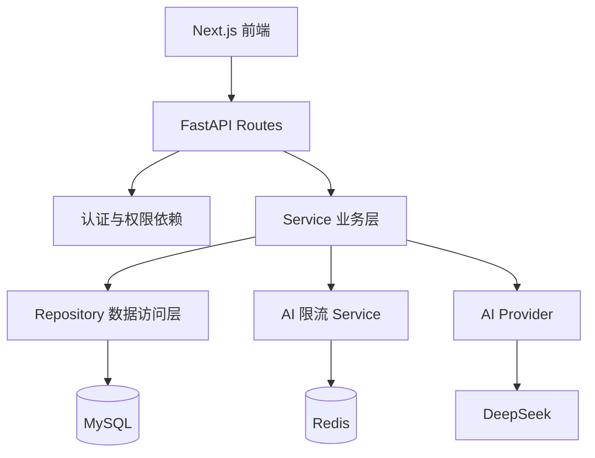
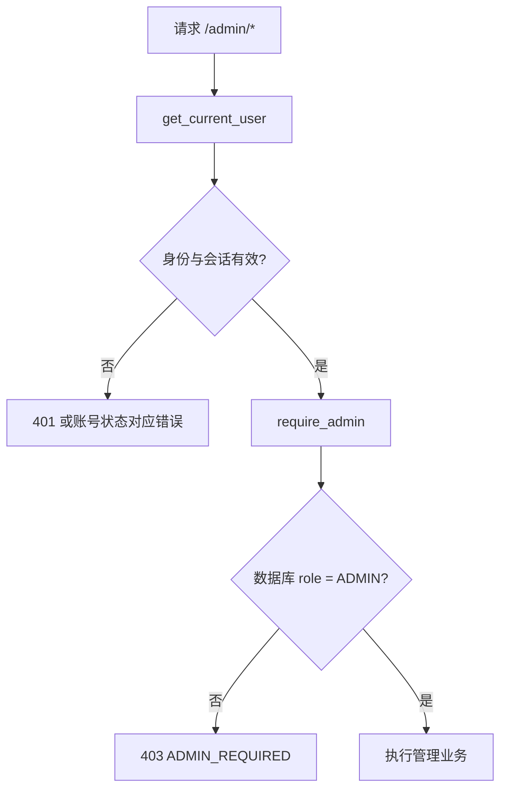
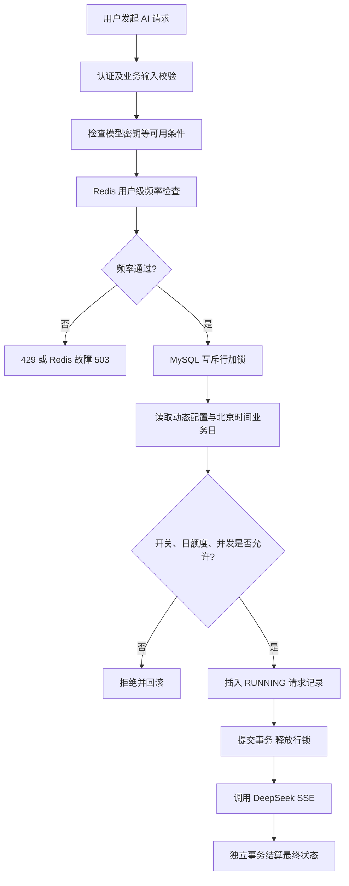

# Smart Study Planner V3.0 技术升级与答辩学习报告

> 智能学习计划管理系统｜管理后台与 AI 资源治理专题
>
> 版本：V1.0 学习版 · 2026-11-27
>
> 用途：课程答辩、源码复习、技术原理巩固、现场演示准备

## 阅读说明与当前进度

本报告的目标是让开发者能够脱离 AI 编程工具，独立解释项目的业务需求、系统架构、核心代码、数据一致性、安全策略以及技术选型，而不是背诵一堆技术名词。

报告依据此前确定的 V3.0 业务规则、A0.4/A1 源码交接、A3/A4 源码盘点、旧版 AI Guard 源码，以及最新 Memurai 环境检查报告编写。关键函数以已知源码和此前提供的设计为依据；尚未拿到修复后完整工作区源码的地方，使用流程或示意代码讲解，不当作最终源码逐字引用。

| 阶段 | 内容 | 截至本报告的状态 |
|---|---|---|
| A0 | 数据库迁移与认证基础准备 | 开发/测试环境已准备；正式数据库迁移未执行 |
| A1 | 管理员角色与权限 | 已有通过报告：517 passed，9 skipped |
| A2 | 用户管理、会话撤销、审计 | 已有通过报告：547 passed，9 skipped |
| A3 | 平台统计 | 已提供实现，最终专项报告尚未确认 |
| A4 | 动态 AI 配置、Redis 固定窗口 | 业务代码已存在；Settings 启动缺陷已授权修复，修复与全量验收结果待确认 |
| A4.1 | Redis ZSET + Lua 精确滑动窗口 | 已确定方案，尚未实施及验收 |
| A5 | 管理后台前端 | 待交给 Codex |
| A6 | 前后端联调、安全回归 | 待完成 |

**答辩时务必区分「已实现」「已测试」「计划实施」。** 本报告不虚构滑动窗口测试成绩，也不把 Memurai 的命令兼容性测试等同于整个 A4 业务验收。等最终测试报告出来后，应更新本节以及文末验收记录。

## 目录

- [第一章：项目定位与升级背景](#第一章项目定位与升级背景)
- [第二章：系统架构与技术选型](#第二章系统架构与技术选型)
- [第三章：管理员认证与权限](#第三章管理员认证与权限)
- [第四章：用户管理与事务审计](#第四章用户管理与事务审计)
- [第五章：平台统计](#第五章平台统计)
- [第六章：AI 资源治理总体设计](#第六章ai-资源治理总体设计)
- [第七章：MySQL 准入、额度与租约](#第七章mysql-准入额度与租约)
- [第八章：动态 AI 配置](#第八章动态-ai-配置)
- [第九章：Redis 基础与固定窗口](#第九章redis-基础与固定窗口)
- [第十章：精确滑动窗口算法](#第十章精确滑动窗口算法)
- [第十一章：SSE 生命周期与结算](#第十一章sse-生命周期与结算)
- [第十二章：关键函数与源码学习地图](#第十二章关键函数与源码学习地图)
- [第十三章：工程问题与解决过程](#第十三章工程问题与解决过程)
- [第十四章：测试、部署与已知边界](#第十四章测试部署与已知边界)
- [第十五章：答辩问答与现场演示](#第十五章答辩问答与现场演示)
- [第十六章：复习计划与技术亮点总结](#第十六章复习计划与技术亮点总结)

---

# 第一章：项目定位与升级背景

## 1.1 系统解决什么问题

Smart Study Planner 不是一个简单的待办事项系统。它把长期学习目标拆解为树形步骤，再由叶节点生成全周期每日任务。用户执行任务时形成学习打卡记录，可根据实际情况修改未来任务、顺延未完成数量，最后通过笔记、复习与 AI 助手巩固学习成果。

例如，用户制定 30 天英语学习计划，可以设置单词、阅读、听力等步骤。数字型任务可分配目标数量，布尔型任务表示是否完成。非叶节点汇总子树进度，计划进度按可计算叶节点等权计算，而非按每层分支数递归分配权重。

项目此前已形成三个相互关联的业务层次：学习执行（计划、任务、记录、顺延）、知识沉淀（Markdown 笔记、复习）、智能辅助（笔记生成、整理、总结、问答和练习）。V3.0 增加第四个层次：平台运营与安全治理。

## 1.2 为什么需要 V3.0

普通用户模块可以完成学习业务，但当系统开始对外提供服务时，只拥有普通用户功能是不够的。管理员需要知道有多少用户、多少 AI 调用、是否有异常账号；系统需要限制付费模型的调用频率、总量和同时执行的请求，并追踪敏感操作。

| 旧版本痛点 | V3.0 对策 |
|---|---|
| 无平台级管理权限 | USER / ADMIN 两级角色，后端实时鉴权 |
| 异常用户无法集中处理 | 封禁、解封、撤销全部会话 |
| 管理操作无可追踪记录 | 审计表与业务变更同事务提交 |
| 统计分散在用户页面 | 管理端仪表盘、AI 使用统计 |
| AI 配额依赖静态环境配置 | MySQL 运行时配置、管理员可动态调整 |
| 短时间请求可能大量涌入 | Redis 用户级分布式频率限制 |
| 模型请求耗时、存在调用成本 | 持久化额度、并发租约、超时结算 |

## 1.3 设计范围与取舍

V3.0 首版只使用 USER 和 ADMIN 两级角色，不引入复杂 RBAC 权限矩阵、不允许通过普通注册接口获得管理员权限、不提供管理端修改角色或读取用户私密笔记内容的接口。管理员角色由受控数据库操作授予。

AI 治理不等同于全站 WAF，也不等同于模型 Token 精确计费。本阶段限制的是请求频率、每日请求数与并发数量。请求次数能够提供成本风险的上界控制，但真实费用仍取决于模型价格、输入输出 Token 等因素。

---

# 第二章：系统架构与技术选型

## 2.1 技术栈

| 技术 | 责任 |
|---|---|
| Next.js / React / TypeScript | 页面路由、交互、类型约束与 API 调用 |
| shadcn/ui | 前端组件与视觉一致性 |
| FastAPI | REST 接口、依赖注入、SSE 响应 |
| Pydantic / pydantic-settings | 入参、响应结构与运行配置校验 |
| SQLAlchemy Session + text() | 数据库访问、参数绑定和事务管理 |
| MySQL InnoDB | 业务持久化、行锁、审计、AI 请求记录 |
| Redis（本地 Memurai 兼容服务） | 跨进程共享的短时间请求频率状态 |
| Lua | 将 Redis 多步限流操作作为原子脚本执行 |
| DeepSeek Provider | 调用模型并接收流式生成结果 |
| pytest | 单元测试、集成测试与历史回归 |

## 2.2 后端分层



- Routes：负责 HTTP 入参、依赖注入、响应封装，不直接拼接复杂 SQL。
- Service：负责业务规则、权限二次校验、事务边界与跨模块协调。
- Repository：负责 SQL 查询及写入，不擅自提交上层业务事务。
- Schema：定义允许的字段及数据类型，减少不合法输入进入业务层。
- Core：保存认证依赖、时间等通用基础能力；Redis 客户端也属于基础设施。

## 2.3 为什么不使用 SQLAlchemy ORM

本项目没有放弃 SQLAlchemy，而是使用它的 Session、连接池、事务和 `text()` SQL 执行能力，不使用 ORM 映射模型来完成业务查询。这种选择有利于直接理解 JOIN、聚合、索引、行锁和事务边界，也符合当前项目规模和学习目标。

```python
# 示意：命名绑定参数，不使用 f-string 拼接用户输入
row = db.execute(
    text("SELECT id, role FROM users WHERE id = :user_id"),
    {"user_id": user_id},
).mappings().first()
```

`mappings()` 让结果可以按列名读取；`first()` 返回首行或 None。参数绑定不是把用户输入当作 SQL 语句执行，因此可防止这类值参数的 SQL 注入。动态列名和排序方向不能简单依靠值参数绑定，若使用则应由白名单控制。

## 2.4 关键表关系

| 表 | 职责 |
|---|---|
| users | 用户身份、状态及角色 |
| 认证会话表 / tb_refresh_token | Auth V2 会话、Refresh Token 生命周期与撤销 |
| study_plans / plan_steps | 学习计划与树形步骤 |
| daily_tasks / study_records | 执行任务与追加型打卡记录 |
| task_rollovers | 任务顺延历史 |
| knowledge_notes / knowledge_review_records | 知识笔记与复习记录 |
| ai_requests | 模型请求准入、租约、状态、Token 用量等 |
| ai_guard_mutex | 固定互斥行，用于串行化 AI 准入与配置变更 |
| ai_runtime_config | 固定 ID 的运行时 AI 配置 |
| admin_audit_logs | 管理操作的前后状态、原因与时间 |

开发/测试数据库与正式数据库隔离。V3 开发/测试库在前期迁移报告中为 19 张表；正式数据库仍有旧认证结构，不能直接假设已升级。正式迁移涉及历史数据清理，必须单独授权、备份并确认数据影响。

---

# 第三章：管理员认证与权限

## 3.1 Authentication 和 Authorization

Authentication（身份认证）回答「你是谁」；Authorization（授权）回答「你可以做什么」。合法 Access Token 不代表拥有管理员权限。

管理员复用 Auth V2 登录流程，无需另做一套登录系统。认证依赖解析 Access Token，获取用户与会话身份、检查数据库中的有效状态，管理员依赖再检查用户角色。



## 3.2 核心函数 get_current_user / require_admin

`get_current_user` 是整个认证链路的基础依赖，负责识别请求对应的当前用户。Auth V2 的会话机制使服务端能够判断已撤销的会话，而不是仅依赖 JWT 的到期时间。

`require_admin` 依赖 `get_current_user`，验证数据库中实时返回的 role 是否为 ADMIN。以下是教学示意，省略原项目具体异常封装：

```python
def require_admin(user=Depends(get_current_user)):
    if user["role"] != "ADMIN":
        raise HTTPException(
            status_code=403,
            detail={"code": "ADMIN_REQUIRED", "message": "需要管理员权限"},
        )
    return user
```

为什么 role 不仅存 JWT？因为 JWT 签发后内容不可动态修改。如果 Token 内保存 ADMIN 且后端只信任该声明，数据库取消管理员身份后，旧 Token 可能在有效期内继续访问。实时数据库授权可以避免这种权限滞后。敏感写操作还应在事务内重新校验权限，以减少检查与使用之间的竞态。

## 3.3 Auth V2 与会话撤销

Access Token 用于访问 API，生命周期短；Refresh Token 用于续期，生命周期较长。项目通过 Refresh Token Rotation、重放检测以及服务端 Session 记录管理会话。管理员撤销会话时，同时处理会话及对应 Refresh Token。对于已经发出的 Access Token，失效依赖服务端认证检查会话状态，而不是假设能从客户端远程删除 JWT。

客户端隐藏管理菜单只能改善体验，不能充当安全边界。真正的边界必须位于后端接口。

涉及 Cookie 的敏感写接口还复用 Auth V2 的请求来源及 CSRF 检查（例如 `require_auth_request`）。CORS 本身不是身份认证，也不能替代针对 Cookie 自动携带场景的 CSRF 防护。

---

# 第四章：用户管理与事务审计

## 4.1 管理员可以做什么

查看用户列表、查看限定范围的用户详情、封禁用户、解封用户、撤销用户所有会话、查看管理员操作审计。列表包含分页、关键词搜索、状态筛选；邮件在列表中脱敏，详情可展示管理所需信息，不返回密码哈希或 Token。

管理员不应通过这些接口操作其他 ADMIN 账号（包括自己）；也不通过管理 API 提供任意角色变更。

## 4.2 核心函数 change_user_state

该函数是管理敏感写操作的核心 Service。其重点是业务变更和审计在同一数据库事务内完成。

流程：

1. 开启事务，按固定 ID 顺序锁定管理员与目标用户。
2. 检查管理员仍为有效 ADMIN，并重新校验其当前会话。
3. 检查目标用户存在，且不是 ADMIN。
4. 读取操作前状态、活跃会话数，校验封禁/解封是否重复。
5. 更新用户状态，按业务需要撤销 Session 与 Refresh Token。
6. 写入审计记录，记录操作者、目标、前后状态、操作原因。
7. 一并提交；中途异常则回滚。

```python
# 教学伪代码：表达事务边界，非最终源码完整替换版
with db.begin():
    actor, target = lock_and_validate_users()
    validate_current_admin_session(actor)
    before = read_target_state(target)
    apply_user_operation(target)
    after = read_operation_result(target)
    insert_audit_log(before, after, reason)
```

为什么固定锁顺序？若两个事务分别先锁 A 再锁 B、先锁 B 再锁 A，可能互相等待形成死锁。统一顺序降低此类死锁风险，但不能声称完全杜绝所有死锁（其他表、外键和索引也可能产生锁竞争）。

## 4.3 核心函数 revoke_user_sessions_with_counts

撤销目标用户的会话和相关 Refresh Token，分别返回实际更新行数。原有 `revoke_user_sessions` 保持旧接口兼容；新增带计数函数用于管理审计。

需要理解「活跃会话数」与「被撤销记录数」并不完全相同：前者要求会话当前有效；后者可能包含已经过期但尚未被标记撤销的记录。审计必须按真实操作结果记录，不能把两者强行视为相等。

封禁后，旧会话失效；解封仅恢复用户的登录资格，不恢复已经撤销的 Token。重复封禁/解封按已定业务规则拒绝；强制退出若无任何会话或 Token 需要撤销，可作为无变更操作返回，不生成虚假审计。

## 4.4 审计表 admin_audit_logs

| 字段 | 说明 |
|---|---|
| id | 审计记录主键 |
| admin_id | 操作者用户 ID |
| action | BAN_USER、UNBAN_USER、REVOKE_SESSIONS、UPDATE_AI_CONFIG |
| target_type / target_id | 操作目标类型及 ID |
| before_data / after_data | JSON 形式的变更前后数据 |
| reason | 操作原因，去除首尾空白后 1–200 字符 |
| created_at | UTC 时间，微秒精度 |

`insert_audit_log()` 位于 Repository，不自行 commit，事务交给 Service 控制。`list_logs()` 与 `count_logs()` 提供分页查询；列表通过 LEFT JOIN 获取管理员用户名，避免仅因为用户名关联缺失就丢弃历史审计记录。注意 JOIN 返回的是查询时的用户名，不等于历史用户名快照。

为什么不能先提交业务，再单独写日志？假设封禁提交成功、审计写入失败，就会出现无法追踪的状态变更。反过来，先提交日志再更新状态也可能产生虚假记录。同一事务保证两者同时成功或同时失败。

审计表目前属于业务级审计，不是密码学防篡改日志。数据库高权限人员仍可能直接修改数据；这属于系统边界，不应在答辩中夸大为绝对不可篡改。

---

# 第五章：平台统计

## 5.1 管理端仪表盘

`GET /admin/dashboard` 设计返回用户总量、启用/禁用用户、新增用户、今日学习活跃用户、累计及今日打卡、计划数、活跃计划、笔记数、今日 AI 请求数，以及最近七个自然日趋势与计划状态分布。

`GET /admin/ai/statistics` 设计返回今日已用/剩余 AI 额度、成功/失败/取消数、当前有效并发、配置状态、请求趋势、状态分布和业务操作类型分布。

这些统计是基于现有业务数据的聚合，不需要另建一套复杂的数据仓库。当前规模下直接查询 MySQL 足够；如果数据量明显增长，可依据 EXPLAIN 与实际延迟考虑汇总表、缓存等，而不是提前引入复杂组件。

## 5.2 统计关键函数

| 函数 | 作用 |
|---|---|
| get_user_counts | 按用户状态统计总体数量 |
| get_daily_new_users | 按注册时间汇总每日新增 |
| count_checkins | 统计符合有效计划口径的学习记录 |
| get_daily_learning_activity | 每日活跃学习用户与打卡次数 |
| get_plan_status_counts | 汇总未删除计划的状态分布 |
| count_notes | 统计未软删除的笔记 |
| count_ai_requests / get_daily_ai_counts | 汇总 AI 请求数及趋势 |
| get_ai_state | 汇总当前有效并发及请求状态 |
| get_ai_operation_counts | 汇总 AI 业务操作类型 |
| get_ai_statistics | 组装 AI 统计与运行时有效配置 |

函数名称来自此前 A3 实现设计，最终应与工作区验收版核对。

## 5.3 统计 SQL 的学习重点

```sql
-- 示例：学习记录与计划关联，沿用既定软删除统计口径
SELECT COUNT(*)
FROM study_records AS sr
JOIN daily_tasks AS dt ON dt.id = sr.task_id
JOIN study_plans AS sp
  ON sp.id = dt.plan_id AND sp.user_id = sr.user_id
WHERE sp.deleted_at IS NULL
  AND sr.recorded_at >= :start_at
  AND sr.recorded_at < :end_at;
```

`COUNT(*)` 统计打卡事件次数，`COUNT(DISTINCT sr.user_id)` 统计学习活跃用户数。二者不能混用。

本项目打卡记录属于追加型历史事件；任务软删除后，其历史打卡仍计入；所属计划软删除后，按现有口径不再计入有效学习统计。该口径不代表删除原有打卡记录。

学习业务采用北京时间自然日。最近七天包括今天，使用半开区间 `[起始日 00:00, 次日 00:00)`，避免 23:59:59 遗漏微秒精度数据。无记录的日期在 Service 层补零，便于前端连续展示七日趋势。认证、审计及 AI 租约等技术时间采用 UTC 语义；不要将不同时区的 DATETIME 直接比较。

---

# 第六章：AI 资源治理总体设计

## 6.1 AI 六类业务入口

| operation | 接口 | 业务含义 |
|---|---|---|
| GENERATE | POST /notes/ai/generate | 按主题生成笔记候选稿 |
| ORGANIZE | POST /notes/{note_id}/ai/organize | 整理当前已保存笔记 |
| SUMMARY | POST /notes/{note_id}/ai/summary | 总结当前笔记 |
| ASK | POST /notes/{note_id}/ai/ask | 当前笔记问答 |
| PRACTICE_GENERATE | POST /ai/practices/generate | AI 生成练习题 |
| PRACTICE_GRADE | POST /ai/practices/submit | 需要 AI 时执行主观题等批改 |

这些入口共享同一个 AI Guard，而不是每个接口实现自己的额度。练习提交中的本地判分和已保存结果复用不应被当作新的模型调用；历史记录 GET/DELETE 也不消耗 AI 调用额度。

## 6.2 五层治理分别解决什么问题

| 层次 | 技术 | 解决的问题 |
|---|---|---|
| 身份和数据权限 | Auth V2、笔记归属与版本校验 | 谁在调用、是否能访问该数据 |
| 短时间频率限制 | Redis + Lua（A4.1 计划 ZSET） | 高频请求、短时间大量准入尝试 |
| 持久化额度 | MySQL 请求记录与互斥锁 | 用户和全站每日最多准入多少次 |
| 并发治理 | MySQL RUNNING 状态与租约 | 同时运行多少模型请求 |
| 生命周期治理 | SSE、超时、取消、独立事务结算 | 请求何时结束、状态如何记录和释放 |

## 6.3 完整调用链



上述是 A4 设计链路，最终路由顺序应在 A4 验收中逐项核实。

**频率、额度、并发绝不是同一个概念。** 假设某用户在短时间内发出多个请求，Redis 可能允许这些请求继续参与准入，但 MySQL 用户并发上限为 1，其他请求仍会被拒绝；即使并发为空，也可能因为每日额度用完而拒绝。

Redis 记录的是通过频率检查的尝试，包括后续在 MySQL 阶段被拒绝的尝试；MySQL 记录的是成功准入的模型请求。两种计数不同属于设计行为，不应该为了让数字一致而随意回退 Redis 记录。

---

# 第七章：MySQL 准入、额度与租约

## 7.1 核心函数 admit_request()

位置：`app/services/knowledge/ai_guard_service.py`。

已知的原始函数结构使用 `Admission` 数据类返回请求标识、用户 ID 及可选笔记 ID。A4 在原有事务准入前增加 Redis 频率检查，事务中读取动态配置。

```python
@dataclass(frozen=True)
class Admission:
    request_id: str
    user_id: int
    note_id: int | None
```

`dataclass` 自动生成常用构造方法；`frozen=True` 阻止普通属性赋值；`int | None` 表示某些调用（例如主题生成）不关联现有笔记。`Admission` 是通过准入后交给流式结算器的上下文，不是新的认证凭据。

A4 的核心逻辑如下（示意而非可直接覆盖源码）：

```python
check_ai_rate_limit(user_id)
try:
    lock_admission(db)
    today = business_today()
    config = read_config(db)
    # 检查 AI 开关、用户/全站日额度、用户/全站并发
    # 生成练习额外检查至少剩余两次额度
    insert_request(..., operation=operation, request_date=today)
    db.commit()
    return Admission(request_id, user_id, note_id)
except Exception:
    db.rollback()
    raise
```

为什么先锁再统计？否则两个请求可能同时看到「还剩一次」，然后分别插入一条记录，导致额度超限。先获取共享互斥行的排他锁，让这些准入事务按顺序读取并写入。

## 7.2 lock_admission() 与 FOR UPDATE

```sql
SELECT id
FROM ai_guard_mutex
WHERE id = 1
FOR UPDATE;
```

`SELECT ... FOR UPDATE` 对命中的行施加排他锁，持有到事务提交或回滚。在同一个 MySQL 主库、相同固定互斥行、所有准入路径均遵守加锁协议的条件下，多个 FastAPI Worker 也能共享同一准入顺序。

这里不是「锁住整个模型生成过程」，而是短时间锁住准入检查与写入过程。若把模型网络请求放在锁内，数十秒的响应会阻塞所有其他 AI 准入，严重降低吞吐量。

还要确保进入准入前没有携带旧事务快照。SQLAlchemy Session 可能在首次查询时自动开始事务（autobegin）；A4 设计要求前置查询结束后，以干净事务执行锁定及统计。在 InnoDB REPEATABLE READ 下，已有一致性读快照可能导致后续非锁定统计读取旧数据。需要实际并发集成测试，而不能只看代码存在 FOR UPDATE 就认为安全。

## 7.3 daily_counts() 每日额度

```sql
SELECT COUNT(*) FROM ai_requests WHERE request_date = :request_date;

SELECT COUNT(*) FROM ai_requests
WHERE request_date = :request_date AND user_id = :user_id;
```

所有成功准入的状态均计入每日额度，包括 ERROR、TIMEOUT、CANCELLED 和 BLOCKED，不自动退还。这样可以限制用户反复取消或故意触发失败带来的请求消耗。Redis 拒绝和 MySQL 准入拒绝没有插入 AI 请求记录，不计入日额度。

默认初始配置：用户每日 10 次、全站每日 80 次。管理端调整配置后按新额度检查，历史使用量不会清空。AI 生成练习要求剩余额度至少两次，目的是给后续批改留出机会；这不是额度预留，不保证之后一定还有批改额度。

## 7.4 active_counts() 有效并发

```sql
SELECT COUNT(*) FROM ai_requests
WHERE status = 'RUNNING' AND leased_until > UTC_TIMESTAMP(6);

SELECT COUNT(*) FROM ai_requests
WHERE user_id = :user_id
  AND status = 'RUNNING'
  AND leased_until > UTC_TIMESTAMP(6);
```

默认用户并发 1、全站并发 2。租约 `leased_until` 是请求占用有效并发的最晚时间。此前配置为最大流式时长 120 秒、租约 180 秒，且租约必须长于流式超时。

如果 Worker 崩溃，没有机会写最终状态，数据库可能仍留有 RUNNING 记录。但租约到期后，该行不再计入有效并发，避免永久占用资源。管理统计可展示 RUNNING_EXPIRED 以暴露未结算记录；它是统计派生类别，不必修改数据库原始状态。

租约不是绝对保证模型端已经停止：如果上游连接未能及时关闭、外部调用仍在执行，租约过期后可能出现真实资源与统计不一致。这是需要监控及进一步治理的边界。

## 7.5 insert_request() 与 finish_request()

`insert_request()` 在准入事务中插入唯一 request_id、user_id、note_id、operation、request_date、RUNNING 状态及租约截止时间。

`finish_request()` 在结算时更新状态，原有约束为只更新 `status='RUNNING'` 的记录。这个条件避免迟到的重复终止事件覆盖已经结算的状态。Token 用量没有获取到时保存 NULL，而非填 0（未知不等于零）。

```sql
-- 示意：状态条件更新，不是完整 Repository 源码
UPDATE ai_requests
SET status = :status, finished_at = UTC_TIMESTAMP(6)
WHERE request_id = :request_id AND status = 'RUNNING';
```

这是一种条件式状态转换，可提供重复结算时的保护；并不等同于整个 HTTP 请求或外部模型调用具备 exactly-once 保证。

---

# 第八章：动态 AI 配置

## 8.1 为什么不全部使用 .env

原先静态 `AI_ENABLED`、用户日额度及全站日额度来自 Settings；修改环境变量通常需要重启进程，并且多个 Worker 可能在滚动更新时短时间使用不同配置。

运行时配置放入 MySQL 后，管理员可在线调整业务开关与配额。每次准入在互斥行保护下读取同一共享配置，不需要重启进程。

## 8.2 ai_runtime_config

| 字段 | 说明 |
|---|---|
| id | 固定为 1 |
| enabled | AI 服务业务总开关 |
| user_daily_limit | 单用户日额度 |
| global_daily_limit | 全站日额度 |
| updated_at | 最近变更 UTC 时间 |

初始开发配置为 enabled=1，user_daily_limit=10，global_daily_limit=80。环境配置仍承担部署安全边界，例如 Redis 地址、模型密钥、并发配置、频率配置和硬额度上限。

| 配置项 | A4 设计默认值 |
|---|---|
| REDIS_URL | redis://127.0.0.1:6379/0 |
| AI_USER_RATE_LIMIT | 6 |
| AI_RATE_WINDOW_SECONDS | 60 |
| AI_USER_DAILY_HARD_LIMIT | 50 |
| AI_GLOBAL_DAILY_HARD_LIMIT | 200 |
| AI_USER_CONCURRENCY | 1 |
| AI_GLOBAL_CONCURRENCY | 2 |

这些值是开发阶段的保守初始配置，不是通过压力测试测出的服务器最大处理能力。运行时日额度可由管理员更新，但频率与并发在当前设计中属于部署配置。

## 8.3 read_config() / effective_limits() / public_config()

位置：`app/services/knowledge/ai_runtime_service.py`。

`read_config()` 读取固定配置行；缺失或数据库访问失败时拒绝 AI 调用，不静默使用旧默认值绕过限制。

`effective_limits()` 计算实际执行额度。在之前提供的实现方案中，有效值取数据库配置与部署硬上限的较小值。`public_config()` 对管理端展示原始值、有效值、硬上限、模型是否配置及更新时间。

需要特别核对：此前关于「历史配置超出硬上限时直接拒绝」与「运行时取较小值」存在方案差异。本报告以最近提供的 clamp（取较小值）设计解释，不将其视为最终已验收规则。应在 A4 定稿时统一策略、补充异常配置测试；数据库中非法非正数或用户额度大于全站额度的情况也应明确拒绝。

## 8.4 update_config()

位置：`app/services/admin/ai_config_service.py`。

预期流程：校验请求字段和原因，重新锁定管理员用户与当前会话，确认 ADMIN 权限，获取与 AI 准入共享的互斥行，读取当前配置，合并本次修改、检查额度及硬限制，更新配置并写入审计，同事务提交。

`GET /admin/ai/config` 查询配置；`PATCH /admin/ai/config` 局部修改配置。Pydantic 的严格类型校验可拒绝将字符串或布尔值误当成正整数额度，明确区分未传字段与传入 null。无实际变化的 PATCH 不应产生虚假审计。

配置更新与 AI 准入共享互斥行，确保开关和配额变更与新请求准入有明确顺序。已经准入的请求继续执行；关闭开关控制后续模型准入，不强制杀死正在生成的任务。降低配额不会删历史记录；如果今日已用超过新的额度，后续请求被拒绝。

需要在最终验收中核对不同事务获取用户锁、会话锁与 AI 互斥锁的顺序，尤其是 `ai_requests` 外键可能产生的共享锁。锁顺序不一致可能形成死锁，应以真实数据库测试验证，不凭推测宣布存在或不存在。

---

# 第九章：Redis 基础与固定窗口

## 9.1 为什么引入 Redis

Redis 将短期频率状态放在共享的内存数据存储中。相比单进程 Python dict，它可以被多个 Worker 共同访问，并提供原子命令、TTL 和 Lua 脚本。

例如两个 Worker 各自维护用户 6 次限制，同一用户通过不同 Worker 访问时可能获得两套额度。把计数放入同一 Redis Key 后，可以共享同一限流状态。

Redis 并没有替代 MySQL。短期频率限制适合快速、可自动过期的数据；每日额度、审计、业务记录仍需要 MySQL 持久化与事务能力。Redis 故障时不能自动放行，否则攻击流量可能直接冲击付费模型。

## 9.2 A4 固定窗口原理

原方案采用 String 计数器与 Lua。第一次请求建立计数器并设置过期时间，同一窗口内后续请求增加计数。核心概念示意：

```lua
local count = redis.call('INCR', KEYS[1])
local ttl = redis.call('TTL', KEYS[1])
if count == 1 or ttl < 0 then
    redis.call('EXPIRE', KEYS[1], tonumber(ARGV[1]))
end
return {count, redis.call('TTL', KEYS[1])}
```

Python 侧将超过上限的请求拒绝为 HTTP 429。这个原方案以计数器首次创建为窗口起点，不是按整分钟自动对齐的固定窗口；超限尝试也可能继续增加计数，但不会因此获得更多通过次数。上面的脚本是核心逻辑示意，以最终源码为准。

## 9.3 为什么要升级

假设计数器在 t=0 创建，窗口 60 秒、上限 6。t=0 已有一次通过，t=59 附近再通过 5 次；t=60 旧 Key 过期后，新的窗口可立即通过 6 次。因此边界附近可以短时间通过 11 次。对齐固定窗口的经典例子则是两个窗口边界附近各通过 6 次，共 12 次。

**关键点：固定窗口限制的是某个计数周期，无法确保任意滚动 60 秒内至多 6 次。** 精确滑动窗口限制的才是每次请求时向前看的最近 60 秒。

---

# 第十章：精确滑动窗口算法

> 本章为 A4.1 已确定设计与教学实现，当前尚未替换固定窗口及通过专项测试。验收后需更新为实际版本。

## 10.1 算法选型

| 算法 | 精确滚动计数 | 空间 | 适用情况 |
|---|---|---|---|
| 固定窗口 | 否 | 每 Key O(1) | 简单频率控制 |
| 滑动窗口计数器 | 近似 | 每 Key O(1) | 请求量很大且容许估算 |
| 滑动窗口日志 | 是（时间精度内） | 每 Key O(L) | 本项目低阈值 AI 入口 |
| 令牌桶 | 不等同于严格滚动窗口 | 每 Key O(1) | 允许受控突发、按速率补充令牌 |
| 漏桶 | 不等同于严格滚动窗口 | 取决于实现 | 平滑输出速率、控制排队 |

L 是单窗口允许的请求数。我们的默认 L=6，因此保存精确时间记录的空间成本较低，没有必要为了节省少量存储而改用近似计数。

## 10.2 ZSET 数据结构

Sorted Set（有序集合）由唯一的 member 和可排序的 score 组成。使用毫秒时间戳作为 score，UUID 作为 member。

```text
Key: ssp:ssp_v3_admin_dev:ai:rate:v2:1024

member              score（毫秒时间戳）
request_uuid_1      1795770001000
request_uuid_2      1795770005000
request_uuid_3      1795770012000
```

Key 按项目、数据库环境、AI 限流版本和用户 ID 隔离。真实项目使用数字用户 ID，不能由客户端任意指定，应来自服务端认证结果。

为什么用 UUID 而不用时间戳作为 member？因为同一毫秒可能有多条请求。如果 member 相同，ZADD 会更新同一成员的 score，而不是新增一条记录，导致漏计。使用唯一标识解决这一问题。

版本前缀 v2 可避免旧 String 和新 ZSET 在同一个 Key 上引发 WRONGTYPE。升级期间所有实例必须采用同一版本，不能长期混用两个限流 Key，否则不同实例可能分别允许请求。

## 10.3 精确窗口定义

设当前 Redis 时间为 t，窗口长度 W=60000 毫秒，最大允许记录数 L=6。保留所有时间戳满足 `t-W < score <= t` 的记录。剔除 `score <= t-W` 的旧记录后，若当前数量小于 L 则允许并写入，否则拒绝。

| 时间（秒） | 操作 | 结果 |
|---:|---|---|
| 0 | 第一次请求 | 通过，记录 0 |
| 10 | 第二次请求 | 通过，记录 10 |
| 20 | 第三次请求 | 通过 |
| 30 | 第四次请求 | 通过 |
| 40 | 第五次请求 | 通过 |
| 50 | 第六次请求 | 通过 |
| 55 | 第七次请求 | 拒绝，距最早记录过期还有 5 秒 |
| 60 | 再次请求 | 移除 t=0 记录后通过 |
| 61 | 再次请求 | 拒绝，下一次机会在 t=70 左右 |

这不是要求用户每十秒只能发一个请求；滑动窗口允许六次合法短时突发，但不能在记录未离开滚动窗口前无限继续通过。

## 10.4 Lua 原子执行的意义

错误的非原子写法是：先在 Python 中执行 ZCARD，再根据结果执行 ZADD。如果两个 Worker 同时读取到 5 条记录，可能都允许并写入，最终数量为 7。

Lua 将读取时间、删除过期成员、计数、判断、插入、设置过期等操作交给 Redis 服务器在一个脚本中执行，不允许其他客户端命令插入到这些步骤之间。

Redis 脚本原子执行并不意味着 SQL 式事务回滚。脚本运行时错误可能保留此前已经执行的写入。应提前校验配置，并控制脚本复杂度与数据类型。

## 10.5 核心 Lua 代码与逐段解释

以下为此前选定方案的教学参考脚本；正式替换时应基于当前 Service 原有异常契约并完成测试。

```lua
local key = KEYS[1]
local limit = tonumber(ARGV[1])
local window_ms = tonumber(ARGV[2])
local request_id = ARGV[3]

local server_time = redis.call('TIME')
local now = tonumber(server_time[1]) * 1000
    + math.floor(tonumber(server_time[2]) / 1000)
local cutoff = now - window_ms

redis.call('ZREMRANGEBYSCORE', key, '-inf', cutoff)

-- 同一次脚本调用在网络重试时，避免重复记录。
if redis.call('ZSCORE', key, request_id) then
    return {1, 0}
end

local count = redis.call('ZCARD', key)
if count >= limit then
    local index = count - limit
    local oldest = redis.call('ZRANGE', key, index, index, 'WITHSCORES')
    local retry_ms = tonumber(oldest[2]) + window_ms - now
    return {0, math.max(retry_ms, 1)}
end

redis.call('ZADD', key, now, request_id)
redis.call('PEXPIRE', key, window_ms)
return {1, 0}
```

### KEYS 与 ARGV

`KEYS[1]` 是操作的 Redis Key，Lua 数组下标从 1 开始。`ARGV[1]`、`ARGV[2]`、`ARGV[3]` 是限流阈值、窗口长度和唯一请求 ID。`tonumber()` 将字符串参数转换为数字。正整数限制应由 Pydantic Settings 校验。

### TIME

`redis.call('TIME')` 返回服务器当前秒数和微秒部分。转换成毫秒后，所有 Worker 使用同一个 Redis 服务器的时间基准，避免各个应用节点本地时间不同而引起窗口偏差。

它不是单调时钟，Redis 主机时间被调整或故障切换到时钟不同的主机仍可能影响窗口。正式部署应保证系统时钟同步。

### ZREMRANGEBYSCORE

删除分数从负无穷到 cutoff（含）的所有成员。这样只保留最近窗口内的数据。不会逐条扫描所有用户，只处理当前用户的 ZSET。

### ZSCORE

读取指定成员的分数。若同一脚本请求 ID 已存在，视为同一调用的重复执行，不增加计数。这只能减少 Redis 命令重试导致的重复记录，不能保证完整 HTTP 请求或付费模型调用幂等；记录过期后也不再保留此去重信息。

### ZCARD

返回 ZSET 的成员数量。删掉旧记录后，该数量就是当前滚动窗口内已通过的请求次数。该命令时间复杂度 O(1)。

### ZRANGE WITHSCORES 与 Retry-After

如果已达到上限，需要知道什么时候有足够记录过期。正常 `count == limit` 时读取最早记录（下标 0）。如果运行配置降低，可能存在 `count > limit`，需等更多记录过期，因此索引取 `count - limit`。

例如 count=6、limit=4，需要移除至少 3 条旧记录才能使当前数量变为 3 并允许下一次请求，因此读取下标 2 的记录。`retry_ms = score + window_ms - now` 即理论等待时间。服务器可把毫秒向上取整成秒，通过 HTTP `Retry-After` 返回；这是最早可重试估计，不是保证下一次必定通过，因为其他请求可能抢占机会或 MySQL 额度已用完。

### ZADD

把本次通过频率检查的请求写入集合。超限请求不写入，避免恶意反复重试持续扩张日志。固定阈值下每个用户 Key 最多保存 6 条记录（运行时改变阈值时可能短暂保留旧数量）。

### PEXPIRE

给 Key 设置毫秒级过期时间，每次成功写入时刷新 TTL。如果此后没有请求，在最后一个有效记录离开窗口时可以回收整个 Key。TTL 回收 Key 与 ZREMRANGEBYSCORE 清理窗口记录是两种互补机制；只依赖 TTL 无法移除仍在活跃 Key 中的旧成员。

## 10.6 Python Service 与脚本缓存

位置：`app/services/knowledge/ai_rate_limit_service.py`；Redis 连接基础设施位于 `app/core/redis_client.py`。

```python
# 教学示意：保留现有函数入口，具体异常文案和类型处理以验收版为准
sliding_window_script = redis_client.register_script(SLIDING_WINDOW_SCRIPT)

def check_ai_rate_limit(user_id: int) -> None:
    key = f"ssp:{settings.DB_NAME}:ai:rate:v2:{user_id}"
    request_id = str(uuid4())
    try:
        result = sliding_window_script(
            keys=[key],
            args=[settings.AI_USER_RATE_LIMIT,
                  settings.AI_RATE_WINDOW_SECONDS * 1000,
                  request_id],
        )
    except RedisError:
        # 503 AI_RATE_LIMIT_UNAVAILABLE，禁止进入模型准入
        raise
    allowed, retry_ms = map(int, result)
    if not allowed:
        retry_after = (retry_ms + 999) // 1000
        # 429 AI_RATE_LIMIT，携带 Retry-After
        ...
```

上述示意故意省略项目的 HTTPException 转换，不能直接粘贴替换生产文件。正式代码需确保 RedisError 映射为安全的 503，429 保留既有业务错误码及统一响应，正确传递响应头。

`register_script()` 创建 redis-py Script 对象，执行时优先使用脚本摘要 EVALSHA；当 Redis 尚无缓存脚本、返回 NOSCRIPT 时，客户端可加载脚本并重试。这样减少重复传输整段 Lua，无需自己实现复杂脚本管理机制。

`redis_client` 通过连接池复用连接，并设置较短连接和命令超时。导入客户端不等于 Redis 已经连通；真实运行时需用 PING 验证。若同步 redis-py 客户端在 async 路由中直接调用，应检查是否占用事件循环；可在现有同步准入路径或合适工作线程中运行，不为本次升级盲目改写全部异步代码。

## 10.7 复杂度与工程边界

ZREMRANGEBYSCORE 为 O(log N + M)，N 为当前成员数，M 为删除数量；ZADD 为 O(log N)（单成员）；ZCARD 为 O(1)；ZRANGE 在取一条记录时开销约 O(log N + 1)。默认阈值很小，单用户处理开销较低，但全站占用仍与活跃用户数有关。

当前设计没有实现 Redis Cluster、Sentinel、独立限流微服务或全局短时频率桶，不应在答辩中宣称具备这些能力。Redis 重启、缓存淘汰或切换到缺少最新数据的实例可能丢失短期频率状态；每日额度仍由 MySQL 保持。正式环境应配置访问控制、网络隔离、合适的内存与淘汰策略，并监控延迟及错误率。

## 10.8 为什么它能成为项目亮点

不是因为 Redis 和 Lua 名词本身，而是因为我们明确识别了固定窗口边界缺陷，选择与实际 AI 请求低阈值匹配的精确算法，并结合跨 Worker 共享状态、原子检查、时间统一、错误处理、Key 隔离和专项测试。该亮点应在 A4.1 完成后用测试证据支撑。

---

# 第十一章：SSE 生命周期与结算

## 11.1 SSE 是什么

Server-Sent Events 是服务器向客户端持续发送文本事件的机制，适用于模型生成等单向数据流。本项目由前端发起 POST 请求，服务端返回 SSE 格式流，前端可用 fetch 读取流；浏览器原生 EventSource 不支持以普通方式发 POST 请求，因此不能混淆两种客户端实现。

```text
event: delta
data: {"text":"正在生成的内容"}

event: done
data: {"usage":{"prompt_tokens":120,"completion_tokens":200}}

```

以上只是 SSE 格式示例，实际业务事件字段按接口契约执行。收到 delta 并不意味着业务成功；只有合法终止事件以及必要的状态结算成功，才能确认完成。

## 11.2 metered_ai_stream()

位置：`app/services/knowledge/ai_guard_service.py`。它是可被不同 AI 业务共享的异步生成器包装器，负责观察业务流、判断终止事件、控制总时长、结算请求状态。

| 事件或情况 | 结算状态 |
|---|---|
| 正常 done | SUCCESS，先结算再下发终止事件 |
| blocked | BLOCKED |
| 业务结果失效（如笔记版本变化） | STALE |
| error / 协议异常 | ERROR |
| 总时长超时 | TIMEOUT |
| 客户端取消 | CANCELLED（尽力结算） |
| Worker 突然退出、未能结算 | 保留 RUNNING，租约超期后不再占有效并发 |

`asyncio.timeout()` 限制流式调用总时长。`aclosing(event_stream)` 确保退出异步生成器时尝试调用 aclose，帮助清理上游连接。`async for` 逐个消费事件。`yield` 向下游发送事件并暂停生成器，等待继续迭代。

`_event_name()` 与 `_event_data()` 解析应用自己构造的 SSE 帧，不直接承担不同模型供应商协议的兼容适配。Provider 层负责模型接口差异。

## 11.3 _finish_request_record()

该函数使用 `SessionLocal()` 创建独立短事务，调用 Repository 的 `finish_request()` 更新状态并提交。结算在独立事务中执行，避免把模型生成全程绑在最初的数据库 Session 与锁上。

已知旧版实现通过 `anyio.to_thread.run_sync()` 将同步数据库操作放入工作线程，使异步流处理不必直接执行阻塞 SQL。合法 Token 数要求非负整数并排除 bool（Python 中 bool 是 int 的子类）；缺失或非法用量保存 NULL。

为什么正常 done 要先结算再发送？如果先告诉前端成功，数据库结算又失败，界面显示成功但请求还处于 RUNNING；因此正常路径先完成数据库状态写入。取消和异常情况下结算可能失败，需保留日志并依赖租约兜底。

---

# 第十二章：关键函数与源码学习地图

建议在 VS Code 中按以下顺序阅读，而不是从项目目录随机打开文件。实际函数所在行号会随版本变化，可使用全局搜索查找名称。

| 顺序 | 文件 / 函数 | 必须理解的问题 |
|---:|---|---|
| 1 | app/config.py — Settings / validate_ai_limits | 字段定义、环境变量、实例化、字段间校验 |
| 2 | app/core/deps.py — get_current_user / require_admin（按实际文件查找） | 登录与授权为何分离，数据库角色为何实时读取 |
| 3 | app/services/auth/session_service.py — lock_current_user | 用户锁、会话锁、敏感操作重新验证 |
| 4 | app/api/routes/admin.py | 路由前缀、Depends、管理接口、CSRF 检查 |
| 5 | app/schemas/admin.py | 严格类型、操作原因、分页和筛选入参 |
| 6 | app/repositories/admin/user_repository.py | COUNT 与分页 SELECT、搜索、字段白名单 |
| 7 | app/services/admin/user_service.py — change_user_state | 状态变更、固定锁顺序、会话撤销、事务 |
| 8 | app/repositories/admin/audit_repository.py — insert_audit_log / list_logs | JSON 审计、事务归属、LEFT JOIN |
| 9 | app/repositories/admin/statistics_repository.py | JOIN、GROUP BY、COUNT DISTINCT、时间范围 |
| 10 | app/services/admin/statistics_service.py | 补零、配置有效值、统计口径 |
| 11 | app/core/redis_client.py | 客户端、连接池、超时 |
| 12 | app/services/knowledge/ai_rate_limit_service.py — check_ai_rate_limit | Key、Lua、频率检查、429/503 |
| 13 | app/repositories/admin/ai_config_repository.py | 单行配置读写 |
| 14 | app/services/knowledge/ai_runtime_service.py | 动态配置读取与有效额度 |
| 15 | app/services/admin/ai_config_service.py — update_config | 权限二次确认、互斥、配置与审计同事务 |
| 16 | app/repositories/knowledge/ai_guard_repository.py | lock_admission、daily_counts、active_counts、insert_request、finish_request |
| 17 | app/services/knowledge/ai_guard_service.py — admit_request | 共享准入检查、请求记录、commit/rollback |
| 18 | 同上 — metered_ai_stream / _finish_request_record | SSE 事件、超时、结算与租约兜底 |
| 19 | app/api/routes/knowledge_ai.py / ai_practice.py | 六种业务入口如何复用 Guard |

## 12.1 分页为何先查数量，再查内容

总数量提供总页数以及当前查询有多少条记录，分页内容只返回当前页所需数据。两个 SQL 需要使用相同筛选条件，否则会造成列表与总数不匹配。

```sql
SELECT COUNT(*) FROM users WHERE ...;
SELECT id, username, role FROM users
WHERE ...
ORDER BY created_at DESC, id DESC
LIMIT :page_size OFFSET :offset;
```

`offset = (page - 1) * page_size`。排序追加 id 是为了在创建时间相同的情况下维持稳定顺序。使用 OFFSET 在很深的页码时成本可能增加，首版管理后台规模下无需立即引入游标分页。

## 12.2 Service 清理参数是什么意思

例如去除搜索关键词首尾空格、将空字符串视为未提供、规范邮件搜索条件、验证操作原因不是纯空白。这些是业务语义处理，不应让 Repository 为每个输入状态重复判断。

## 12.3 统一 HTTP 响应

普通 API 使用项目已有 `code/message/data` 结构；错误使用 HTTP 状态码与可识别业务错误码。SSE 已经开始传输后，HTTP 状态码无法再改成 429 或 500，所以准入检查必须发生在创建流式响应之前，运行中错误通过 SSE 终止事件表达。

---

# 第十三章：工程问题与解决过程

## 13.1 Windows 没有可用 Redis 服务

Trae 核查发现 Docker 未安装、WSL 未启用、当前进程无管理员权限、Hypervisor 未运行、6379 无监听。这里 `HypervisorPresent=False` 不代表 CPU 一定不支持虚拟化，只说明当前 Hypervisor 未运行。

最终选择 Memurai Developer Edition 作为本地 Redis 兼容测试环境。最新报告称 Memurai Developer 4.1.2 以普通用户免安装运行，只监听 127.0.0.1:6379，返回 redis_version=7.2.5；PING、TIME、ZSET、PEXPIRE、PTTL、EVAL、EVALSHA、SCRIPT LOAD、pipeline、SCAN 均已验证。

这解决了本地测试依赖问题，不代表已正式部署 Linux Redis。开发版仅作开发测试，正式服务器应使用适合生产许可及运维要求的 Redis 环境。

## 13.2 Settings 字段缩进错误

最新 Trae 报告指出 Redis 和 AI 硬上限配置块被写到了 `Settings` 类外部，而 `validate_ai_limits` 在实例校验时引用这些属性，导致 `settings = Settings()` 抛出 AttributeError。

```python
# 错误结构示意
class Settings(BaseSettings):
    @model_validator(mode="after")
    def validate_ai_limits(self):
        if self.AI_USER_DAILY_HARD_LIMIT > self.AI_GLOBAL_DAILY_HARD_LIMIT:
            raise ValueError("Invalid limits")
        return self

AI_USER_DAILY_HARD_LIMIT: int = 50  # 模块变量，不是 Settings 字段
```

正确方式是把配置字段定义在 Settings 类体内，保留原有名称、类型、默认值和校验逻辑。Pydantic 根据类字段定义解析环境变量与构建实例；模块变量不会自动成为实例属性。

此缺陷属于启动级错误。旧进程的 `/health` 返回 200 不代表新版本可导入或运行，因为修改文件并不会必然重启已运行的 Python 进程。

已授权 Trae 只修复该缩进问题，随后检查 Settings 实例化、环境变量覆盖、字段关系校验、新应用启动与全量回归。修复结果目前尚未收到。

## 13.3 Redis 故障保护：Fail Closed

当 Redis 无法连接、命令超时或脚本执行失败，新的 AI 模型请求返回 503，而不是直接跳过限流。对付费模型而言，短时不可用通常比无保护地允许大量付费调用更可控。

应保证故障影响面仅限依赖该 AI 准入的业务；普通学习计划、打卡、笔记 CRUD、管理配置查询及不需要模型的练习历史操作不应被 Redis 故障拖垮。实际隔离能力需通过测试确认。

---

# 第十四章：测试、部署与已知边界

## 14.1 如何建立可靠测试基线

先修复 Settings 并完成 A4 固定窗口版本的验收，再替换滑动窗口 Service，随后执行专项测试及全量回归。若同时修改环境和算法，出现失败时很难区分环境缺陷还是业务实现缺陷。

A4/A4.1 只使用测试数据库 `ssp_v3_admin_test` 与隔离 Redis Key 前缀；不修改共享 .env，不操作正式数据库，不使用 FLUSHALL/FLUSHDB 清除共享实例。AI Provider 使用 Mock，避免消耗真实模型额度。Mock 不能替代真实 Redis/MySQL 的原子性和并发集成测试。

## 14.2 A4 验收矩阵

| 测试主题 | 应验证的结果 | 当前状态 |
|---|---|---|
| 新进程启动 | Settings 成功实例化，读取环境变量正确 | 待确认 |
| Redis 环境 | PING 与所需命令成功 | Trae 已报告通过 |
| 管理权限 | 未登录 401、普通用户 403、ADMIN 正常访问 | A1/A2 已有报告，A4 回归待确认 |
| 动态配置 | 开关立即影响后续准入、额度变化不清空历史 | 待验收 |
| 审计原子性 | 配置/用户状态变更与审计同事务回滚 | A4 待验收 |
| 固定窗口 | 达到阈值拒绝，TTL 到期恢复，用户隔离 | 待验收 |
| Redis 故障 | AI 拒绝 503，普通业务正常 | 待验收 |
| 并发与额度 | 多 Session 竞争不超额，租约过期释放有效并发 | 待验收 |
| 六类 AI 入口 | 共享 Guard，本地批改及历史复用不误计费 | 待验收 |
| API 响应契约 | 429 错误码、Retry-After 头不被异常包装丢弃 | 待验收 |
| 统计一致性 | 配额、已用、剩余、当前并发与真实数据一致 | 待验收 |
| 历史回归 | 所有既有模块无新增失败 | 待验收 |

## 14.3 A4.1 滑动窗口专项测试

| 场景 | 成功标准 |
|---|---|
| 基本阈值 | 同一用户前 6 次通过，第 7 次频率拒绝 |
| 滚动临界点 | 原窗口边界前后合计不能突破滚动窗口上限 |
| 精确过期 | score 等于 cutoff 时被删除；刚未到期仍保留 |
| 同毫秒多请求 | 不同 UUID 不覆盖，全部正确计数 |
| 多客户端并发 | 同 Key 同时提交超过上限的不同请求 ID，恰好允许阈值内请求 |
| 用户隔离 | 用户 A 被限流不影响用户 B 的独立频率状态 |
| 脚本重试 | 同 request_id 重试不重复记数（记录仍在窗口时） |
| TTL 自动回收 | 无新通过请求后 Key 自动消失，拒绝不无限延长 TTL |
| Retry-After | 等待时间按最早可用机会计算，秒数向上取整 |
| 阈值降低 | 若历史记录数超过新阈值，等待足够记录过期 |
| 缓存失效恢复 | NOSCRIPT 后重新加载并正常执行（隔离测试实例） |
| 旧 Key 兼容 | 旧 String 不与 v2 ZSET 发生 WRONGTYPE 冲突 |
| 故障策略 | Redis 不可用时新 AI 请求不进入模型准入 |
| 全量回归 | 动态配置、统计、练习、SSE 结算、认证均无新增失败 |

测试应区分直接测试频率 Service 和测试完整 AI API。完整 AI API 还受并发上限、日额度等限制，因此不能仅凭「第几个 HTTP 请求失败」推断 Redis 算法正确。

## 14.4 正式部署边界

开发环境验证通过不等于生产上线。正式部署应使用 Linux 上适合生产的 Redis/MySQL，保护 Redis 网络端口及凭据，设置应用和模型服务超时，监控 Redis 连接错误、429/503、AI 请求失败率、MySQL 锁等待及连接池占用。

现阶段采用单条 MySQL 互斥行适合低吞吐 AI 服务，优点是简单、易验证；未来请求量很大时可能成为全局准入瓶颈。Redis 当前为单实例方案，没有高可用或跨地域一致性保证。不要把「支持多 Worker 共享状态」等同于已经通过大规模压测或具备完整生产级高可用。

另外需核对：所有 AI 入口是否在准入前结束旧 Session 事务；配置更新与外键写入的锁顺序；硬上限异常配置策略；异常响应包装器是否保留 Retry-After；旧版与新版限流 Key 切换是否同步。这些是最终验收重点，不是目前已经证实的故障清单。

---

# 第十五章：答辩问答与现场演示

## 15.1 重点问答

### Q1：你的系统与普通待办应用有什么不同？

系统从长期计划树自动生成每日任务，记录学习执行，支持数字型目标与布尔型任务、进度聚合和任务顺延，并将知识笔记、复习及 AI 辅助连成完整学习闭环。V3.0 进一步加入平台管理与资源治理，而不只是 CRUD 页面。

### Q2：为什么选择前后端分离？

Next.js 负责页面和交互，FastAPI 提供稳定的业务 API。前后端各自开发与测试，认证、权限和业务规则统一由服务端执行。但也带来接口契约、跨域配置、认证状态协调等额外工作。

### Q3：为什么要增加管理员后台？

公开服务需要平台级用户管理、异常账号处理、运行统计和敏感操作追踪。AI 接口有外部调用成本，因此还需要动态开关与预算相关的请求数治理。

### Q4：普通用户能不能直接请求管理员接口？

即便知道 URL，也必须经过后端身份认证和实时角色检查。合法普通用户没有 ADMIN 角色，应返回 403。前端隐藏入口不是安全措施本身。

### Q5：管理员封禁后，旧 Access Token 为什么不能继续使用？

因为 Auth V2 的认证不仅检查 Token 签名，还检查数据库账号和会话状态；封禁同时撤销对应会话及 Refresh Token，旧请求会被后端拒绝。并非远程从用户设备删除 Token。

### Q6：为什么审计与业务必须同一个事务？

保证敏感操作和审计记录不会出现一方成功、一方失败。发生异常时可以整体回滚，使状态变化与追踪信息一致。

### Q7：为什么选 Redis 而不是 Python 字典？

Python dict 是进程本地状态，多个 Worker 无法天然共享同一个频率计数器。Redis 提供共享状态、TTL 和 Lua 原子执行，适合短期高频状态。

### Q8：为什么不把所有额度也放 Redis？

可以设计 Redis 为所有额度的治理中心，但本项目已依赖 MySQL 保存请求历史、统计和审计，日额度需要可持久追踪的事实来源。当前方案把短期频率和持久业务额度分层，降低状态同步和故障恢复复杂度。

### Q9：固定窗口有什么缺陷？

窗口边界前后可以分别消耗两套额度，因此短时间内可能超过任意滚动窗口要求。滑动窗口以当前时间向前计算最近 60 秒内的实际记录，更符合这里的严格频率规则。

### Q10：为什么用 ZSET？

ZSET 可以按时间戳排序，快速删除窗口外记录、统计窗口内成员，并找到下一条将过期的记录，方便计算重试时间。UUID 避免相同毫秒的记录互相覆盖。

### Q11：为什么 Lua 不直接用多个 Redis 命令？

多个独立命令之间可能插入其他客户端的操作，形成检查后写入的竞态。Lua 将整个检查与写入放在 Redis 一次原子执行中。它不等同于支持自动回滚的数据库事务。

### Q12：为什么用 Redis TIME？

各 Worker 共享 Redis 的时间基准，避免应用服务器的时间差异造成窗口判断不一致。它不是单调时钟，生产环境仍需时钟同步。

### Q13：为什么限流之后还要日额度和并发限制？

限流只限制请求进入的速度，日额度控制一整天可以准入多少次，并发控制同时执行多少次。三者分别处理不同资源风险，任何一个都不能替代其他两个。

### Q14：MySQL 如何防止两次请求同时用掉最后一次额度？

准入事务先锁定固定的互斥行，再统计已用额度和有效并发，插入 RUNNING 记录后提交。各 Worker 遵循相同加锁协议，避免同时使用同一个剩余额度。

### Q15：为什么不一直持有 MySQL 行锁直到 AI 返回？

模型生成可能耗时几十秒，长事务会阻塞其他准入并增加资源占用。准入写入 RUNNING 记录后马上提交，后续模型执行由状态和租约跟踪。

### Q16：如果服务器突然崩溃怎么办？

正常请求会记录结束状态。异常退出时可能留下 RUNNING，但租约到期后不再计入有效并发，避免永久占用。日额度不退还，管理统计可以识别过期未结算记录。

### Q17：Redis 挂了会怎么样？

新 AI 调用采用 Fail Closed，返回 503，不绕过频率保护。普通不依赖 Redis 的业务仍应可用。已有持久化日额度记录由 MySQL 保存。

### Q18：管理员关闭 AI 时，正在生成的请求怎么办？

当前设计控制新准入，不主动取消已经准入的请求。共享互斥行使配置生效与请求准入有清晰顺序。已用额度也不会因关闭再打开而重置。

### Q19：练习生成要求两次额度，是否保证能够完成批改？

不保证。这是准入时的提示性检查，不进行额度预留，后续其他调用仍可能消耗额度。本地判分不需要模型时不消耗新 AI 额度。

### Q20：你的系统是不是企业级生产系统？

采用了面向生产的若干工程实践，例如分层架构、事务审计、跨进程原子限流、并发租约、故障保护和隔离回归。但现阶段是课程项目，生产高可用、规模压测、成本监控和正式迁移仍需额外工作。以真实测试结果说明能力，不把技术方案当作已经上线的成果。

## 15.2 建议的 5–8 分钟演示流程

| 阶段 | 展示内容 | 想让老师看到什么 |
|---|---|---|
| 1 | 用户创建学习计划、执行每日任务 | 核心业务不是单纯表格 CRUD |
| 2 | 笔记与 AI 助手 | 完整学习流程及智能能力 |
| 3 | 管理后台用户列表与统计 | 平台视角和权限隔离 |
| 4 | 管理操作、审计及会话状态 | 事务一致性与认证治理 |
| 5 | AI 配额配置与限流 | 运行时治理与资源保护 |
| 6 | VS Code 展示 Guard 和 Lua | 解释最有技术含量的核心代码 |
| 7 | 展示测试报告 | 证明实际验证过关键风险 |

演示使用独立测试用户和数据库，不操作真实用户，不暴露 .env、API Key、密码或 Token。若滑动窗口尚未验收，只展示设计，不能把固定窗口测试说成滑动窗口测试。

## 15.3 本地启动检查

建议使用 VS Code，不依赖 Trae Agent 完成演示。提前检查 MySQL、Memurai、后端虚拟环境、前端依赖与配置。在项目实际目录中使用既有启动方式；以下为常见命令示例，运行前须核对实际 ASGI 模块路径及 package.json 脚本。

```powershell
# 后端终端：使用隔离的开发库
cd D:\project\back
$env:DB_NAME = "ssp_v3_admin_dev"
$env:REDIS_URL = "redis://127.0.0.1:6379/0"
.\.venv\Scripts\python.exe -c "from app.config import settings; print(settings.DB_NAME)"
# 若实际入口为 app.main:app
.\.venv\Scripts\python.exe -m uvicorn app.main:app --host 127.0.0.1 --port 8000
```

前端在实际 `next-fro` 目录按项目已有 npm 脚本启动（通常为 `npm run dev`）。Swagger UI 一般位于 `/docs`，但以项目实际配置为准。先验证新进程再访问 `/health`，防止旧进程假活。

如现场展示 Redis ZSET，使用 Redis Insight 或兼容 CLI 查询测试用户的 Key，并观察 ZRANGE WITHSCORES、ZCARD、PTTL。注意不要为了演示而清空共享实例或发起大量真实付费模型请求。最好在 Mock 模型或专门测试入口环境中展示限流实验。

---

# 第十六章：复习计划与技术亮点总结

## 16.1 学习路线

| 复习轮次 | 学习内容 | 自测标准 |
|---|---|---|
| 第一轮 | 业务、表结构、分层 | 不看稿能画出项目架构和数据关系 |
| 第二轮 | 认证、权限、会话、审计 | 能解释封禁到旧会话失效的完整链路 |
| 第三轮 | SQL 统计、事务、行锁 | 能手写关键 SQL，解释为什么先锁再统计 |
| 第四轮 | Redis、固定窗口、滑动窗口 | 能手算请求时间序列，解释每条 Lua 命令 |
| 第五轮 | SSE、租约、动态配置 | 能解释正常与异常请求如何释放资源 |
| 第六轮 | 测试、环境、答辩 | 不用 Agent 能启动、复现和讲解关键功能 |

建议重点练习：在纸上画出一个 AI 请求从前端到数据库与 Redis，再到 DeepSeek 和 SSE 结算的流程。每个节点都回答四个问题：输入是什么、做了什么判断、写了什么数据、失败后如何处理。

## 16.2 五大可讲技术亮点

1. **Auth V2 与实时权限控制**：双 Token、轮换、重放检测、Session 撤销和数据库角色校验形成可管理的认证体系。
2. **事务审计**：使用 MySQL 事务保证敏感业务变更与审计同步成功或回滚。
3. **分层 AI 资源治理**：Redis 频率、MySQL 日额度、全局与用户并发、租约分别治理不同维度的资源风险。
4. **精确滑动窗口（待 A4.1 验收）**：ZSET + Lua 原子检查、Redis TIME、UUID、TTL、EVALSHA 缓存、Retry-After 及 Fail Closed。
5. **流式生命周期管理**：SSE 增量输出、总超时、取消和终止状态结算，避免长事务与异常情况下的永久并发占用。

## 16.3 一分钟技术介绍参考

> 我的项目是 Smart Study Planner 智能学习计划管理系统。前端采用 Next.js 和 TypeScript，后端使用 FastAPI、SQLAlchemy Session 以及 MySQL，实现了树形学习计划、每日任务、打卡、任务顺延、知识笔记与 AI 学习助手。V3.0 重点升级了平台级管理与资源治理，使用数据库角色校验、会话撤销和事务审计保障管理员操作的可控性。对于付费模型调用，我们设计了 Redis 短时间频率限制、MySQL 每日额度和并发租约相结合的多层治理机制，并通过 SSE 生命周期统一记录请求状态。针对固定窗口的边界突发问题，我们还设计了基于 Redis ZSET 和 Lua 的精确滑动窗口。这个项目让我重点学习了分层架构、数据库事务、分布式原子操作以及流式接口的工程处理。

如果 A4.1 最终测试通过，可将「设计了」更新为「实现并验证了」，并补充实际并发测试与临界窗口测试证据。

## 16.4 最终验收记录（留待实际报告填入）

| 项目 | 最终结果 |
|---|---|
| A3 专项验收 | 待填写 |
| A4 Settings 修复与新进程启动 | 待填写 |
| A4 固定窗口专项 | 待填写 |
| A4.1 精确滑动窗口专项 | 待填写 |
| 全量回归 passed / failed / skipped | 待填写 |
| 临界窗口实验结果 | 待填写 |
| 多 Worker 共享限流结果 | 待填写 |
| Retry-After 与 Redis 故障测试 | 待填写 |
| A5 管理端前端验收 | 待填写 |
| A6 最终联调 | 待填写 |
| 正式数据库迁移 | 未执行；需独立授权与备份 |

---

## 附录：参考材料与进一步核对

项目内部依据：2026-11-27 A0.4/A1 源码交接；A3/A4 盘点资料（`粘贴的文本 (1)(20261127-064631).txt` 中的统计、AI 状态及锁定函数章节）；旧版 `ai_guard_service.py`；此前 V3.0 A1–A4 实现方案及测试报告；用户转述的最新 Memurai 与 Settings 启动缺陷检查结果。报告中的 A4.1 Lua 与 Python 为计划实现的学习示意，尚未与最终代码核验。

进一步学习可查阅下列官方文档（本次报告未联网复核网页更新情况）：

- Redis 命令及脚本：<https://redis.io/docs/latest/commands/>（TIME、ZADD、ZCARD、ZREMRANGEBYSCORE、ZRANGE、PEXPIRE、EVALSHA）
- Redis Lua：<https://redis.io/docs/latest/develop/programmability/eval-intro/>
- FastAPI 依赖注入：<https://fastapi.tiangolo.com/tutorial/dependencies/>
- SQLAlchemy Session：<https://docs.sqlalchemy.org/en/20/orm/session_basics.html>
- MySQL InnoDB 锁定读：<https://dev.mysql.com/doc/refman/8.4/en/innodb-locking-reads.html>
- Pydantic Settings：<https://docs.pydantic.dev/latest/concepts/pydantic_settings/>
- SSE：<https://developer.mozilla.org/en-US/docs/Web/API/Server-sent_events/Using_server-sent_events>

**核心复习口诀：身份先验证，权限由后端；Redis 控频率，MySQL 管额度；短事务做准入，租约管并发；SSE 传结果，独立事务做结算；敏感操作与审计同提交。**
