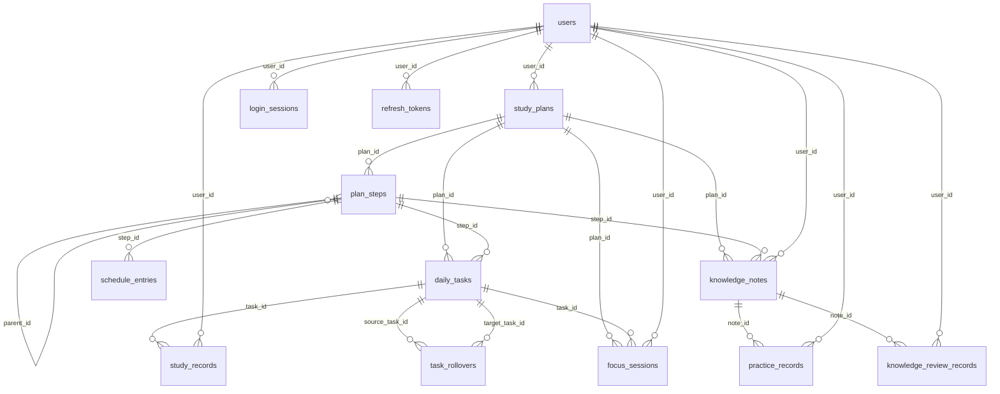

# Smart Study Planner V3.0 数据库结构说明

- 数据库：`smart_study_planner`
- 生成时间：2026-11-28 14:45:09
- 表数量：19
- 外键数量：22

## 1. 表清单

| 序号 | 表名 | 说明 | 当前行数 |
| ---: | --- | --- | ---: |
| 1 | `admin_audit_logs` | 管理员操作审计日志（长期保留，不级联删除） | 25 |
| 2 | `ai_guard_mutex` | - | 1 |
| 3 | `ai_requests` | - | 200 |
| 4 | `ai_runtime_config` | AI 运行时动态配置（固定单行，id=1） | 1 |
| 5 | `auth_events` | 认证安全事件（保留 30 天） | 10 |
| 6 | `daily_tasks` | - | 747 |
| 7 | `email_verifications` | 邮箱验证码与发送额度 | 0 |
| 8 | `focus_sessions` | - | 113 |
| 9 | `knowledge_notes` | - | 100 |
| 10 | `knowledge_review_records` | - | 140 |
| 11 | `login_sessions` | 登录会话（多设备管理） | 2 |
| 12 | `plan_steps` | - | 307 |
| 13 | `practice_records` | - | 50 |
| 14 | `refresh_tokens` | 刷新令牌表 | 2 |
| 15 | `schedule_entries` | - | 0 |
| 16 | `study_plans` | - | 72 |
| 17 | `study_records` | - | 482 |
| 18 | `task_rollovers` | - | 24 |
| 19 | `users` | 用户表 | 31 |

## 2. 表关系总览

| 子表.字段 | 父表.字段 | 约束名 | ON UPDATE | ON DELETE |
| --- | --- | --- | --- | --- |
| `daily_tasks.plan_id` | `study_plans.id` | `fk_daily_tasks_plan` | NO ACTION | NO ACTION |
| `daily_tasks.step_id` | `plan_steps.id` | `fk_daily_tasks_step` | NO ACTION | NO ACTION |
| `focus_sessions.plan_id` | `study_plans.id` | `fk_focus_plan` | NO ACTION | SET NULL |
| `focus_sessions.task_id` | `daily_tasks.id` | `fk_focus_task` | NO ACTION | SET NULL |
| `focus_sessions.user_id` | `users.id` | `fk_focus_user` | NO ACTION | CASCADE |
| `knowledge_notes.plan_id` | `study_plans.id` | `fk_notes_plan` | NO ACTION | SET NULL |
| `knowledge_notes.step_id` | `plan_steps.id` | `fk_notes_step` | NO ACTION | SET NULL |
| `knowledge_notes.user_id` | `users.id` | `fk_notes_user` | NO ACTION | CASCADE |
| `knowledge_review_records.note_id` | `knowledge_notes.id` | `fk_review_note` | NO ACTION | CASCADE |
| `knowledge_review_records.user_id` | `users.id` | `fk_review_user` | NO ACTION | CASCADE |
| `login_sessions.user_id` | `users.id` | `fk_login_sessions_user` | NO ACTION | CASCADE |
| `plan_steps.parent_id` | `plan_steps.id` | `fk_plan_steps_parent` | NO ACTION | NO ACTION |
| `plan_steps.plan_id` | `study_plans.id` | `fk_plan_steps_plan` | NO ACTION | NO ACTION |
| `practice_records.note_id` | `knowledge_notes.id` | `fk_practice_note` | NO ACTION | SET NULL |
| `practice_records.user_id` | `users.id` | `fk_practice_user` | NO ACTION | CASCADE |
| `refresh_tokens.user_id` | `users.id` | `fk_refresh_token_user` | NO ACTION | CASCADE |
| `schedule_entries.step_id` | `plan_steps.id` | `fk_schedule_entries_step` | NO ACTION | NO ACTION |
| `study_plans.user_id` | `users.id` | `fk_study_plans_user` | NO ACTION | NO ACTION |
| `study_records.task_id` | `daily_tasks.id` | `fk_study_records_task` | NO ACTION | NO ACTION |
| `study_records.user_id` | `users.id` | `fk_study_records_user` | NO ACTION | NO ACTION |
| `task_rollovers.source_task_id` | `daily_tasks.id` | `fk_task_rollovers_source` | NO ACTION | NO ACTION |
| `task_rollovers.target_task_id` | `daily_tasks.id` | `fk_task_rollovers_target` | NO ACTION | NO ACTION |

## 3. ER 关系图

## 4. 各表字段明细

### 4.1 `admin_audit_logs`

> 管理员操作审计日志（长期保留，不级联删除）

| # | 字段 | 类型 | 可空 | 键 | 默认值 | 额外 | 说明 |
| ---: | --- | --- | --- | --- | --- | --- | --- |
| 1 | `id` | `bigint unsigned` | NO | PRI | - | auto_increment | 主键 |
| 2 | `admin_id` | `bigint unsigned` | NO | MUL | - | - | 操作管理员 users.id（不建外键，审计长期保留） |
| 3 | `action` | `varchar(32)` | NO | MUL | - | - | 操作类型：BAN_USER / UNBAN_USER / REVOKE_SESSIONS / UPDATE_AI_CONFIG |
| 4 | `target_type` | `varchar(32)` | NO | MUL | - | - | 目标类型：USER / AI_CONFIG |
| 5 | `target_id` | `bigint unsigned` | NO | - | - | - | 目标主键（users.id 或 ai_runtime_config.id） |
| 6 | `before_data` | `json` | NO | - | - | - | 变更前快照（禁止存放密码哈希/Token） |
| 7 | `after_data` | `json` | NO | - | - | - | 变更后快照（禁止存放密码哈希/Token） |
| 8 | `reason` | `varchar(200)` | NO | - | - | - | 操作原因（1~200 字符） |
| 9 | `created_at` | `datetime(6)` | NO | MUL | - | - | 操作时间（UTC，由后端显式写入） |

**索引**

| 索引名 | 唯一 | 类型 | 字段（按顺序） |
| --- | --- | --- | --- |
| `idx_admin_audit_action_created` | 否 | BTREE | action, created_at |
| `idx_admin_audit_admin_created` | 否 | BTREE | admin_id, created_at |
| `idx_admin_audit_created` | 否 | BTREE | created_at |
| `idx_admin_audit_target` | 否 | BTREE | target_type, target_id, created_at |
| `PRIMARY` | 是 | BTREE | id |

### 4.2 `ai_guard_mutex`

| # | 字段 | 类型 | 可空 | 键 | 默认值 | 额外 | 说明 |
| ---: | --- | --- | --- | --- | --- | --- | --- |
| 1 | `id` | `tinyint unsigned` | NO | PRI | - | - | - |

**索引**

| 索引名 | 唯一 | 类型 | 字段（按顺序） |
| --- | --- | --- | --- |
| `PRIMARY` | 是 | BTREE | id |

### 4.3 `ai_requests`

| # | 字段 | 类型 | 可空 | 键 | 默认值 | 额外 | 说明 |
| ---: | --- | --- | --- | --- | --- | --- | --- |
| 1 | `request_id` | `char(36)` | NO | PRI | - | - | - |
| 2 | `user_id` | `bigint unsigned` | NO | MUL | - | - | - |
| 3 | `note_id` | `bigint unsigned` | YES | - | - | - | - |
| 4 | `operation` | `varchar(24)` | NO | - | - | - | - |
| 5 | `request_date` | `date` | NO | MUL | - | - | - |
| 6 | `status` | `varchar(20)` | NO | MUL | - | - | - |
| 7 | `leased_until` | `datetime(6)` | NO | - | - | - | - |
| 8 | `created_at` | `datetime(6)` | NO | - | CURRENT_TIMESTAMP(6) | DEFAULT_GENERATED | - |
| 9 | `finished_at` | `datetime(6)` | YES | - | - | - | - |
| 10 | `prompt_tokens` | `int unsigned` | YES | - | - | - | - |
| 11 | `completion_tokens` | `int unsigned` | YES | - | - | - | - |

**索引**

| 索引名 | 唯一 | 类型 | 字段（按顺序） |
| --- | --- | --- | --- |
| `idx_ai_active` | 否 | BTREE | status, leased_until |
| `idx_ai_request_date` | 否 | BTREE | request_date |
| `idx_ai_user_date` | 否 | BTREE | user_id, request_date |
| `PRIMARY` | 是 | BTREE | request_id |

### 4.4 `ai_runtime_config`

> AI 运行时动态配置（固定单行，id=1）

| # | 字段 | 类型 | 可空 | 键 | 默认值 | 额外 | 说明 |
| ---: | --- | --- | --- | --- | --- | --- | --- |
| 1 | `id` | `tinyint unsigned` | NO | PRI | - | - | 固定为 1（单行配置） |
| 2 | `enabled` | `tinyint` | NO | - | 1 | - | AI 总开关：1 开启，0 关闭 |
| 3 | `user_daily_limit` | `int unsigned` | NO | - | 10 | - | 单用户每日 AI 请求额度 |
| 4 | `global_daily_limit` | `int unsigned` | NO | - | 80 | - | 全站每日 AI 请求额度 |
| 5 | `updated_at` | `datetime(6)` | NO | - | - | - | 最后修改时间（UTC，应用显式写入） |

**索引**

| 索引名 | 唯一 | 类型 | 字段（按顺序） |
| --- | --- | --- | --- |
| `PRIMARY` | 是 | BTREE | id |

### 4.5 `auth_events`

> 认证安全事件（保留 30 天）

| # | 字段 | 类型 | 可空 | 键 | 默认值 | 额外 | 说明 |
| ---: | --- | --- | --- | --- | --- | --- | --- |
| 1 | `id` | `bigint unsigned` | NO | PRI | - | auto_increment | 主键 |
| 2 | `user_id` | `bigint unsigned` | YES | MUL | - | - | 用户 ID（不建外键，保留历史） |
| 3 | `identifier` | `varchar(254)` | YES | MUL | - | - | 登录标识（用户名/邮箱） |
| 4 | `event_type` | `varchar(32)` | NO | MUL | - | - | 事件类型 |
| 5 | `ip` | `varchar(45)` | YES | MUL | - | - | 请求 IP |
| 6 | `family_id` | `char(36)` | YES | - | - | - | 关联会话 |
| 7 | `created_at` | `datetime(6)` | NO | - | - | - | 发生时间（UTC） |

**索引**

| 索引名 | 唯一 | 类型 | 字段（按顺序） |
| --- | --- | --- | --- |
| `idx_auth_events_identifier_type_time` | 否 | BTREE | identifier, event_type, created_at |
| `idx_auth_events_ip_type_time` | 否 | BTREE | ip, event_type, created_at |
| `idx_auth_events_type_time` | 否 | BTREE | event_type, created_at |
| `idx_auth_events_user_time` | 否 | BTREE | user_id, created_at |
| `PRIMARY` | 是 | BTREE | id |

### 4.6 `daily_tasks`

| # | 字段 | 类型 | 可空 | 键 | 默认值 | 额外 | 说明 |
| ---: | --- | --- | --- | --- | --- | --- | --- |
| 1 | `id` | `bigint unsigned` | NO | PRI | - | auto_increment | - |
| 2 | `plan_id` | `bigint unsigned` | NO | MUL | - | - | - |
| 3 | `step_id` | `bigint unsigned` | NO | MUL | - | - | - |
| 4 | `task_date` | `date` | NO | - | - | - | - |
| 5 | `task_type` | `enum('BOOLEAN','NUMERIC')` | NO | - | - | - | - |
| 6 | `content` | `varchar(255)` | NO | - | - | - | - |
| 7 | `target_quantity` | `bigint unsigned` | YES | - | - | - | - |
| 8 | `actual_quantity` | `bigint unsigned` | NO | - | 0 | - | - |
| 9 | `rollover_out_quantity` | `bigint unsigned` | NO | - | 0 | - | - |
| 10 | `status` | `enum('PENDING','IN_PROGRESS','COMPLETED','OVERDUE','ENDED')` | NO | - | PENDING | - | - |
| 11 | `completed_at` | `datetime` | YES | - | - | - | - |
| 12 | `deleted_at` | `datetime` | YES | - | - | - | - |
| 13 | `created_at` | `datetime` | NO | - | CURRENT_TIMESTAMP | DEFAULT_GENERATED | - |
| 14 | `updated_at` | `datetime` | NO | - | CURRENT_TIMESTAMP | DEFAULT_GENERATED on update CURRENT_TIMESTAMP | - |
| 15 | `numeric_active_date` | `date` | YES | - | - | STORED GENERATED | - |

**外键（本表引用）**

- `plan_id` → `study_plans.id` （fk_daily_tasks_plan，ON DELETE NO ACTION）
- `step_id` → `plan_steps.id` （fk_daily_tasks_step，ON DELETE NO ACTION）

**被引用（其它表指向本表）**

- `focus_sessions.task_id` → `task_id`（fk_focus_task）
- `study_records.task_id` → `task_id`（fk_study_records_task）
- `task_rollovers.source_task_id` → `source_task_id`（fk_task_rollovers_source）
- `task_rollovers.target_task_id` → `target_task_id`（fk_task_rollovers_target）

**索引**

| 索引名 | 唯一 | 类型 | 字段（按顺序） |
| --- | --- | --- | --- |
| `idx_daily_tasks_plan_date` | 否 | BTREE | plan_id, task_date, deleted_at |
| `idx_daily_tasks_step_date` | 否 | BTREE | step_id, task_date |
| `PRIMARY` | 是 | BTREE | id |
| `uk_daily_tasks_numeric_day` | 是 | BTREE | step_id, numeric_active_date |

### 4.7 `email_verifications`

> 邮箱验证码与发送额度

| # | 字段 | 类型 | 可空 | 键 | 默认值 | 额外 | 说明 |
| ---: | --- | --- | --- | --- | --- | --- | --- |
| 1 | `id` | `bigint unsigned` | NO | PRI | - | auto_increment | 主键 |
| 2 | `email` | `varchar(254)` | NO | MUL | - | - | 目标邮箱（统一小写） |
| 3 | `purpose` | `enum('REGISTER','LOGIN','RESET_PASSWORD','CHANGE_EMAIL_OLD','CHANGE_EMAIL_NEW')` | NO | - | - | - | 验证码用途 |
| 4 | `user_id` | `bigint unsigned` | YES | - | - | - | 关联用户（换绑/重置时必填） |
| 5 | `family_id` | `char(36)` | YES | - | - | - | 绑定的登录会话（换绑时必填） |
| 6 | `code_hash` | `char(64)` | NO | - | - | - | 验证码 HMAC-SHA256 摘要 |
| 7 | `attempts` | `tinyint unsigned` | NO | - | 0 | - | 已尝试次数 |
| 8 | `created_at` | `datetime(6)` | NO | MUL | - | - | 创建时间（UTC） |
| 9 | `expires_at` | `datetime(6)` | NO | MUL | - | - | 过期时间（UTC） |
| 10 | `consumed_at` | `datetime(6)` | YES | - | - | - | 消费时间（UTC） |
| 11 | `invalidated_at` | `datetime(6)` | YES | - | - | - | 主动作废时间（UTC） |
| 12 | `request_ip` | `varchar(45)` | NO | MUL | - | - | 请求 IP |
| 13 | `send_status` | `enum('PENDING','SENT','FAILED')` | NO | - | PENDING | - | 发送状态 |

**索引**

| 索引名 | 唯一 | 类型 | 字段（按顺序） |
| --- | --- | --- | --- |
| `idx_email_verifications_created` | 否 | BTREE | created_at |
| `idx_email_verifications_email_created` | 否 | BTREE | email, created_at |
| `idx_email_verifications_email_purpose_created` | 否 | BTREE | email, purpose, created_at |
| `idx_email_verifications_expires` | 否 | BTREE | expires_at |
| `idx_email_verifications_ip_created` | 否 | BTREE | request_ip, created_at |
| `PRIMARY` | 是 | BTREE | id |

### 4.8 `focus_sessions`

| # | 字段 | 类型 | 可空 | 键 | 默认值 | 额外 | 说明 |
| ---: | --- | --- | --- | --- | --- | --- | --- |
| 1 | `id` | `bigint unsigned` | NO | PRI | - | auto_increment | - |
| 2 | `user_id` | `bigint unsigned` | NO | MUL | - | - | - |
| 3 | `plan_id` | `bigint unsigned` | YES | MUL | - | - | - |
| 4 | `task_id` | `bigint unsigned` | YES | MUL | - | - | - |
| 5 | `session_type` | `enum('POMODORO','STOPWATCH')` | NO | - | - | - | - |
| 6 | `status` | `enum('RUNNING','PAUSED','COMPLETED','CANCELLED')` | NO | - | RUNNING | - | - |
| 7 | `planned_seconds` | `int unsigned` | YES | - | - | - | - |
| 8 | `focused_seconds` | `int unsigned` | NO | - | 0 | - | - |
| 9 | `running_started_at` | `datetime(6)` | YES | - | - | - | - |
| 10 | `started_at` | `datetime(6)` | NO | - | CURRENT_TIMESTAMP(6) | DEFAULT_GENERATED | - |
| 11 | `ended_at` | `datetime(6)` | YES | - | - | - | - |
| 12 | `focus_date` | `date` | NO | - | - | - | - |
| 13 | `created_at` | `datetime(6)` | NO | - | CURRENT_TIMESTAMP(6) | DEFAULT_GENERATED | - |
| 14 | `updated_at` | `datetime(6)` | NO | - | CURRENT_TIMESTAMP(6) | DEFAULT_GENERATED on update CURRENT_TIMESTAMP(6) | - |

**外键（本表引用）**

- `plan_id` → `study_plans.id` （fk_focus_plan，ON DELETE SET NULL）
- `task_id` → `daily_tasks.id` （fk_focus_task，ON DELETE SET NULL）
- `user_id` → `users.id` （fk_focus_user，ON DELETE CASCADE）

**索引**

| 索引名 | 唯一 | 类型 | 字段（按顺序） |
| --- | --- | --- | --- |
| `idx_focus_plan` | 否 | BTREE | plan_id |
| `idx_focus_task` | 否 | BTREE | task_id |
| `idx_focus_user_date` | 否 | BTREE | user_id, focus_date |
| `idx_focus_user_started` | 否 | BTREE | user_id, started_at |
| `idx_focus_user_status` | 否 | BTREE | user_id, status |
| `PRIMARY` | 是 | BTREE | id |

### 4.9 `knowledge_notes`

| # | 字段 | 类型 | 可空 | 键 | 默认值 | 额外 | 说明 |
| ---: | --- | --- | --- | --- | --- | --- | --- |
| 1 | `id` | `bigint unsigned` | NO | PRI | - | auto_increment | - |
| 2 | `user_id` | `bigint unsigned` | NO | MUL | - | - | - |
| 3 | `plan_id` | `bigint unsigned` | YES | MUL | - | - | - |
| 4 | `step_id` | `bigint unsigned` | YES | MUL | - | - | - |
| 5 | `title` | `varchar(255)` | NO | - | - | - | - |
| 6 | `content_md` | `mediumtext` | NO | - | - | - | - |
| 7 | `tags` | `json` | NO | - | json_array() | DEFAULT_GENERATED | - |
| 8 | `created_at` | `datetime` | NO | - | CURRENT_TIMESTAMP | DEFAULT_GENERATED | - |
| 9 | `updated_at` | `datetime` | NO | - | CURRENT_TIMESTAMP | DEFAULT_GENERATED on update CURRENT_TIMESTAMP | - |
| 10 | `deleted_at` | `datetime` | YES | - | - | - | - |

**外键（本表引用）**

- `plan_id` → `study_plans.id` （fk_notes_plan，ON DELETE SET NULL）
- `step_id` → `plan_steps.id` （fk_notes_step，ON DELETE SET NULL）
- `user_id` → `users.id` （fk_notes_user，ON DELETE CASCADE）

**被引用（其它表指向本表）**

- `knowledge_review_records.note_id` → `note_id`（fk_review_note）
- `practice_records.note_id` → `note_id`（fk_practice_note）

**索引**

| 索引名 | 唯一 | 类型 | 字段（按顺序） |
| --- | --- | --- | --- |
| `idx_notes_plan` | 否 | BTREE | plan_id |
| `idx_notes_step` | 否 | BTREE | step_id |
| `idx_notes_user_deleted` | 否 | BTREE | user_id, deleted_at |
| `PRIMARY` | 是 | BTREE | id |

### 4.10 `knowledge_review_records`

| # | 字段 | 类型 | 可空 | 键 | 默认值 | 额外 | 说明 |
| ---: | --- | --- | --- | --- | --- | --- | --- |
| 1 | `id` | `bigint unsigned` | NO | PRI | - | auto_increment | - |
| 2 | `note_id` | `bigint unsigned` | NO | MUL | - | - | - |
| 3 | `user_id` | `bigint unsigned` | NO | MUL | - | - | - |
| 4 | `reviewed_at` | `datetime` | NO | - | CURRENT_TIMESTAMP | DEFAULT_GENERATED | - |

**外键（本表引用）**

- `note_id` → `knowledge_notes.id` （fk_review_note，ON DELETE CASCADE）
- `user_id` → `users.id` （fk_review_user，ON DELETE CASCADE）

**索引**

| 索引名 | 唯一 | 类型 | 字段（按顺序） |
| --- | --- | --- | --- |
| `idx_review_note_time` | 否 | BTREE | note_id, reviewed_at |
| `idx_review_user_time` | 否 | BTREE | user_id, reviewed_at |
| `PRIMARY` | 是 | BTREE | id |

### 4.11 `login_sessions`

> 登录会话（多设备管理）

| # | 字段 | 类型 | 可空 | 键 | 默认值 | 额外 | 说明 |
| ---: | --- | --- | --- | --- | --- | --- | --- |
| 1 | `family_id` | `char(36)` | NO | PRI | - | - | 会话 ID，等于 refresh_tokens.family_id |
| 2 | `user_id` | `bigint unsigned` | NO | MUL | - | - | 用户 ID |
| 3 | `user_agent` | `varchar(255)` | YES | - | - | - | 登录设备 User-Agent |
| 4 | `created_at` | `datetime(6)` | NO | - | - | - | 创建时间（UTC） |
| 5 | `last_activity_at` | `datetime(6)` | NO | - | - | - | 最后活跃时间（UTC） |
| 6 | `absolute_expires_at` | `datetime(6)` | NO | MUL | - | - | 会话绝对过期时间（UTC） |
| 7 | `revoked_at` | `datetime(6)` | YES | - | - | - | 撤销时间（UTC） |
| 8 | `revoked_reason` | `varchar(32)` | YES | - | - | - | LOGOUT/LOGOUT_ALL/REPLAY/PASSWORD_CHANGED/ADMIN |

**外键（本表引用）**

- `user_id` → `users.id` （fk_login_sessions_user，ON DELETE CASCADE）

**索引**

| 索引名 | 唯一 | 类型 | 字段（按顺序） |
| --- | --- | --- | --- |
| `idx_login_sessions_expires` | 否 | BTREE | absolute_expires_at |
| `idx_login_sessions_user_active` | 否 | BTREE | user_id, revoked_at, absolute_expires_at |
| `PRIMARY` | 是 | BTREE | family_id |

### 4.12 `plan_steps`

| # | 字段 | 类型 | 可空 | 键 | 默认值 | 额外 | 说明 |
| ---: | --- | --- | --- | --- | --- | --- | --- |
| 1 | `id` | `bigint unsigned` | NO | PRI | - | auto_increment | - |
| 2 | `plan_id` | `bigint unsigned` | NO | MUL | - | - | - |
| 3 | `parent_id` | `bigint unsigned` | YES | MUL | - | - | - |
| 4 | `name` | `varchar(100)` | NO | - | - | - | - |
| 5 | `description` | `text` | YES | - | - | - | - |
| 6 | `node_type` | `enum('GROUP','LEAF')` | NO | - | - | - | - |
| 7 | `task_type` | `enum('BOOLEAN','NUMERIC')` | YES | - | - | - | - |
| 8 | `schedule_mode` | `enum('REPEAT','DAILY_CUSTOM','AUTO_DISTRIBUTE','DAILY_MANUAL')` | YES | - | - | - | - |
| 9 | `repeat_content` | `varchar(255)` | YES | - | - | - | - |
| 10 | `total_target` | `bigint unsigned` | YES | - | - | - | - |
| 11 | `sort_order` | `int unsigned` | NO | - | 0 | - | - |
| 12 | `deleted_at` | `datetime` | YES | - | - | - | - |
| 13 | `created_at` | `datetime` | NO | - | CURRENT_TIMESTAMP | DEFAULT_GENERATED | - |
| 14 | `updated_at` | `datetime` | NO | - | CURRENT_TIMESTAMP | DEFAULT_GENERATED on update CURRENT_TIMESTAMP | - |

**外键（本表引用）**

- `parent_id` → `plan_steps.id` （fk_plan_steps_parent，ON DELETE NO ACTION）
- `plan_id` → `study_plans.id` （fk_plan_steps_plan，ON DELETE NO ACTION）

**被引用（其它表指向本表）**

- `daily_tasks.step_id` → `step_id`（fk_daily_tasks_step）
- `knowledge_notes.step_id` → `step_id`（fk_notes_step）
- `plan_steps.parent_id` → `parent_id`（fk_plan_steps_parent）
- `schedule_entries.step_id` → `step_id`（fk_schedule_entries_step）

**索引**

| 索引名 | 唯一 | 类型 | 字段（按顺序） |
| --- | --- | --- | --- |
| `fk_plan_steps_parent` | 否 | BTREE | parent_id |
| `idx_plan_steps_tree` | 否 | BTREE | plan_id, parent_id, deleted_at |
| `PRIMARY` | 是 | BTREE | id |

### 4.13 `practice_records`

| # | 字段 | 类型 | 可空 | 键 | 默认值 | 额外 | 说明 |
| ---: | --- | --- | --- | --- | --- | --- | --- |
| 1 | `id` | `bigint unsigned` | NO | PRI | - | auto_increment | - |
| 2 | `user_id` | `bigint unsigned` | NO | MUL | - | - | - |
| 3 | `note_id` | `bigint unsigned` | YES | MUL | - | - | - |
| 4 | `note_title_snapshot` | `varchar(255)` | NO | - | - | - | - |
| 5 | `generation_id` | `char(36)` | NO | - | - | - | - |
| 6 | `question_count` | `tinyint unsigned` | NO | - | - | - | - |
| 7 | `score` | `decimal(5,2)` | NO | - | - | - | - |
| 8 | `questions_json` | `json` | NO | - | - | - | - |
| 9 | `created_at` | `datetime(6)` | NO | - | CURRENT_TIMESTAMP(6) | DEFAULT_GENERATED | - |

**外键（本表引用）**

- `note_id` → `knowledge_notes.id` （fk_practice_note，ON DELETE SET NULL）
- `user_id` → `users.id` （fk_practice_user，ON DELETE CASCADE）

**索引**

| 索引名 | 唯一 | 类型 | 字段（按顺序） |
| --- | --- | --- | --- |
| `idx_practice_note` | 否 | BTREE | note_id |
| `idx_practice_user_created` | 否 | BTREE | user_id, created_at, id |
| `idx_practice_user_note_created` | 否 | BTREE | user_id, note_id, created_at, id |
| `PRIMARY` | 是 | BTREE | id |
| `uk_practice_user_generation` | 是 | BTREE | user_id, generation_id |

### 4.14 `refresh_tokens`

> 刷新令牌表

| # | 字段 | 类型 | 可空 | 键 | 默认值 | 额外 | 说明 |
| ---: | --- | --- | --- | --- | --- | --- | --- |
| 1 | `id` | `bigint unsigned` | NO | PRI | - | auto_increment | 主键 |
| 2 | `user_id` | `bigint unsigned` | NO | MUL | - | - | 用户 ID |
| 3 | `token_hash` | `char(64)` | NO | UNI | - | - | Refresh Token 的 SHA-256 摘要 |
| 4 | `family_id` | `char(36)` | NO | - | - | - | 登录会话家族 |
| 5 | `expires_at` | `datetime` | NO | MUL | - | - | 过期时间 |
| 6 | `revoked_at` | `datetime` | YES | - | - | - | 撤销时间 |
| 7 | `replaced_by` | `char(64)` | YES | - | - | - | 下一代 Token 摘要 |
| 8 | `created_at` | `datetime` | NO | - | CURRENT_TIMESTAMP | DEFAULT_GENERATED | 创建时间 |

**外键（本表引用）**

- `user_id` → `users.id` （fk_refresh_token_user，ON DELETE CASCADE）

**索引**

| 索引名 | 唯一 | 类型 | 字段（按顺序） |
| --- | --- | --- | --- |
| `idx_refresh_expires_at` | 否 | BTREE | expires_at |
| `idx_refresh_user_family` | 否 | BTREE | user_id, family_id |
| `PRIMARY` | 是 | BTREE | id |
| `uk_refresh_token_hash` | 是 | BTREE | token_hash |

### 4.15 `schedule_entries`

|   # | 字段                | 类型                | 可空  | 键   | 默认值               | 额外                                            | 说明  |
| --: | ----------------- | ----------------- | --- | --- | ----------------- | --------------------------------------------- | --- |
|   1 | `id`              | `bigint unsigned` | NO  | PRI | -                 | auto_increment                                | -   |
|   2 | `step_id`         | `bigint unsigned` | NO  | MUL | -                 | -                                             | -   |
|   3 | `task_date`       | `date`            | NO  | -   | -                 | -                                             | -   |
|   4 | `content`         | `varchar(255)`    | YES | -   | -                 | -                                             | -   |
|   5 | `target_quantity` | `bigint unsigned` | YES | -   | -                 | -                                             | -   |
|   6 | `sort_order`      | `int unsigned`    | NO  | -   | 0                 | -                                             | -   |
|   7 | `deleted_at`      | `datetime`        | YES | -   | -                 | -                                             | -   |
|   8 | `created_at`      | `datetime`        | NO  | -   | CURRENT_TIMESTAMP | DEFAULT_GENERATED                             | -   |
|   9 | `updated_at`      | `datetime`        | NO  | -   | CURRENT_TIMESTAMP | DEFAULT_GENERATED on update CURRENT_TIMESTAMP | -   |

**外键（本表引用）**

- `step_id` → `plan_steps.id` （fk_schedule_entries_step，ON DELETE NO ACTION）

**索引**

| 索引名 | 唯一 | 类型 | 字段（按顺序） |
| --- | --- | --- | --- |
| `idx_schedule_entries_step_date` | 否 | BTREE | step_id, task_date, deleted_at |
| `PRIMARY` | 是 | BTREE | id |

### 4.16 `study_plans`

| # | 字段 | 类型 | 可空 | 键 | 默认值 | 额外 | 说明 |
| ---: | --- | --- | --- | --- | --- | --- | --- |
| 1 | `id` | `bigint unsigned` | NO | PRI | - | auto_increment | - |
| 2 | `user_id` | `bigint unsigned` | NO | MUL | - | - | - |
| 3 | `name` | `varchar(100)` | NO | - | - | - | - |
| 4 | `description` | `text` | YES | - | - | - | - |
| 5 | `start_date` | `date` | NO | - | - | - | - |
| 6 | `end_date` | `date` | NO | - | - | - | - |
| 7 | `status` | `enum('DRAFT','ACTIVE','ENDED')` | NO | - | DRAFT | - | - |
| 8 | `started_at` | `datetime` | YES | - | - | - | - |
| 9 | `ended_at` | `datetime` | YES | - | - | - | - |
| 10 | `deleted_at` | `datetime` | YES | - | - | - | - |
| 11 | `created_at` | `datetime` | NO | - | CURRENT_TIMESTAMP | DEFAULT_GENERATED | - |
| 12 | `updated_at` | `datetime` | NO | - | CURRENT_TIMESTAMP | DEFAULT_GENERATED on update CURRENT_TIMESTAMP | - |

**外键（本表引用）**

- `user_id` → `users.id` （fk_study_plans_user，ON DELETE NO ACTION）

**被引用（其它表指向本表）**

- `daily_tasks.plan_id` → `plan_id`（fk_daily_tasks_plan）
- `focus_sessions.plan_id` → `plan_id`（fk_focus_plan）
- `knowledge_notes.plan_id` → `plan_id`（fk_notes_plan）
- `plan_steps.plan_id` → `plan_id`（fk_plan_steps_plan）

**索引**

| 索引名 | 唯一 | 类型 | 字段（按顺序） |
| --- | --- | --- | --- |
| `idx_study_plans_user_status` | 否 | BTREE | user_id, status, deleted_at |
| `PRIMARY` | 是 | BTREE | id |

### 4.17 `study_records`

| # | 字段 | 类型 | 可空 | 键 | 默认值 | 额外 | 说明 |
| ---: | --- | --- | --- | --- | --- | --- | --- |
| 1 | `id` | `bigint unsigned` | NO | PRI | - | auto_increment | - |
| 2 | `task_id` | `bigint unsigned` | NO | MUL | - | - | - |
| 3 | `user_id` | `bigint unsigned` | NO | MUL | - | - | - |
| 4 | `event_type` | `enum('BOOLEAN_COMPLETE','NUMERIC_PROGRESS')` | NO | - | - | - | - |
| 5 | `recorded_value` | `bigint unsigned` | YES | - | - | - | - |
| 6 | `task_date` | `date` | NO | - | - | - | - |
| 7 | `recorded_at` | `datetime` | NO | - | CURRENT_TIMESTAMP | DEFAULT_GENERATED | - |

**外键（本表引用）**

- `task_id` → `daily_tasks.id` （fk_study_records_task，ON DELETE NO ACTION）
- `user_id` → `users.id` （fk_study_records_user，ON DELETE NO ACTION）

**索引**

| 索引名 | 唯一 | 类型 | 字段（按顺序） |
| --- | --- | --- | --- |
| `fk_study_records_user` | 否 | BTREE | user_id |
| `idx_study_records_task_time` | 否 | BTREE | task_id, recorded_at |
| `PRIMARY` | 是 | BTREE | id |

### 4.18 `task_rollovers`

| # | 字段 | 类型 | 可空 | 键 | 默认值 | 额外 | 说明 |
| ---: | --- | --- | --- | --- | --- | --- | --- |
| 1 | `id` | `bigint unsigned` | NO | PRI | - | auto_increment | - |
| 2 | `source_task_id` | `bigint unsigned` | NO | MUL | - | - | - |
| 3 | `target_task_id` | `bigint unsigned` | NO | MUL | - | - | - |
| 4 | `quantity` | `bigint unsigned` | YES | - | - | - | - |
| 5 | `created_at` | `datetime` | NO | - | CURRENT_TIMESTAMP | DEFAULT_GENERATED | - |

**外键（本表引用）**

- `source_task_id` → `daily_tasks.id` （fk_task_rollovers_source，ON DELETE NO ACTION）
- `target_task_id` → `daily_tasks.id` （fk_task_rollovers_target，ON DELETE NO ACTION）

**索引**

| 索引名 | 唯一 | 类型 | 字段（按顺序） |
| --- | --- | --- | --- |
| `fk_task_rollovers_target` | 否 | BTREE | target_task_id |
| `PRIMARY` | 是 | BTREE | id |
| `uk_rollover_source_target` | 是 | BTREE | source_task_id, target_task_id |

### 4.19 `users`

> 用户表

| # | 字段 | 类型 | 可空 | 键 | 默认值 | 额外 | 说明 |
| ---: | --- | --- | --- | --- | --- | --- | --- |
| 1 | `id` | `bigint unsigned` | NO | PRI | - | auto_increment | - |
| 2 | `username` | `varchar(50)` | NO | UNI | - | - | 登录用户名 |
| 3 | `password_hash` | `varchar(255)` | NO | - | - | - | 密码哈希 |
| 4 | `password_updated_at` | `datetime(6)` | NO | - | - | - | 密码最近修改时间（UTC） |
| 5 | `email` | `varchar(254)` | NO | UNI | - | - | 邮箱（登录标识，统一小写） |
| 6 | `email_verified_at` | `datetime(6)` | NO | - | - | - | 邮箱验证时间（UTC） |
| 7 | `nickname` | `varchar(50)` | YES | - | - | - | 用户昵称 |
| 8 | `avatar_url` | `varchar(255)` | YES | - | - | - | 头像地址（可选） |
| 9 | `created_at` | `datetime` | NO | - | CURRENT_TIMESTAMP | DEFAULT_GENERATED | - |
| 10 | `updated_at` | `datetime` | NO | - | CURRENT_TIMESTAMP | DEFAULT_GENERATED on update CURRENT_TIMESTAMP | - |
| 11 | `is_active` | `tinyint` | NO | - | 1 | - | Whether the user account is active |
| 12 | `role` | `enum('USER','ADMIN')` | NO | - | USER | - | 用户角色：USER=普通用户，ADMIN=管理员 |

**被引用（其它表指向本表）**

- `focus_sessions.user_id` → `user_id`（fk_focus_user）
- `knowledge_notes.user_id` → `user_id`（fk_notes_user）
- `knowledge_review_records.user_id` → `user_id`（fk_review_user）
- `login_sessions.user_id` → `user_id`（fk_login_sessions_user）
- `practice_records.user_id` → `user_id`（fk_practice_user）
- `refresh_tokens.user_id` → `user_id`（fk_refresh_token_user）
- `study_plans.user_id` → `user_id`（fk_study_plans_user）
- `study_records.user_id` → `user_id`（fk_study_records_user）

**索引**

| 索引名 | 唯一 | 类型 | 字段（按顺序） |
| --- | --- | --- | --- |
| `PRIMARY` | 是 | BTREE | id |
| `uk_users_email` | 是 | BTREE | email |
| `uk_users_username` | 是 | BTREE | username |

