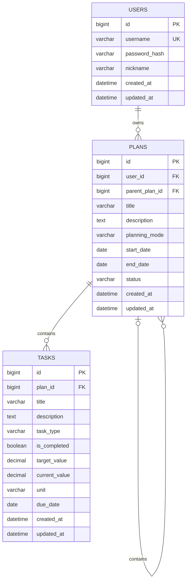

# 智能学习计划管理系统 — 数据库设计 v1.0

## 一、设计范围

数据库采用 MySQL 8.0。

第一阶段设计三张核心表：
1. users：用户表
2. plans：学习计划表
3. tasks：每日任务表

暂不设计学习历史、标签、提醒等扩展功能。

## 二、ER 图

## 三、表结构设计

### 1. users 用户表

| 字段 | 类型 | 约束 | 说明 |
|---|---|---|---|
| id | BIGINT UNSIGNED | PK, 自增 | 用户 ID |
| username | VARCHAR(50) | NOT NULL, UNIQUE | 登录用户名 |
| password_hash | VARCHAR(255) | NOT NULL | 密码哈希，不存明文密码 |
| nickname | VARCHAR(50) | 可为空 | 用户昵称 |
| created_at | DATETIME | NOT NULL | 创建时间 |
| updated_at | DATETIME | NOT NULL | 更新时间 |

### 2. plans 学习计划表

| 字段 | 类型 | 约束 | 说明 |
|---|---|---|---|
| id | BIGINT UNSIGNED | PK, 自增 | 计划 ID |
| user_id | BIGINT UNSIGNED | FK, NOT NULL | 所属用户 |
| parent_plan_id | BIGINT UNSIGNED | FK, 可为空 | 父计划 ID |
| title | VARCHAR(100) | NOT NULL | 计划名称 |
| description | TEXT | 可为空 | 计划描述 |
| planning_mode | ENUM | NOT NULL | 细分模式或每日任务模式 |
| start_date | DATE | 可为空 | 开始日期 |
| end_date | DATE | 可为空 | 结束日期 |
| status | ENUM | NOT NULL | ACTIVE、PAUSED、ARCHIVED |
| created_at | DATETIME | NOT NULL | 创建时间 |
| updated_at | DATETIME | NOT NULL | 更新时间 |

planning_mode 的取值：
- SUBPLANS：继续细分为子计划。
- DAILY_TASKS：直接安排每日任务。

parent_plan_id 为 NULL 时，该计划是顶层计划；
否则，它指向上级计划的 id。

计划模式由后端验证：
- SUBPLANS 模式允许新增子计划，不允许直接新增每日任务。
- DAILY_TASKS 模式允许新增每日任务，不允许新增子计划。
- 已经有子计划或每日任务的计划，不允许直接切换模式。

### 3. tasks 每日任务表

| 字段 | 类型 | 约束 | 说明 |
|---|---|---|---|
| id | BIGINT UNSIGNED | PK, 自增 | 任务 ID |
| plan_id | BIGINT UNSIGNED | FK, NOT NULL | 所属计划 ID |
| title | VARCHAR(100) | NOT NULL | 任务名称 |
| description | TEXT | 可为空 | 任务说明 |
| task_type | ENUM | NOT NULL | BOOLEAN 或 NUMERIC |
| is_completed | TINYINT(1) | 可为空 | 布尔型任务的完成状态 |
| target_value | DECIMAL(10,2) | 可为空 | 数值型任务的目标值 |
| current_value | DECIMAL(10,2) | 可为空 | 数值型任务的当前值 |
| unit | VARCHAR(20) | 可为空 | 单位，如个、页、小时 |
| due_date | DATE | NOT NULL | 任务日期 |
| created_at | DATETIME | NOT NULL | 创建时间 |
| updated_at | DATETIME | NOT NULL | 更新时间 |

## 四、任务类型规则

### BOOLEAN 布尔型任务

示例：完成 Java 继承章节学习。

- is_completed = 0：未完成。
- is_completed = 1：已完成。
- target_value 和 current_value 必须为空。

### NUMERIC 数值型任务

示例：学习 30 个英语单词。

- target_value = 30。
- current_value 初始为 0。
- unit = "个"。
- is_completed 必须为空。
- 目标值必须大于 0，当前值不能小于 0。

完成比例：

progress = min(current_value / target_value, 1) × 100%

数值任务达到或超过目标值，即视为完成。

## 五、表之间的关系

1. 一个用户可以拥有多个学习计划。
   users.id → plans.user_id

2. 一个计划可以拥有多个子计划，一个子计划最多只有一个父计划。
   plans.id → plans.parent_plan_id

3. 一个每日任务只属于一个计划，一个计划可以拥有多个每日任务。
   plans.id → tasks.plan_id

## 六、主键、外键与索引

### 主键 PK
- users.id
- plans.id
- tasks.id

### 外键 FK
- plans.user_id → users.id
- plans.parent_plan_id → plans.id
- tasks.plan_id → plans.id

### 索引
- users.username：唯一索引，避免用户名重复。
- plans.user_id：加快查询用户的计划。
- plans.parent_plan_id：加快查询子计划。
- tasks(plan_id, due_date)：加快查询某个计划在指定日期的任务。

## 七、重要设计原则

1. 每张表都使用独立的主键。
2. 外键用于维护数据之间的引用关系。
3. 新增或修改子计划时，后端必须验证父计划和当前用户的归属关系，并防止形成循环引用。
4. 计划进度根据所属任务及子计划计算，不在 plans 表中重复保存一个容易与真实数据不一致的百分比。
5. 删除计划时，要防止意外删除子计划和任务；具体删除策略在后续实现时确定。
6. 布尔型和数值型任务使用同一张 tasks 表，通过 task_type 区分，并由后端校验对应字段。
7. 本设计先满足第一版项目的核心需求，后续再按实际需要扩展。
