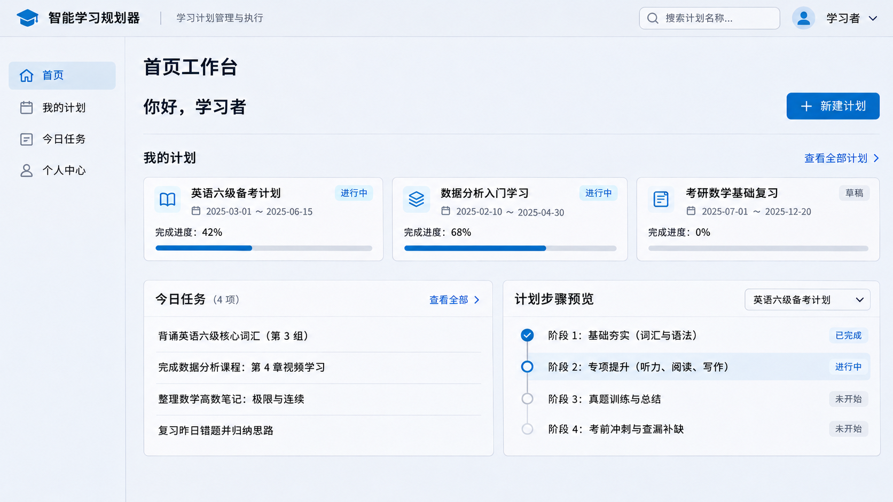

# Smart Study Planner：前端开发教学与项目交接指南

> 读者：负责辅导项目作者的 ChatGPT。请先阅读本文，再根据每个阶段所需信息，向作者索取当前代码。你的目标是帮助作者把项目做出来，并理解自己写出的交互逻辑。
>
> 快照时间：2026 年 11 月 15 日。整理过程中，后端新增提交 `9e37ebf`，包含进度统计和计划结束相关代码。代码已提交不等于接口规则或联调结果已经确认；后端仍可能继续开发，本文不是冻结的 API 合同。**进度与生命周期须请后端开发者确认稳定版本、业务规则和测试状态后再接入**。
>
> 范围：网页版。第一阶段完成真实业务闭环：**计划 → 步骤 → 每日任务 → 打卡 → 顺延**。不要先虚构数据冒充已接入，也不要擅自扩展为其他产品。

## 1. 最重要的合作方式

### 1.1 你需要如何教作者

- 作者对 React、TypeScript 和 Next.js **有基础，能看懂组件**，重点希望学习业务交互和前后端联调。
- 每个经过确认的开发步骤，可以给出**该步骤所需的完整实现**，随后逐部分解释：数据从哪里来、状态如何变化、为什么这样写、怎样验证、错误怎么处理。
- 「完整实现」指当前经确认的小步骤，不是一次性重写整个项目。每次明确列出要修改或新增的文件，让作者能够检查和学习。
- 请根据作者实际提供的代码讲解。**你无法直接访问作者本地磁盘，也不能声称已经看见未提供的文件、运行了未运行的测试。**
- 不清楚字段、函数、现有文件或规则时，先问作者索取；不要把本文中的设计草案当作已经实现。
- 示例数据、效果图中的数据只能作为演示，不能冒充真实数据库结果。

### 1.2 修改权限

**作者已明确：涉及前端交互逻辑、业务规则、接口字段或后端/数据库修改，先解释具体方案和影响，征得作者确认。纯样式调整可直接进行。**

在确认前，可以阅读代码、画流程、说明选择、准备可审阅的方案；不能声称已实施。即使作者同意某个阶段，也要明确具体改动范围；新增业务规则或改变接口契约时再次确认。删除或覆盖原文件前先确认现状和范围，保留作者已有改动。

前端不应修改后端接口或数据库来迁就页面；若发现契约缺失或冲突，整理证据，由作者转给后端开发者确认。

### 1.3 具体的每轮教学步骤

1. 明确这一轮只解决什么问题，涉及哪些页面和文件。
2. 向作者索取这一轮**实际最新**的文件、接口定义和必要的非敏感响应示例。
3. 解释状态流、接口调用、失败场景和将修改的文件。
4. 等作者确认交互方案。
5. 给当前步骤的完整代码，标明文件路径；若作者的原文件尚未提供，先索取，避免覆盖已有功能。
6. 分段解释关键代码，并提供可执行的本地验证方法和预期。
7. 作者运行并反馈结果后，确认通过，再进入下一步。

**不要要求作者发送 `.env`、密码、JWT、Refresh Token、数据库凭据或真实个人数据。**接口示例应脱敏，测试只使用作者授权的隔离环境和测试账户。

---

## 2. 项目目的和第一阶段目标

项目是一个学习计划管理系统：用户建立带周期的学习计划，把计划拆成树形步骤，设置任务执行规则；后端生成每日任务，用户打卡，并可将未完成部分顺延。

第一阶段期望可以演示：

```text
登录 → 查看首页 → 创建计划 → 添加步骤与规则
    → 检查并开始计划 → 查看每日任务
    → BOOLEAN / NUMERIC 打卡 → 符合条件时顺延
```

用户希望最终不仅能操作，还要能说清楚：页面为什么这样设计、调用了什么接口、状态和错误如何处理、为什么前端不能代替后端校验。这些解释要服务于学习和答辩。

**不是第一阶段默认承诺：**搜索所有业务数据、消息通知、学习笔记、学习资料、复盘、复杂图表、手机适配或跨设备同步。是否做需另行确认。

---

## 3. 理想界面：以这个首页为视觉基准



> 将本文发给无法访问本地文件的 ChatGPT 时，请**同时上传**同目录的 `前端首页设计参考.png`；仅粘贴 Markdown，图片路径对方通常无法读取。

已确认的视觉方向：

- 蓝白配色、浅蓝灰背景、简洁边框和卡片。
- 布局克制，不使用大面积插画、海量渐变和夸张装饰；避免“AI 生成模板感”。
- 网页版优先；保留适当的浏览器宽度变化，不把移动端作为当前阶段的强制目标。
- 统一顶部栏与侧边栏；顶部搜索框在用户头像左侧，第一版只搜索**已加载计划的名称**。
- 首页包含「我的计划」「今日任务」「计划步骤预览」；计划状态和进度用文字、状态标记、简洁横向进度条表达。
- 登录页、注册页、个人中心已存在，不应为了首页擅自重做。它们的具体样式以代码为准。
- 图中的名称、日期、任务、百分比和步骤状态仅是示例。**效果图是视觉参考，不是接口与功能合同。**不得默认图中“已完成/进行中”就是每个步骤已提供的字段。

界面语言：中文；产品名称使用「学习计划管理系统」。不要将设计图中的其他项目名称或额外功能照搬进项目。

---

## 4. 实际项目快照：前端

项目位于 `D:\project`；前端为 `D:\project\next-fro`，后端为 `D:\project\back`。

### 4.1 当前前端技术栈

本地 `package.json` 显示 Next.js 16.4.2、React 19.3.0、TypeScript 和 Tailwind CSS 4。项目使用 App Router。版本具体用法要以当前项目本地文档和实际安装为准。

`next-fro/AGENTS.md` 要求：写 Next.js 代码前，查阅该项目 `node_modules/next/dist/docs/` 中的相关指南。作者如果只复制文件给 ChatGPT，需要同时提供对应版本/文档片段；不能凭旧版本习惯假定行为一致。

当前 `next.config.ts` 启用了 `cacheComponents` 和 `partialPrefetching`，并有 CSS 的 Turbopack 自定义规则。路由切换可能保留组件状态；历史上出现过退出后按钮状态或提示保留的问题。因此新增表单、消息和退出状态时，要考虑离开页面后哪些状态应重置，但**不要自行关闭这些配置**。

### 4.2 已存在的页面

| 地址 | 当前情况 | 对应代码 |
| --- | --- | --- |
| `/` | 目前主要显示后端健康检查，不是设计图里的真实首页 | `next-fro/app/page.tsx` |
| `/login` | 已有登录界面、登录流程、令牌保存和进入个人中心 | `app/(auth)/login/page.tsx`、`components/auth/LoginForm.tsx` |
| `/register` | 已有注册界面；注册成功后尝试自动登录并进入个人中心 | `app/(auth)/register/page.tsx`、`components/RegisterForm.tsx` |
| `/profile` | 已有个人中心、当前用户显示和两种退出操作 | `app/profile/page.tsx`、`components/auth/UsersProfile.tsx` |

计划列表、创建计划、计划详情和任务页面的实际路径与文件**尚未建立**；实现前先与作者确认。诸如 `/plans/new`、`/plans/[id]`、`/tasks/today` 只能作为待确认建议，不能当作现存路由。

### 4.3 现有代码如何组织

```text
next-fro/
├── app/                     # 路由、页面、全局布局
├── components/
│   ├── auth/                # 登录与个人中心组件
│   ├── RegisterForm.tsx
│   └── css/                 # LoginForm.css、Profile.css
├── services/auth.service.ts # 当前认证接口
├── lib/api/client.ts        # 统一请求、错误与令牌刷新
├── lib/auth/token.ts        # 本地令牌读写
├── types/auth.ts            # 认证请求/响应类型
└── public/login-background.png
```

- 组件 CSS 集中放在 `components/css`，规则按多行格式书写，便于维护。应用级 `app/globals.css` 仍保留在 `app`。
- 项目此前在当前构建配置下遇到 CSS Module 引用无类名的问题，后来使用带前缀的普通 CSS。不要未经验证地改回 CSS Module 或改动构建配置。
- 可以建议按计划、步骤、任务分别组织 `services` 和 `types`，但目录及具体交互方案要先说明并确认。
- 当前根布局中网站标题仍为默认值，首页使用单独的健康检查 `fetch`；这是现状，不是要求立即修改。

### 4.4 认证和请求的现有基础

- `lib/api/client.ts` 提供 `apiFetch`，当前默认基址为本机后端，实际地址由环境配置决定。普通业务请求应考虑复用现有请求入口，不要各自实现一套令牌刷新。
- 现有代码处理 access token 过期、刷新请求共享、刷新后重试和错误码。不要重写或改变双 Token 交互，除非先向作者说明并获确认。
- 登录用表单编码；注册用 JSON。后端的业务响应一般是 `{ code, message, data }`；健康检查是例外。
- 认证信息目前保存在浏览器本地存储。它是现有实现，不表示适合所有生产安全需求；安全方案需要单独讨论，不能在做页面时顺手改变。
- 页面切换及用户切换时，避免展示上一个账户的缓存数据或保留错误的按钮禁用状态。

---

## 5. 后端快照：有哪些能力

后端采用 FastAPI、SQLAlchemy `Session` + `text()` 和 MySQL。业务路由、Schema、Service、Repository 分层；请遵循当前实现，不擅自引入 ORM 模型或更改数据库结构。

截至快照，已看到下列路由；后端开发者仍需确认版本和测试状态：

| 业务 | 方法与路径 | 前端用途 |
| --- | --- | --- |
| 计划列表 / 创建 | `GET /plans`、`POST /plans` | 首页、计划列表、创建表单 |
| 计划详情 / 修改 / 删除 | `GET/PATCH/DELETE /plans/{plan_id}` | 详情、编辑、删除 |
| 计划启动 | `POST /plans/{plan_id}/start` | 校验草稿并生成每日任务 |
| 草稿步骤 | `GET/POST /plans/{plan_id}/steps`、`PATCH/DELETE /plans/{plan_id}/steps/{step_id}`、`PUT /plans/{plan_id}/steps/{step_id}/rule` | 读取树、新增、编辑、删除、配置规则 |
| 草稿逐日安排 | `GET/PUT /plans/{plan_id}/steps/{step_id}/schedule` | 逐日自定义内容或数量 |
| 计划内任务 | `GET /plans/{plan_id}/tasks` | 查询某计划的任务 |
| 今日任务 / 详情 / 记录 | `GET /tasks/today`、`GET /tasks/{task_id}`、`GET /tasks/{task_id}/records` | 查看今日任务、详情与打卡历史 |
| 打卡 | `POST /tasks/{task_id}/complete`、`PUT /tasks/{task_id}/progress` | BOOLEAN 完成、NUMERIC 更新累计值 |
| 顺延 / 删除任务 | `POST /tasks/{task_id}/rollover`、`DELETE /tasks/{task_id}` | 顺延及软删除 |
| 执行中修改任务 | `PATCH /tasks/{task_id}` | 修改符合条件的未来任务 |
| 执行中新增 / 删除步骤 | `POST /plans/{plan_id}/active-steps`、`DELETE /plans/{plan_id}/active-steps/{step_id}` | 执行中计划的步骤调整 |
| 计划进度 | `GET /plans/{plan_id}/progress` | **代码与路由已提交，业务规则及验证状态须确认** |
| 提前结束 | `POST /plans/{plan_id}/end` | **代码与路由已提交，业务规则及验证状态须确认** |

查看最新代码时以 `back/app/api/router.py` 为准：文件存在不等于路由已挂载，也不等于测试通过或部署完成。

### 5.1 已看到的业务边界

以下为**代码快照**，不替代后端负责人的最终确认：

- 计划状态：`DRAFT`、`ACTIVE`、`ENDED`。创建计划后先是草稿；开始时校验并生成任务。执行中修改周期受限制。
- 任务步骤为 `GROUP` 或 `LEAF`。GROUP 是分类；LEAF 负责规则和任务。
- 任务类型为 `BOOLEAN` 或 `NUMERIC`；规则分别支持 `REPEAT` / `DAILY_CUSTOM` 和 `AUTO_DISTRIBUTE` / `DAILY_MANUAL`。
- 草稿逐日安排的 PUT 是**整体替换**，不是只修改提交的某一行。保存可以不完整，开始计划时再检查完整性。
- NUMERIC 更新的 `actual_quantity` 是**累计值**，不是本次增加量；已完成任务等限制由后端决定。
- NUMERIC 顺延转移全部可顺延剩余量，不是前端任填部分；BOOLEAN 来源顺延后不能再次打卡或顺延。
- 删除步骤和提前结束可能影响相关任务，应在界面上根据后端实际规则清晰说明并要求确认；不能把删除当成无影响操作。
- 业务日期使用东八区。界面的日期展示与请求格式要和后端核对，不要擅自用浏览器本地时区推导业务是否可操作。

### 5.2 进度的特殊提醒

快照中 `progress_service.py` 已有 `progress_percent` 和 `reason`，不能再笼统说「后端完全没有进度接口」。它及相关路由已纳入 `9e37ebf`，但仍需**等待后端确认规则和实际测试结果**。

当前代码观察到：

- `progress_percent` 可能为数字，也可能为 `null`；前端不能把 `null` 一律当作 0% 或 100%。
- 非 ACTIVE 计划当前返回 `PLAN_NOT_ACTIVE`；无可计算叶子等情况也会给原因。
- 当前计划总进度按可计算叶子进度做平均；BOOLEAN 顺延来源在统计中被排除。
- NUMERIC 按有效目标汇总并封顶。注释、业务要求和实现之间是否完全一致，特别是超额完成、多任务汇总与顺延目标删除后口径，必须请后端负责人确认。
- 未得到正式确认前，设计图上的 42%、68% 等一律是示意，不能作为真实结果。

### 5.3 错误与会话

- 后端当前有统一错误处理和 401、404、409、422 等响应；实际格式需要按当前 `main.py` 和真实脱敏示例核对。
- `409` 可能表示业务冲突，例如计划状态、重复顺延或目标任务不可合并；应显示可理解的说明，而不是一律写「服务器错误」。
- `422` 可能包含字段校验详情；现有 `apiFetch` 如何解析这些详情需要先看真实代码。
- 网络失败、后端返回错误、空数据和加载中是不同状态。不要把失败伪装成空列表。
- 因为历史上出现过后端异常响应缺少跨域头、浏览器只显示 `Failed to fetch`，遇到它应排查网络、服务、数据库和跨域，不要直接断言某一个原因。

---

## 6. 主要请求数据：便于沟通的示意

下面是根据当前 Schema 整理的**请求示意**，不是来自线上抓包；发送前要以作者提供的最新 Schema、接口说明及测试结果核实。

### 6.1 创建草稿计划

```json
{
  "name": "英语学习计划",
  "description": "按计划学习单词和听力",
  "start_date": "2026-12-01",
  "end_date": "2026-12-07"
}
```

对应 `POST /plans`。名称去掉首尾空格后需非空；开始不能晚于结束。JSON 日期示例是演示，不是要求使用固定日期测试。

### 6.2 草稿步骤

```json
{
  "name": "单词学习",
  "node_type": "GROUP",
  "children": [
    {
      "name": "背单词",
      "node_type": "LEAF",
      "rule": {
        "task_type": "NUMERIC",
        "schedule_mode": "AUTO_DISTRIBUTE",
        "total_target": 70
      }
    }
  ]
}
```

对应 `POST /plans/{plan_id}/steps`。GROUP 创建时必须有子节点且无规则；LEAF 必须有规则且无子节点。嵌套子节点不能自行指定 `parent_id`。

### 6.3 每日安排与打卡、顺延

```json
{ "entries": [{ "task_date": "2026-12-01", "target_quantity": 10 }] }
```

这是 NUMERIC + DAILY_MANUAL 的部分草稿安排示意，对应 `PUT /plans/{plan_id}/steps/{step_id}/schedule`；它会替换该步骤已有安排。开始计划时要满足全周期和总量校验。

```json
{ "actual_quantity": 18 }
```

对应 `PUT /tasks/{task_id}/progress`，18 表示**当前累计 18**。

```json
{ "target_date": "2026-12-03" }
```

对应 `POST /tasks/{task_id}/rollover`，具体合法日期要由后端业务规则校验；NUMERIC 由后端计算全部剩余量，不能让用户误以为提交的是任意数量。

数值 Schema 支持的无符号 64 位整数范围大于 JavaScript 安全整数范围，前端处理极大值时不能假定普通 JS `number` 始终精确；先与后端约定前端上限或传输方案，不要自行改接口。

---

## 7. 推荐开发分期与验收

以下是建议顺序，**不是授权直接修改交互逻辑**。每一步先提供方案、文件清单和验证方法，待作者确认。

### 第 0 阶段：确认现状与联调环境

- 核对前后端启动方式、后端当前代码版本、已提交与未提交改动。
- 让作者提供相关文件，而不是要求整个项目或敏感配置。
- 使用已授权的隔离账户与测试数据；不要删除已有业务数据。
- 确认本轮要覆盖的业务规则，以及后端开发者对进度和生命周期接口稳定性的回复。
- 浏览器刷新、登录状态、令牌过期与失败提示应有明确处理思路。

### 第 1 阶段：首页和计划列表

- 基于已确认的视觉图构建页面，先接入当前用户、`GET /plans` 和 `GET /tasks/today`。
- 搜索仅对当前加载的计划名称筛选；为空时给出明确结果，不把网络失败显示成“没有计划”。
- 展示真实计划名称、日期、状态；按实际返回字段建立类型。
- 进度接口等后端负责人确认后再接入。未确认期间显示「暂无进度」或隐藏该区域，**不要用假百分比**。
- 空、加载、错误和重新尝试都要有设计。

**验收：**登录后的用户看到自己的计划；空账户有明确空状态；断开后端可看到错误；搜索能筛选已加载名称；不出现其他用户数据或设计图示例。

### 第 2 阶段：创建计划和步骤

- 建立计划名称、描述、开始/结束日期表单；前端做友好提示，后端仍是最终规则权威。
- 支持构建 GROUP / LEAF 树，按任务类型配置四种规则。
- 手动安排模式区分草稿保存与完整启动校验；避免意外覆盖整组安排。
- 展示启动前校验结果。计划开始前给用户机会确认；成功后读取后端真实状态。

**验收：**能创建自己的草稿、添加有效步骤、保存需要的安排，并成功或按后端明确错误被拒绝启动。

### 第 3 阶段：计划详情与任务

- 根据计划状态和后端规则显示可用操作，不用 CSS 伪造权限控制。
- 详情展示步骤树与计划内任务；可查看今日任务及其所属计划。
- BOOLEAN 提供完成操作；NUMERIC 清楚标注“累计完成数量”。
- 进行中的任务编辑、步骤增删、提前结束，必须先确认接口稳定性、数据影响和交互。

**验收：**任务展示与真实返回一致；提交失败仍保留合理的输入并显示原因；不重复触发提交。

### 第 4 阶段：顺延、刷新和进度

- 顺延前展示来源日期、任务类型、目标与实际数量、剩余量和目标日期；BOOLEAN 不显示无意义数量。
- 与后端确认目标是否可合并、目标日期限制、顺延后状态和历史的展示方式。
- 成功后按真实响应重新读取受影响的任务、计划和进度，避免卡片显示旧数据；失败不应制造假成功。
- 进度百分比与空值规则确认稳定后接入；同步覆盖顺延、打卡、删除与结束计划后的刷新。

**验收：**有合法和不合法顺延场景；无重复顺延；刷新页面后仍与后端数据一致。并发风险和不可计算进度要诚实呈现。

### 第 5 阶段：端到端演示与答辩

- 用隔离测试账户串起完整闭环，记录哪些场景实际通过、哪些只是手工检查。
- 准备无计划、有草稿、执行中、顺延冲突、后端不可用等演示状态。
- 教作者解释：为什么需要分层、前端如何管理异步状态、为什么需要后端二次校验、顺延后为何不能只凭状态计算实际完成量。

---

## 8. 需要每个页面考虑的交互状态

| 场景 | 页面应考虑什么 |
| --- | --- |
| 首次加载 | 明确提示正在获取，不显示虚构数据 |
| 空计划 / 空任务 | 区分真正为空和请求失败，给出合理下一步 |
| 提交中 | 禁止重复触发，显示处理状态；失败后恢复可操作状态 |
| 表单错误 | 精确指出名称、日期、数量或规则问题；服务端错误仍要展示 |
| 会话过期 | 沿用现有令牌刷新方案；最终失效时正确引导登录 |
| 无权限 / 不存在 | 按真实错误处理，避免泄露别人的数据 |
| 状态改变 | 更新相关视图，避免任务、计划和进度相互矛盾 |
| 删除 / 提前结束 | 显示真实影响并确认；不要承诺当前不存在的撤销能力 |
| 再次进入页面 | 检查缓存的提示、表单与按钮状态，避免上次操作残留 |
| 进度为 null | 显示「暂无可计算进度」等准确文案，依据服务端原因区分 |

前端可以根据规则提前禁用明显不合法的操作，但后端仍必须进行最终校验；前端隐藏按钮不等于授权。

---

## 9. 请作者转给后端开发者的确认问题

下面的问题是交接清单，不代表已收到答案。涉及未确认内容时先暂停对应接入。

### 9.1 版本和契约

1. 当前后端最终分支、提交版本和未提交代码分别是什么？哪些可以视为稳定？
2. 最新接口清单、Schema、脱敏请求和成功/错误响应示例在哪里？是否能提供 OpenAPI 导出或对应路由与 Schema？
3. 业务错误的 HTTP 状态、`message`、`detail`、422 字段错误结构分别是什么？是否可能出现无跨域头的 500？
4. 是否有隔离测试环境、演示账号和可安全使用的初始化方法？请不要提供真实令牌或密码到聊天中。

### 9.2 计划与步骤

5. 草稿计划和执行中计划允许编辑哪些字段？开始与结束日期的边界具体如何判断？
6. GROUP 创建时是否必须同时提交子节点？执行中新增树和草稿新增树的请求体有哪些不同？
7. 执行中删除步骤会影响哪些历史任务、打卡记录和顺延关系？最少保留一个叶子的规则是否最终确定？
8. 自动分配数量时余数是否仍集中在最后一天？目标为 0 的步骤和任务是否允许用户操作？
9. 草稿每日安排 PUT 是否始终整体替换？BOOLEAN 同一天多条与 NUMERIC 每天一条的规则是否固定？

### 9.3 打卡、顺延与进度

10. BOOLEAN 打卡和 NUMERIC 累计值更新的所有状态限制、允许补打卡的范围是什么？
11. 数值任务超额完成是否允许？完成后是否允许撤销、修改或删除？前端如何展示真实累计值？
12. NUMERIC 顺延是否始终全部剩余转出？目标已有打卡历史、被删除、已顺延时如何处理？
13. BOOLEAN 顺延来源是否继续计入有效任务分母？目标删除后这个口径是否变化？
14. `GET /plans/{id}/progress` 的最终返回字段、空值、草稿和已结束行为是什么？叶子平均、超额完成、顺延链和删除目标的统计口径是否最终确认？
15. 顺延并发 R19/R20、死锁和锁等待场景是否已在隔离数据库通过？未解决风险是什么？

### 9.4 生命周期与部署

16. 提前结束对已开始、未开始、已完成和已顺延任务分别有什么影响？前端确认框应提示什么？
17. 到期 worker 如何运行，是否已实际部署、由什么调度、失败如何恢复？不要将代码存在等同于自动运行。
18. 后端状态有变化时，前端应在哪些操作后重新拉取计划、任务和进度？有没有聚合接口可避免过多请求？

### 9.5 让后端回复的格式

请对每个问题注明：**已确认规则 / 当前代码行为 / 已验证范围 / 未决定或风险**，附对应源码路径或脱敏样例。不要让后端开发者输出 `.env`、密码、Token 或真实用户记录。

---

## 10. 给教学 ChatGPT 的启动指令

作者可把本节连同整份文档、首页参考图发给 ChatGPT：

> 我在开发 Smart Study Planner。请把本文视为项目快照和教学约定，不要把效果图或示例视为已经实现的功能。我的前端对 React、TypeScript 和 Next.js 有基础，希望重点学习业务交互；你可以在每个确认后的小阶段给完整代码，再逐部分讲解。
>
> 我会按你的要求逐个提供真实文件。请先告诉我本轮需要哪些文件、为什么需要；收到以后先分析现有代码、提出交互方案、列出修改文件和验收方法，等我确认后再给代码。涉及前端交互、接口、后端或数据库的逻辑必须先得到我确认；纯样式可以直接调整。不要索取密钥、Token 或真实用户数据。
>
> 先从「第 0 阶段：确认版本与联调环境」开始。本文快照中后端进度统计和计划结束代码已提交，但仍需后端负责人确认规则和测试情况后才能接入。第一阶段目标是完成计划、步骤、每日任务、打卡和顺延的真实闭环。

---

## 11. 开始第一个教学步骤时，应向作者索取什么

先按问题分批索取，不要一次要求作者粘贴全部项目：

1. 项目状态：后端开发者对第 9 节的回复、最新版本信息、是否有其他未提交更改。
2. 前端基础：`package.json`、`next.config.ts`、`app/page.tsx`、`lib/api/client.ts`、`types/auth.ts`、个人中心组件和相关 CSS。需要认证细节时再索取相应文件。
3. 首页接口：`plans.py`、`tasks.py` 中对应路由及其 Service / Repository、脱敏的 `GET /plans` 和 `GET /tasks/today` 响应。
4. 开始编写某个 Next.js 特性之前，按 `next-fro/AGENTS.md` 查阅项目对应版本的本地文档；若 ChatGPT 无法读取，让作者提供相关章节。
5. 只有当计划进度正式确认稳定时，才索取进度接口、类型和示例。对尚未确认的部分，清楚标注为待定。

可以让作者先从 `GET /plans` 的真实响应样例和当前首页代码开始。不要要求一次性提供数十个文件。

---

## 12. 文档维护与已知风险

- 本文的接口、状态和文件清单是快照；后端由其他会话继续开发时可能变化。开发前重新核对真实代码及 `git status`。
- 原有 [后端核心业务与答辩指南](./后端核心业务与答辩指南.md) 也是更早的代码快照，对进度和生命周期的描述可能已经过时；它可用于学习基础原理，不能取代最新接口确认。
- 页面设计图中的任务状态、进度和导航只是视觉示例；按实际已实现能力决定最终界面。
- 不确认后端就自行改变统计、日期、顺延、删除或权限规则，会造成前后端不一致。
- 编译、静态检查、浏览器查看、实际接口联调、完整业务流程和并发测试是不同的验证；只有实际执行才可写「通过」。
- 本文与首页效果图可一同交给 ChatGPT；源码路径只有在对方有项目访问权限时才能直接打开。作者选择的是**按需逐个提供实际文件**。
