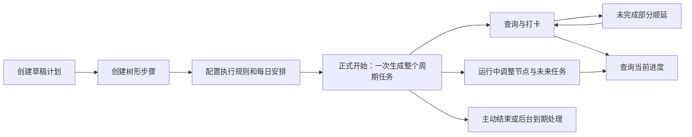
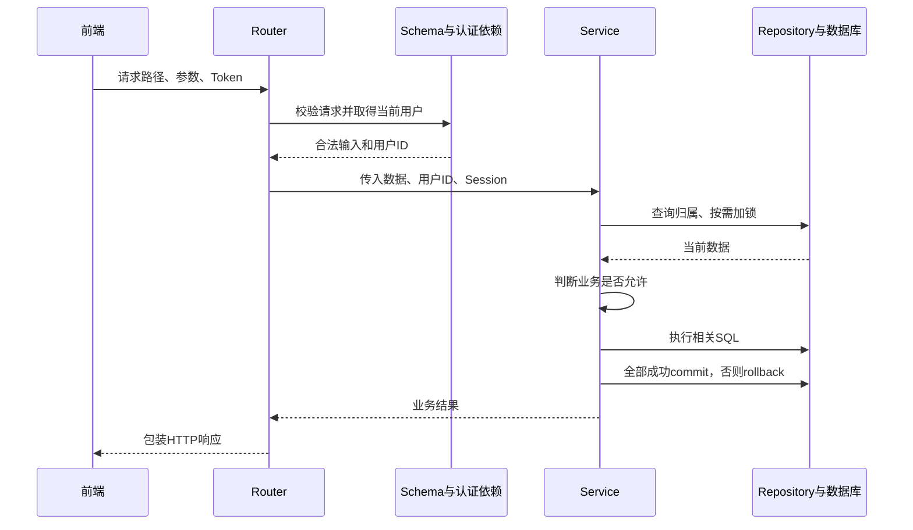
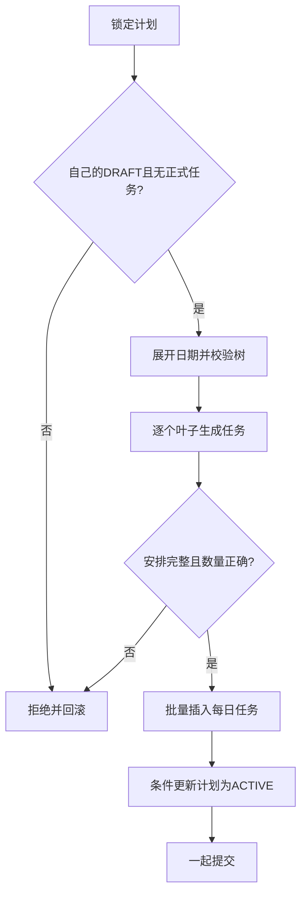
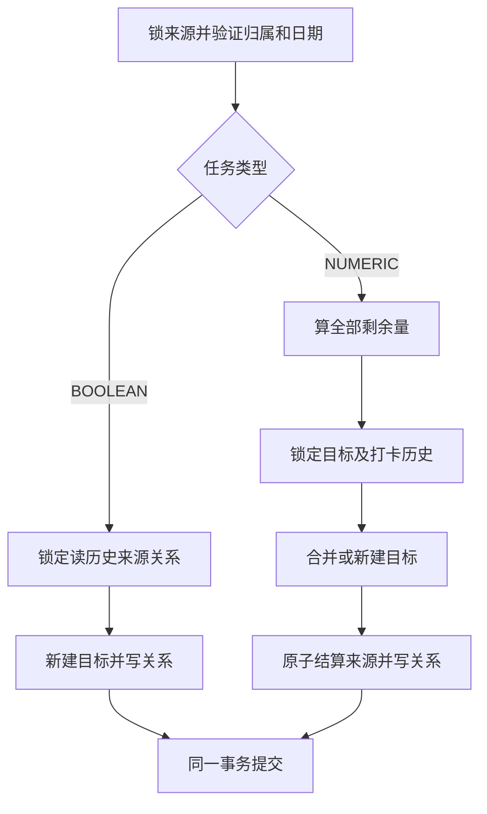

# 学习计划管理系统：后端接口与函数全解

> 阅读目的：理解自己写的业务，能解释一次请求怎样完成，并能应对答辩追问。
>
> 整理日期：2026-11-15。依据：`D:/project/back/app` 当前源码，开始整理时 Git 提交为 `795b49d`。覆盖 **59 个 Python 文件、181 个函数/方法（含内部函数）、38 个业务路由、17 个类**。不含第三方库与测试函数。
>
> 本文讲的是**当前代码实际行为**。没有连接数据库核对实时表结构，也没有执行写数据库的接口或启动到期 Worker。案例均为教学数据，不是用户真实记录或本轮回归测试结果。未读取 `.env`，不展示密码、密钥或真实 Token。
>
> 文档校验：已通过源码语法树核对全部文件、函数及路由覆盖，检查 246 个文档链接；复用源码计算函数执行的 22 项内存案例全部通过，包含数量分配、零目标、顺延后的有效目标、BOOLEAN 来源排除及计划平均进度。计划聚合案例使用内存替身提供数据，未访问数据库。这些检查验证文档计算示例，不代替 HTTP、数据库或并发回归测试。后端源码文件哈希与整理前一致。

## 阅读目录

1. [先理解项目整体](#overview)
2. [请求、响应与权限](#contract)
3. [按接口理解完整业务](#endpoints)
4. [事务、并发与当前实现边界](#boundaries)
5. [逐文件、逐函数索引](#source-index)
6. [答辩讲解与模拟问答](#defense)

推荐先读第 1～3 部分，把一个计划从创建讲到结束；然后按函数名查第 5 部分。不要第一次就背全部函数名。本文中的代码片段用于解释思路，省略内容的片段不能直接代替项目源码。

<a id="overview"></a>
## 一、先理解项目整体

### 1.1 系统究竟解决什么问题

用户先确定学习目标和周期，把目标拆成树形步骤，再为最末级步骤选择执行方式。系统据此生成每日任务。用户每天提交完成情况；没完成的任务可以顺延。系统保存历史、计算当前进度，并在用户主动结束或计划到期时收尾。

它的核心不只是“保存几张表”，而是保证：**规则能生成任务；任务能记录真实学习量；顺延不会让同一目标重复计算；不同用户的数据不能互相操作。**



### 1.2 六种数据不要混淆

| 概念/表 | 可以怎样理解 | 举例 |
|---|---|---|
| `study_plans` | 一份学习项目的封面和周期 | 三天英语复习，11 月 15～17 日 |
| `plan_steps` | 目标目录树；叶子保存任务规则 | 英语 → 听力、单词 |
| `schedule_entries` | 尚未正式执行的逐日安排草稿 | 第一天听第一课，第二天听第二课 |
| `daily_tasks` | 某一天真正需要执行的一条任务 | 11 月 15 日背 33 个单词 |
| `study_records` | 每次提交的历史凭据 | 先提交累计 10，再提交累计 20 |
| `task_rollovers` | 一次目标转移的来源关系 | 任务 A 将剩余 13 转给任务 B |

另外，`users` 保存账号，`tb_refresh_token` 保存刷新凭据摘要和会话关系。这里按源码中的 SQL 解释表用途，不等于重新确认了数据库全部字段、外键和唯一索引。

**任务当前值不等于历史值之和。** 先报累计 10，再报累计 20，当前实际量是 20，不是 30。历史用于追溯“改过什么”，不能直接累加 `recorded_value` 当学习总量。

### 1.3 项目分层：一次请求由谁接力



| 层 | 主要职责 | 不要混淆的点 |
|---|---|---|
| `api/routes` | 接收 HTTP 请求、注入依赖、调用业务函数、包装响应 | 核心学习业务的规则主要在 Service |
| `schemas` | 检查数据形状、类型、字段组合 | 类型合法不代表业务允许，例如未来任务不能提前打卡 |
| `services` | 决定能否操作、组织顺序、控制事务 | 一次顺延涉及多个表，应一起提交 |
| `repositories` | 执行 `Session + text()` 原生 SQL | 通常不自行提交；依赖上层先校验用户归属 |
| `core` | 当前用户、密码/Token 工具、业务日期 | 属于多个业务共同使用的基础能力 |
| `jobs` | 独立运行的到期检查进程 | 不会因为启动 FastAPI 就自动启动 |

**实际代码有分层例外：** `users.py`、认证登录 Router 直接执行部分 SQL；`auth_service.py` 也直接操作刷新凭据表；`active_task_repository.recalculate_numeric_leaf_total()` 会抛业务 HTTP 异常。答辩时可说“核心学习业务采用三层结构”，不要宣称整个项目已经完全严格分层。

### 1.4 状态与日期

计划状态：`DRAFT → ACTIVE → ENDED`。逻辑删除由 `deleted_at` 表示，不是第四种状态；目前没有恢复计划或结束后重新激活的接口。

任务状态：`PENDING`、`IN_PROGRESS`、`COMPLETED`、`OVERDUE`、`ENDED`。逾期展示主要由 `_format_task()` 根据日期临时计算：它添加 `display_status`，不写回数据库。正常到期也不会批量把历史任务改成完成。

业务上的“今天”来自 `business_today()`，使用固定 UTC+8。完成、删除等多处 SQL 时间戳使用 `UTC_TIMESTAMP()`；老用户接口还有 `NOW()`。**业务日期与事件时间戳不是同一个概念，不能断言所有时间字段都由同一种时区机制生成。**

<a id="contract"></a>
## 二、请求、响应与权限

### 2.1 实际路径与响应

`main.py` 直接挂载 `api_router`，没有统一 `/api` 前缀。下文 `/plans` 就是实际路由，不是 `/api/plans`。

大部分成功响应：

```json
{"code": 200, "message": "success", "data": {}}
```

注册、创建计划、创建草稿步骤明确返回 201；运行中新增步骤仍返回 200。删除学习业务对象通常返回 200、`data: null`，不是 204。`/` 与 `/health` 直接返回字典，不走这一包装。

HTTP 异常处理保留：`code`、`message`、原始 `detail`、`data: null`；认证业务码可能在 `detail.code` 中。Pydantic 校验失败通常返回 422，错误列表放 `data`，未处理异常统一返回 500。

| 状态码 | 本项目常见含义 |
|---|---|
| 400 | PATCH 没传修改字段 |
| 401 | 未登录、Token 无效/过期、刷新凭据异常 |
| 403 | 账户被禁用；用户接口访问别人账号 |
| 404 | 计划/任务/步骤不存在，或不属于当前用户 |
| 409 | 请求格式可以理解，但违反当前业务状态或发生并发冲突 |
| 422 | 字段类型、日期、规则组合、逐日安排等不合法 |
| 500 | 未处理异常、内部一致性错误等 |

### 2.2 当前用户从哪里来

学习业务的 Router 依赖 `get_current_user()`：从 `Authorization: Bearer <access_token>` 取凭据，验证签名、过期时间和类型，检查 `sub`，查询数据库用户及启用状态，返回用户字典。Service 使用其中的 `id`，而不是相信前端随意提交的 `user_id`。

查计划时同时限定 `id + user_id + deleted_at IS NULL`。查任务时联查计划与步骤，并检查三者都有效。这样“猜到了别人任务 ID”仍不能操作。

**边界：** 不是每个 Repository 都独立验证用户。它们是在经过归属校验的 Service 调用链中工作，不能当成不受限制的外部接口调用。后台到期处理没有登录用户，属于系统内部按到期条件处理计划。

### 2.3 请求模型共识

- 日期使用 `YYYY-MM-DD`，数量接口多处使用严格非负整数；`"10"`、`true`、`1.5` 不等同于合法数量。
- `exclude_unset=True` 表示只处理请求确实提交的字段。未传描述表示不改，显式传 `null` 才表示清空允许为空的描述。
- 一些模型设置 `extra="forbid"`，但不是全部。例如顺延不允许额外传 `quantity`；不能把“所有接口都拒绝多余字段”作为统一结论。
- 前端最终应以响应数据重新显示任务，而不是自己猜测状态或完成率。

<a id="endpoints"></a>
## 三、按接口理解完整业务

下面“返回”均指成功响应里的 `data`，除非明确说明。`plan_service` 等短名均对应第 5 部分提供的完整文件链接。公共鉴权/模型校验之外的业务错误在每一组补充说明。

### 3.1 计划：先创建一个允许反复编辑的草稿

| 接口 | Router → 实现链 | 做法、输入及返回 |
|---|---|---|
| `POST /plans` | `plans.create_plan → plan_service.create_plan → insert_plan` | 收 `name/description/start_date/end_date`；模型清理名称并检查日期先后；写入当前用户的 DRAFT 计划，提交后重查并返回完整计划；201 |
| `GET /plans` | `plans.list_plans → plan_service.list_plans → find_plans_by_user` | 无请求体；按创建时间、ID 倒序返回自己的未删除计划；没有分页，不限 ACTIVE |
| `GET /plans/{plan_id}` | `plans.get_plan → get_owned_plan → find_plan_by_id` | 用计划 ID 和当前用户 ID 查；找不到统一 404；返回完整计划 |
| `PATCH /plans/{plan_id}` | `plans.update_plan → plan_service.update_plan → update_plan_fields` | 锁计划，提取实际提交字段，按状态限制修改；提交后返回新计划 |
| `DELETE /plans/{plan_id}` | `plans.delete_plan → plan_service.delete_plan → soft_delete_plan` | 锁定自己的计划，只设置计划 `deleted_at`，不物理删除下属表；返回 null |

创建示例（日期是教学示例，实际操作请按当前业务日期选择）：

```json
{
  "name": "三天英语复习",
  "description": "单词与听力",
  "start_date": "2026-11-15",
  "end_date": "2026-11-17"
}
```

修改规则：DRAFT 可改名称、描述、起止日期；ACTIVE 只能改名称、描述，**即使提交相同日期也会因为出现日期字段而拒绝**；ENDED 拒绝修改。空修改是 400，必填字段设 null 或新日期先后错误是 422。描述允许清空。

修改草稿周期不会自动搬移旧的 `schedule_entries`。正式开始时会重新检查覆盖日期。删除计划不限制计划状态，但其下任务会因为查询联查到已删除计划而无法通过常规任务接口访问；这不是物理级联删除。

### 3.2 草稿步骤：把目标变成目录树

| 接口 | 实现链 | 输入、处理、返回 |
|---|---|---|
| `POST /plans/{plan_id}/steps` | `create_step → require_draft_plan → _insert_tree` | `StepCreate` 可带嵌套 `children`；父节点只能是同计划 GROUP；递归插入整棵子树，返回 `created_id + tree`；201 |
| `GET /plans/{plan_id}/steps` | `get_step_tree → find_all_steps` | 任何未删除且属于自己的计划均可读；一次取全部有效节点，在内存组成树，返回根节点列表 |
| `PATCH /plans/{plan_id}/steps/{step_id}` | `update_step → update_step_fields` | DRAFT 限制；只改 `name/description`，不用于移动父节点、改类型或改规则；返回节点 |
| `PUT /plans/{plan_id}/steps/{step_id}/rule` | `update_step_rule → clear_draft_schedule + update_step_rule` | DRAFT、LEAF 才能用；整体替换 `StepRule`，先逻辑删除旧逐日安排，提交后返回节点 |
| `DELETE /plans/{plan_id}/steps/{step_id}` | `delete_step → find_descendant_ids → soft_delete_steps` | DRAFT；删本节点和全部有效后代，再向上清理变空父节点；返回 null |

`GROUP` 是分类，不执行任务；`LEAF` 是最末级步骤，必须有规则，不能有孩子。当前创建接口要求 GROUP 一次带至少一个孩子，因此不能先创建空分类再保存；草稿删除则可能最终删空整棵树，开始计划时才拒绝空树。

示例：

```json
{
  "name": "英语",
  "node_type": "GROUP",
  "children": [
    {
      "name": "单词",
      "node_type": "LEAF",
      "rule": {"task_type": "NUMERIC", "schedule_mode": "AUTO_DISTRIBUTE", "total_target": 100}
    },
    {
      "name": "听力",
      "node_type": "LEAF",
      "rule": {"task_type": "BOOLEAN", "schedule_mode": "REPEAT", "repeat_content": "听一篇短文"}
    }
  ]
}
```

顶层可带 `parent_id` 作为插入位置；嵌套孩子不能再指定父 ID，Service 用刚插入的父节点 ID 自动连接，避免一份子树被偷偷接到其他位置。

**组树算法**：假设 SQL 返回 `(1,父空)、(2,父1)、(3,父1)`。先创建 `node_map[1..3]`，每个节点有空的 `children`；再遍历，把 2、3 放到 1 的 children，1 放到 roots。组树本身时间/空间均为 O(N)，不是每个节点都再查询一次数据库。SQL 已按 `sort_order,id` 排序。无效父节点会报内部错误；代码没有对任意脏数据做完整的环检测，不要称其为“任意图修复算法”。

**删除算法**：数据库递归 CTE 找到本节点及后代；批量标记删除；随后沿 `parent_id` 向上查，只要父节点没有有效孩子就继续删除，遇到仍有孩子的父节点就停止。这保护了“分类必须有内容”的正常树结构。

### 3.3 四种执行规则

| 类型 | 模式 | 意义 | 需要逐日安排 |
|---|---|---|---|
| BOOLEAN | REPEAT | 每天重复同一条内容 | 不需要，使用 `repeat_content` |
| BOOLEAN | DAILY_CUSTOM | 每天内容不同，同一天可多条 | 需要 `content` |
| NUMERIC | AUTO_DISTRIBUTE | 将总数量分配到整个周期 | 不需要，使用 `total_target` |
| NUMERIC | DAILY_MANUAL | 用户指定每天数量 | 需要 `target_quantity`，一天一条 |

`StepRule.validate_rule()` 约束组合：BOOLEAN 不接受数量目标；NUMERIC 必须有总目标，不能用重复内容；任务类型不能搭配错误模式。一个容易漏掉的细节：BOOLEAN 的 DAILY_CUSTOM 并没有强制 `repeat_content` 为 null，但生成任务时不使用它。

### 3.4 每日草稿安排：允许先保存一部分

| 接口 | 实现链 | 输入与结果 |
|---|---|---|
| `GET /plans/{plan_id}/steps/{step_id}/schedule` | `get_schedule → _require_draft_leaf → find_entries` | 只允许 DRAFT 的 LEAF，且模式为 DAILY_CUSTOM/DAILY_MANUAL；返回有效安排列表 |
| `PUT /plans/{plan_id}/steps/{step_id}/schedule` | `replace_schedule → soft_delete_entries + insert_entries` | 收 `{"entries":[...]}`；替换整个有效安排集合，返回新集合 |

保存时检查每条日期位于计划内。BOOLEAN 必须有内容、没有数量，允许同一天多条；NUMERIC 必须有数量、没有内容，同一天不能重复。输入内容会去首尾空格，空白转为 null。

```json
{"entries":[{"task_date":"2026-11-15","target_quantity":20}]}
```

这份只填一天的 NUMERIC 安排可以先保存。**保存阶段不要求填满，也不要求数量之和已等于总目标；开始计划时才做完整验收。** `entries: []` 可以清空有效草稿安排。

先验证全部新输入，再在同一事务内软删旧安排、插入新安排；插入失败会一起回滚，不会留下“旧安排没了、新安排也没有”的中间结果。

### 3.5 正式开始与任务生成

#### `POST /plans/{plan_id}/start`

无请求体。调用 `plan_activation_service.start_plan()`：

1. 锁定当前用户计划，要求 DRAFT。
2. `count_plan_tasks()` 检查这个计划从未有正式任务；**计数包含已逻辑删除的任务**，避免删掉后重新生成。
3. `get_plan_days()` 展开完整日期，含开始和结束日。
4. `_validate_tree()` 检查父节点存在、父类型是 GROUP、GROUP 有孩子、有 LEAF。
5. 每个叶子调用 `_build_leaf_tasks()`，按四种规则生成内存任务列表。
6. 批量 `insert_tasks()`，默认全部为 PENDING。
7. `activate_plan()` 条件更新 DRAFT 为 ACTIVE，检查影响一行。
8. 全部成功才 commit，返回 `plan_id/status/generated_count/start_date/end_date`。



**开始时的完整性要求**：BOOLEAN DAILY_CUSTOM 每一天至少一条；NUMERIC DAILY_MANUAL 每天恰好一条且总和等于 `total_target`。手动安排缺一天、超周期、有错误类型都会拒绝。自动分配与重复模式不需要手填安排。

**数量分配算法的真实做法**：`base = total // D`，前 `D-1` 天均为 base，最后一天为 `total - base*(D-1)`。

| 总数 | 天数 | 分配结果 | 解释 |
|---|---|---|---|
| 100 | 3 | 33、33、34 | 余数全部放最后一天 |
| 11 | 4 | 2、2、2、5 | 不是 3、3、3、2；不要误讲成余数均摊 |
| 2 | 5 | 0、0、0、0、2 | 总数小于天数时前几天允许 0 |
| 0 | 3 | 0、0、0 | 仍会生成三条零目标任务 |

算法 O(D)，不用小数，保证数量守恒。它不是智能推荐，也不是自适应学习算法。零目标任务初始仍为 PENDING，允许首次提交累计 0 来确认完成；进度统计却可能因整个叶子总目标为 0 而返回不可计算，两者并不冲突。

当前 `start_plan()` 不检查“今天是否晚于计划开始/结束日”；它按配置的完整周期生成任务。日期范围外是否能打卡由打卡 Service 再限制，后续到期由 Worker 处理。这个差异应解释为当前实现边界，而不是补写成不存在的限制。

#### `GET /plans/{plan_id}/tasks`

`daily_task_service.list_plan_tasks()` 先验证计划归属，再查询有效任务及有效步骤，按日期、步骤 ID、任务 ID 排序。它返回简版字段：任务 ID、计划/步骤 ID、步骤名、日期、类型、内容、目标、实际量、状态、完成时间。

**不要将它与 `/tasks/today` 的返回字段混用**：这个接口没有附加 `display_status`、`is_rolled_over`、有效目标和剩余数量等字段。

### 3.6 查询执行任务与历史

| 接口 | 实现链 | 结果和注意点 |
|---|---|---|
| `GET /tasks/today` | `list_today_tasks → find_today_tasks → _format_task` | 只返回业务今天、处于执行周期内的 ACTIVE 计划有效任务；包含今天已完成的任务，不是只查待办，也不汇总过去逾期任务 |
| `GET /tasks/{task_id}` | `get_task → _require_task → _format_task` | 返回本人有效任务详情；附带计划信息、顺延标记和展示状态；读取本身不要求 ACTIVE |
| `GET /tasks/{task_id}/records` | `get_task_records → _require_task → find_study_records` | 历史按 `recorded_at,id` 升序；包含事件类型、累计值、任务日期、记录时间 |

`/today` 的声明放在 `/{task_id}` 前面，避免固定单词被当成整数 ID。

`_format_task()` 对 NUMERIC 计算：

```text
effective_target_quantity = max(0, target_quantity - rollover_out_quantity)
remaining_quantity = max(0, effective_target_quantity - actual_quantity)
is_rolled_over = rollover_out_quantity > 0
```

BOOLEAN 没有数量，用历史来源关系 `has_rollover` 判断 `is_rolled_over`。一个已经顺延的 BOOLEAN 来源仍可能显示 PENDING 或 OVERDUE；前端必须同时看顺延标记，不能只按状态决定按钮可用。

### 3.7 打卡：状态与历史一起写

公共 `_validate_checkin()` 要求：计划 ACTIVE；今天在执行周期内；任务不是未来日期；状态允许操作；未完成、未停止、未作为已顺延来源。过去任务可补打卡，但只能在计划执行周期尚未结束时。

#### `POST /tasks/{task_id}/complete`

无请求体，仅 BOOLEAN。`complete_boolean_task()` 锁任务、统一校验并校验类型，Repository 条件更新为 COMPLETED、写 UTC 完成时间，再插入 `BOOLEAN_COMPLETE` 历史（`recorded_value=null`）。两步一起提交，然后重查任务返回。重复提交因已完成而 409。

#### `PUT /tasks/{task_id}/progress`

请求：`{"actual_quantity":60}`，含义是“当前累计共 60”，不是“再加 60”。仅 NUMERIC。模型要求严格整数，范围 `0..2^64-1`。

`update_numeric_task()` 锁定并校验任务后，根据新累计量选择状态：

```text
actual >= target  → COMPLETED
0 < actual < target → IN_PROGRESS
actual == 0 且 target > 0 → PENDING
```

再更新当前量与状态，插入一条 `NUMERIC_PROGRESS` 历史，记录本次累计值。提交后返回新任务。尚未完成时可以从 10 改回 0，但已有记录不会被抹掉；一旦 COMPLETED，公共校验阻止再次修改。

相同累计值拒绝重复写历史，零目标首次提交 0 是例外。允许实际量大于目标；进度统计封顶 100%，实际学习量仍保留真实值。

### 3.8 顺延：移动责任，不伪造完成量

#### `POST /tasks/{task_id}/rollover`

请求只能是 `{"target_date":"2026-11-17"}`。调用 `rollover_service.rollover_task()`；不接收任意部分数量。

公共要求：当前用户来源任务有效；计划 ACTIVE；今天在计划周期内；来源日期不晚于今天；目标日期严格晚于今天且不超过计划结束日；来源状态允许操作。

**NUMERIC 案例**：A 的目标 100、实际 60、转出 0；未来 B 原目标 50、实际 0、PENDING、无历史。

| 字段 | A 顺延前 | A 顺延后 | B 顺延后 |
|---|---:|---:|---:|
| 目标 `target_quantity` | 100 | 100 | 90 |
| 实际 `actual_quantity` | 60 | 60 | 0 |
| 转出 `rollover_out_quantity` | 0 | 40 | 0 |
| 状态 | IN_PROGRESS | COMPLETED | PENDING |

转移量 `100-60-0=40`。B 的目标增加 40；A 原始目标、实际量都不动。A 的 COMPLETED 表示**这一天的责任已结算**，不是实际完成 100。不会凭空插入 40 的打卡记录。

关键来源 SQL 同时做三件事：增加转出、改 COMPLETED、记录完成时间；WHERE 同时核对原目标、原实际量、原转出量及“此次恰好转移全部剩余”。影响行数不是 1 就拒绝，整个事务回滚。

```sql
UPDATE daily_tasks
SET rollover_out_quantity = rollover_out_quantity + :quantity,
    status = 'COMPLETED', completed_at = UTC_TIMESTAMP()
WHERE id = :source_id
  AND actual_quantity = :expected_actual
  AND target_quantity = :expected_target
  AND rollover_out_quantity = :expected_out
  AND :quantity > 0
  AND actual_quantity + rollover_out_quantity + :quantity = target_quantity
  -- 原代码还限制任务类型、允许状态和未删除条件
```

目标查找限定同计划、同叶子、同目标日期、未删除 NUMERIC，并锁定它。目标只有 PENDING、实际 0、转出 0、**从未打卡**才允许合并。先填 10 再改回 0 的目标仍拒绝，因为 `study_records` 留有历史。目标不存在则创建；剩余量为 0、目标已完成、已顺延来源或数量溢出均拒绝。

**BOOLEAN**：原任务保留状态，新建 PENDING 目标，关系的 quantity 为 null。查询来源是否有任意历史顺延，不限定目标日期，也不排除已删除目标；因此同一来源最多成功一次。来源不能再完成打卡。目标到自己的执行日期后可继续成为新来源，形成 A→B→C。

返回：`source_task_id/target_task_id/task_type/target_date/rollover_quantity/merged`；NUMERIC 还返回 `source_remaining_quantity:0`。



### 3.9 删除一条任务

#### `DELETE /tasks/{task_id}`

`task_service.delete_task()` 锁定本人有效任务，`soft_delete_task()` 只设置该任务的 `deleted_at`。NUMERIC 还会在同一事务中调用 `recalculate_numeric_leaf_total()`，更新所属叶子的有效目标总和。返回 null。

该接口目前没有 ACTIVE 或任务日期限制；不要和“只能修改未来任务”的 PATCH 接口混淆。

对于 A→B→C，只删除 B，A/C 不改，关系和打卡历史不物理删除，不恢复 A 已转出的数量。由于普通历史查询先要求任务有效，B 被删后 `/tasks/B/records` 会 404；**保留数据库历史不代表目前提供了已删除任务历史浏览接口。**

### 3.10 ACTIVE 计划中的调整

#### `PATCH /tasks/{task_id}`：改未来任务，不是打卡

`active_task_service.update_active_task()` 锁定本人的任务，要求 ACTIVE、任务日期晚于今天、PENDING、无打卡历史。

- BOOLEAN 只能提交 `{"content":"新的学习内容"}`。
- NUMERIC 只能提交 `{"target_quantity":80}`。
- 必须恰好提交对应的一个字段；不能同时改两种字段，也不能显式传 null。

NUMERIC 新目标不得小于历史承接量之和。例如原目标 50，接收顺延 40 后为 90，改成 30 会抹掉承接责任，因此拒绝；改成 60 可以。真正 UPDATE 还复查无历史、无转出、未作为顺延来源、承接量下界，更新后重算叶子总目标，和本次编辑一起提交。

返回 `{"task":更新后的详情,"leaf_total_target":新总目标}`；BOOLEAN 没有 `leaf_total_target`。锁等待超时/死锁被转换成 409，其他异常回滚。

#### `POST /plans/{plan_id}/active-steps`

请求外层是 `{"parent_id":null,"node":{...}}`，与草稿步骤 POST 的结构不同。`node` 内含 name、node_type、rule、entries、children。ACTIVE 新节点没有“先存半成品”的阶段，逐日安排必须一次满足剩余周期要求。

`create_active_tree()` 锁计划 → 校验父 GROUP → `_remaining_days()` 筛出计划日期中 `>=今天` 的日期 → 递归插入节点、校验并保存安排、收集任务 → 批量写任务 → 一起提交。

例如原计划 1～5 日，今天 3 日，新增总目标 100 的自动分配叶子，只生成 3、4、5 日的 33、33、34，不补造 1、2 日任务。未来才开始的 ACTIVE 计划仍使用其完整未来周期；没有剩余天数则拒绝。

返回 `created_step_ids/generated_task_count/tree`。同级排序用当前有效兄弟的最大 `sort_order + 1`；空兄弟集合从 0 开始，根节点也使用同一逻辑。

#### `DELETE /plans/{plan_id}/active-steps/{step_id}`

`delete_active_tree()` 要求 ACTIVE；找本节点及后代，确认删除后还至少有一个有效 LEAF，然后逻辑删除这些节点对应的**全部有效任务（包括已有完成记录的任务）**和节点，并清理空父节点。历史表、顺延关系保留。返回 `deleted_step_ids/deleted_step_count`，计数包含被清理的空祖先。

与草稿删除不同：ACTIVE 不能删掉最后一个有效叶子。与单任务删除不同：这里的删除范围是整个子树。不要把它说成“只删除未来任务”，代码没有这个日期过滤。

### 3.11 进度统计：先算叶子，再算计划

#### `GET /plans/{plan_id}/progress`

`progress_service.get_plan_progress()` 校验归属。非 ACTIVE 返回 `progress_percent:null`、`reason:PLAN_NOT_ACTIVE`，叶子列表为空。ACTIVE 时读取有效叶子及其全部有效任务，按 `step_id` 分组，分别计算，再把**可计算叶子的百分比等权平均**。

BOOLEAN：先剔除有来源顺延关系的任务，再用 `COMPLETED条数 / 候选任务条数`。即使目标后来删除，原来源也不重新进入分母。没有候选时返回 null，不是 100%。这已是当前代码的明确实现；是否作为最终业务口径，需由负责人确认，不能沿用旧文档“尚未实现”的说法。

NUMERIC：

```text
target_total = Σ(每条有效任务的 target_quantity - rollover_out_quantity)
actual_total = Σ(每条有效任务的 actual_quantity)
progress_percent = round(min(actual_total, target_total) / target_total * 100, 2)
```

缺目标或转出大于原目标时，该叶子返回 null，并列入 `data_anomalies`。无任务为 `NO_VALID_TASKS`；有效目标和为 0 时为 `ZERO_TARGET`。`_percent()` 自己不处理零分母，是上层分支在调用前排除。

**它按叶子内的数量总和封顶，不是每条任务先封顶再求和。** 例如两条目标各 100，实际分别 150 和 0，当前叶子进度为 75%，不是 50%。超额数量可以在同一叶子内抵消其他任务欠量，这是现有公式的实际效果。

顺延例子：A 原目标 100、实际 60、转出 40，B 原有目标 50、承接后目标 90。有效目标合计 `(100-40)+90=150`，实际 60，进度 40%。错误地直接相加原目标会得到 190，重复计算转出的 40。

整体例子：听力 BOOLEAN 1/2=50%；单词 NUMERIC 60/150=40%；另一个零目标叶子不可计算。计划进度 `(50+40)/2=45%`，`leaf_count=3`、`computable_leaf_count=2`。它不是按任务总条数或各叶子目标大小加权，更不能把“单词数量”与“听力条数”直接相加。

返回还包含 `plan_status/reason/leaves/data_anomalies`。整体有可计算叶子时仍可返回百分比，同时带其他叶子的异常；前端应展示统计覆盖情况。

**删除会改变当前有效目标集合。** 若只剩 A 的有效目标 60、实际 60，删除 B 后进度可能成为 100%。这表示“当前有效任务范围已完成”，不是“最初承诺的全部 150 已完成”。系统目前没有固定原始目标的历史进度快照。

### 3.12 主动结束与自然到期

#### `POST /plans/{plan_id}/end`

无请求体。`end_plan_early()` 锁本人计划，要求 ACTIVE。

| 情况 | 当前行为 |
|---|---|
| 今天尚未超过结束日 | `end_mode=EARLY`；已开始但未完成的任务改 ENDED；从未开始的未完成任务逻辑删除；已完成任务保持；计划改 ENDED |
| 今天已经超过结束日，但 Worker 还没处理 | `end_mode=NORMAL_EXPIRED`；只结束计划，不改任务历史 |

“已开始”依据为：状态 IN_PROGRESS、实际量大于 0、或存在任何打卡历史。曾经 10 后改回 0 的任务仍算开始过。仅有顺延关系不属于这一判断条件，因此未打卡的 BOOLEAN 顺延来源在提前结束时可能被逻辑删除，但关系保留。

返回 `plan_id/status/end_mode/ended_task_count/deleted_task_count`。修改任务与计划状态一次提交；失败回滚。结束不是完成，不能把进度强制改为 100%。

#### 没有 HTTP 地址的到期 Worker

入口是 `jobs/plan_expiration_worker.py`，不是接口。使用方式（**本文没有执行这些命令**）：

```powershell
cd D:\project\back
.\.venv\Scripts\python.exe -m app.jobs.plan_expiration_worker --once
# 持续运行：去掉 --once
```

`run_due_plan_check()` 取得业务今天，先读最多 500 个 `ACTIVE 且 end_date < today` 的未删除计划 ID；每个计划单独开 Session/事务，调用 `expire_due_plan()` 再锁定、复核。已经处理过则 False，成功改 ENDED 则 True。某个失败不影响其他计划，记录检查、结束、失败数量。

`main()` 启动时立即查一次，随后 APScheduler 每五分钟运行；单进程任务 `max_instances=1`、`coalesce=True`、错过运行宽限 120 秒。正常到期只改计划，保留未完成历史。500 条达到上限时留待下次；这不是无限循环批处理，也不能保证每个实例之间有全局调度锁。

### 3.13 注册、登录和会话：简讲，但不省略接口

| 接口 | 实现及输入 | 返回/注意 |
|---|---|---|
| `POST /users` | `users.create_user` 收 username/password/nickname；哈希密码后 INSERT、提交 | 201，id/username/nickname；不是自动随机生成用户名，也不直接签发登录 Token；数据库生成 ID；完整性异常映射 409 |
| `GET /users` | `users.get_users` 直接查用户列表 | **当前无认证依赖**；返回账号基本信息，不返回密码哈希；属于需要处理的访问控制风险 |
| `GET /users/me` | `users.get_me → get_current_user` | 当前 id/username/nickname/is_active；不是任意用户查询 |
| `GET /users/{user_id}` | 先要求 path ID 等于当前用户 ID，再 SELECT | 别人账号 403；返回基本信息及创建/更新时间 |
| `PUT /users/{user_id}` | 只接收 nickname，校验本人后 UPDATE | 成功 data=null；不是修改密码接口 |
| `DELETE /users/{user_id}` | 校验本人后执行 `DELETE FROM users` | **物理删除用户**，不同于学习业务软删除；实际关联影响受数据库外键约束制约，本轮未验证，不要拿正式账号演示 |
| `POST /auth/login` | OAuth2 表单 username/password；查询用户、验密码、验启用状态，再 `issue_token_pair()` | data 包含 Token 对、有效期秒数和基本 user；不是 JSON 登录请求体 |
| `POST /auth/refresh` | JSON `{"refresh_token":"<占位符>"}`，调用 `rotate_refresh_token()` | 返回新 Token 对；使用过的旧凭据再次刷新触发会话族撤销 |
| `POST /auth/logout` | 同样传 refresh_token，`revoke_current_session()` | 撤销这个登录会话族的未撤销刷新凭据；不要求 Access Token 依赖 |
| `POST /auth/logout-all` | Access Token 认证，`revoke_all_sessions()` | 撤销当前用户所有刷新凭据，data=null |

密码：`hash_password()` 用随机 16 字节盐、PBKDF2-SHA256、600000 次迭代生成保存字符串；`verify_password()` 解析格式、检查算法和迭代范围、重新计算并常量时间比较。哈希不是可解密的加密。

Token：JWT 使用 HS256，带 sub/iat/exp/type/jti；配置默认 Access 15 分钟、Refresh 7 天，**实际部署可由环境配置覆盖，本文没有读取该值**。Access 用来访问业务，Refresh 用来续期；每次登录生成新的 `family_id`，刷新沿用同族。数据库存 Refresh 的 SHA-256 摘要，不存完整凭据。

刷新关键：锁旧凭据 → 检查 JWT 与数据库用户/会话族一致 → 检查账号状态 → 条件更新旧凭据撤销及 replaced_by → 插入新摘要 → 事务提交。如果发现旧凭据已经被替代，则撤销整族，**先让撤销提交，再在事务外返回 401**，否则异常回滚会把撤销也撤回。

**退出的实际边界**：后端撤销的是 Refresh。`get_current_user()` 不查会话族或 Access 黑名单，因此已经签发且未过期的 Access 通常仍能通过认证（前提是账号存在且启用）。不能宣称“退出后所有已发出的 Access 立即在服务器失效”。前端清理本地 Token 是另一层行为。

### 3.14 系统接口

| 接口 | 函数 | 实现与边界 |
|---|---|---|
| `GET /` | `system.read_root()` | 返回启动提示与版本，普通字典 |
| `GET /health` | `system.health_check()` | 固定返回 `{"status":"ok"}`；没有查询数据库，因此只说明 HTTP 应用可响应 |

FastAPI 自带的 OpenAPI/文档端点不属于这里统计的 38 个业务 Router 函数。CORS 允许本地 3000 端口的 localhost 和 127.0.0.1；它不是权限控制，不能代替 Token 或数据归属校验。

<a id="boundaries"></a>
## 四、事务、并发与当前实现边界

### 4.1 为什么先判断还要在 SQL 中再判断

Service 的判断给用户明确错误；UPDATE 的 WHERE 是真正写入时的最后一道条件。比如 Service 刚读到“尚未顺延”，另一个请求可能已完成操作。行锁、条件更新和影响行数共同保护，不能只靠前端把按钮变灰。

`FOR UPDATE` 可理解为“当前事务先占住要改的记录，其他冲突写操作等待”。锁随提交/回滚结束。实际锁范围与查询、索引、隔离级别有关；联查任务与计划的锁定读不能简单宣称只锁一个 `daily_tasks` 行。

在同一 Session 内，认证查询可能已经启动事务并形成读取快照。顺延的关键历史检查采用额外锁定读，目的就是避免拿较早快照判断“没有顺延/没有打卡”。当前数据库隔离级别未现场确认，因此这是代码的保护意图，不是本轮锁实验结论。

### 4.2 三个原子操作案例

| 业务 | 必须一起成功的步骤 | 中途失败的正确结果 |
|---|---|---|
| 开始计划 | 写每日任务 + 计划改 ACTIVE | 回到开始前，不留下半批任务 |
| 打卡 | 更新当前任务 + 插入真实历史 | 当前值与历史都不产生本次变动 |
| 顺延 | 创建/合并目标 + 来源结算 + 写关系 | 三者全部撤回，不丢失/复制数量 |

Repository 通常接收同一个 `db: Session`，由 Service commit/rollback。`get_db()` 只负责提供和关闭连接会话，不替每次请求统一 commit。多数写服务在提交之后还会再次查询结果，所以可能出现“数据库已经提交、响应阶段却失败”；前端重试不能假设第一次从未发生，应重新查询状态。

顺延和未来任务编辑、主动结束会把 MySQL 1205/1213 转成可重试的 409。**不代表从此不会死锁，也没有自动重试循环。** 多来源合并依靠目标锁与 `target_quantity = target_quantity + :quantity` 避免简单的覆盖丢失；目标不存在时还依赖真实数据库唯一约束。当前代码没有全模块统一的加锁顺序，需要独立数据库中的跨连接测试来确认并发表现。

### 4.3 从源码确认的限制与待确认项

| 项目 | 已看到的事实 | 对理解/答辩的影响 |
|---|---|---|
| BOOLEAN 顺延统计 | 已排除来源，包括目标被删的情况 | 这是当前实现；最终业务认可需确认 |
| 统计口径 | 叶子内 NUMERIC 汇总封顶、可计算叶子等权平均；只在 ACTIVE 统计 | 不宣称按任务加权或保留结束时快照 |
| 删除目标 | 不恢复上游，当前统计分母可缩小 | 100% 不等于原始承诺全部完成 |
| 开始日期检查 | 创建/开始没有“必须今天或以后”的统一限制 | 不把未实现的业务条件写成已实现 |
| 树完整性 | 正常 API 约束父子结构，但未完整检测数据库任意环 | 导入或直接改库产生的脏数据仍有风险 |
| 用户列表/删除 | 列表无认证；删除是物理 DELETE | 与学习业务的归属校验、软删除并不完全一致 |
| 注销 | 撤销刷新凭据，不建立 Access 黑名单 | 不承诺所有已发 Access 立即失效 |
| 校验异常序列化 | `validation_exception_handler` 直接将 `exc.errors()` 交给编码器；含 ValueError 上下文时的兼容性需实际验证 | 没有本轮 HTTP 校验测试，不能宣称每类 422 均已验证 |
| 叶子总目标重算 | 使用有效任务 SUM，再更新叶子；主要写入入口有锁，但聚合读取并非统一显式锁定读 | 并发编辑、删除及先前事务快照的影响需要专门测试 |
| 更新范围 | ACTIVE 删除子树会软删其全部有效任务；单任务删除不限制计划状态 | 不能混同于仅允许编辑未来任务的规则 |
| 运行部署 | Worker 独立启动；健康接口不查数据库 | 应用可打开不代表数据库和 Worker 都正常 |

这些是文档梳理发现的事实或明确待验证点，**本次没有擅自修复代码，也没有重做阶段 8 的数据库回归测试**。旧对话中曾报告的测试结果不能当作当前版本全部功能的验证结论。

### 4.4 可以讲的亮点，以及怎样避免夸大

- 两种任务类型加四种执行模式，让“做没做”和“做多少”分别处理。
- 树形结构把大目标拆成分类与可执行叶子，查询时用映射组树，删除时使用递归 CTE。
- 草稿可以分次保存，正式开始一次完整验收，减少半成品执行数据。
- 剩余数量顺延与真实完成量分离，保留来源关系和链式历史。
- 打卡、顺延等多表变化使用事务，关键写入有数据库条件保护。
- 当前状态与历史事件分开保存，“曾经开始过”不会被改回 0 伪装成未开始。
- 业务日期统一 UTC+8，到期检查与 HTTP 服务分离。

适合的答辩表达是“这些设计提高了可解释性和一致性”。不要说“绝对无并发问题”“支持无限深度树”“采用 AI 算法自动规划”“所有接口都经过端到端测试”。

<a id="source-index"></a>
## 五、逐文件、逐函数索引

本节按实际文件逐一列出；每个函数只在自己所属文件下登记一次。相同名字如 `create_plan` 在 Router、Service 中分别列出，不能只按函数短名计数。两个嵌套的任务追加函数也包含在内。

参数阅读约定：`db` 是调用链共享的数据库 Session；`user_id` 是认证后的当前用户；`plan_id/step_id/task_id` 是业务对象编号；`data/rule/node` 是校验后的请求模型；`for_update=True` 表示使用锁定查询。表中给出原函数的参数名称，具体数据结构和案例见对应接口章节。

### 5.1 [app/api/__init__.py](/D:/project/back/app/api/__init__.py)

当前为空的包初始化文件，没有函数或业务副作用；不是遗漏实现的接口文件。

### 5.2 [app/api/router.py](/D:/project/back/app/api/router.py)

把 13 个路由模块汇总到 api_router；没有额外统一路径前缀，也没有自定义函数。

### 5.3 [app/api/routes/__init__.py](/D:/project/back/app/api/routes/__init__.py)

当前为空的包初始化文件，没有函数或业务副作用；不是遗漏实现的接口文件。

### 5.4 [app/api/routes/active_steps.py](/D:/project/back/app/api/routes/active_steps.py)

执行中计划的新增/删除子树入口；不复用草稿编辑接口。

| 函数 / 方法（源码链接） | 参数名称 | 职责、实现和返回 |
|---|---|---|
| [create_active_tree()](/D:/project/back/app/api/routes/active_steps.py:20) | `plan_id, data, user, db` | POST /plans/{plan_id}/active-steps：接收ActiveStepTreeCreate，调用create_active_tree，返回新增ID、生成任务数和树。 |
| [delete_active_tree()](/D:/project/back/app/api/routes/active_steps.py:40) | `plan_id, step_id, user, db` | DELETE /plans/{plan_id}/active-steps/{step_id}：调用delete_active_tree，返回删除节点ID和数量。 |

### 5.5 [app/api/routes/active_tasks.py](/D:/project/back/app/api/routes/active_tasks.py)

执行中计划的未来任务编辑入口，与打卡接口分开。

| 函数 / 方法（源码链接） | 参数名称 | 职责、实现和返回 |
|---|---|---|
| [update_active_task()](/D:/project/back/app/api/routes/active_tasks.py:20) | `task_id, data, user, db` | PATCH /tasks/{task_id}：接收ActiveTaskUpdate，调用active_task_service.update_active_task；返回task及NUMERIC叶子总量。 |

### 5.6 [app/api/routes/auth.py](/D:/project/back/app/api/routes/auth.py)

登录、刷新、当前会话注销、全部会话注销的HTTP入口；登录仍直接查询用户。

| 函数 / 方法（源码链接） | 参数名称 | 职责、实现和返回 |
|---|---|---|
| [login()](/D:/project/back/app/api/routes/auth.py:29) | `form_data, db` | POST /auth/login：接收OAuth2表单，查用户、verify_password、检查is_active，再issue_token_pair；返回Token对及user资料。 |
| [refresh()](/D:/project/back/app/api/routes/auth.py:91) | `request, db` | POST /auth/refresh：接收RefreshRequest，交rotate_refresh_token处理，包装新的Token对。 |
| [logout()](/D:/project/back/app/api/routes/auth.py:110) | `request, db` | POST /auth/logout：接收RefreshRequest，调用revoke_current_session；成功data=null。 |
| [logout_all()](/D:/project/back/app/api/routes/auth.py:127) | `db, current_user` | POST /auth/logout-all：认证得到user_id，调用revoke_all_sessions；成功data=null。 |

### 5.7 [app/api/routes/daily_tasks.py](/D:/project/back/app/api/routes/daily_tasks.py)

按计划查询已生成任务的入口，响应是简版任务字段。

| 函数 / 方法（源码链接） | 参数名称 | 职责、实现和返回 |
|---|---|---|
| [list_plan_tasks()](/D:/project/back/app/api/routes/daily_tasks.py:18) | `plan_id, user, db` | GET /plans/{plan_id}/tasks：调用daily_task_service.list_plan_tasks，返回有效任务列表。 |

### 5.8 [app/api/routes/plan_lifecycle.py](/D:/project/back/app/api/routes/plan_lifecycle.py)

用户主动结束计划的入口；自然到期由后台任务调用Service处理。

| 函数 / 方法（源码链接） | 参数名称 | 职责、实现和返回 |
|---|---|---|
| [end_plan_early()](/D:/project/back/app/api/routes/plan_lifecycle.py:18) | `plan_id, user, db` | POST /plans/{plan_id}/end：调用end_plan_early，返回结束模式及任务处理数量。 |

### 5.9 [app/api/routes/plans.py](/D:/project/back/app/api/routes/plans.py)

计划CRUD及正式开始的HTTP入口；认证取user_id，业务交给对应Service。

| 函数 / 方法（源码链接） | 参数名称 | 职责、实现和返回 |
|---|---|---|
| [create_plan()](/D:/project/back/app/api/routes/plans.py:20) | `data, user, db` | POST /plans：接收PlanCreate，调用plan_service.create_plan，返回201和完整计划。 |
| [list_plans()](/D:/project/back/app/api/routes/plans.py:39) | `user, db` | GET /plans：调用plan_service.list_plans，返回本人的有效计划列表。 |
| [get_plan()](/D:/project/back/app/api/routes/plans.py:52) | `plan_id, user, db` | GET /plans/{plan_id}：调用get_owned_plan，返回计划或404。 |
| [update_plan()](/D:/project/back/app/api/routes/plans.py:67) | `plan_id, data, user, db` | PATCH /plans/{plan_id}：接收PlanUpdate，调用update_plan，返回新计划。 |
| [delete_plan()](/D:/project/back/app/api/routes/plans.py:87) | `plan_id, user, db` | DELETE /plans/{plan_id}：调用delete_plan，成功返回null。 |
| [start_plan()](/D:/project/back/app/api/routes/plans.py:105) | `plan_id, user, db` | POST /plans/{plan_id}/start：无请求体，调用plan_activation_service.start_plan，返回生成数量及计划周期。 |

### 5.10 [app/api/routes/progress.py](/D:/project/back/app/api/routes/progress.py)

计划进度查询入口。

| 函数 / 方法（源码链接） | 参数名称 | 职责、实现和返回 |
|---|---|---|
| [get_plan_progress()](/D:/project/back/app/api/routes/progress.py:18) | `plan_id, user, db` | GET /plans/{plan_id}/progress：调用progress_service.get_plan_progress，返回整体、叶子进度及不可计算原因/异常。 |

### 5.11 [app/api/routes/rollovers.py](/D:/project/back/app/api/routes/rollovers.py)

任务顺延HTTP入口；请求只提供目标日期，不允许选择部分转移量。

| 函数 / 方法（源码链接） | 参数名称 | 职责、实现和返回 |
|---|---|---|
| [rollover_task()](/D:/project/back/app/api/routes/rollovers.py:19) | `task_id, data, user, db` | POST /tasks/{task_id}/rollover：读取RolloverRequest.target_date，调用rollover_service.rollover_task，返回来源/目标与合并信息。 |

### 5.12 [app/api/routes/schedules.py](/D:/project/back/app/api/routes/schedules.py)

手动逐日草稿安排的查询和整体替换入口。

| 函数 / 方法（源码链接） | 参数名称 | 职责、实现和返回 |
|---|---|---|
| [get_schedule()](/D:/project/back/app/api/routes/schedules.py:19) | `plan_id, step_id, user, db` | GET /plans/{plan_id}/steps/{step_id}/schedule：调用get_schedule，返回该叶子的有效安排。 |
| [replace_schedule()](/D:/project/back/app/api/routes/schedules.py:36) | `plan_id, step_id, data, user, db` | PUT /plans/{plan_id}/steps/{step_id}/schedule：接收ScheduleReplace，调用replace_schedule，返回替换后的安排列表。 |

### 5.13 [app/api/routes/steps.py](/D:/project/back/app/api/routes/steps.py)

草稿树形步骤创建、读取、基本信息修改、规则替换、删除的HTTP入口。

| 函数 / 方法（源码链接） | 参数名称 | 职责、实现和返回 |
|---|---|---|
| [create_step()](/D:/project/back/app/api/routes/steps.py:25) | `plan_id, data, user, db` | POST /plans/{plan_id}/steps：接收StepCreate，调用step_service.create_step，返回201及created_id/tree。 |
| [get_step_tree()](/D:/project/back/app/api/routes/steps.py:46) | `plan_id, user, db` | GET /plans/{plan_id}/steps：调用get_step_tree，返回树根列表。 |
| [update_step()](/D:/project/back/app/api/routes/steps.py:61) | `plan_id, step_id, data, user, db` | PATCH /plans/{plan_id}/steps/{step_id}：接收StepUpdate，调用update_step，返回修改后的节点。 |
| [update_step_rule()](/D:/project/back/app/api/routes/steps.py:83) | `plan_id, step_id, data, user, db` | PUT /plans/{plan_id}/steps/{step_id}/rule：接收StepRule，调用update_step_rule，返回节点。 |
| [delete_step()](/D:/project/back/app/api/routes/steps.py:105) | `plan_id, step_id, user, db` | DELETE /plans/{plan_id}/steps/{step_id}：调用delete_step软删子树及空祖先，成功data=null。 |

### 5.14 [app/api/routes/system.py](/D:/project/back/app/api/routes/system.py)

两个公开的基础状态接口；直接返回字典，不使用统一 success 包装。

| 函数 / 方法（源码链接） | 参数名称 | 职责、实现和返回 |
|---|---|---|
| [read_root()](/D:/project/back/app/api/routes/system.py:7) | `无` | GET /：返回启动提示和版本；无参数、不访问数据库。 |
| [health_check()](/D:/project/back/app/api/routes/system.py:15) | `无` | GET /health：固定返回status=ok；不检查数据库或Worker。 |

### 5.15 [app/api/routes/tasks.py](/D:/project/back/app/api/routes/tasks.py)

今日任务、详情、打卡历史、完成打卡、数量打卡和单任务删除入口；/today先于动态ID路由声明。

| 函数 / 方法（源码链接） | 参数名称 | 职责、实现和返回 |
|---|---|---|
| [list_today_tasks()](/D:/project/back/app/api/routes/tasks.py:21) | `user, db` | GET /tasks/today：调用task_service.list_today_tasks，返回今天的格式化任务列表。 |
| [get_task()](/D:/project/back/app/api/routes/tasks.py:34) | `task_id, user, db` | GET /tasks/{task_id}：调用get_task，返回含派生状态及剩余量的任务详情。 |
| [get_task_records()](/D:/project/back/app/api/routes/tasks.py:49) | `task_id, user, db` | GET /tasks/{task_id}/records：调用get_task_records，返回真实打卡历史。 |
| [complete_boolean_task()](/D:/project/back/app/api/routes/tasks.py:64) | `task_id, user, db` | POST /tasks/{task_id}/complete：无请求体，调用complete_boolean_task，返回更新后的任务。 |
| [update_numeric_task()](/D:/project/back/app/api/routes/tasks.py:82) | `task_id, data, user, db` | PUT /tasks/{task_id}/progress：从NumericProgressUpdate取累计量，调用update_numeric_task；不是累加增量。 |
| [delete_task()](/D:/project/back/app/api/routes/tasks.py:102) | `task_id, user, db` | DELETE /tasks/{task_id}：调用delete_task；成功data=null。 |

### 5.16 [app/api/routes/users.py](/D:/project/back/app/api/routes/users.py)

用户注册和资料接口；这是老模块，数据库SQL及部分事务仍写在Router中。

| 函数 / 方法（源码链接） | 参数名称 | 职责、实现和返回 |
|---|---|---|
| [create_user()](/D:/project/back/app/api/routes/users.py:18) | `user, db` | POST /users：UserCreate输入→密码哈希→插入用户→提交→返回生成ID和资料；201；完整性异常回滚并映射用户名冲突409。 |
| [get_users()](/D:/project/back/app/api/routes/users.py:54) | `db` | GET /users：直接查询所有用户基本资料列表；无认证依赖、无分页。不要当作已实现安全的管理员接口。 |
| [get_me()](/D:/project/back/app/api/routes/users.py:67) | `current_user` | GET /users/me：返回认证依赖提供的当前用户，不再额外查表。 |
| [get_user()](/D:/project/back/app/api/routes/users.py:72) | `user_id, current_user, db` | GET /users/{user_id}：要求path ID等于当前用户ID，否则403；查询后返回基本资料或404。 |
| [update_user()](/D:/project/back/app/api/routes/users.py:96) | `user_id, user, current_user, db` | PUT /users/{user_id}：仅本人可修改nickname；UPDATE后检查rowcount，再提交，成功data=null。 |
| [delete_user()](/D:/project/back/app/api/routes/users.py:125) | `user_id, current_user, db` | DELETE /users/{user_id}：仅本人可调用，执行物理DELETE并提交；不等同于学习任务软删除，外键影响未现场验证。 |

### 5.17 [app/config.py](/D:/project/back/app/config.py)

Settings 定义数据库连接与 Token 配置，从 back/.env/环境变量加载；BASE_DIR 根据文件位置定位。没有自定义函数。本文只读配置类源码，未读取实际配置值。

本文件定义的类：`Settings`。

### 5.18 [app/core/__init__.py](/D:/project/back/app/core/__init__.py)

当前为空的包初始化文件，没有函数或业务副作用；不是遗漏实现的接口文件。

### 5.19 [app/core/clock.py](/D:/project/back/app/core/clock.py)

统一业务日期，固定使用 UTC+8，避免服务器 UTC 日期与用户“今天”错位。

| 函数 / 方法（源码链接） | 参数名称 | 职责、实现和返回 |
|---|---|---|
| [business_today()](/D:/project/back/app/core/clock.py:9) | `无` | 返回 datetime.now(BUSINESS_TIMEZONE).date()，类型为 date；它不是数据库事件时间戳生成器。 |

### 5.20 [app/core/deps.py](/D:/project/back/app/core/deps.py)

OAuth2PasswordBearer 提取 Access Token，向需要登录的接口注入当前用户。

| 函数 / 方法（源码链接） | 参数名称 | 职责、实现和返回 |
|---|---|---|
| [get_current_user()](/D:/project/back/app/core/deps.py:15) | `token, db` | 验 Access 签名/过期/类型，校验 sub 为数字，查询用户存在且启用；返回 id/username/nickname/is_active；失败为401或403。不查询刷新族撤销状态。 |

### 5.21 [app/core/security.py](/D:/project/back/app/core/security.py)

密码哈希、JWT 生成/解析、刷新摘要与会话族 ID 的基础工具；不执行业务 SQL。

| 函数 / 方法（源码链接） | 参数名称 | 职责、实现和返回 |
|---|---|---|
| [hash_password()](/D:/project/back/app/core/security.py:20) | `password` | 输入明文，生成16字节随机盐，用PBKDF2-SHA256迭代600000次，返回含算法/次数/盐/摘要的保存字符串。 |
| [verify_password()](/D:/project/back/app/core/security.py:28) | `password, stored_hash` | 解析保存字符串并限制迭代次数在100000～2000000；重算摘要，用hmac.compare_digest比较；返回bool，格式或算法不匹配时False。 |
| [_create_token()](/D:/project/back/app/core/security.py:50) | `data, expires_delta, token_type` | 复制传入载荷，加iat/exp/type及随机jti，用配置密钥进行HS256签名，返回JWT字符串。jti避免同秒签发完全相同。 |
| [create_access_token()](/D:/project/back/app/core/security.py:75) | `data` | 根据配置的分钟数调用_create_token，type设access，返回短期访问凭据。 |
| [create_refresh_token()](/D:/project/back/app/core/security.py:86) | `data` | 根据配置的天数调用_create_token，type设refresh，返回刷新凭据。 |
| [decode_token()](/D:/project/back/app/core/security.py:99) | `token` | 用固定HS256和配置密钥解码，要求sub/iat/exp/type；无效JWT返回None，合法时返回载荷字典。 |
| [decode_access_token()](/D:/project/back/app/core/security.py:113) | `token` | 复用decode_token，再检查type=access；返回载荷或None。当前认证依赖实际使用更详细的解码函数。 |
| [decode_access_token_detailed()](/D:/project/back/app/core/security.py:125) | `token` | 区分ACCESS_EXPIRED、INVALID_TOKEN、TOKEN_TYPE_INVALID；返回(载荷, None)或(None, 错误码)，便于前端判断能否刷新。 |
| [decode_refresh_token()](/D:/project/back/app/core/security.py:148) | `token` | 复用decode_token并要求type=refresh；返回载荷或None，防止拿Access当刷新凭据。 |
| [hash_refresh_token()](/D:/project/back/app/core/security.py:161) | `token` | 对完整Refresh字符串做SHA-256，返回十六进制摘要，数据库据此查询凭据；不是密码慢哈希。 |
| [create_family_id()](/D:/project/back/app/core/security.py:168) | `无` | 返回随机UUID字符串，作为一次登录会话族标识；同次会话后续刷新沿用它。 |

### 5.22 [app/database.py](/D:/project/back/app/database.py)

构造 mysql+pymysql 引擎及 SessionLocal；pool_pre_ping 在取连接时检查存活；没有 ORM 模型。

| 函数 / 方法（源码链接） | 参数名称 | 职责、实现和返回 |
|---|---|---|
| [get_db()](/D:/project/back/app/database.py:30) | `无` | 每次依赖使用时创建 Session，yield 给请求处理链，finally 关闭；不自动替业务提交。业务函数负责 commit/rollback。 |

### 5.23 [app/jobs/plan_expiration_worker.py](/D:/project/back/app/jobs/plan_expiration_worker.py)

独立APScheduler到期处理程序；main不是FastAPI启动钩子，--once也会实际改数据库。

| 函数 / 方法（源码链接） | 参数名称 | 职责、实现和返回 |
|---|---|---|
| [run_due_plan_check()](/D:/project/back/app/jobs/plan_expiration_worker.py:17) | `无` | 读业务今天，查询最多500个到期ID；每计划独立Session调用expire_due_plan，失败记录日志并继续；返回checked_count/ended_count/failed_count。 |
| [main()](/D:/project/back/app/jobs/plan_expiration_worker.py:75) | `无` | 配日志与UTC间隔调度器，设每5分钟、单实例、合并错过执行、120秒宽限；先立即检查，再阻塞运行，退出时关闭调度器。 |

### 5.24 [app/main.py](/D:/project/back/app/main.py)

应用入口：创建 FastAPI、挂载路由、配置本地 CORS、统一异常响应。不是业务服务或后台调度器。

| 函数 / 方法（源码链接） | 参数名称 | 职责、实现和返回 |
|---|---|---|
| [http_exception_handler()](/D:/project/back/app/main.py:35) | `request, exc` | 接收 HTTP 异常；保留原 detail、HTTP 状态和认证响应头，选择可读 message，返回 JSONResponse。字典 detail 的业务码不会被丢掉。 |
| [validation_exception_handler()](/D:/project/back/app/main.py:64) | `request, exc` | 接收请求校验异常，取 exc.errors()，通过 error() 返回 422 和错误列表；含异常上下文的编码兼容性尚需真实请求验证。 |
| [generic_exception_handler()](/D:/project/back/app/main.py:77) | `request, exc` | 接收未被专门处理的异常，返回通用 500，不向前端直接暴露内部异常文本。 |

### 5.25 [app/repositories/steps/active_step_repository.py](/D:/project/back/app/repositories/steps/active_step_repository.py)

运行中节点读取、同级排序、节点插入和节点/任务集合软删除。

| 函数 / 方法（源码链接） | 参数名称 | 职责、实现和返回 |
|---|---|---|
| [list_active_nodes()](/D:/project/back/app/repositories/steps/active_step_repository.py) | `db, plan_id` | 查计划下所有未删除节点简要字段；active指当前有效，不是另一个节点状态枚举；返回列表。 |
| [next_sort_order()](/D:/project/back/app/repositories/steps/active_step_repository.py) | `db, plan_id, parent_id` | 同级有效节点MAX(sort_order)+1，空集为0；parent_id使用MySQL空值安全比较<=>，因此根节点也能匹配。 |
| [insert_node()](/D:/project/back/app/repositories/steps/active_step_repository.py) | `db, plan_id, parent_id, node, sort_order` | 把ActiveStepNode及可选rule转为字段，加传入sort_order插入；GROUP规则字段为空，返回lastrowid。 |
| [soft_delete_nodes()](/D:/project/back/app/repositories/steps/active_step_repository.py) | `db, plan_id, node_ids` | 对计划内ID集合批量写deleted_at，空集无操作，保留物理记录。 |
| [soft_delete_node_tasks()](/D:/project/back/app/repositories/steps/active_step_repository.py) | `db, plan_id, node_ids` | 对计划内指定step集合的全部有效任务软删；不限制日期或完成状态，不删除历史表。 |

### 5.26 [app/repositories/tasks/active_task_repository.py](/D:/project/back/app/repositories/tasks/active_task_repository.py)

未来任务安全更新、历史承接量读取和数量叶子有效总目标重算。该文件含少量业务异常处理。

| 函数 / 方法（源码链接） | 参数名称 | 职责、实现和返回 |
|---|---|---|
| [has_study_history()](/D:/project/back/app/repositories/tasks/active_task_repository.py) | `db, task_id` | SELECT EXISTS检查任务是否曾有任意打卡记录；返回bool，当前累计归零也不会抹掉结果。 |
| [get_incoming_quantity()](/D:/project/back/app/repositories/tasks/active_task_repository.py) | `db, task_id` | 对target_task_id的历史quantity求和，COALESCE为空给0；来源删除不影响历史；返回int。 |
| [update_future_boolean()](/D:/project/back/app/repositories/tasks/active_task_repository.py) | `db, task_id, today, content` | 限未来/PENDING/BOOLEAN/有效/无历史/无来源顺延，更新content，返回rowcount。 |
| [update_future_numeric()](/D:/project/back/app/repositories/tasks/active_task_repository.py) | `db, task_id, today, target_quantity` | 限未来/PENDING/NUMERIC/实际0/转出0/有效/无历史/无来源关系；SQL内检查新目标不少于历史转入量，更新并返回rowcount。 |
| [recalculate_numeric_leaf_total()](/D:/project/back/app/repositories/tasks/active_task_repository.py) | `db, plan_id, step_id` | 对该叶子有效NUMERIC任务SUM有效目标，并统计异常项；异常或溢出抛409；更新plan_steps.total_target、核对一行，返回总量。由上层事务一起提交。 |

### 5.27 [app/repositories/tasks/daily_task_repository.py](/D:/project/back/app/repositories/tasks/daily_task_repository.py)

正式任务批量生成、计划激活和按计划查任务。

| 函数 / 方法（源码链接） | 参数名称 | 职责、实现和返回 |
|---|---|---|
| [count_plan_tasks()](/D:/project/back/app/repositories/tasks/daily_task_repository.py) | `db, plan_id` | COUNT计划下全部daily_tasks，包含已软删行；用于防止重新生成正式任务。 |
| [insert_tasks()](/D:/project/back/app/repositories/tasks/daily_task_repository.py) | `db, plan_id, tasks` | 将plan_id合并进每个任务字典，批量插入并固定PENDING；空列表直接返回。 |
| [activate_plan()](/D:/project/back/app/repositories/tasks/daily_task_repository.py) | `db, plan_id, user_id` | 条件UPDATE本人有效DRAFT计划为ACTIVE，记录UTC started_at；影响行数非1抛RuntimeError让上层回滚。 |
| [find_plan_tasks()](/D:/project/back/app/repositories/tasks/daily_task_repository.py) | `db, plan_id` | 联查步骤名，过滤任务/步骤未删除，按日期/step/id排序；返回简版任务列表，归属由外层计划校验保证。 |

### 5.28 [app/repositories/plans/plan_lifecycle_repository.py](/D:/project/back/app/repositories/plans/plan_lifecycle_repository.py)

到期查询、主动结束时的任务分类处理、计划结束条件写入。

| 函数 / 方法（源码链接） | 参数名称 | 职责、实现和返回 |
|---|---|---|
| [find_plan_for_update()](/D:/project/back/app/repositories/plans/plan_lifecycle_repository.py) | `db, plan_id` | 系统内部按ID锁未删除计划，返回id/status/end_date或None；不接收用户ID。 |
| [find_expired_plan_ids()](/D:/project/back/app/repositories/plans/plan_lifecycle_repository.py) | `db, today, limit` | 按ID顺序查询ACTIVE且end_date<today的有效计划，默认最多500个，返回ID列表。 |
| [end_started_unfinished_tasks()](/D:/project/back/app/repositories/plans/plan_lifecycle_repository.py) | `db, plan_id` | 对允许未完成状态且开始过的任务设ENDED；开始依据IN_PROGRESS/actual>0/有历史；返回影响行数。 |
| [delete_unstarted_tasks()](/D:/project/back/app/repositories/plans/plan_lifecycle_repository.py) | `db, plan_id` | 对未完成且不满足开始条件的任务软删；已完成任务不在WHERE中，返回影响行数。 |
| [mark_plan_ended()](/D:/project/back/app/repositories/plans/plan_lifecycle_repository.py) | `db, plan_id` | 有效ACTIVE计划条件更新为ENDED并写UTC ended_at；返回行数，上层要求成功一行。 |

### 5.29 [app/repositories/plans/plan_repository.py](/D:/project/back/app/repositories/plans/plan_repository.py)

study_plans的原生SQL；查询字段集中在PLAN_COLUMNS。

| 函数 / 方法（源码链接） | 参数名称 | 职责、实现和返回 |
|---|---|---|
| [insert_plan()](/D:/project/back/app/repositories/plans/plan_repository.py) | `db, user_id, name, description, start_date, end_date` | 参数化INSERT，状态固定DRAFT；返回lastrowid，不commit。 |
| [find_plan_by_id()](/D:/project/back/app/repositories/plans/plan_repository.py) | `db, plan_id, user_id, for_update` | 限id/user_id/未删除，可加FOR UPDATE；返回dict或None。 |
| [find_plans_by_user()](/D:/project/back/app/repositories/plans/plan_repository.py) | `db, user_id` | 过滤用户与未删除，按created_at,id倒序；返回dict列表。 |
| [update_plan_fields()](/D:/project/back/app/repositories/plans/plan_repository.py) | `db, plan_id, user_id, changes` | 仅允许name/description/start_date/end_date白名单，构造SET字段并绑定值；限制归属与未删除；不检查业务状态，由Service负责。 |
| [soft_delete_plan()](/D:/project/back/app/repositories/plans/plan_repository.py) | `db, plan_id, user_id` | 给本人未删除计划写UTC deleted_at；不删除下属行，不返回业务数据。 |

### 5.30 [app/repositories/progress/progress_repository.py](/D:/project/back/app/repositories/progress/progress_repository.py)

只查询用于进度计算的当前有效叶子和任务，不在SQL中直接完成整个百分比计算。

| 函数 / 方法（源码链接） | 参数名称 | 职责、实现和返回 |
|---|---|---|
| [find_effective_leaves()](/D:/project/back/app/repositories/progress/progress_repository.py) | `db, plan_id` | 按plan_id读未删除LEAF的id/parent/name/type，按id排序返回列表。 |
| [find_progress_tasks()](/D:/project/back/app/repositories/progress/progress_repository.py) | `db, plan_id` | 联查同计划有效LEAF，读取其全部有效任务及历史来源EXISTS标记；不按今天截断，不过滤已删顺延目标的历史关系。 |

### 5.31 [app/repositories/rollovers/rollover_repository.py](/D:/project/back/app/repositories/rollovers/rollover_repository.py)

顺延来源历史、目标查找/合并、来源结算与关系写入；关键历史使用锁定读。

| 函数 / 方法（源码链接） | 参数名称 | 职责、实现和返回 |
|---|---|---|
| [has_rollover_from_source()](/D:/project/back/app/repositories/rollovers/rollover_repository.py) | `db, source_task_id` | SELECT来源历史LIMIT1 FOR UPDATE；不按目标日期、不过滤已删目标；返回bool。 |
| [find_numeric_target()](/D:/project/back/app/repositories/rollovers/rollover_repository.py) | `db, plan_id, step_id, target_date` | 按plan/step/date/NUMERIC/有效锁目标，再锁定读study_records补has_study_records；返回dict或None。 |
| [insert_rollover_target()](/D:/project/back/app/repositories/rollovers/rollover_repository.py) | `db, source, target_date, quantity` | 继承来源plan/step/type/content，使用指定未来日期和数量，插入PENDING任务；返回新ID。 |
| [add_quantity_to_target()](/D:/project/back/app/repositories/rollovers/rollover_repository.py) | `db, target_task_id, quantity` | 原地target_quantity += quantity；WHERE要求未开始、实际0、转出0、无打卡历史、有效NUMERIC；返回rowcount给Service判断。 |
| [add_source_rollover_quantity()](/D:/project/back/app/repositories/rollovers/rollover_repository.py) | `db, source_task_id, quantity, expected_out, expected_actual, expected_target` | 一条UPDATE增加转出、完成状态和时间；核对旧量及正数量、全部剩余等式、类型/状态/删除；返回影响行数。 |
| [insert_rollover_relation()](/D:/project/back/app/repositories/rollovers/rollover_repository.py) | `db, source_task_id, target_task_id, quantity` | 插入source/target/quantity，BOOLEAN数量允许传None；返回lastrowid，是否满足实际NULL约束取决于数据库结构。 |

### 5.32 [app/repositories/schedules/schedule_repository.py](/D:/project/back/app/repositories/schedules/schedule_repository.py)

schedule_entries的有效列表读取、旧集合软删除和新集合批量写入。

| 函数 / 方法（源码链接） | 参数名称 | 职责、实现和返回 |
|---|---|---|
| [find_entries()](/D:/project/back/app/repositories/schedules/schedule_repository.py) | `db, step_id` | 过滤step_id与未删除，按日期/sort_order/id查询，返回安排列表。 |
| [soft_delete_entries()](/D:/project/back/app/repositories/schedules/schedule_repository.py) | `db, step_id` | 把一个叶子的现有有效安排全部逻辑删除，不物理清表。 |
| [insert_entries()](/D:/project/back/app/repositories/schedules/schedule_repository.py) | `db, step_id, entries` | 按输入顺序enumerate生成sort_order，批量参数化INSERT；空列表不操作，不提交。 |

### 5.33 [app/repositories/steps/step_repository.py](/D:/project/back/app/repositories/steps/step_repository.py)

plan_steps查询、更新及子树查询；也负责规则替换时清理对应草稿安排。

| 函数 / 方法（源码链接） | 参数名称 | 职责、实现和返回 |
|---|---|---|
| [find_step()](/D:/project/back/app/repositories/steps/step_repository.py) | `db, plan_id, step_id` | 按plan_id/step_id/未删除查节点，返回dict或None。 |
| [find_all_steps()](/D:/project/back/app/repositories/steps/step_repository.py) | `db, plan_id` | 一次查全部有效节点，按sort_order,id排序，返回平面dict列表供Service组树。 |
| [insert_step()](/D:/project/back/app/repositories/steps/step_repository.py) | `db, plan_id, parent_id, values` | 插入节点与规则扁平字段；返回新ID；草稿写入不自行指定sort_order。 |
| [update_step_fields()](/D:/project/back/app/repositories/steps/step_repository.py) | `db, plan_id, step_id, changes` | 白名单限制name/description，动态构造SET并绑定参数；要求节点在指定计划且有效。 |
| [update_step_rule()](/D:/project/back/app/repositories/steps/step_repository.py) | `db, plan_id, step_id, values` | 固定UPDATE规则四字段，限制LEAF/计划/未删除，不会改父节点和类型。 |
| [clear_draft_schedule()](/D:/project/back/app/repositories/steps/step_repository.py) | `db, step_id` | 将该step有效schedule_entries写deleted_at，规则更换时防止沿用旧安排。 |
| [find_descendant_ids()](/D:/project/back/app/repositories/steps/step_repository.py) | `db, plan_id, step_id` | WITH RECURSIVE从本节点出发沿parent_id展开有效后代，返回含本节点的ID列表；依赖数据库支持递归CTE。 |
| [soft_delete_steps()](/D:/project/back/app/repositories/steps/step_repository.py) | `db, plan_id, step_ids` | 用expanding参数将ID集合安全展开到IN，批量软删；空集合直接返回。 |
| [count_active_children()](/D:/project/back/app/repositories/steps/step_repository.py) | `db, parent_id` | COUNT当前parent_id下未删除直接孩子；返回整数，供向上清理判断。 |

### 5.34 [app/repositories/tasks/task_repository.py](/D:/project/back/app/repositories/tasks/task_repository.py)

执行任务查询、数据库级打卡保护、历史记录和任务软删除。TASK_COLUMNS统一详情列。

| 函数 / 方法（源码链接） | 参数名称 | 职责、实现和返回 |
|---|---|---|
| [find_owned_task()](/D:/project/back/app/repositories/tasks/task_repository.py) | `db, task_id, user_id, for_update` | 联查任务/计划/步骤并校验用户和全部未删除；可FOR UPDATE；锁定模式再锁定读来源关系以取最新has_rollover；返回dict或None。 |
| [find_today_tasks()](/D:/project/back/app/repositories/tasks/task_repository.py) | `db, user_id, today` | 限本人ACTIVE且今天在周期、task_date=今天、相关对象有效；按plan/step/id排序；不只查未完成任务。 |
| [mark_boolean_completed()](/D:/project/back/app/repositories/tasks/task_repository.py) | `db, task_id` | WHERE限制BOOLEAN/允许状态/无来源顺延/未删除，设COMPLETED和UTC完成时间；非1行抛RuntimeError。 |
| [update_numeric_progress()](/D:/project/back/app/repositories/tasks/task_repository.py) | `db, task_id, actual_quantity, new_status` | WHERE限制NUMERIC/允许状态/转出0/未删除；更新累计量及状态，完成则设完成时间否则清空；非1行抛RuntimeError。 |
| [insert_study_record()](/D:/project/back/app/repositories/tasks/task_repository.py) | `db, task_id, user_id, event_type, recorded_value, task_date` | 参数化插入task/user/event/value/task_date，返回lastrowid；没有自行commit。 |
| [find_study_records()](/D:/project/back/app/repositories/tasks/task_repository.py) | `db, task_id` | 按任务查全部记录，按recorded_at,id正序；返回列表，不在此处检查用户。 |
| [soft_delete_task()](/D:/project/back/app/repositories/tasks/task_repository.py) | `db, task_id` | 只给目标有效任务写UTC deleted_at；非1行抛RuntimeError，不级联历史或顺延链。 |

### 5.35 [app/response.py](/D:/project/back/app/response.py)

统一的成功与失败 JSON 响应包装；日期等对象用 jsonable_encoder 转成可编码数据。

| 函数 / 方法（源码链接） | 参数名称 | 职责、实现和返回 |
|---|---|---|
| [success()](/D:/project/back/app/response.py:5) | `data, message, code` | 输入 data/message/code，返回相同 HTTP 状态码的 JSONResponse，包含 code/message/data；调用方需要明确传入 201 才会返回 201。 |
| [error()](/D:/project/back/app/response.py:16) | `code, message, data` | 输入错误码、信息、可选附加数据，返回失败响应；本函数负责表达错误，不回滚业务事务。 |

### 5.36 [app/schemas/__init__.py](/D:/project/back/app/schemas/__init__.py)

当前为空的包初始化文件，没有函数或业务副作用；不是遗漏实现的接口文件。

### 5.37 [app/schemas/active_step.py](/D:/project/back/app/schemas/active_step.py)

ActiveStepNode递归包含rule/entries/children；ActiveStepTreeCreate额外包装parent_id与node；禁止额外字段，model_rebuild解析递归引用。

本文件定义的类：`ActiveStepNode`、`ActiveStepTreeCreate`。

| 函数 / 方法（源码链接） | 参数名称 | 职责、实现和返回 |
|---|---|---|
| [ActiveStepNode.clean_name()](/D:/project/back/app/schemas/active_step.py:39) | `cls, value` | 去空格并拒空名，返回清理后的字符串。 |
| [ActiveStepNode.validate_structure()](/D:/project/back/app/schemas/active_step.py:48) | `self` | GROUP必须有孩子且不得有rule/entries；LEAF必须有rule且无孩子；成功返回self。逐日日期与总量由Service验证。 |

### 5.38 [app/schemas/active_task.py](/D:/project/back/app/schemas/active_task.py)

ActiveTaskUpdate定义可选content和严格非负uint64目标，禁止额外字段；恰好修改一个对应字段由Service检查。

本文件定义的类：`ActiveTaskUpdate`。

| 函数 / 方法（源码链接） | 参数名称 | 职责、实现和返回 |
|---|---|---|
| [ActiveTaskUpdate.validate_content()](/D:/project/back/app/schemas/active_task.py:32) | `cls, value` | None原样返回；字符串去空格后必须非空，否则ValueError；返回清理后的内容。 |

### 5.39 [app/schemas/auth.py](/D:/project/back/app/schemas/auth.py)

TokenPair定义Access/Refresh/type/有效期秒数；RefreshRequest只定义refresh_token。无自定义函数。

本文件定义的类：`TokenPair`、`RefreshRequest`。

### 5.40 [app/schemas/plan.py](/D:/project/back/app/schemas/plan.py)

PlanName去空格、长度1～100；PlanCreate有周期，PlanUpdate字段可选；描述最长2000。

本文件定义的类：`PlanCreate`、`PlanUpdate`。

| 函数 / 方法（源码链接） | 参数名称 | 职责、实现和返回 |
|---|---|---|
| [PlanCreate.check_dates()](/D:/project/back/app/schemas/plan.py:38) | `self` | 模型完成字段解析后比较起止日期；start>end抛ValueError，正常返回self；不限制是否为过去日期。 |

### 5.41 [app/schemas/rollover.py](/D:/project/back/app/schemas/rollover.py)

RolloverRequest只接收target_date并禁止额外字段；未来日期/计划周期由Service判断；无自定义函数。

本文件定义的类：`RolloverRequest`。

### 5.42 [app/schemas/schedule.py](/D:/project/back/app/schemas/schedule.py)

ScheduleEntryInput声明日期、可选内容、严格非负数量；ScheduleReplace包装entries；两者禁止多余字段。

本文件定义的类：`ScheduleEntryInput`、`ScheduleReplace`。

| 函数 / 方法（源码链接） | 参数名称 | 职责、实现和返回 |
|---|---|---|
| [ScheduleEntryInput.clean_content()](/D:/project/back/app/schemas/schedule.py:32) | `cls, value` | 保留None，字符串去空格后若为空转None；业务层再按任务类型判断是否允许为空。 |

### 5.43 [app/schemas/step.py](/D:/project/back/app/schemas/step.py)

StepRule定义两类型四模式；StepCreate是递归树节点；StepUpdate仅基本信息。未统一设置extra=forbid。

本文件定义的类：`StepRule`、`StepCreate`、`StepUpdate`。

| 函数 / 方法（源码链接） | 参数名称 | 职责、实现和返回 |
|---|---|---|
| [StepRule.validate_rule()](/D:/project/back/app/schemas/step.py:38) | `self` | 验证BOOLEAN只配REPEAT/DAILY_CUSTOM且无总量，REPEAT必须有非空内容；NUMERIC只配两种数量模式、必须有总量且无重复内容；成功返回self。 |
| [StepCreate.validate_name()](/D:/project/back/app/schemas/step.py:104) | `cls, value` | 名称去首尾空格，空白名ValueError，否则返回清理后字符串。 |
| [StepCreate.validate_node()](/D:/project/back/app/schemas/step.py:113) | `self` | GROUP禁止rule且必须带孩子；LEAF禁止孩子且必须带rule；成功返回self，约束递归请求的每个节点。 |
| [StepUpdate.validate_name()](/D:/project/back/app/schemas/step.py:153) | `cls, value` | 允许模型暂接收None，由Service拒绝必填名null；非None去空格并拒绝空白名；返回清理值。 |

### 5.44 [app/schemas/task.py](/D:/project/back/app/schemas/task.py)

NumericProgressUpdate只接收actual_quantity，严格非负整数、不超过2^64-1，禁止额外字段；无自定义函数。

本文件定义的类：`NumericProgressUpdate`。

### 5.45 [app/schemas/user.py](/D:/project/back/app/schemas/user.py)

UserCreate声明username/password/nickname三字符串；UserUpdate只声明nickname。没有自定义校验函数，也没有声明最小密码长度等额外约束。

本文件定义的类：`UserCreate`、`UserUpdate`。

### 5.46 [app/services/__init__.py](/D:/project/back/app/services/__init__.py)

当前为空的包初始化文件，没有函数或业务副作用；不是遗漏实现的接口文件。

### 5.47 [app/services/steps/active_step_service.py](/D:/project/back/app/services/steps/active_step_service.py)

运行中增删完整子树；新增时立即创建剩余周期任务，删除时维护有效叶子与历史。

| 函数 / 方法（源码链接） | 参数名称 | 职责、实现和返回 |
|---|---|---|
| [_reject()](/D:/project/back/app/services/steps/active_step_service.py) | `message, status_code` | 默认抛409，也可传404/422表达不存在或输入不合法。 |
| [_require_active_plan()](/D:/project/back/app/services/steps/active_step_service.py) | `db, plan_id, user_id, for_update` | 验归属和ACTIVE，按参数决定是否加锁；返回plan，不负责检查还有几天。 |
| [_remaining_days()](/D:/project/back/app/services/steps/active_step_service.py) | `plan` | 展开计划周期并筛选>=business_today的日期，含今天；为空拒绝，返回日期列表。 |
| [_validate_entries()](/D:/project/back/app/services/steps/active_step_service.py) | `node, days` | 非手动模式拒绝多余entries；手动模式逐条校验字段、剩余日期、每日覆盖，NUMERIC每日一条且和等于总目标；返回可写库的安排字典列表。 |
| [_build_tasks()](/D:/project/back/app/services/steps/active_step_service.py) | `node, step_id, days, entries` | 按四种执行规则用剩余日期生成任务列表；重复/均分模式直接生成，手动模式使用已验证entries。 |
| [_build_tasks.add()](/D:/project/back/app/services/steps/active_step_service.py) | `day, content, quantity` | 内部闭包，把日期/内容/数量连同step_id和rule.task_type追加到外部tasks列表，无数据库操作。 |
| [_insert_tree()](/D:/project/back/app/services/steps/active_step_service.py) | `db, plan_id, parent_id, node, days, created_ids, tasks` | 为节点分配同级sort_order并插入，记录created_ids；GROUP递归，LEAF验证/保存安排并收集任务；返回节点ID，不单独提交。 |
| [create_active_tree()](/D:/project/back/app/services/steps/active_step_service.py) | `db, plan_id, user_id, data` | 锁ACTIVE计划、校验父GROUP，计算剩余天数；递归插树和安排，批量写任务，同一事务提交；返回ID集合、任务数、整树。 |
| [delete_active_tree()](/D:/project/back/app/services/steps/active_step_service.py) | `db, plan_id, step_id, user_id` | 锁ACTIVE计划，找子树，要求还剩有效叶子；软删子树所有有效任务和节点，沿父链清理空GROUP，提交并返回删除节点集合/数量。 |

### 5.48 [app/services/tasks/active_task_service.py](/D:/project/back/app/services/tasks/active_task_service.py)

编辑ACTIVE计划中未来未开始任务，确保承接目标不被削减掉，并同步数量叶子的总目标。

| 函数 / 方法（源码链接） | 参数名称 | 职责、实现和返回 |
|---|---|---|
| [_reject()](/D:/project/back/app/services/tasks/active_task_service.py) | `message` | 用HTTP409表示编辑条件不满足。 |
| [update_active_task()](/D:/project/back/app/services/tasks/active_task_service.py) | `db, task_id, user_id, data` | 锁任务，要求未来/PENDING/无历史；BOOLEAN只改content，NUMERIC只改target_quantity且不少于历史转入和；条件UPDATE、NUMERIC重算叶子、一起提交；返回task及可选leaf_total_target。 |

### 5.49 [app/services/auth/auth_service.py](/D:/project/back/app/services/auth/auth_service.py)

签发、轮换、撤销刷新凭据的事务实现；目前此服务直接执行SQL，没有独立认证Repository。

| 函数 / 方法（源码链接） | 参数名称 | 职责、实现和返回 |
|---|---|---|
| [_build_token_pair()](/D:/project/back/app/services/auth/auth_service.py) | `user_id, family_id` | 由用户ID和family_id生成Access/Refresh，算刷新摘要及UTC无时区到期时间；返回token_pair/token_hash/expires_at，不写库。 |
| [_insert_refresh_token()](/D:/project/back/app/services/auth/auth_service.py) | `db, user_id, family_id, token_hash, expires_at` | 把用户、族、摘要、到期时间插入tb_refresh_token；不自行提交，无返回业务对象。 |
| [issue_token_pair()](/D:/project/back/app/services/auth/auth_service.py) | `db, user_id` | 每次登录新建family，生成Token并插入刷新摘要，提交或回滚；返回可给前端的Token对。 |
| [rotate_refresh_token()](/D:/project/back/app/services/auth/auth_service.py) | `db, refresh_token` | 验JWT，begin事务锁旧摘要及用户，验证身份/状态/到期；正常则条件撤旧并插新；已被替代则撤整族，提交后才抛401；正常返回新Token对。 |
| [revoke_current_session()](/D:/project/back/app/services/auth/auth_service.py) | `db, refresh_token` | 验Refresh JWT与库记录一致，锁对应记录；撤销该用户该family所有未撤销刷新凭据，提交；不撤销Access。 |
| [revoke_all_sessions()](/D:/project/back/app/services/auth/auth_service.py) | `db, user_id` | 按当前用户ID批量设置所有未撤销刷新凭据的revoked_at，提交；无返回业务数据。 |

### 5.50 [app/services/tasks/daily_task_service.py](/D:/project/back/app/services/tasks/daily_task_service.py)

按计划查看有效每日任务，负责在查询前验证计划归属。

| 函数 / 方法（源码链接） | 参数名称 | 职责、实现和返回 |
|---|---|---|
| [list_plan_tasks()](/D:/project/back/app/services/tasks/daily_task_service.py) | `db, plan_id, user_id` | 调用get_owned_plan，再find_plan_tasks；返回按日期排列的简版任务列表，不调用_format_task。 |

### 5.51 [app/services/plans/plan_activation_service.py](/D:/project/back/app/services/plans/plan_activation_service.py)

正式开始计划：完整验收、批量生成任务、切换ACTIVE，整体事务。

| 函数 / 方法（源码链接） | 参数名称 | 职责、实现和返回 |
|---|---|---|
| [_reject()](/D:/project/back/app/services/plans/plan_activation_service.py) | `message` | 把开始业务拒绝原因包装为HTTP409并抛出，不返回。 |
| [_validate_tree()](/D:/project/back/app/services/plans/plan_activation_service.py) | `steps` | 两遍检查父存在、父为GROUP、分类非空、类型合法并收集LEAF；无叶子也拒绝；返回叶子列表，不是完整环检测器。 |
| [_build_leaf_tasks()](/D:/project/back/app/services/plans/plan_activation_service.py) | `step, days, entries` | 给定叶子、全部日期、有效安排，分四种模式生成任务字典；手动模式校验覆盖与总和；返回列表，不写数据库。 |
| [_build_leaf_tasks.add_task()](/D:/project/back/app/services/plans/plan_activation_service.py) | `day, content, quantity` | 内部闭包，把日期、内容、可选数量和外层step_id/task_type组合后追加到tasks；无返回值，无数据库操作。 |
| [start_plan()](/D:/project/back/app/services/plans/plan_activation_service.py) | `db, plan_id, user_id` | 锁本人DRAFT、防历史任务重复生成、校验树与所有叶子；批量插入任务并条件激活；提交后返回计划ID/状态/生成数量/周期。 |

### 5.52 [app/services/plans/plan_lifecycle_service.py](/D:/project/back/app/services/plans/plan_lifecycle_service.py)

主动结束与自然到期的不同收尾规则；通过锁和条件更新使重复系统处理安全退出。

| 函数 / 方法（源码链接） | 参数名称 | 职责、实现和返回 |
|---|---|---|
| [_reject()](/D:/project/back/app/services/plans/plan_lifecycle_service.py) | `message` | 抛HTTP409表示不能结束或计划状态已变化。 |
| [end_plan_early()](/D:/project/back/app/services/plans/plan_lifecycle_service.py) | `db, plan_id, user_id` | 锁本人ACTIVE；已过期则仅结束计划，否则开始过的未完成任务置ENDED、未开始者软删；一起提交，返回模式和计数；特定锁错误转409。 |
| [expire_due_plan()](/D:/project/back/app/services/plans/plan_lifecycle_service.py) | `db, plan_id, today` | 后台用：锁计划，若不存在/非ACTIVE/未到期则rollback并False；否则只标记计划ENDED，提交True；失败回滚上抛。 |

### 5.53 [app/services/plans/plan_rules.py](/D:/project/back/app/services/plans/plan_rules.py)

无数据库副作用的日期展开和数量分配算法。

| 函数 / 方法（源码链接） | 参数名称 | 职责、实现和返回 |
|---|---|---|
| [get_plan_days()](/D:/project/back/app/services/plans/plan_rules.py) | `start_date, end_date` | 接收开始/结束date，倒置则ValueError；按差值+1展开日期列表，包含首尾，时间空间O(D)。 |
| [distribute_numeric_target()](/D:/project/back/app/services/plans/plan_rules.py) | `total_target, start_date, end_date` | 严格要求非负int，调用get_plan_days；前D-1天取整数商，最后一天补齐余量；返回date→int字典，保证总和等于total_target。 |

### 5.54 [app/services/plans/plan_service.py](/D:/project/back/app/services/plans/plan_service.py)

计划归属校验与CRUD业务规则，组织相应事务。

| 函数 / 方法（源码链接） | 参数名称 | 职责、实现和返回 |
|---|---|---|
| [get_owned_plan()](/D:/project/back/app/services/plans/plan_service.py) | `db, plan_id, user_id, for_update` | 以计划ID和用户ID查有效计划，可选择锁定；无结果抛404，否则返回dict。被其他业务大量复用。 |
| [create_plan()](/D:/project/back/app/services/plans/plan_service.py) | `db, user_id, data` | 接收认证用户及PlanCreate，插入DRAFT并提交，失败回滚；提交后用get_owned_plan返回数据库中的完整数据。 |
| [list_plans()](/D:/project/back/app/services/plans/plan_service.py) | `db, user_id` | 直接委托find_plans_by_user，返回当前用户未删除计划列表。 |
| [update_plan()](/D:/project/back/app/services/plans/plan_service.py) | `db, plan_id, user_id, data` | 锁计划，ENDED拒绝；取实际提交字段，空修改400、必填null及日期错误422、ACTIVE改周期409；白名单更新并提交，重查返回。 |
| [delete_plan()](/D:/project/back/app/services/plans/plan_service.py) | `db, plan_id, user_id` | 锁定本人有效计划，仅soft_delete_plan，提交；没有仅DRAFT才能删的限制。 |

### 5.55 [app/services/progress/progress_service.py](/D:/project/back/app/services/progress/progress_service.py)

只读计算当前有效目标的进度；叶子内按类型统计，计划层对可计算叶子等权平均。

| 函数 / 方法（源码链接） | 参数名称 | 职责、实现和返回 |
|---|---|---|
| [_percent()](/D:/project/back/app/services/progress/progress_service.py) | `value, total` | 返回round(value/total*100,2)；自身无零分母保护，调用者先分支排除不可计算情况。 |
| [_boolean_leaf()](/D:/project/back/app/services/progress/progress_service.py) | `step, tasks` | 剔除has_rollover来源，完成条数除以剩余候选数；无候选null/NO_VALID_TASKS；返回叶子统计dict。 |
| [_numeric_leaf()](/D:/project/back/app/services/progress/progress_service.py) | `step, tasks` | 检查缺目标与转出大于目标；异常返回null及异常列表；否则SUM有效目标和实际量、总体封顶；无任务/零目标明确原因；返回(叶子结果,异常列表)。 |
| [get_plan_progress()](/D:/project/back/app/services/progress/progress_service.py) | `db, plan_id, user_id` | 验归属；非ACTIVE返回不可统计；ACTIVE读叶子/任务，按step_id分组，分别计算，再平均非null进度；返回覆盖数量与异常信息。 |

### 5.56 [app/services/rollovers/rollover_service.py](/D:/project/back/app/services/rollovers/rollover_service.py)

统一顺延校验、BOOLEAN/NUMERIC分流、原子事务和特定锁异常转换。

| 函数 / 方法（源码链接） | 参数名称 | 职责、实现和返回 |
|---|---|---|
| [_reject()](/D:/project/back/app/services/rollovers/rollover_service.py) | `message` | 抛HTTP409及业务原因，不返回。 |
| [_validate_rollover()](/D:/project/back/app/services/rollovers/rollover_service.py) | `source, target_date, today` | 验ACTIVE、今天在周期内、来源状态可用且日期不未来、目标严格未来并在周期内；通过不返回。 |
| [_rollover_boolean()](/D:/project/back/app/services/rollovers/rollover_service.py) | `db, source, target_date` | 查任何历史来源关系，无则创建PENDING目标和quantity=null关系；保留来源原状态；返回顺延结果，不单独commit。 |
| [_rollover_numeric()](/D:/project/back/app/services/rollovers/rollover_service.py) | `db, source, target_date` | 算全部正剩余量，拒已转出；锁目标并查历史，合并或新建；原子结算来源并核对影响行数，写关系；返回结果，不单独commit。 |
| [rollover_task()](/D:/project/back/app/services/rollovers/rollover_service.py) | `db, task_id, user_id, target_date` | 锁本人来源、统一校验后分流；一起提交。IntegrityError和1205/1213回滚并转409；其他异常回滚后上抛。 |

### 5.57 [app/services/schedules/schedule_service.py](/D:/project/back/app/services/schedules/schedule_service.py)

草稿逐日安排的模式、日期、内容及重复日期校验；保存时允许不完整。

| 函数 / 方法（源码链接） | 参数名称 | 职责、实现和返回 |
|---|---|---|
| [_require_draft_leaf()](/D:/project/back/app/services/schedules/schedule_service.py) | `db, plan_id, step_id, user_id, for_update` | 验本人计划为DRAFT、节点有效且LEAF、模式为DAILY_CUSTOM或DAILY_MANUAL；可锁计划；返回(plan,step)。 |
| [get_schedule()](/D:/project/back/app/services/schedules/schedule_service.py) | `db, plan_id, step_id, user_id` | 通过_require_draft_leaf后返回有效安排列表。 |
| [replace_schedule()](/D:/project/back/app/services/schedules/schedule_service.py) | `db, plan_id, step_id, user_id, data` | 检查所有日期与字段组合；NUMERIC同日不重复；新输入验证完后软删旧集合、插入新集合并提交；返回重读结果。这里不验完整覆盖和总和。 |

### 5.58 [app/services/steps/step_service.py](/D:/project/back/app/services/steps/step_service.py)

草稿步骤树的创建、组装、更新和递归删除；查询树不限草稿。

| 函数 / 方法（源码链接） | 参数名称 | 职责、实现和返回 |
|---|---|---|
| [require_draft_plan()](/D:/project/back/app/services/steps/step_service.py) | `db, plan_id, user_id` | 通过get_owned_plan锁计划，要求DRAFT，否则409；返回plan。它也承担用户归属校验。 |
| [require_step()](/D:/project/back/app/services/steps/step_service.py) | `db, plan_id, step_id` | 在已确定的计划里找未删除节点，返回dict；不存在404。自身不接收user_id，依赖外层已验证计划归属。 |
| [_insert_tree()](/D:/project/back/app/services/steps/step_service.py) | `db, plan_id, parent_id, node` | 先把node及rule扁平字段插入，再递归子节点；嵌套孩子不得自带parent_id；返回本次根ID，不自行提交。 |
| [create_step()](/D:/project/back/app/services/steps/step_service.py) | `db, plan_id, user_id, data` | 锁草稿，检查可选父节点为GROUP；调用_insert_tree；一起提交后返回created_id和重读的tree。 |
| [get_step_tree()](/D:/project/back/app/services/steps/step_service.py) | `db, plan_id, user_id` | 校验归属，一次查询所有有效节点；用ID字典和children列表两遍组树；返回roots，无效父节点500。 |
| [update_step()](/D:/project/back/app/services/steps/step_service.py) | `db, plan_id, step_id, user_id, data` | 限草稿、有效节点；只更新实际提交的name/description；空修改400，name=null为422；提交后返回节点。 |
| [update_step_rule()](/D:/project/back/app/services/steps/step_service.py) | `db, plan_id, step_id, user_id, rule` | 限草稿叶子；先软删旧安排，再整体写入规则；同一事务提交，返回节点。不会自动把旧安排换算成新模式。 |
| [delete_step()](/D:/project/back/app/services/steps/step_service.py) | `db, plan_id, step_id, user_id` | 递归CTE找到本节点及后代，批量软删；沿父链检查剩余孩子并清理空祖先；一起提交，无返回数据。 |

### 5.59 [app/services/tasks/task_service.py](/D:/project/back/app/services/tasks/task_service.py)

任务执行、显示状态、打卡历史、单任务删除的业务层。

| 函数 / 方法（源码链接） | 参数名称 | 职责、实现和返回 |
|---|---|---|
| [_require_task()](/D:/project/back/app/services/tasks/task_service.py) | `db, task_id, user_id, for_update` | 调用find_owned_task，支持锁定；无结果404，返回含计划/步骤信息的任务dict。 |
| [_format_task()](/D:/project/back/app/services/tasks/task_service.py) | `task, today` | 复制任务结果，不改数据库；根据ACTIVE/日期/状态算逾期，补display_status；NUMERIC算有效目标和剩余量，BOOLEAN按来源关系设顺延标记。 |
| [_validate_checkin()](/D:/project/back/app/services/tasks/task_service.py) | `task, today` | 拒绝非ACTIVE、周期外、未来、已完成/停止或顺延来源；只允许PENDING/IN_PROGRESS/OVERDUE；通过时无返回值。 |
| [get_task()](/D:/project/back/app/services/tasks/task_service.py) | `db, task_id, user_id` | 查本人任务，再用business_today格式化，返回任务详情。 |
| [list_today_tasks()](/D:/project/back/app/services/tasks/task_service.py) | `db, user_id` | 只取一次business_today，查询所有符合周期条件的今天任务，再逐个格式化，返回列表。 |
| [complete_boolean_task()](/D:/project/back/app/services/tasks/task_service.py) | `db, task_id, user_id` | 锁任务→统一及BOOLEAN类型校验→条件完成UPDATE→BOOLEAN_COMPLETE历史→提交→重读任务；任意失败回滚。 |
| [update_numeric_task()](/D:/project/back/app/services/tasks/task_service.py) | `db, task_id, user_id, actual_quantity` | 锁任务→统一及NUMERIC校验→防相同累计重复提交→按新累计量定状态→更新并写历史→提交；实际量可超目标，已完成后不能再改。 |
| [get_task_records()](/D:/project/back/app/services/tasks/task_service.py) | `db, task_id, user_id` | 先要求任务仍有效且属于用户，再查询历史；任务被软删后历史仍在数据库，但本入口不可访问。 |
| [delete_task()](/D:/project/back/app/services/tasks/task_service.py) | `db, task_id, user_id` | 锁任务并软删；NUMERIC同时重算叶子有效总目标；提交。不修改上下游任务或顺延历史。 |


<a id="defense"></a>
## 六、答辩讲解与模拟问答

### 6.1 一段可以用自己的话讲的介绍

“我的系统把学习计划分为草稿、执行中和已结束三个阶段。用户先通过树形步骤拆分目标，再为叶子节点配置完成型或数量型任务规则。正式开始时，系统统一校验并生成整个周期的每日任务。执行时，当前任务状态和打卡历史一起保存；未完成内容可以顺延，其中数量型顺延只转移剩余责任，不增加实际学习量。进度基于当前有效任务计算，并对不可计算情况明确返回原因。主要学习业务分为 Router、Service、Repository，业务规则和事务由 Service 组织，数据库使用 SQLAlchemy Session 执行原生 SQL。”

### 6.2 老师可能继续追问

**问：为什么要分步骤规则、草稿安排和每日任务？**

规则描述怎么生成，草稿安排允许用户慢慢编辑，正式任务用于执行和追踪。混在一起容易让未配置完整的数据提前进入打卡和统计。

**问：用 SQLAlchemy 为什么没有 ORM 模型？**

SQLAlchemy 也能提供 Session、连接管理和参数绑定；本项目用 `text()` 编写显式 SQL，保留 SQL 的控制力，没有引入 ORM 模型。代价是字段、关联和 SQL 维护更多依靠开发者及测试。

**问：怎样防止 SQL 注入？**

业务值通过 `:name` 等绑定参数传入；动态更新的字段名先限制白名单；可变 ID 集合用 `bindparam(expanding=True)`。不是直接把用户输入拼进 SQL 字符串。

**问：自动平均分配为什么 11 个任务四天是 2、2、2、5？**

当前算法把余量集中最后一天，前三天取整数商，最后一天补足总量。优势是简单且总量严格守恒；不代表每天负担差最小。若要让每天差至多 1，需要另行确认并修改算法。

**问：已经显示 COMPLETED 为什么实际只有 60/100？**

NUMERIC 来源可能把剩余 40 顺延，COMPLETED 表示来源责任结算。实际量仍是 60，通过转出量和来源关系区分真实达成与顺延结算。统计使用有效目标，而不只数 COMPLETED。

**问：BOOLEAN 顺延为什么不把原任务改完成？**

否则会伪造真实完成。原状态保留，顺延关系使其不能再次打卡或顺延；当前统计实现也把来源排除，只让后续有效目标承担这份责任。

**问：把累计 10 改回 0，不就能冒充没开始吗？**

当前量会回到 0，但打卡历史仍存在。合并目标、未来编辑和提前结束的开始判断会检查历史，不能仅靠当前量。

**问：为什么记录累计值，不记录每次增量？**

界面提交的是“当前总共完成多少”，允许未完成时纠正；历史反映每次快照。这样不能累加历史当总量，需要使用任务当前实际量。

**问：相同来源同时点两次顺延怎么办？**

事务先锁来源，随后查最新历史、条件更新并核对行数；第一个成功后，第二个看到已经结算或有历史应被拒绝。数据库唯一约束和锁异常处理提供补充保护，但仍要通过真实并发测试验证具体隔离级别和约束下的行为。

**问：为什么 Service 和 SQL 都校验？**

Service 负责清晰说明不能操作的原因；SQL 条件负责最终写入时不突破约束。二者解决的时点不同。

**问：删除顺延链中间任务会怎样？**

只逻辑删除选中的任务，保留两侧任务及历史关系，不恢复上游转出。NUMERIC 同时重算当前叶子有效总目标。因此当前统计范围可能变化，但历史不会被改写成没发生过顺延。

**问：为什么整体进度不把所有目标数量直接相加？**

不同叶子的单位可能不同，比如单词个数与听力条数不能直接相加。当前实现先算每个叶子的百分比，再对可计算叶子等权平均。这是一种明确的产品选择，不是唯一合理方案。

**问：零目标为什么不返回 100%？**

分母为 0 无法按比例计算，直接 100% 会制造虚假的学习进度，所以返回 null 和 ZERO_TARGET；零目标任务允许确认完成，与整个叶子是否可算比例是两回事。

**问：提前结束和自然到期有何不同？**

提前结束会保留开始过但未完成任务为 ENDED，并软删从未开始的未完成任务；自然到期只结束计划，完整保留任务历史状态。若主动结束接口发现实际上已经过期，也走自然到期分支。

**问：为什么保存密码盐，别人知道盐也安全吗？**

盐不要求保密，它让相同密码得到不同保存结果；校验时必须取出盐和迭代次数重新计算。真正需要保密的是密码本身和签名密钥；本文没有展示任何实际凭据。

**问：Refresh 重放为什么要先提交再返回错误？**

重放时业务要撤销整族。如果在事务内部直接抛错，撤销操作也会回滚。所以先让撤销落库，再返回拒绝响应。

**问：退出全部设备是不是所有 Access 都马上失效？**

当前后端不是。它撤销全部刷新凭据；旧 Access 未过期且用户仍有效时，认证依赖没有黑名单检查。要做到服务器立即失效，需要额外设计并确认。

**问：目前最值得继续完善什么？**

优先处理无认证的用户列表与用户删除策略，确认统计口径；在隔离数据库补充并发与异常场景验证；再完善结束后的历史统计与分层一致性。不要把尚未完成的内容包装为已实现能力。

### 6.3 如何用本文件让 ChatGPT 带你学习

可以把本文和被讨论的实际文件一起发给 ChatGPT，并使用下面的提示词：

> 请以本文及我提供的当前源码为准，每次只教一个接口。先给出具体请求场景，再带我沿 Router → Schema/认证 → Service → Repository 追踪。用具体数据演算，并让我预测成功与失败的结果。遇到文档与代码不一致请指出，不要自行修改业务口径。讲完后出三道答辩追问，等我回答再纠正。不要一次把所有代码逐行翻译。

第一轮建议顺序：创建计划 → 生成任务 → 数量打卡 → 顺延 → 进度统计 → 运行中调整 → 结束计划 → 认证。每轮都能回答“为什么允许/拒绝、哪些表改变、什么时候提交、返回什么”，就已经真正理解这条业务链。
