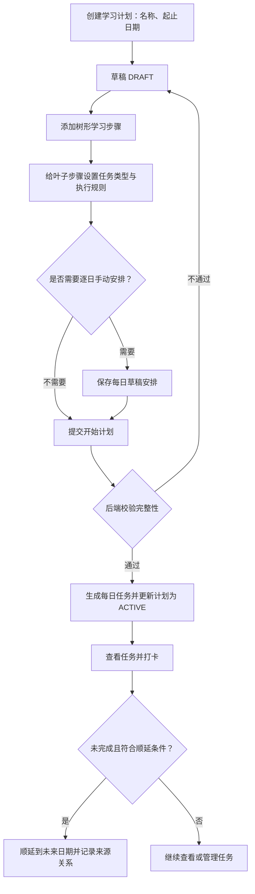
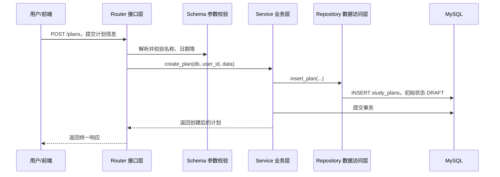
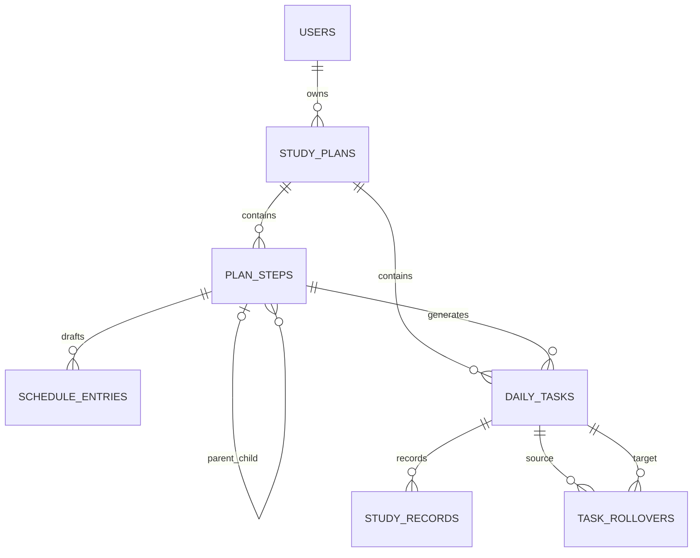

# Smart Study Planner：后端核心业务与答辩指南

> 阅读目标：不只是知道接口怎么调用，还能说清楚「为什么这样设计、数据怎样变化、哪些地方需要注意」。
>
> 本文根据 2026 年 11 月 15 日工作区中的后端代码整理，包含当时尚未提交的顺延修复。代码和需求继续变化时，请以实际代码为准。文中的姓名、日期和数字均为教学示例。

## 目录

1. [先用一分钟认识项目](#1-先用一分钟认识项目)
2. [系统的完整业务链](#2-系统的完整业务链)
3. [后端结构：一次请求经过哪些地方](#3-后端结构一次请求经过哪些地方)
4. [核心数据：六张表分别做什么](#4-核心数据六张表分别做什么)
5. [学习计划：创建、修改与删除](#5-学习计划创建修改与删除)
6. [树形步骤：如何把大目标拆小](#6-树形步骤如何把大目标拆小)
7. [任务规则与草稿安排](#7-任务规则与草稿安排)
8. [开始计划：从草稿生成每日任务](#8-开始计划从草稿生成每日任务)
9. [任务打卡：布尔型与数值型](#9-任务打卡布尔型与数值型)
10. [任务顺延：把未完成的事情移到未来](#10-任务顺延把未完成的事情移到未来)
11. [事务、并发与数据归属](#11-事务并发与数据归属)
12. [进度与统计：当前实现和未来规则](#12-进度与统计当前实现和未来规则)
13. [一个从头到尾的完整案例](#13-一个从头到尾的完整案例)
14. [核心接口速查](#14-核心接口速查)
15. [答辩时可以讲的亮点](#15-答辩时可以讲的亮点)
16. [模拟答辩问答](#16-模拟答辩问答)
17. [代码阅读路线与自测](#17-代码阅读路线与自测)

---

## 1. 先用一分钟认识项目

### 1.1 项目解决什么问题

学习目标往往太大，比如「一个月学完 900 个单词」。如果只有一句目标，用户很难知道今天做什么。

本项目的思路是：

> 先创建学习计划，把计划拆成树形步骤，再依据规则生成每日任务。用户每天记录实际完成情况；没完成的部分可以顺延到未来。

它不是只保存一份待办清单，而是把**目标、拆解、安排、执行和调整**连接起来。

### 1.2 答辩时可用的开场表达

> 我的系统是一个学习计划与每日任务管理系统。用户可以先制定带时间范围的学习计划，把学习内容分解成层级步骤，为具体步骤设置重复、自定义或者数量分配规则。计划启动后，后端会生成每日任务；用户可以打卡记录完成情况，也可以把未完成任务顺延到未来。系统通过用户归属校验、事务和数据约束，保护学习记录的一致性。

注意：这段话描述的是当前后端能力。它**不等于**前端所有页面均已实现，也不表示进度统计、自动结束和并发压力测试已经全部完成。

---

## 2. 系统的完整业务链

### 2.1 从计划到执行



### 2.2 一句话区分容易混淆的概念

| 概念 | 通俗解释 | 示例 |
| --- | --- | --- |
| 学习计划 Plan | 一个有时间范围的大目标 | 12 月 1 日至 12 月 3 日学习英语 |
| 分类步骤 GROUP | 整理学习内容的文件夹 | 「单词」或「听力」 |
| 叶子步骤 LEAF | 可配置执行规则的具体学习内容 | 「背单词」 |
| 执行规则 Rule | 告诉系统任务如何生成 | 每天重复，或把总数量分配到每天 |
| 草稿安排 Schedule | 正式开始前手动填写的每日安排 | 12 月 1 日安排 30 个单词 |
| 每日任务 Daily Task | 计划开始后实际需要执行的任务 | 12 月 1 日背 30 个单词 |
| 打卡记录 Study Record | 对某个任务的一次实际操作记录 | 当天累计背了 18 个 |
| 顺延关系 Rollover | 一项任务转到另一项任务的历史 | 任务 A 剩余 12 个转给任务 B |

**重要区别：**执行规则是「怎么生成」，草稿安排是「生成之前写好的具体安排」，每日任务是「生成后真正要做的事」。

---

## 3. 后端结构：一次请求经过哪些地方

### 3.1 以「创建学习计划」为例



| 层次 | 在本项目中的职责 | 可以怎么理解 |
| --- | --- | --- |
| Router | 定义 HTTP 路径，接收请求，取得当前用户和数据库会话，调用业务层 | 窗口：接收和转交 |
| Schema | 用 Pydantic 描述字段、类型和部分规则 | 表单：先检查填写格式 |
| Service | 检查业务规则、组织多个操作、提交或回滚事务 | 负责人：决定事情能否做、怎样做 |
| Repository | 使用 SQLAlchemy 的 `Session` 和 `text()` 执行 SQL | 仓库管理员：查询与修改数据 |
| MySQL | 保存计划、任务和历史，并通过约束保护数据 | 数据仓库 |

例如 `POST /plans` 的入口见 [计划路由](../back/app/api/routes/plans.py)，规则见 [plan_service.py](../back/app/services/plans/plan_service.py)，SQL 见 [plan_repository.py](../back/app/repositories/plans/plan_repository.py)。

**注意：**分层是主要设计方向，不要在答辩时声称「所有模块都完全分层」：目前用户注册等部分逻辑仍直接位于用户路由文件。

### 3.2 登录和当前用户与业务的关系

本文不展开双 Token 实现。理解核心业务时，只需掌握：

1. 客户端登录后持有访问令牌。
2. 业务接口通过 `get_current_user` 取得当前用户。
3. Service 把用户 ID 交给 Repository，按用户归属查询。
4. 获取不到本人有效计划或任务时，通常按「不存在」返回 404，避免仅凭 ID 操作他人数据。

认证入口可看 [deps.py](../back/app/core/deps.py)，具体归属检查可看 `get_owned_plan()` 和 `find_owned_task()`。**令牌能证明身份，但不能替代业务数据归属校验。**

---

## 4. 核心数据：六张表分别做什么



| 表 | 主要职责 | 为什么需要它 |
| --- | --- | --- |
| `study_plans` | 计划名称、所属用户、周期、状态 | 确定学习目标的范围 |
| `plan_steps` | 步骤名称、父节点、节点类型、执行规则 | 支持多层次拆解 |
| `schedule_entries` | 某叶子步骤的逐日草稿安排 | 手动安排在正式开始前可以反复调整 |
| `daily_tasks` | 具体日期、任务类型、目标数量、实际数量、状态 | 保存真正执行的任务 |
| `study_records` | 完成或累计数量的打卡历史 | 当前值可以变化，但需要保留操作历史 |
| `task_rollovers` | 顺延来源、目标、转移数量 | 追踪任务之间的顺延关系 |

业务上也依赖 `users` 确认计划所属用户。`tb_refresh_token` 服务于认证，不属于本文重点。

### 4.1 为什么既有 `daily_tasks` 又有 `study_records`？

`daily_tasks` 更像**任务的当前快照**；`study_records` 是**操作流水**。

例如一个数值任务原目标是 30：

| 时刻 | 当前累计值 | 新增的打卡记录 |
| --- | --- | --- |
| 第一次提交 | 10 | 记录累计值 10 |
| 第二次提交 | 18 | 记录累计值 18 |

第二次的 18 是**当前累计值**，不是「又增加 18」。历史记录也记录每次提交的累计值，不能简单把 10 和 18 相加当成真实完成量。

### 4.2 软删除是什么意思

软删除通常是写入 `deleted_at`，而不是立刻从表中删除一行。相关有效数据查询通常会检查 `deleted_at IS NULL`。

它有助于保留任务与顺延历史，但并不意味着系统已经提供「回收站」或「恢复」功能。删除中间顺延任务时，上下游历史如何用于统计也需要单独制定规则。

数据库字段与索引可参考 [数据库结构快照](docs/database-schema.md)。它是历史快照，不保证与未来数据库完全一致；分析时应对照当前代码和实际数据库。

---

## 5. 学习计划：创建、修改与删除

代码：[plan_service.py](../back/app/services/plans/plan_service.py)、[plan_repository.py](../back/app/repositories/plans/plan_repository.py)、[plan.py](../back/app/schemas/plan.py)。

### 5.1 计划状态

| 状态 | 含义 | 当前实现中的主要限制 |
| --- | --- | --- |
| `DRAFT` | 草稿，可以继续准备 | 可编辑步骤和手动安排；启动前检查完整性 |
| `ACTIVE` | 执行中 | 计划日期不能修改；满足周期等条件才允许打卡、顺延 |
| `ENDED` | 已结束 | `update_plan()` 不允许修改 |

当前代码可以把草稿启动为 `ACTIVE`。虽然代码识别 `ENDED` 并对其限制，但本次检查的路由中**没有实现完整的自动到期结束流程**，不要说「系统已经有定时自动结束计划」。

### 5.2 核心函数

**`create_plan(db, user_id, data)`：创建草稿**

1. 根据 Schema 校验计划名称和日期，开始日期不能晚于结束日期。
2. 调用 `insert_plan()` 插入计划，状态设为 `DRAFT`。
3. 成功则提交；失败则回滚。
4. 使用 `get_owned_plan()` 返回创建后的数据。

**`get_owned_plan(db, plan_id, user_id, for_update=False)`：取出本人计划**

查询条件同时包含计划 ID、用户 ID、未删除状态。查不到时返回 404；需要修改时可通过 `for_update=True` 请求数据库锁定读取。

**`update_plan()`：按状态修改**

- 未传任何修改字段：拒绝。
- `name`、`start_date`、`end_date` 不能被明确改成空值。
- `ACTIVE` 不允许修改开始或结束日期；但可以按当前规则修改允许的其他字段。
- `ENDED` 不允许修改。
- 更新后仍检查开始日期不晚于结束日期。

**`delete_plan()`：逻辑删除**

先检查归属，再设置 `deleted_at`。此操作不等于逐行物理删除所有步骤和任务，也不是恢复功能。

### 5.3 答辩时为什么要区分草稿和执行中

> 草稿阶段允许调整计划结构；启动后会根据这些结构生成具体每日任务。如果已经生成任务，随意修改周期或步骤，可能让已有任务与新计划不一致，所以当前实现限制执行中的部分修改。

---

## 6. 树形步骤：如何把大目标拆小

代码：[step_service.py](../back/app/services/steps/step_service.py)、[step_repository.py](../back/app/repositories/steps/step_repository.py)、[step.py](../back/app/schemas/step.py)。

### 6.1 数据结构

```text
英语学习计划
├── 单词                    GROUP：分类，不直接配置执行规则
│   ├── 背单词              LEAF：配置数量型规则
│   └── 单词复习            LEAF：配置是否完成型规则
└── 听力                    GROUP
    └── 听一段英语材料      LEAF
```

数据库不需要为每一层建一张表，而是用 `plan_steps.parent_id` 指向父节点：

| id | name | parent_id | node_type |
| --- | --- | --- | --- |
| 1 | 单词 | NULL | GROUP |
| 2 | 背单词 | 1 | LEAF |
| 3 | 单词复习 | 1 | LEAF |

`parent_id = NULL` 表示顶层节点。`GROUP` 负责分组，`LEAF` 才能带任务执行规则。

创建时的规则由 `StepCreate.validate_node()` 等校验：

- `GROUP` 不能带执行规则，而且创建时必须至少包含一个子节点。
- `LEAF` 必须有执行规则，不能有子节点。
- 直接新增到某个父节点下时，父节点必须是 `GROUP`。
- 当前步骤编辑入口仅允许操作本人 **DRAFT** 计划。

### 6.2 `_insert_tree()`：递归写入子树

递归可以理解为「做完当前节点，再对每个孩子做同样的事」：

1. 插入当前节点并取得数据库生成的 ID。
2. 遍历它的 `children`。
3. 以当前节点 ID 作为父 ID，递归插入每个孩子。
4. 某一处失败则整个事务回滚，避免只保存半棵树。

嵌套子节点的父 ID 由程序决定；如果嵌套数据又自行指定 `parent_id`，当前代码会拒绝。

### 6.3 `get_step_tree()`：把平面数据拼成树

数据库读出来是一行一行的平面记录。实现分两遍：

1. **建映射：**把每行变成 `id → 节点`，先给每个节点准备空的 `children`。
2. **找父节点：**遍历记录；没有 `parent_id` 的放入根列表，有父 ID 的放进父节点的 `children`。

假设有 `n` 个节点，忽略数据库排序等成本，这两轮内存组装的时间和额外空间通常都是 **O(n)**。它避免了「每找到一个子节点就重新扫描整个列表」的重复工作。

### 6.4 删除一个步骤为什么可能影响父节点

`delete_step()` 先用递归 SQL 找出当前节点和全部后代，再软删除整棵子树。之后向上检查：如果父分类已经没有有效子节点，就继续软删除空父分类，直到遇到仍有其他孩子的父节点或到达顶层。

**答辩注意：**这不是仅删除一行；操作某个子树还可能清理因此变空的祖先分类。历史数据仍是逻辑删除，不是直接物理删除。

---

## 7. 任务规则与草稿安排

### 7.1 先分清两类任务

| 类型 | 适用场景 | 主要记录 |
| --- | --- | --- |
| `BOOLEAN` | 一件事做了或没做 | 完成状态，如「听一段英语」 |
| `NUMERIC` | 用数量表示进度 | 目标数量和实际累计数量，如「背 30 个单词」 |

### 7.2 四种执行模式

| 任务类型 | 模式 | 意思 | 草稿时是否要逐日填写 |
| --- | --- | --- | --- |
| BOOLEAN | `REPEAT` | 每天重复相同内容 | 不用；需填写重复内容 |
| BOOLEAN | `DAILY_CUSTOM` | 每天自己写任务内容 | 需要；同一天可以有多条 |
| NUMERIC | `AUTO_DISTRIBUTE` | 根据计划周期分配总目标 | 不用；需填写总目标 |
| NUMERIC | `DAILY_MANUAL` | 自己指定每天的目标数量 | 需要；每天必须恰好一条 |

类型与模式不能任意组合。例如 BOOLEAN 不能使用数量自动分配，NUMERIC 不能填写 BOOLEAN 的重复内容。具体规则见 `StepRule.validate_rule()`。

### 7.3 `replace_schedule()`：保存手动安排

这个函数只处理草稿计划的叶子节点，并且只适用于 `DAILY_CUSTOM`、`DAILY_MANUAL`：

1. 校验计划归属、草稿状态、节点类型和执行模式。
2. 检查每条安排的日期在计划周期内。
3. BOOLEAN 要有内容、不能有目标数量；NUMERIC 要有非负整数数量、不能填内容，并且同一天不能重复。
4. 在一个事务中把旧安排软删除，再插入新安排。

这里的「替换」是**整组替换**，不是仅修改本次提交的某一项。保存草稿时可以还没填完所有日期；等真正开始计划时，再统一检查是否完整。

另外，当叶子步骤的执行规则被修改时，`update_step_rule()` 会软删除旧的草稿安排，避免旧安排继续套用到新规则上。

---

## 8. 开始计划：从草稿生成每日任务

代码：[plan_activation_service.py](../back/app/services/plans/plan_activation_service.py)、[plan_rules.py](../back/app/services/plans/plan_rules.py)、[daily_task_repository.py](../back/app/repositories/tasks/daily_task_repository.py)。

### 8.1 `start_plan()` 做了什么

1. 查询并锁定属于当前用户的计划。
2. 检查状态必须为 `DRAFT`，并检查计划没有已生成的正式任务。
3. 展开计划的所有日期，开始和结束当天都包括在内。
4. 检查步骤树：不能没有步骤；子节点的父节点必须有效且为 GROUP；GROUP 不能没有子节点；至少要有一个 LEAF。
5. 对每个叶子步骤，按其执行模式生成每日任务。
6. 批量插入任务，将计划状态改成 `ACTIVE`。
7. 成功一起提交；中途任何步骤失败则一起回滚。

```text
草稿准备好
    ↓
检查计划 + 日期 + 步骤 + 规则
    ↓
生成所有任务
    ↓
插入任务 + 计划改为 ACTIVE
    ↓
提交事务；若失败则全部回滚
```

**为什么要放在一个事务？**避免出现「任务只生成了一半，但计划已经开始」或「计划未开始，却已经留下部分正式任务」。

### 8.2 `get_plan_days()`：计算日期范围

核心公式：

```text
天数 = 结束日期 − 开始日期 + 1
```

例如 12 月 1 日到 12 月 3 日，共 3 天：1 日、2 日、3 日。加 1 是因为**首尾都算**。

### 8.3 `distribute_numeric_target()`：数量自动分配

当前实现不是复杂的 AI 算法，而是清晰可解释的整数分配：

1. 用整数除法得到基础数量：`base = total_target // days`。
2. 前 `days - 1` 天各分配 `base`。
3. 最后一天分配剩余的全部数量。

例如 100 个单词分 3 天：

```text
100 // 3 = 33
第 1 天：33
第 2 天：33
第 3 天：100 − 33 × 2 = 34
合计：100
```

优点是简单、不会丢失目标数量；但要诚实说明它的限制：**余数全部集中到最后一天**。例如 2 个目标分 5 天，结果是 `0、0、0、0、2`，并不是把余数均匀分散。当前代码允许总目标为 0，部分每日目标也可能为 0。

### 8.4 `_build_leaf_tasks()`：四种模式如何生成

- BOOLEAN + REPEAT：在每个日期生成相同内容的任务。
- BOOLEAN + DAILY_CUSTOM：按日期读取草稿内容，开始计划时要求每一天都有安排；同一天可以生成多条。
- NUMERIC + AUTO_DISTRIBUTE：按上述整数分配规则，每天生成数量任务。
- NUMERIC + DAILY_MANUAL：每一天必须恰好有一条安排，并且每天目标数量之和必须等于叶子步骤的总目标。

### 8.5 已知工程注意点

当前启动函数会在内存中累积 `all_tasks`，并对每个叶子步骤读取安排。计划周期或步骤非常多时，任务量和数据库查询量都会增长；目前不要宣称已经完成大规模压测或分页优化。

---

## 9. 任务打卡：布尔型与数值型

代码：[task_service.py](../back/app/services/tasks/task_service.py)、[task_repository.py](../back/app/repositories/tasks/task_repository.py)、[clock.py](../back/app/core/clock.py)。

### 9.1 `_validate_checkin()`：先判断有没有资格打卡

共同检查包括：

- 任务所属计划必须为 `ACTIVE`，当前业务日期必须在计划周期内。
- 任务状态必须允许打卡；已完成、已停止任务不能继续打卡。
- 不能提前给未来日期的任务打卡，但可以补打卡过去的任务。
- 已顺延的 BOOLEAN 来源不能再打卡；已转出数量的 NUMERIC 来源也不能继续打卡。

实际操作之前会通过 `_require_task(..., for_update=True)` 检查用户归属并锁定读取，防止仅靠前端按钮判断。

### 9.2 BOOLEAN：`complete_boolean_task()`

例子：「今天听一段英语」。

1. 找到本人任务并校验。
2. 检查任务类型确实是 BOOLEAN。
3. 把任务更新为 `COMPLETED`，设置完成时间。
4. 写入一条 `BOOLEAN_COMPLETE` 打卡记录。
5. 两项都成功才提交，失败则回滚。

Service 检查业务条件，Repository 更新语句也会检查状态和是否已顺延，属于多层防护。

### 9.3 NUMERIC：`update_numeric_task()`

例子：「今天背 30 个单词」：

| 用户提交的累计数量 | 目标 | 当前代码设置的状态 |
| --- | --- | --- |
| 0 | 30 | `PENDING` |
| 18 | 30 | `IN_PROGRESS` |
| 30 或更多 | 30 | `COMPLETED` |

这里提交的是**累计数量**。例如先提交 10，再提交 18，当前值是 18，不是 28。尚未完成的任务可以把累计值从 10 改回 0；每次有效变更会新增一条历史记录。

注意边界：

- 相同累计值通常不能重复提交；目标为 0 时允许首次提交 0 来确认完成。
- 达到或超过目标会设为完成；已完成任务在当前规则下不能继续打卡。
- 输入必须是非负整数，且不能超过数据库支持的无符号 64 位整数范围。
- 更新当前任务和插入 `NUMERIC_PROGRESS` 历史记录在同一事务中。

### 9.4 「逾期」是怎样显示的

`_format_task()` 会结合计划状态、任务日期和当前业务日期，计算 `is_overdue` 和 `display_status`。这是**返回时的展示判断**，不一定会把数据库中的 `status` 自动改写成 `OVERDUE`。

业务日期由 `business_today()` 按东八区计算；代码使用 `UTC_TIMESTAMP()` 写入一些时间戳。要区分「以哪一天作为今天」和「数据库怎样记录时间」。

当前 BOOLEAN 来源顺延后保留原状态，因此它也可能符合展示层的逾期条件；前端应结合 `is_rolled_over` 解读，不能只看展示状态。

---

## 10. 任务顺延：把未完成的事情移到未来

代码：[rollover_service.py](../back/app/services/rollovers/rollover_service.py)、[rollover_repository.py](../back/app/repositories/rollovers/rollover_repository.py)。

### 10.1 统一入口 `rollover_task()`

以 `POST /tasks/{task_id}/rollover` 为入口：

1. 按用户归属锁定读取来源任务。
2. 调用 `_validate_rollover()` 检查计划、状态和日期。
3. 根据任务类型调用 BOOLEAN 或 NUMERIC 分支。
4. 保存目标任务、来源变化和历史关系。
5. 一起提交；异常时回滚。

顺延的主要前提：计划处于 `ACTIVE`，当前日期在计划周期内；来源任务不能是未来任务；目标日期必须晚于今天且不能超过计划结束日期；来源状态必须允许顺延。

### 10.2 BOOLEAN 顺延：保留原任务，再创建新任务

例如今天「听英语」没有完成：

```text
任务 A：今天听英语，未完成
  └── 顺延关系 A → B
任务 B：明天听英语，PENDING
```

- A 保持原始状态，不能假装已经听完。
- `task_rollovers` 记录 A 与 B 的关系；BOOLEAN 的 `quantity` 为 `NULL`。
- A 有了顺延关系，就不能再打卡或再次顺延；即使 B 后来被软删除也一样。
- B 到了符合条件的日期后，可再作为来源顺延到 C。

为什么不能只看任务状态？因为 BOOLEAN 的 A 顺延后仍可能是 `PENDING`；是否顺延要看**历史关系**，这就是 `has_rollover` 的作用。

### 10.3 NUMERIC 顺延：转移剩余量并结算来源

例子：

| 项目 | 顺延前 | 顺延后 |
| --- | ---: | ---: |
| 来源原目标 `target_quantity` | 100 | 100 |
| 来源实际累计 `actual_quantity` | 60 | 60 |
| 已转出 `rollover_out_quantity` | 0 | 40 |
| 来源状态 | IN_PROGRESS | COMPLETED |

目标任务新增或合并 40。来源任务的 `COMPLETED` 在这里表示**这一天的来源任务已结算**，并不表示用户实际完成了 100；真实完成量仍然是 60。

当前每次必须转移全部可顺延剩余量：

```text
有效目标 = 原目标 − 已转出数量
剩余数量 = max(0, 有效目标 − 实际累计数量)
```

例子中有效目标先是 100，剩余 40；顺延后来源的有效目标变成 60，剩余 0。不能把「转出的 40」也记录为实际打卡，否则会虚增学习量。

### 10.4 如果未来日期已有 NUMERIC 任务

同一叶子节点的目标日期可能已有数量任务：

- 尚未开始、`actual_quantity = 0`、没有转出数量、没有任何打卡历史，才允许合并。
- 合并前也检查目标数量和剩余量之和不超过数据库支持的范围。
- 假设 B 原目标 50，A 转来 40，B 的目标变成 90。
- 如果 B 曾从 0 打卡到 10，后来又改回 0，它仍有打卡历史，所以不能合并。

最后一点说明：**当前值为 0 不等于从来没有开始过。**

### 10.5 为什么 A → B → C 不会重复顺延 A

```text
A ──顺延──> B ──顺延──> C
│            │
已经结算      B 可以作为新的来源
```

这里「A 不能再次顺延」与「B 可以继续顺延」并不矛盾。判断对象不同：每次看当前选择的来源任务，而不是认为整条链只能顺延一次。

### 10.6 删除中间任务

删除 B 后：

- A 保留，之前转出的数量不自动恢复。
- B 标记删除。
- C 保留。
- A → B 和 B → C 的历史关系保留。

这能保留操作历史，但删除 B 后，如何让未来的进度统计反映整个链条，仍需明确统计口径。

---

## 11. 事务、并发与数据归属

### 11.1 事务：要么一起成功，要么一起失败

事务像一次银行转账：不能只扣款却不入账。同理，NUMERIC 顺延不能只给目标加数量，却忘记结算来源。

当前顺延事务包括：

```text
创建或更新目标任务
        +
结算来源任务（NUMERIC）
        +
插入顺延关系
        ↓
全部成功 → commit
任一步失败 → rollback
```

测试中通过注入中间异常，验证了相应场景会回滚；这不等于已经完成所有并发场景的验证。

### 11.2 `FOR UPDATE`：为什么读取时加锁

假设两个请求几乎同时顺延同一任务。如果两个请求都先读到「还有 40」，又都转走 40，就可能重复转移。

当前代码在修改前使用数据库锁定读，并在更新 SQL 的 `WHERE` 中再次检查状态、原目标、实际值和已转出量，要求更新行数符合预期。顺延关系和目标历史也使用锁定读取，降低读到旧事务快照的风险。

**不要过度承诺：**锁、唯一约束和条件更新是当前实现的保护措施；相同来源的真正并发请求，以及多来源同时合并同一目标，尚未在隔离数据库完成实际并发测试。MySQL 死锁或锁等待超时会回滚，并返回可重试的 409。

### 11.3 唯一约束有什么用

已检查的数据库结构快照中，`daily_tasks` 使用生成列和唯一索引，限制同一叶子节点同一天只能有一个**有效 NUMERIC** 任务。任务软删除后，该生成列变成 `NULL`，不再占用同一天的有效任务唯一位置。

BOOLEAN 允许一天有多条任务，不适用同一条数量任务的唯一限制。顺延关系的唯一索引是「来源 + 目标」组合；BOOLEAN 的「同一来源最多顺延一次」还依赖业务检查与锁，不能把组合唯一索引误说成单独的来源唯一约束。

### 11.4 归属检查为什么不能只在前端做

前端隐藏按钮只能影响正常界面。用户仍可能直接构造 HTTP 请求，所以后端必须根据登录用户查询其拥有的计划或任务，而不是只相信传进来的 ID。

---

## 12. 进度与统计：当前实现和未来规则

**当前代码已实现：**NUMERIC 单个任务的有效目标、剩余量和是否顺延等展示字段。

**当前不能直接宣称已实现：**完整的计划完成率统计、汇总接口、所有顺延及删除场景的统计口径。不要把设计图上的百分比当作系统真实数据。

已确认的未来 NUMERIC 统计方向：

```text
单任务有效目标 = target_quantity − rollover_out_quantity

汇总数值进度 = min(
    有效任务 actual_quantity 之和 / 有效任务有效目标之和,
    1
)
```

- 只纳入当前有效、未逻辑删除的任务。
- 分母为 0 时必须明确处理，不能直接除零，也不能凭空说完成了 100%。
- 不能只数 `COMPLETED`：一个顺延结算的来源虽然是 COMPLETED，却不代表实际做完了原目标。
- 如果允许单个任务实际数量超额，简单汇总实际值时还应评估是否会掩盖其他任务不足；该口径不能仅凭本公式推断为已经解决。
- BOOLEAN 已顺延来源是否进入完成率分母，**尚待确认**。
- 删除顺延目标后，历史关系仍存在，但有效任务集合发生变化；对整体统计的影响需要另行设计。

---

## 13. 一个从头到尾的完整案例

假设用户创建「三天英语计划」，周期是 12 月 1 日至 12 月 3 日。

### 第一步：创建计划

计划名称、日期校验通过后，数据库新增一条 `study_plans`，状态是 `DRAFT`。

### 第二步：建立步骤

```text
英语计划
├── 单词 GROUP
│   └── 背单词 LEAF：NUMERIC + AUTO_DISTRIBUTE，总目标 100
└── 听力 GROUP
    └── 听一段英语 LEAF：BOOLEAN + REPEAT，每天重复
```

### 第三步：开始计划

`start_plan()` 校验树和规则。3 天内：

- 单词目标被分配为 33、33、34。
- 听力每天生成一次 BOOLEAN 任务。
- 共生成 6 个正式任务，计划变为 `ACTIVE`。

这是假设均满足现有规则的示例，实际生成条数取决于叶子规则及每日安排。

### 第四步：第一天打卡

用户提交第一天单词累计 20。任务目标是 33，因此状态为 `IN_PROGRESS`；同时新增一条 `NUMERIC_PROGRESS` 记录，其值是 20。

### 第五步：把第一天剩余的 13 顺延到第二天

第二天已经有目标 33 的同一叶子 NUMERIC 任务，假设它仍未开始且没有打卡记录：

```text
第一天来源：目标 33，实际 20，转出 13，状态 COMPLETED
第二天目标：原目标 33 + 转入 13 = 46
顺延记录：第一天任务 → 第二天任务，数量 13
```

第一天真实完成量仍是 20。第二天的 46 包含它原本的 33 和转来的 13；来源任务不能再次打卡或重复顺延。

如果第二天任务已经开始或有历史打卡，就不能这样合并。此时需要选择允许的其他日期；系统不会无条件覆盖目标任务。

---

## 14. 核心接口速查

以下是当前路由对应的主要能力，业务接口通常要求登录。实际响应错误以当前代码和运行环境为准。

| 功能 | 方法与路径 | 对应核心函数 |
| --- | --- | --- |
| 创建、列出计划 | `POST /plans`、`GET /plans` | `create_plan`、`list_plans` |
| 计划详情、修改、删除 | `GET/PATCH/DELETE /plans/{plan_id}` | `get_owned_plan`、`update_plan`、`delete_plan` |
| 开始计划 | `POST /plans/{plan_id}/start` | `start_plan` |
| 创建、查看步骤树 | `POST/GET /plans/{plan_id}/steps` | `create_step`、`get_step_tree` |
| 修改步骤 / 规则 / 删除 | `PATCH /plans/{plan_id}/steps/{step_id}`、`PUT .../{step_id}/rule`、`DELETE .../{step_id}` | `update_step`、`update_step_rule`、`delete_step` |
| 查看、替换草稿安排 | `GET/PUT /plans/{plan_id}/steps/{step_id}/schedule` | `get_schedule`、`replace_schedule` |
| 查看某计划任务 | `GET /plans/{plan_id}/tasks` | `list_plan_tasks` |
| 查看今日任务、详情、记录 | `GET /tasks/today`、`GET /tasks/{task_id}`、`GET /tasks/{task_id}/records` | `list_today_tasks`、`get_task`、`get_task_records` |
| BOOLEAN 完成 | `POST /tasks/{task_id}/complete` | `complete_boolean_task` |
| NUMERIC 更新累计数量 | `PUT /tasks/{task_id}/progress` | `update_numeric_task` |
| 任务顺延 / 任务删除 | `POST /tasks/{task_id}/rollover`、`DELETE /tasks/{task_id}` | `rollover_task`、`delete_task` |

注意：`/tasks/today` 这样的固定路径在路由文件中放在 `/tasks/{task_id}` 之前，避免被当成任务 ID 处理。

---

## 15. 答辩时可以讲的亮点

亮点不是说系统没有缺点，而是说明「针对什么问题，采用了什么办法」：

1. **树形拆解：**用 `parent_id` 表达多层学习结构；使用映射组装树，让大计划可以按模块细分。
2. **规则驱动任务生成：**区分 BOOLEAN、NUMERIC 和四种执行模式；启动时根据规则批量生成任务。
3. **草稿与执行分离：**草稿允许准备和修改，启动前再进行完整性校验，减少半成品任务进入执行阶段。
4. **当前状态与历史分离：**`daily_tasks` 保存当前情况，`study_records` 保留提交历史。
5. **顺延不伪造学习量：**NUMERIC 将真实完成数量与转出数量分开；BOOLEAN 保留原状态并通过关系记录顺延。
6. **多层数据保护：**用户归属、业务校验、事务、锁、条件更新与数据库约束共同降低越权和数据不一致风险。
7. **可解释的算法：**日期展开、整数分配、树形组装和顺延计算都能用例子解释，也能指出边界。

这些是设计与代码层面的亮点；不要据此宣称系统已完成全部性能、安全或高并发验证。

---

## 16. 模拟答辩问答

### Q1：你的系统和普通待办清单有什么不同？

普通待办往往直接记录一件事；我的系统先管理有日期范围的计划，再把计划拆成多层步骤，根据规则生成每天的任务，并记录打卡与顺延历史。这样可以从总目标追踪到每日执行。

### Q2：为什么要设计 GROUP 和 LEAF？

GROUP 用来组织层级，像文件夹；LEAF 才代表可配置执行规则的具体学习步骤。这样可以表达「英语 → 单词 → 背单词」，同时避免分类节点和实际任务混在一起。

### Q3：树形数据在数据库中怎么保存？

所有步骤放在同一张 `plan_steps` 表，每条记录用 `parent_id` 指向父步骤；为空的是根节点。查询时先建立 ID 映射，再把每个节点挂到父节点的 `children` 中。

### Q4：为什么 `get_step_tree()` 要先建立 ID 映射？

建立映射后，可以根据父 ID 快速找到父节点，再把子节点挂上去。对 `n` 个节点，内存组装通常是两次遍历，约为 O(n)，避免每个子节点都重新扫描全部记录。

### Q5：为什么创建 GROUP 时至少要有一个孩子？

这是当前 Schema 的业务约束，避免提交空分类。后端启动计划时也会再次检查 GROUP 是否有子节点，防止不完整的树进入执行阶段。

### Q6：草稿安排与每日任务有什么区别？

草稿安排是开始计划前准备的数据，可整体替换，也可以暂时不完整；每日任务是启动计划通过校验后正式生成、可执行和打卡的数据。

### Q7：为什么草稿保存时允许不完整？

因为用户可能分多次填写。系统在正式开始时再验证每天是否都有必需内容、数量合计是否正确，既保留编辑灵活性，也保证执行数据完整。

### Q8：自动分配是不是人工智能算法？

目前不是。代码用整数除法计算每天的基础数量，最后一天承接剩余数量。它简单可解释，但余数集中在最后一天，未来可以根据需求优化。

### Q9：100 个目标分三天，代码怎么分？

前两天各 33，最后一天 34；因为 `100 // 3 = 33`，最后一天用总目标减去前两天分配的数量。

### Q10：开始计划时为什么需要事务？

因为生成任务和修改计划状态是一组不可分的操作。如果其中一步失败，要让前面的修改一起回滚，避免计划状态与任务数据不一致。

### Q11：BOOLEAN 和 NUMERIC 有什么不同？

BOOLEAN 关注一件事是否完成；NUMERIC 有目标和累计实际数量。BOOLEAN 完成时记一次完成事件；NUMERIC 更新时保存当前累计值和对应历史。

### Q12：数值打卡第二次提交 18，是又增加 18 吗？

不是。接口接收的是累计值；从 10 更新到 18 后，当前累计为 18。历史记录分别保存这两次提交，不能直接把它们相加。

### Q13：为什么还要单独建打卡历史表？

当前任务只反映现在的累计值或状态。历史表能保留每次提交，让系统知道用户做过什么，也能区分「一直是 0」和「打卡后又改回 0」。

### Q14：NUMERIC 顺延后，来源为什么是 COMPLETED？

在当前业务约定中，COMPLETED 表示来源任务已经结算，剩余部分已经转走，不意味着原目标全部被实际完成。真实完成数量仍保留在 `actual_quantity`，转出的数量记录在 `rollover_out_quantity`。

### Q15：BOOLEAN 顺延后为什么不直接把来源设为完成？

BOOLEAN 是「做了没有」，顺延不代表真的做了，所以来源状态保持原样。是否已经顺延由历史关系判断，防止来源再打卡或再次顺延。

### Q16：顺延到已有 NUMERIC 任务时，为什么检查打卡历史？

因为目标任务可能打卡过又改回 0。如果只看当前为 PENDING 且数量为 0，会错误地把已开始过的任务当成全新任务，所以还要检查 `study_records`。

### Q17：如何防止两次请求重复顺延？

设计上先锁定来源，再检查业务状态和历史；更新来源时还会检查原目标、实际值和已转出数量，要求更新恰好一行，并使用数据库约束和事务保护。真正并发下的效果仍需隔离数据库测试，答辩时不能说已经充分验证。

### Q18：删除 A → B → C 中的 B 会发生什么？

当前任务删除是软删除。只标记 B，A 的转出量不自动恢复，C 保留，顺延关系也保留。未来做统计时要专门考虑这种链条的口径。

### Q19：`COMPLETED` 能不能直接用来计算数值任务完成率？

不能。NUMERIC 来源因顺延也可能为 COMPLETED，但实际完成量小于原目标。未来统计应区分实际累计数量和转出数量。

### Q20：老师问「现在系统有哪些还没做完」，怎么回答？

目前顺延业务已做事务隔离的 Service 级数据库回归，但跨连接并发与 HTTP 端到端仍需补充验证；完整的计划进度统计和 BOOLEAN 顺延来源的统计口径也还未完成。计划自动结束流程不能当成已实现功能。

### Q21：为什么查看不到别人任务时返回 404？

查询时把任务 ID 和当前用户归属放在一起检查，查不到有效本人任务就按不存在处理，避免通过接口确认或操作别人的任务。

### Q22：事务和锁有什么区别？

事务保证一组操作整体提交或整体回滚；锁控制并发访问时谁能先读写特定数据。事务不自动等于没有并发问题，锁也不能代替对失败的回滚。

---

## 17. 代码阅读路线与自测

### 17.1 推荐阅读顺序

1. 先看 [计划路由](../back/app/api/routes/plans.py)，认识用户能发起什么请求。
2. 看 [计划服务](../back/app/services/plans/plan_service.py)，理解计划归属、状态和事务。
3. 看 [步骤 Schema](../back/app/schemas/step.py) 和 [步骤服务](../back/app/services/steps/step_service.py)，理解 GROUP、LEAF 和树形组装。
4. 看 [安排服务](../back/app/services/schedules/schedule_service.py)，理解手动草稿。
5. 看 [计划启动服务](../back/app/services/plans/plan_activation_service.py) 与 [分配规则](../back/app/services/plans/plan_rules.py)，理解任务如何生成。
6. 看 [任务服务](../back/app/services/tasks/task_service.py)，理解两类打卡和历史记录。
7. 最后看 [顺延服务](../back/app/services/rollovers/rollover_service.py) 和 [顺延 SQL](../back/app/repositories/rollovers/rollover_repository.py)，理解转移、锁定与回滚。
8. 看 [顺延回归测试](../back/tests/test_rollover_regression.py)，对照具体边界。测试需要合适的 MySQL 环境；运行前先确认配置与数据库环境，不要使用正式数据随意试验。

### 17.2 合上文档，试着回答

1. 用自己的话说明从创建计划到生成每日任务的全过程。
2. 给出一棵三层步骤树，画出对应的 `id / parent_id`。
3. 解释为什么 `get_plan_days()` 计算时要加 1。
4. 计算 100 个目标分 3 天、2 个目标分 5 天的结果。
5. 说明草稿可以暂时不完整，正式开始时又检查了什么。
6. 目标 100、实际 60 时顺延 40：来源和目标分别怎样变化？
7. 为什么来源状态为 COMPLETED 不代表真实完成了 100？
8. 如果目标任务从 10 改回 0，为什么仍不能接收合并？
9. A → B → C 删除 B 后，哪些数据保留？
10. 哪些功能已实现，哪些仍然是规划或尚未验证？

如果这十题都能不用背稿、结合代码讲明白，核心业务的答辩就有了比较扎实的基础。
